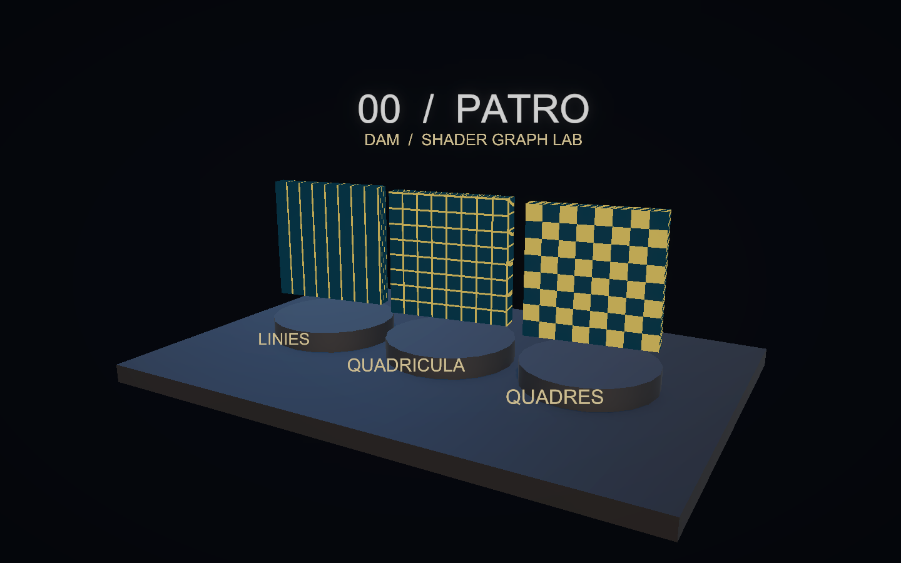
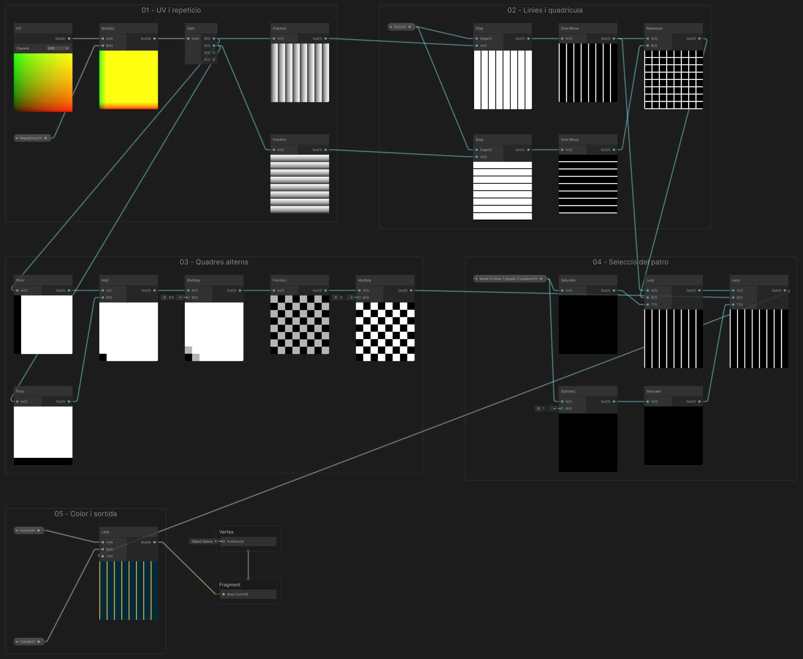
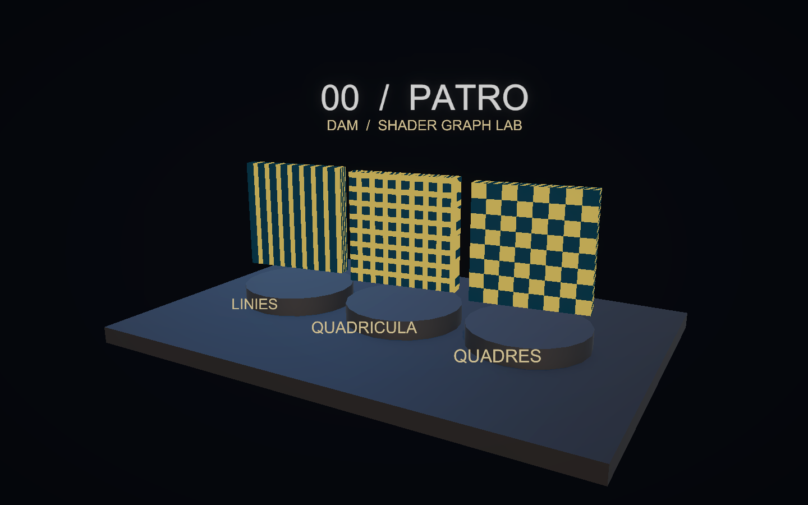

# Demo 0: Patró: línies, quadrícula i quadres

Construirem un material Unlit que mostra tres patrons a partir de les mateixes UV. Seguirem els passos del graf per construir les línies, la quadrícula i els quadres alternats. No cal haver fet cap altra demo.

**Projecte acabat:** [Demo-0-Patro.zip](demos/Demo-0-Patro.zip). Descomprimeix-lo i obre la carpeta amb Assets, Packages i ProjectSettings des de Unity Hub. La primera importació obre automàticament `Assets/Demos/Patro/Scenes/DemoPatro.unity`; prem Play. Els materials poden trigar una estona a carregar-se.

<a href="assets/demopatro-escena.png"></a>

## 1. Partir de Universal 3D

1. Crea un projecte **Universal 3D (URP)**.
2. A Package Manager, comprova **Universal RP**, **Shader Graph** i **Input System**. Shader Graph arriba com a dependència d’URP.
3. A **Project Settings > Player > Active Input Handling**, selecciona **Input System Package (New)**. Accepta el reinici si Unity el demana.
4. Crea `Assets/Demos/Patro` amb les carpetes **Shaders**, **Materials**, **Scenes** i **Meshes**. Crea també **Assets/Common** per als scripts.
5. Obre **Assets/Scenes/SampleScene**, que ja inclou **Main Camera**, **Directional Light** i **Global Volume**. Conserva aquests objectes. Amb **File > Save As…**, desa una còpia com a `DemoPatro` dins de Scenes. Més endavant ajustarem la càmera i la llum existents.

## 2. Crear el Shader Graph

A Shaders, crea **Create > Shader Graph > URP > Unlit Shader Graph**, amb nom **SPatro**. A Graph Inspector > Graph Settings, fixa:

| Opció | Valor |
|---|---|
| Target | Universal |
| Material | Unlit |
| Surface Type | Opaque |
| Alpha Clipping | Desactivat |
| Render Face | Front |
| Cast Shadows | Desactivat |

Afegeix al Blackboard aquestes propietats. Activa **Exposed** i escriu les **Reference exactes**, inclòs el guió baix. Els colors s’indiquen com a **RGB (0–255)**, tal com apareixen al selector de Unity; mantén **Alpha = 255** llevat que s’indiqui un altre valor. Els valors Float i Vector continuen en les seves unitats originals.

| Nom | Tipus | Reference | Valor inicial |
|---|---|---|---|
| ColorA | Color | `_ColorA` | RGB (6, 48, 64) |
| ColorB | Color | `_ColorB` | RGB (217, 179, 82) |
| Gruix | Float | `_Gruix` | 0.12 |
| Mode (0 linies, 1 graella, 2 quadres) | Float | `_Mode` | 0 |
| Repeticions | Float | `_Repeticions` | 8 |

Arrossega les propietats al gràfic per crear els seus nodes. La propietat no es crea escrivint-ne el nom en un node Float: s’ha de crear al Blackboard.

## 3. Connectar els nodes

Segueix els passos en ordre dins del mateix Shader Graph. Prem **Espai** per crear un node del tipus indicat; arrossega les propietats des del Blackboard. Els identificadors de les taules serveixen per distingir nodes repetits: no cal canviar els noms dels nodes. Si ho necessites, posa una **Sticky Note** al costat del node amb l’identificador.

A cada fila de cables, arrossega des del **port de sortida** del node origen fins al **port d’entrada** del node destí. Reutilitza els nodes dels passos anteriors. `Out` indica la sortida principal; als nodes de propietat pot mostrar el nom de la propietat.

Per organitzar el graf com a la captura, selecciona els nodes de cada pas i tria **Group Selection** al menú del botó dret. Mantén els grups a prop i deixa prou espai per veure els cables.

Per veure el resultat d’un node, fes-hi botó dret i tria **View > Expand Preview**; amb **Collapse Preview** el pots plegar.

Escriu els valors de la taula als camps sense cable. Si el camp és vectorial i només s’indica un valor, repeteix-lo a tots els components. Clica les captures per veure-les a mida completa.

**Graf complet:** segueix els grups numerats de l’1 al 5 i acaba connectant el color a **Fragment / Base Color**. Les previsualitzacions mostren les rampes, les línies, la quadrícula, els quadres i el color final. [Obre la imatge a mida completa](assets/demopatro-graf-complet.png) per llegir els ports i seguir tots els cables.

<a href="assets/demopatro-graf-complet.png"></a>

### Pas 1. UV i repeticio

Multiply escala les UV. Split separa U i V; Fraction repeteix la rampa de cada cel·la.

**Nodes que has de crear i valors que has d’escriure:**

| Identificador de la guia | Tipus a cercar a Unity | Configuració / valors sense cable |
|---|---|---|
| `UV` | UV | Channel = UV0 |
| `Escala` | Multiply | Valors per defecte |
| `Eixos` | Split | Valors per defecte |
| `FaseU` | Fraction | Valors per defecte |
| `FaseV` | Fraction | Valors per defecte |

**Cables: arrossega de la sortida a l’entrada indicada.**

| Node origen | Port de sortida | Node destí | Port d’entrada |
|---|---|---|---|
| `UV` | Out | `Escala` | A |
| `Repeticions` | Out | `Escala` | B |
| `Escala` | Out | `Eixos` | In |
| `Eixos` | R | `FaseU` | In |
| `Eixos` | G | `FaseV` | In |

**Comprova el resultat:** Obre la previsualització dels dos **Fraction**: botó dret al node → **View > Expand Preview**. Un ha de mostrar vuit rampes verticals de negre a blanc i l’altre vuit rampes horitzontals.

### Pas 2. Linies i quadricula

Step compara la fase amb Gruix. One Minus deixa les línies a 1 (blanc a la previsualització de la màscara) i Maximum uneix els dos eixos.

**Nodes que has de crear i valors que has d’escriure:**

| Identificador de la guia | Tipus a cercar a Unity | Configuració / valors sense cable |
|---|---|---|
| `TallU` | Step | Valors per defecte |
| `LiniaU` | One Minus | Valors per defecte |
| `TallV` | Step | Valors per defecte |
| `LiniaV` | One Minus | Valors per defecte |
| `Quadricula` | Maximum | Valors per defecte |

**Cables: arrossega de la sortida a l’entrada indicada.**

| Node origen | Port de sortida | Node destí | Port d’entrada |
|---|---|---|---|
| `Gruix` | Out | `TallU` | Edge |
| `FaseU` | Out | `TallU` | In |
| `TallU` | Out | `LiniaU` | In |
| `Gruix` | Out | `TallV` | Edge |
| `FaseV` | Out | `TallV` | In |
| `TallV` | Out | `LiniaV` | In |
| `LiniaU` | Out | `Quadricula` | A |
| `LiniaV` | Out | `Quadricula` | B |

**Comprova el resultat:** Desplega els dos **One Minus**: has de veure línies blanques sobre negre, verticals en un i horitzontals en l’altre. Desplega **Maximum**: ha de mostrar les dues direccions juntes, formant una quadrícula.

### Pas 3. Quadres alterns

Floor identifica la cel·la. La suma, multiplicada per 0.5, crea una paritat; Fraction × 2 produeix els quadres alternats.

**Nodes que has de crear i valors que has d’escriure:**

| Identificador de la guia | Tipus a cercar a Unity | Configuració / valors sense cable |
|---|---|---|
| `CelU` | Floor | Valors per defecte |
| `CelV` | Floor | Valors per defecte |
| `SumaCels` | Add | Valors per defecte |
| `Meitat` | Multiply | B = 0.5 |
| `Paritat` | Fraction | Valors per defecte |
| `Alternat` | Multiply | B = 2 |

**Cables: arrossega de la sortida a l’entrada indicada.**

| Node origen | Port de sortida | Node destí | Port d’entrada |
|---|---|---|---|
| `Eixos` | R | `CelU` | In |
| `Eixos` | G | `CelV` | In |
| `CelU` | Out | `SumaCels` | A |
| `CelV` | Out | `SumaCels` | B |
| `SumaCels` | Out | `Meitat` | A |
| `Meitat` | Out | `Paritat` | In |
| `Paritat` | Out | `Alternat` | A |

**Comprova el resultat:** Desplega **Fraction** (Paritat): ha de mostrar quadres negres i grisos. Desplega el **Multiply** amb B = 2 (Alternat): els quadres han de ser negres i blancs.

### Pas 4. Seleccio del patro

Els dos Saturate transformen Mode en selectors: 0 = línies, 1 = quadrícula, 2 = quadres.

**Nodes que has de crear i valors que has d’escriure:**

| Identificador de la guia | Tipus a cercar a Unity | Configuració / valors sense cable |
|---|---|---|
| `Graella` | Saturate | Valors per defecte |
| `LiniesGraella` | Lerp | Valors per defecte |
| `MenysUn` | Subtract | B = 1 |
| `Quadres` | Saturate | Valors per defecte |
| `Mascara` | Lerp | Valors per defecte |

**Cables: arrossega de la sortida a l’entrada indicada.**

| Node origen | Port de sortida | Node destí | Port d’entrada |
|---|---|---|---|
| `Mode` | Out | `Graella` | In |
| `LiniaU` | Out | `LiniesGraella` | A |
| `Quadricula` | Out | `LiniesGraella` | B |
| `Graella` | Out | `LiniesGraella` | T |
| `Mode` | Out | `MenysUn` | A |
| `MenysUn` | Out | `Quadres` | In |
| `LiniesGraella` | Out | `Mascara` | A |
| `Alternat` | Out | `Mascara` | B |
| `Quadres` | Out | `Mascara` | T |

**Comprova el resultat:** Desplega l’últim **Lerp** (Mascara). Canvia temporalment el valor inicial de Mode al Blackboard: 0 mostra línies, 1 quadrícula i 2 quadres. Torna a deixar-lo a 0.

### Pas 5. Color i sortida

Lerp assigna els dos colors a la màscara. Prova primer Mode = 0 abans de comparar els tres patrons.

**Nodes que has de crear i valors que has d’escriure:**

| Identificador de la guia | Tipus a cercar a Unity | Configuració / valors sense cable |
|---|---|---|
| `ColorFinal` | Lerp | Valors per defecte |

**Cables: arrossega de la sortida a l’entrada indicada.**

| Node origen | Port de sortida | Node destí | Port d’entrada |
|---|---|---|---|
| `ColorA` | Out | `ColorFinal` | A |
| `ColorB` | Out | `ColorFinal` | B |
| `Mascara` | Out | `ColorFinal` | T |

**Comprova el resultat:** Desplega **Lerp** (ColorFinal): el fons ha de tenir ColorA i les línies ColorB. Amb Mode = 0, Repeticions = 8 i Gruix = 0.12, les línies ocupen una fracció estreta de cada repetició.

### Pas 6. Master Stack i connexions finals

Connecta les sortides als blocs del Master Stack indicats a la taula de cables. Si hi ha un bloc Normal, configura’l en Tangent. Els blocs sense cable conserven el valor per defecte.

**Cables: arrossega de la sortida a l’entrada indicada.**

| Node origen | Port de sortida | Node destí | Port d’entrada |
|---|---|---|---|
| `ColorFinal` | Out | `Fragment / Base Color` | Base Color |

Els números de les entrades són valors literals. En un vector, repeteix el valor a tots els components quan s’indica un únic nombre. A Combine, tria RG per a Vector2; a Split, R/G/B equivalen a X/Y/Z. Desa el graf abans de crear els materials.

**Comprova el resultat:** Desa el graf. La previsualització principal ha de mostrar el patró amb els dos colors.

## 4. Crear els materials

A la carpeta **Materials**, utilitza **Create > Rendering > Material** per a cada material indicat. A l’Inspector, selecciona **Shader > DAM Shaders > SPatro** (o arrossega SPatro del Project sobre el material). `MPatro0`, `MPatro1` i `MPatro2`: fixa Mode a **0, 1 i 2**, respectivament. Mantén Repeticions = 8 i Gruix = 0.12.

## 5. Construir l’escena

Les posicions són globals i les escales corresponen a les primitives de Unity. Mantén els objectes a l’arrel, sense un pare escalat. Els elements decoratius i textos es poden ometre: no intervenen en el shader.

| Objecte | Primitiva | Posicio | Escala |
|---|---|---|---|
| Base | Cube | (0, -0.22, 0) | (12, 0.4, 8) |
| Mostra0 | Cube | (-3.2, 2.25, 0) | (2.7, 2.7, 0.35) |
| Peanya0 | Cylinder | (-3.2, 0.24, 0) | (2.85, 0.23, 2.85) |
| Mostra1 | Cube | (0, 2.25, 0) | (2.7, 2.7, 0.35) |
| Peanya1 | Cylinder | (0, 0.24, 0) | (2.85, 0.23, 2.85) |
| Mostra2 | Cube | (3.2, 2.25, 0) | (2.7, 2.7, 0.35) |
| Peanya2 | Cylinder | (3.2, 0.24, 0) | (2.85, 0.23, 2.85) |

Aplica una rotació Y = **−8°** a les tres mostres i assigna el material numerat que correspon a cadascuna.

### Càmera i llums

Posa Main Camera a **(8,6,−14)**, amb projecció **Perspective**, Field of View **40**, Near **0.1**, Far **100** i fons de color sòlid **RGB (5,7,13)**. Orienta-la cap al punt **(0,1.7,0)**. La rotació Euler corresponent és aproximadament **(14.932, -29.745, 0)**.

Selecciona la **Directional Light** existent, canvia-li el nom a **Key Light** i ajusta-la: rotació (45,−30,0), intensitat 2 i color RGB (255,224,189); afegeix una segona llum amb **GameObject > Light > Directional Light**, anomena-la **Fill Light** i configura-la: rotació (25,140,0), intensitat 1 i color RGB (89,171,255). A **Window > Rendering > Lighting > Environment**, posa **Environment Lighting > Source = Color** i **Ambient Color** (82,97,122). La base porta un material Lit gris blavós (14,18,24), Smoothness 0.25; les peanyes, RGB (26,36,48). Crea aquests materials també amb **Create > Rendering > Material**, selecciona **Shader > Universal Render Pipeline > Lit** i assigna’ls als objectes corresponents.

Al **Global Volume** existent, duplica el perfil a la carpeta de la demo i assigna-hi la còpia. Conserva només **Bloom** i activa Intensity = **0.35**, Threshold = **1** i Scatter = **0.6**. Mantén **HDR** i **Post Processing** activats a Main Camera.

## 6. Afegir els controls

### Càmera orbital i zoom

Descarrega [DemoOrbitCamera.cs](demos/DemoOrbitCamera.cs) i desa’l a **Assets/Common/DemoOrbitCamera.cs**. Afegeix el component **Demo Orbit Camera** a **Main Camera**. Al ZIP ja està configurat.

- **Center = (0, 1.7, 0)**: punt fix al voltant del qual gira la càmera.
- **Minimum Distance = 3**, **Maximum Distance = 35**.
- **Rotation Sensitivity = 0.2**, **Zoom Sensitivity = 0.0015**.
- **Minimum Elevation = 5**, **Maximum Elevation = 85**: límits d’inclinació en graus.

En **Play**, clica **Game**. Mantén premut el **botó dret** i arrossega per girar; utilitza la **roda del ratolí** per apropar-te o allunyar-te. **Home** recupera la posició i orientació inicials. El centre no es desplaça i no cal afegir-hi cap objecte Target. La roda positiva apropa la càmera; la negativa l’allunya.

El controlador del panell, que trobaràs a continuació, informa la càmera de quan el punter és sobre els controls perquè el lliscador no mogui el punt de vista. La càmera funciona igualment quan el temps del shader està en pausa.

Crea **Assets/Common/DemoControls.cs** amb aquest codi complet:

```csharp
using UnityEngine;
using UnityEngine.InputSystem;

// Controls comuns a les demos. Crea còpies dels materials per conservar els originals del projecte.
public class DemoControls : MonoBehaviour
{
    public string title;
    public string description;
    // Arrossega els objectes visibles als quals aquest panell modificarà el material.
    public Renderer[] surfaces;
    // Nom intern (Reference) de la propietat del Shader Graph que controlarà el lliscador.
    public string parameter = "_Gruix";
    public float minimum = 0.02f;
    public float maximum = 0.3f;
    public float initialValue = 0.12f;
    public float timeScale = 1f;
    public bool paused;
    // Temps propi de la demo: es pot pausar sense aturar la càmera ni tota la partida.
    public float elapsed;
    public bool showPanel = true;
    Material[] materials;
    float value;

    // Prepara els materials i la connexió amb la càmera quan es carrega el component.
    void Awake()
    {
        // Reserva una entrada per al material de cada superfície assignada a l'Inspector.
        materials = new Material[surfaces.Length];
        // Accedir a .material crea una còpia per a cada Renderer; així es conserven els materials del
        // projecte.
        for (int i = 0; i < surfaces.Length; i++) materials[i] = surfaces[i].material;
        value = initialValue;
        // Busca el controlador orbital a la càmera amb el tag MainCamera, si n'hi ha.
        var orbit = Camera.main ? Camera.main.GetComponent<DemoOrbitCamera>() : null;
        // Passa una funció a la càmera perquè detecti el punter sobre el panell i no mogui la vista en
        // usar-lo.
        if (orbit) orbit.IsPointerOverControls = point => showPanel && new Rect(16, 16, 380, 180).Contains(point);
    }
    void Update()
    {
        // Comprova que hi hagi teclat abans de llegir les tecles de control.
        if (Keyboard.current != null)
        {
            // Alterna la pausa amb una sola pulsació, sense repetir-la mentre la tecla es manté premuda.
            if (Keyboard.current.spaceKey.wasPressedThisFrame) paused = !paused;
            if (Keyboard.current.hKey.wasPressedThisFrame) showPanel = !showPanel;
            if (Keyboard.current.rKey.wasPressedThisFrame) { elapsed = 0; SetParameter(initialValue); }
        }
        // Avança el rellotge de l'efecte només si no està en pausa; timeScale en regula la velocitat.
        if (!paused) elapsed += Time.deltaTime * timeScale;
        // Envia aquest temps als shaders que tenen la propietat _Temps.
        ApplyTime(elapsed);
    }
    public void ApplyTime(float seconds)
    {
        if (materials == null) return;
        foreach (Material material in materials)
            // Comprova que la propietat existeixi abans d'actualitzar l'animació del material.
            if (material.HasProperty("_Temps")) material.SetFloat("_Temps", seconds);
    }
    public void SetParameter(float next)
    {
        // Limita el valor triat al rang permès per a aquesta demo.
        value = Mathf.Clamp(next, minimum, maximum);
        if (materials == null) return;
        foreach (Material material in materials)
            // Actualitza la propietat indicada pel seu nom intern a cada material compatible.
            if (material.HasProperty(parameter)) material.SetFloat(parameter, value);
    }
    // Unity crida OnGUI per dibuixar i gestionar aquest panell senzill de controls.
    void OnGUI()
    {
        if (!showPanel) return;
        GUI.Box(new Rect(16, 16, 380, 180), "");
        // Delimita en píxels l'àrea on GUILayout col·locarà els textos i el lliscador.
        GUILayout.BeginArea(new Rect(30, 25, 350, 162));
        GUILayout.Label(title);
        GUILayout.Label(description);
        GUILayout.Label(parameter + ": " + value.ToString("0.00"));
        // Dibuixa el lliscador i llegeix el valor que l'usuari hi selecciona.
        float next = GUILayout.HorizontalSlider(value, minimum, maximum);
        // Aplica el paràmetre als materials només quan l'usuari en canvia el valor.
        if (next != value) SetParameter(next);
        GUILayout.Label("Espai: pausa | R: reinicia | H: amaga el panell");
        GUILayout.Label("Boto dret: orbita | Roda: zoom | Home: vista inicial");
        GUILayout.EndArea();
    }
    void OnDestroy()
    {
        if (materials == null) return;
        // Allibera les còpies de materials creades a Awake quan es destrueix el component.
        foreach (Material material in materials) Destroy(material);
    }
}
```

Crea un objecte buit **Controls** i afegeix-hi DemoControls. A **Surfaces**, assigna els tres Renderers de les mostres, en ordre d’esquerra a dreta. No hi afegeixis la base, els textos ni les peanyes.

| Camp | Valor |
|---|---|
| Title | 00 / Patro |
| Description | Compara les variants i modifica el material. |
| Parameter | `_Gruix` |
| Minimum | 0.02 |
| Maximum | 0.4 |
| Initial Value | 0.12 |

**Controls:** lliscador per modificar `_Gruix`; Espai pausa el temps; R reinicia temps i paràmetre; H amaga el panell. En moure el lliscador, el valor s’aplica a totes les mostres. Abans de tocar-lo, cada material conserva les variants de l’apartat 4. Els rètols de l’escena identifiquen aquestes variants inicials; el panell mostra el valor actual del control.

Els canvis durant Play són temporals. Per canviar els valors inicials de manera permanent, atura Play i edita els assets de material.

## 7. Provar la demo

1. Comprova que les tres mostres mostren línies, quadrícula i quadres, en aquest ordre.
2. Mou Gruix de 0.02 a 0.4: les línies i juntes s’eixamplen, mentre els quadres alternats mantenen la seva distribució.
3. Atura Play i canvia Repeticions al material: 4 mostra menys cel·les que 8.
4. Canvia ColorA i comprova que s’aplica a la zona seleccionada pel Lerp.

<a href="assets/demopatro-variant.png"></a>

## Si alguna cosa no funciona

Si els tres patrons són iguals, comprova que hi ha tres materials diferents i els valors de Mode. Si veus línies massa fines, abaixa Repeticions o augmenta Gruix.

Si el material és rosa, comprova URP, la compilació del gràfic i la Console. Si el teclat no respon, comprova Input System, entra a Play i clica Game.
