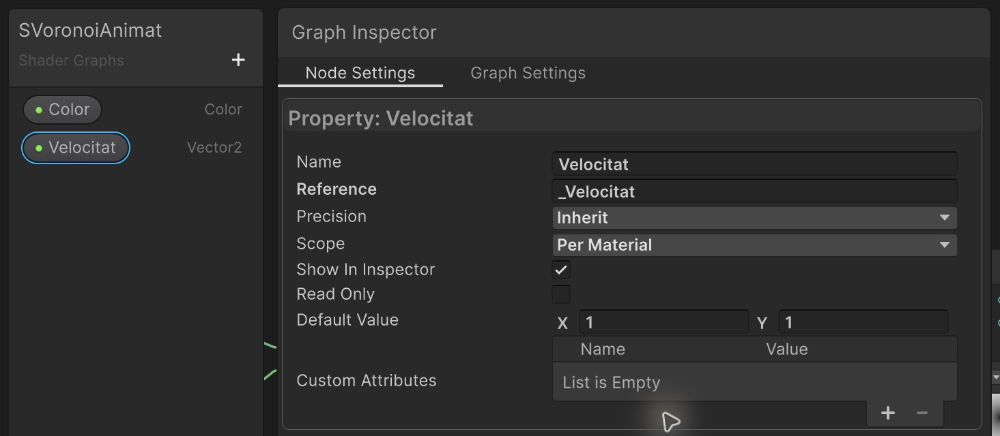
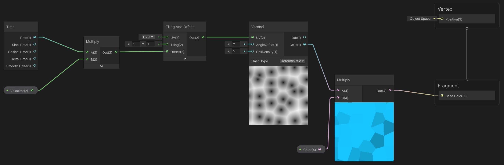
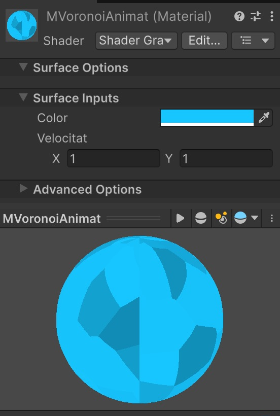

# Demo 0: Voronoi animat

Crea un patró de cel·les amb **color editable** i **velocitat independent en X i Y**. El valor inicial de velocitat serà **(1, 1)**: animació diagonal.

**Projecte acabat:** [Descarrega la Demo 0](demos/Demo-0-Voronoi.zip). Descomprimeix el ZIP i afegeix a Unity Hub la carpeta que conté **Assets**, **Packages** i **ProjectSettings**. La primera obertura carrega **Assets/Scenes/SegonShader.unity**; també la pots obrir amb doble clic a Project o amb **Demo > Obrir escena principal**. Prem **Play** i selecciona **Assets/Materials/MVoronoiAnimat** per canviar Color i Velocitat a l’Inspector.

## 1. Preparar el projecte i el shader

1. Crea un projecte **Universal 3D (URP)** i obre **Assets/Scenes/SampleScene**. També pots continuar al projecte de la [guia del primer shader](Guia-PrimerShader.md).
2. A **Project**, crea les carpetes **Assets/Shaders** i **Assets/Materials** si encara no existeixen.
3. Dins de Shaders, fes clic dret i tria **Create > Shader Graph > URP > Unlit Shader Graph**.
4. Anomena’l **SVoronoiAnimat** i obre’l amb doble clic.
5. Obre **Graph Inspector > Graph Settings**. Configura **Precision = Single**, **Surface Type = Opaque** i deixa **Alpha Clipping** desactivat. Single dona més precisió als càlculs de les coordenades animades.

## 2. Crear els controls de color i velocitat

Al **Blackboard**, el panell de propietats de l’esquerra:

1. Prem **+ > Color** i posa-li el nom **Color**.
2. Selecciona aquesta propietat. A **Graph Inspector > Node Settings**, deixa **Scope = Per Material**, activa **Show In Inspector** i escull un color inicial; per exemple, blau cel. Mantén l’alpha al màxim.
3. Prem **+ > Vector 2** i posa-li el nom **Velocitat**.
4. Selecciona Velocitat, deixa **Scope = Per Material**, activa **Show In Inspector** i escriu **X = 1**, **Y = 1** al valor per defecte.
5. Arrossega les dues propietats del Blackboard cap al gràfic. Apareixerà un node de propietat per a cadascuna.

**Velocitat és una propietat Vector 2 del Blackboard.** Això permet editar els dos components des del material.

## 3. Construir el graf

Prem **Espai** en una zona buida per cercar i crear els nodes. Conserva els noms que posa Unity. Hi haurà dos nodes **Multiply**: un per a la velocitat i un altre per al color.

La captura mostra **tot el graf i tots els cables**. Clica-la per ampliar-la. El preview del segon Multiply mostra les cel·les amb color.

### Pas 1. Multiplicar el temps per la velocitat

1. Crea un node **Time**.
2. Crea un node **Multiply** a la seva dreta.
3. Connecta la sortida **Time** del node Time a l’entrada **A** de Multiply. Utilitza la primera sortida, que es diu Time.
4. Connecta la sortida de la propietat **Velocitat** a l’entrada **B** del mateix Multiply.

Aquest Multiply calcula el desplaçament en els dos eixos. Amb Velocitat `(1, 1)`, tots dos components avancen alhora.

### Pas 2. Desplaçar les coordenades

1. Crea un node **Tiling And Offset** a la dreta del primer Multiply.
2. Deixa **UV** sense cable i amb **UV0** seleccionat.
3. Deixa **Tiling** sense cable, amb **X = 1**, **Y = 1**.
4. Connecta **Out** del primer Multiply a **Offset** de Tiling And Offset.

### Pas 3. Crear les cel·les Voronoi

1. Crea un node **Voronoi** a la dreta de Tiling And Offset.
2. Connecta **Out** de Tiling And Offset a **UV** de Voronoi.
3. Deixa **Angle Offset = 2** i **Cell Density = 5**, sense cables. Deixa **Hash Type = Deterministic**.

Per obrir el preview d’un node, fes-hi clic dret i tria **View > Expand Preview**. El preview de Voronoi mostra el degradat de la seva sortida principal; al pas següent utilitzarem **Cells** per obtenir cel·les de color uniforme i vores definides.

### Pas 4. Aplicar el color

1. Crea un **segon Multiply**, a la dreta i una mica més avall del Voronoi.
2. Connecta **Cells** de Voronoi a **A** d’aquest segon Multiply. Comprova que has agafat **Cells**, no Out.
3. Col·loca la propietat **Color** sota i a la dreta del Voronoi, a l’esquerra del segon Multiply, i connecta’n la sortida a **B** del segon Multiply. Deixa el cable a la vista, sense passar per darrere dels nodes.
4. Obre el preview del segon Multiply: ara has de veure polígons amb diferents intensitats del color escollit i vores netes.
5. Connecta **Out** d’aquest segon Multiply a **Fragment > Base Color**.
6. Conserva els valors inicials dels blocs de **Vertex**. Desa el shader amb el botó del **disquet**.

## 4. Crear un material i assignar-li el shader

1. A **Project > Assets/Materials**, fes clic dret i tria **Create > Material**.
2. Anomena el material **MVoronoiAnimat**.
3. Assigna-li **SVoronoiAnimat** amb **una** d’aquestes dues opcions:

| Opció | Passos |
|---|---|
| Arrossegar | A Project, arrossega l’asset **SVoronoiAnimat** i deixa’l anar **a sobre de l’asset MVoronoiAnimat**. |
| Selector | Selecciona **MVoronoiAnimat**. Al seu Inspector, obre el desplegable **Shader** i escull **Shader Graphs > SVoronoiAnimat**. També pots cercar `SVoronoiAnimat` al selector. |

Selecciona **MVoronoiAnimat** i comprova que el camp Shader indica **Shader Graphs/SVoronoiAnimat**. A **Surface Inputs** han d’aparèixer **Color** i **Velocitat**, amb dos camps **X** i **Y**.

## 5. Aplicar el material a un objecte

1. A **Hierarchy**, fes clic dret i tria **3D Object > Cube**. Anomena’l **CubVoronoi**.
2. Al Transform, posa **Position = (0, 0, 0)**, **Rotation = (0, 0, 0)** i **Scale = (1, 1, 1)**.
3. Arrossega **MVoronoiAnimat** des de Project **a sobre del cub** a Scene o a sobre de **CubVoronoi** a Hierarchy.
4. Selecciona el cub i comprova **Mesh Renderer > Materials > Element 0**: hi ha de dir **MVoronoiAnimat**.
5. Amb el cub seleccionat i el cursor a Scene, prem **F** per enquadrar-lo.
6. Selecciona **Main Camera**. Al Transform, posa **Position = (2, 1.5, −3)** i **Rotation = (22.58854, −33.69007, 0)**. Al component Camera, deixa **Projection = Perspective** i posa **Field of View = 30**. Així veuràs tres cares del cub a Game.
7. A **Camera > Environment**, posa **Background Type = Solid Color** i un color fosc, per exemple **RGB (18, 23, 33)**. A **Rendering**, desactiva **Post Processing** per veure directament el color del material. Pots conservar Directional Light i Global Volume de l’escena inicial.
8. Crea **Assets/Scenes** si cal. Desa l’escena amb **File > Save As…**, amb el nom **SegonShader**, dins d’aquesta carpeta.

## 6. Provar el color i el moviment

Prem **Play** per comprovar l’animació. Selecciona **MVoronoiAnimat** a Project i canvia els controls de **Surface Inputs**:

| Velocitat X | Velocitat Y | Resultat |
|---|---|---|
| 1 | 1 | Moviment diagonal inicial. |
| 1 | 0 | Moviment només horitzontal. |
| 0 | 1 | Moviment només vertical. |
| 0.2 | 0.2 | Moviment diagonal més lent. |
| -1 | -1 | Moviment diagonal en sentit contrari. |
| 0 | 0 | Patró aturat. |

Els valors mouen les **coordenades de lectura**: sobre una superfície amb UV habituals, augmentar l’offset fa que el dibuix sembli desplaçar-se en el sentit contrari. El cub no es mou.

Canvia **Color** i comprova que totes les cel·les adopten diferents intensitats del nou color. Si tries negre, tot el patró quedarà negre. Per acabar, deixa **Velocitat = (1, 1)**.

Si no apareixen els controls al material, revisa **Show In Inspector**, desa el shader i comprova el camp **Shader** del material. Si el cub no canvia, revisa el material assignat a **Mesh Renderer > Materials**.

Si els previews es tornen quadriculats després de tenir Unity obert molta estona, desa el shader i reinicia l’editor abans de tornar a comprovar-los.

## Resultat final

<video src="assets/demovoronoi-cub.mov" poster="assets/demovoronoi-cub.png" width="586" controls loop playsinline></video>

[Obre el vídeo del cub animat](assets/demovoronoi-cub.mov).
