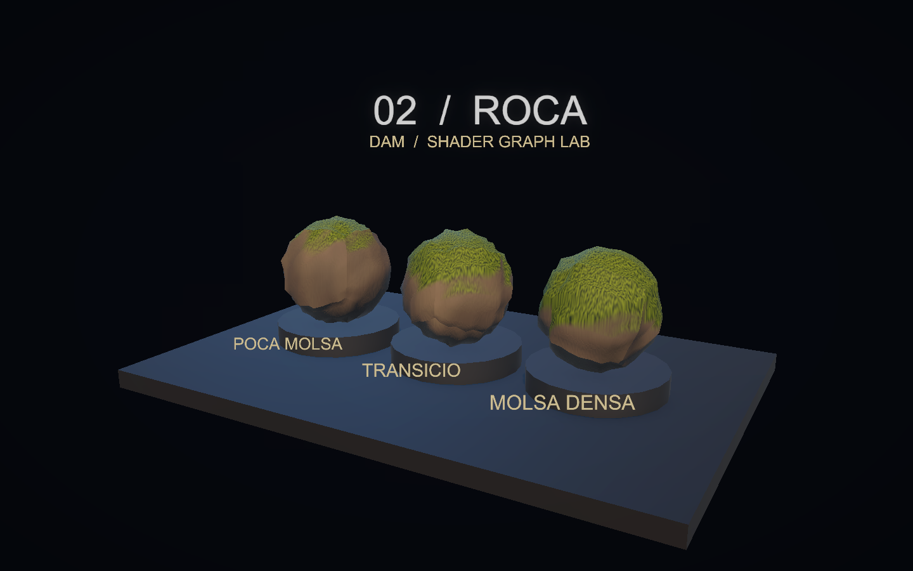
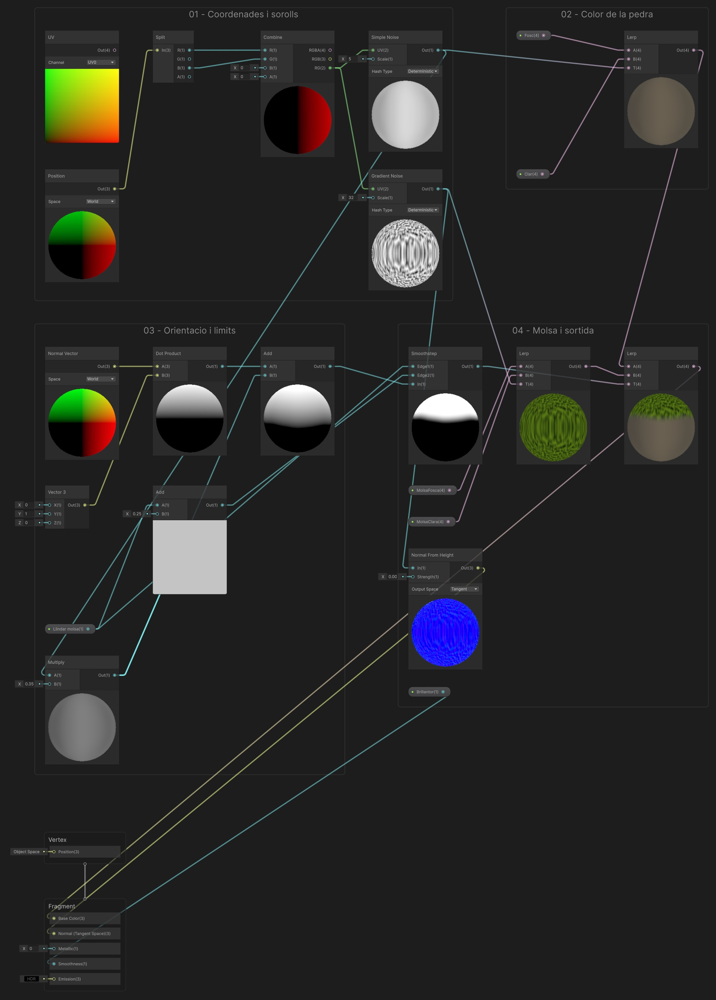

# Demo 2: Roca: pedra i molsa segons l’orientació

Construirem una roca amb tons minerals, detall de superfície i molsa que apareix sobretot a les cares orientades cap amunt. Separarem la geometria irregular, el color i les normals per entendre què aporta cadascun.

**Projecte acabat:** [Demo-2-Roca.zip](demos/Demo-2-Roca.zip). Descomprimeix-lo i obre la carpeta amb Assets, Packages i ProjectSettings des de Unity Hub. La primera importació obre automàticament `Assets/Demos/Roca/Scenes/DemoRoca.unity`; prem Play. Els materials poden trigar una estona a carregar-se.

<a href="assets/demoroca-escena.png"></a>

## 1. Partir de Universal 3D

1. Crea un projecte **Universal 3D (URP)**.
2. A Package Manager, comprova **Universal RP**, **Shader Graph** i **Input System**. Shader Graph arriba com a dependència d’URP.
3. A **Project Settings > Player > Active Input Handling**, selecciona **Input System Package (New)**. Accepta el reinici si Unity el demana.
4. Crea `Assets/Demos/Roca` amb les carpetes **Shaders**, **Materials**, **Scenes** i **Meshes**. Crea també **Assets/Common** per als scripts.
5. Obre **Assets/Scenes/SampleScene**, que ja inclou **Main Camera**, **Directional Light** i **Global Volume**. Conserva aquests objectes. Amb **File > Save As…**, desa una còpia com a `DemoRoca` dins de Scenes. Més endavant ajustarem la càmera i la llum existents.

## 2. Crear el Shader Graph

A Shaders, crea **Create > Shader Graph > URP > Lit Shader Graph**, amb nom **SRoca**. A Graph Inspector > Graph Settings, fixa:

| Opció | Valor |
|---|---|
| Target | Universal |
| Material | Lit |
| Surface Type | Opaque |
| Alpha Clipping | Desactivat |
| Render Face | Front |
| Cast Shadows | Desactivat |

Afegeix al Blackboard aquestes propietats. Activa **Exposed** i escriu les **Reference exactes**, inclòs el guió baix. Els colors s’indiquen com a **RGB (0–255)**, tal com apareixen al selector de Unity; mantén **Alpha = 255** llevat que s’indiqui un altre valor. Els valors Float i Vector continuen en les seves unitats originals.

| Nom | Tipus | Reference | Valor inicial |
|---|---|---|---|
| Brillantor | Float | `_Brillantor` | 0.18 |
| Clar | Color | `_Clar` | RGB (133, 122, 102) |
| Fosc | Color | `_Fosc` | RGB (31, 38, 46) |
| Llindar molsa | Float | `_Llindar` | 0.35 |
| MolsaClara | Color | `_MolsaClara` | RGB (102, 135, 18) |
| MolsaFosca | Color | `_MolsaFosca` | RGB (18, 43, 6) |

Arrossega les propietats al gràfic per crear els seus nodes. La propietat no es crea escrivint-ne el nom en un node Float: s’ha de crear al Blackboard.

## 3. Connectar els nodes

Segueix els passos en ordre dins del mateix Shader Graph. Prem **Espai** per crear un node del tipus indicat; arrossega les propietats des del Blackboard. Els identificadors de les taules serveixen per distingir nodes repetits: no cal canviar els noms dels nodes. Si ho necessites, posa una **Sticky Note** al costat del node amb l’identificador.

A cada fila de cables, arrossega des del **port de sortida** del node origen fins al **port d’entrada** del node destí. Reutilitza els nodes dels passos anteriors. `Out` indica la sortida principal; als nodes de propietat pot mostrar el nom de la propietat.

Per organitzar el graf com a la captura, selecciona els nodes de cada pas i tria **Group Selection** al menú del botó dret. Mantén els grups a prop i deixa prou espai per veure els cables.

Per veure el resultat d’un node, fes-hi botó dret i tria **View > Expand Preview**; amb **Collapse Preview** el pots plegar.

Escriu els valors de la taula als camps sense cable. Si el camp és vectorial i només s’indica un valor, repeteix-lo a tots els components. Clica les captures per veure-les a mida completa.

**Graf complet:** segueix els grups numerats fins al **Master Stack**. Les previsualitzacions mostren els sorolls, la màscara de molsa, els colors i la normal. [Obre la imatge a mida completa](assets/demoroca-graf-complet.png) per llegir els ports i seguir tots els cables.

<a href="assets/demoroca-graf-complet.png"></a>

### Pas 1. Coordenades i sorolls

Combina X i Z de Position World. Els dos sorolls comparteixen coordenades però tenen escales diferents.

**Nodes que has de crear i valors que has d’escriure:**

| Identificador de la guia | Tipus a cercar a Unity | Configuració / valors sense cable |
|---|---|---|
| `UV` | UV | Channel = UV0 |
| `PosicioMon` | Position | Space: World |
| `Eixos` | Split | Valors per defecte |
| `XZ` | Combine | Valors per defecte |
| `Grans` | Simple Noise | Scale = 5 |
| `Detall` | Gradient Noise | Scale = 32 |

**Cables: arrossega de la sortida a l’entrada indicada.**

| Node origen | Port de sortida | Node destí | Port d’entrada |
|---|---|---|---|
| `PosicioMon` | Out | `Eixos` | In |
| `Eixos` | R | `XZ` | R |
| `Eixos` | B | `XZ` | G |
| `XZ` | RG | `Grans` | UV |
| `XZ` | RG | `Detall` | UV |

**Comprova el resultat:** Desplega **Simple Noise** i **Gradient Noise**: han de mostrar taques en escala de grisos amb mides diferents.

### Pas 2. Color de la pedra

Aquest Lerp crea el color mineral abans d’afegir la molsa.

**Nodes que has de crear i valors que has d’escriure:**

| Identificador de la guia | Tipus a cercar a Unity | Configuració / valors sense cable |
|---|---|---|
| `Pedra` | Lerp | Valors per defecte |

**Cables: arrossega de la sortida a l’entrada indicada.**

| Node origen | Port de sortida | Node destí | Port d’entrada |
|---|---|---|---|
| `Fosc` | Out | `Pedra` | A |
| `Clar` | Out | `Pedra` | B |
| `Grans` | Out | `Pedra` | T |

**Comprova el resultat:** Desplega **Lerp** (Pedra): el soroll ha de barrejar els colors Fosc i Clar.

### Pas 3. Orientacio i limits

Dot Product amb el vector (0,1,0) selecciona la part superior. El soroll irregularitza el límit.

**Nodes que has de crear i valors que has d’escriure:**

| Identificador de la guia | Tipus a cercar a Unity | Configuració / valors sense cable |
|---|---|---|
| `NormalMon` | Normal Vector | Space: World |
| `Amunt` | Vector 3 | X = 0; Y = 1; Z = 0 |
| `Orientacio` | Dot Product | Valors per defecte |
| `LimitSuperior` | Add | B = 0.25 |
| `SorollMolsa` | Multiply | B = 0.35 |
| `Irregularitat` | Add | Valors per defecte |

**Cables: arrossega de la sortida a l’entrada indicada.**

| Node origen | Port de sortida | Node destí | Port d’entrada |
|---|---|---|---|
| `NormalMon` | Out | `Orientacio` | A |
| `Amunt` | Out | `Orientacio` | B |
| `Llindar` | Out | `LimitSuperior` | A |
| `Grans` | Out | `SorollMolsa` | A |
| `Orientacio` | Out | `Irregularitat` | A |
| `SorollMolsa` | Out | `Irregularitat` | B |

**Comprova el resultat:** Desplega **Dot Product** (Orientacio): sobre una previsualització esfèrica, la zona orientada cap amunt ha de ser més clara.

### Pas 4. Molsa i sortida

Smoothstep crea la transició pedra–molsa. El relleu de normals és deliberadament discret.

**Nodes que has de crear i valors que has d’escriure:**

| Identificador de la guia | Tipus a cercar a Unity | Configuració / valors sense cable |
|---|---|---|
| `MascaraMolsa` | Smoothstep | Valors per defecte |
| `Verd` | Lerp | Valors per defecte |
| `ColorFinal` | Lerp | Valors per defecte |
| `Relleu` | Normal From Height | Strength = 0.002 |

**Cables: arrossega de la sortida a l’entrada indicada.**

| Node origen | Port de sortida | Node destí | Port d’entrada |
|---|---|---|---|
| `Llindar` | Out | `MascaraMolsa` | Edge1 |
| `LimitSuperior` | Out | `MascaraMolsa` | Edge2 |
| `Irregularitat` | Out | `MascaraMolsa` | In |
| `MolsaFosca` | Out | `Verd` | A |
| `MolsaClara` | Out | `Verd` | B |
| `Detall` | Out | `Verd` | T |
| `Pedra` | Out | `ColorFinal` | A |
| `Verd` | Out | `ColorFinal` | B |
| `MascaraMolsa` | Out | `ColorFinal` | T |
| `Detall` | Out | `Relleu` | In |

**Comprova el resultat:** Desplega **Smoothstep** (MascaraMolsa) i **Lerp** (ColorFinal): comprova la màscara i el color resultant. La distribució definitiva es comprova sobre les roques de l’escena.

### Pas 5. Master Stack i connexions finals

Connecta les sortides als blocs del Master Stack indicats a la taula de cables. Si hi ha un bloc Normal, configura’l en Tangent. Els blocs sense cable conserven el valor per defecte.

**Cables: arrossega de la sortida a l’entrada indicada.**

| Node origen | Port de sortida | Node destí | Port d’entrada |
|---|---|---|---|
| `ColorFinal` | Out | `Fragment / Base Color` | Base Color |
| `Relleu` | Out | `Fragment / Normal (Tangent)` | Normal (Tangent) |
| `Brillantor` | Out | `Fragment / Smoothness` | Smoothness |

Els números de les entrades són valors literals. En un vector, repeteix el valor a tots els components quan s’indica un únic nombre. A Combine, tria RG per a Vector2; a Split, R/G/B equivalen a X/Y/Z. Desa el graf abans de crear els materials.

**Comprova el resultat:** Desa el graf i comprova al material de l’escena que la molsa apareix sobretot a les superfícies orientades cap amunt.

## 4. Crear els materials

A la carpeta **Materials**, utilitza **Create > Rendering > Material** per a cada material indicat. A l’Inspector, selecciona **Shader > DAM Shaders > SRoca** (o arrossega SRoca del Project sobre el material). `MRoca0`, `MRoca1`, `MRoca2`: Llindar = **0.65, 0.35, 0.05**. Les roques utilitzen Rock1, Rock2 i Rock3. Rotacions Euler: **(15,0,10), (15,40,10), (15,80,10)**.

## 5. Construir l’escena

Les posicions són globals i les escales corresponen a les primitives de Unity. Mantén els objectes a l’arrel, sense un pare escalat. Els elements decoratius i textos es poden ometre: no intervenen en el shader.

| Objecte | Primitiva | Posicio | Escala |
|---|---|---|---|
| Base | Cube | (0, -0.22, 0) | (12, 0.4, 8) |
| Roca0 | Sphere | (-3.2, 1.65, 0) | (2.5, 2.4, 2.3) |
| Peanya0 | Cylinder | (-3.2, 0.24, 0) | (2.85, 0.23, 2.85) |
| Roca1 | Sphere | (0, 1.65, 0) | (2.5, 2.4, 2.3) |
| Peanya1 | Cylinder | (0, 0.24, 0) | (2.85, 0.23, 2.85) |
| Roca2 | Sphere | (3.2, 1.65, 0) | (2.5, 2.4, 2.3) |
| Peanya2 | Cylinder | (3.2, 0.24, 0) | (2.85, 0.23, 2.85) |

### Generar les malles

Crea **Assets/Editor/GenerarMalles.cs** amb aquest codi. Espera que compili. El menú **Demos** permet crear una graella d’aigua i cinc roques; els assets apareixen a **Assets/Meshes**. Al ZIP, les malles també són a **Assets/Meshes**.

```csharp
using UnityEngine;
using UnityEditor;
using System.IO;

// Utilitat opcional per reconstruir les malles dels exemples des de zero.
public static class GenerarMalles
{
    // Afegeix una opció al menú de l'Editor; aquesta utilitat es desa dins d'una carpeta Editor.
    [MenuItem("Demos/Crear malla d'aigua")]
    public static void Aigua()
    {
        // Divideix cada costat en 80 trams per tenir prou vèrtexs per dibuixar les onades.
        const int n = 80;
        var mesh = new Mesh { name = "WaterGrid" };
        // Una graella de n trams necessita n + 1 punts a cada costat.
        var vertices = new Vector3[(n + 1) * (n + 1)];
        // Les UV indiquen on correspon cada vèrtex dins del patró o textura, normalment entre 0 i 1.
        var uv = new Vector2[vertices.Length];
        // Cada casella es dibuixa amb dos triangles de tres índexs cadascun.
        var triangles = new int[n * n * 6];
        for (int z = 0; z <= n; z++)
            for (int x = 0; x <= n; x++)
            {
                // Converteix la fila i la columna de la graella en un índex de la llista de vèrtexs.
                int i = z * (n + 1) + x;
                // Reparteix els punts sobre un rectangle de 8 per 5 unitats centrat a l'origen.
                vertices[i] = new Vector3((float)x / n * 8 - 4, 0, (float)z / n * 5 - 2.5f);
                // Associa cada punt de la graella amb la seva coordenada UV proporcional.
                uv[i] = new Vector2((float)x / n, (float)z / n);
            }
        // Recorre la llista d'índexs per construir les dues cares triangulars de cada casella.
        int k = 0;
        for (int z = 0; z < n; z++)
            for (int x = 0; x < n; x++)
            {
                // Converteix la fila i la columna de la graella en un índex de la llista de vèrtexs.
                int i = z * (n + 1) + x;
                triangles[k++] = i; triangles[k++] = i + n + 1; triangles[k++] = i + 1;
                triangles[k++] = i + 1; triangles[k++] = i + n + 1; triangles[k++] = i + n + 2;
            }
        mesh.vertices = vertices; mesh.uv = uv; mesh.triangles = triangles;
        // Calcula les normals i les tangents que els shaders fan servir per orientar la il·luminació i
        // el relleu.
        mesh.RecalculateNormals(); mesh.RecalculateTangents();
        // Reserva altura al volum visible perquè les onades del shader no quedin fora dels límits de la
        // malla.
        mesh.bounds = new Bounds(Vector3.zero, new Vector3(8, 2, 5));
        Save(mesh, "WaterGrid");
    }

    // Afegeix al menú de l'Editor la generació de cinc variants de roca.
    [MenuItem("Demos/Crear cinc malles de roca")]
    public static void Roques()
    {
        for (int seed = 1; seed <= 5; seed++)
        {
            var temporary = GameObject.CreatePrimitive(PrimitiveType.Sphere);
            // Copia la malla de l'esfera per deformar-la sense modificar la malla original de Unity.
            var mesh = Object.Instantiate(temporary.GetComponent<MeshFilter>().sharedMesh);
            // Elimina l'objecte auxiliar de l'Editor; ja conservem la còpia de la seva malla.
            Object.DestroyImmediate(temporary);
            var vertices = mesh.vertices;
            for (int i = 0; i < vertices.Length; i++)
            {
                // Obtén la direcció del vèrtex des del centre per calcular-ne la deformació.
                Vector3 d = vertices[i].normalized;
                // Combina ones per crear irregularitats; seed produeix una forma diferent a cada roca.
                float factor = 1 + .045f * Mathf.Sin(d.x * 13 + seed) * Mathf.Cos(d.y * 11 + seed)
                    + .035f * Mathf.Sin(d.z * 17 + seed);
                // Acosta o allunya el vèrtex del centre segons la deformació calculada.
                vertices[i] *= factor;
            }
            // Aplica la forma nova i actualitza les normals i el volum que l'envolta.
            mesh.vertices = vertices; mesh.RecalculateNormals(); mesh.RecalculateBounds();
            Save(mesh, "Rock" + seed);
        }
    }

    static void Save(Mesh mesh, string name)
    {
        Directory.CreateDirectory("Assets/Meshes");
        // Genera un nom de fitxer lliure per no sobreescriure una malla creada abans.
        string path = AssetDatabase.GenerateUniqueAssetPath("Assets/Meshes/" + name + ".asset");
        // Desa la malla com a recurs del projecte per poder-la assignar a un Mesh Filter.
        AssetDatabase.CreateAsset(mesh, path);
        AssetDatabase.SaveAssets();
        // Selecciona la malla creada perquè es pugui veure a l'Inspector.
        Selection.activeObject = mesh;
    }
}
```

Executa **Demos > Crear cinc malles de roca**. Als Mesh Filter de Roca0, Roca1 i Roca2, substitueix la malla Sphere per Rock1, Rock2 i Rock3. Les rotacions i materials són els de l’apartat anterior.

### Càmera i llums

Posa Main Camera a **(8,6,−14)**, amb projecció **Perspective**, Field of View **40**, Near **0.1**, Far **100** i fons de color sòlid **RGB (5,7,13)**. Orienta-la cap al punt **(0,1.7,0)**. La rotació Euler corresponent és aproximadament **(14.932, -29.745, 0)**.

Selecciona la **Directional Light** existent, canvia-li el nom a **Key Light** i ajusta-la: rotació (45,−30,0), intensitat 2 i color RGB (255,224,189); afegeix una segona llum amb **GameObject > Light > Directional Light**, anomena-la **Fill Light** i configura-la: rotació (25,140,0), intensitat 1 i color RGB (89,171,255). A **Window > Rendering > Lighting > Environment**, posa **Environment Lighting > Source = Color** i **Ambient Color** (82,97,122). La base porta un material Lit gris blavós (14,18,24), Smoothness 0.25; les peanyes, RGB (26,36,48). Crea aquests materials també amb **Create > Rendering > Material**, selecciona **Shader > Universal Render Pipeline > Lit** i assigna’ls als objectes corresponents.

Al **Global Volume** existent, duplica el perfil a la carpeta de la demo i assigna-hi la còpia. Conserva només **Bloom** i activa Intensity = **0.35**, Threshold = **1** i Scatter = **0.6**. Mantén **HDR** i **Post Processing** activats a Main Camera.

## 6. Afegir els controls

### Càmera orbital i zoom

Descarrega [DemoOrbitCamera.cs](demos/DemoOrbitCamera.cs) i desa’l a **Assets/Common/DemoOrbitCamera.cs**. Afegeix el component **Demo Orbit Camera** a **Main Camera**. Al ZIP ja està configurat.

- **Center = (0, 1.7, 0)**: punt fix al voltant del qual gira la càmera.
- **Minimum Distance = 3**, **Maximum Distance = 35**.
- **Rotation Sensitivity = 0.2**, **Zoom Sensitivity = 0.0015**.
- **Minimum Elevation = 5**, **Maximum Elevation = 85**: límits d’inclinació en graus.

En **Play**, clica **Game**. Mantén premut el **botó dret** i arrossega per girar; utilitza la **roda del ratolí** per apropar-te o allunyar-te. **Home** recupera la posició i orientació inicials. El centre no es desplaça i no cal afegir-hi cap objecte Target. La roda positiva apropa la càmera; la negativa l’allunya.

El controlador del panell, que trobaràs a continuació, informa la càmera de quan el punter és sobre els controls perquè el lliscador no mogui el punt de vista. La càmera funciona igualment quan el temps del shader està en pausa.

Crea **Assets/Common/DemoControls.cs** amb aquest codi complet:

```csharp
using UnityEngine;
using UnityEngine.InputSystem;

// Controls comuns a les demos. Crea còpies dels materials per conservar els originals del projecte.
public class DemoControls : MonoBehaviour
{
    public string title;
    public string description;
    // Arrossega els objectes visibles als quals aquest panell modificarà el material.
    public Renderer[] surfaces;
    // Nom intern (Reference) de la propietat del Shader Graph que controlarà el lliscador.
    public string parameter = "_Gruix";
    public float minimum = 0.02f;
    public float maximum = 0.3f;
    public float initialValue = 0.12f;
    public float timeScale = 1f;
    public bool paused;
    // Temps propi de la demo: es pot pausar sense aturar la càmera ni tota la partida.
    public float elapsed;
    public bool showPanel = true;
    Material[] materials;
    float value;

    // Prepara els materials i la connexió amb la càmera quan es carrega el component.
    void Awake()
    {
        // Reserva una entrada per al material de cada superfície assignada a l'Inspector.
        materials = new Material[surfaces.Length];
        // Accedir a .material crea una còpia per a cada Renderer; així es conserven els materials del
        // projecte.
        for (int i = 0; i < surfaces.Length; i++) materials[i] = surfaces[i].material;
        value = initialValue;
        // Busca el controlador orbital a la càmera amb el tag MainCamera, si n'hi ha.
        var orbit = Camera.main ? Camera.main.GetComponent<DemoOrbitCamera>() : null;
        // Passa una funció a la càmera perquè detecti el punter sobre el panell i no mogui la vista en
        // usar-lo.
        if (orbit) orbit.IsPointerOverControls = point => showPanel && new Rect(16, 16, 380, 180).Contains(point);
    }
    void Update()
    {
        // Comprova que hi hagi teclat abans de llegir les tecles de control.
        if (Keyboard.current != null)
        {
            // Alterna la pausa amb una sola pulsació, sense repetir-la mentre la tecla es manté premuda.
            if (Keyboard.current.spaceKey.wasPressedThisFrame) paused = !paused;
            if (Keyboard.current.hKey.wasPressedThisFrame) showPanel = !showPanel;
            if (Keyboard.current.rKey.wasPressedThisFrame) { elapsed = 0; SetParameter(initialValue); }
        }
        // Avança el rellotge de l'efecte només si no està en pausa; timeScale en regula la velocitat.
        if (!paused) elapsed += Time.deltaTime * timeScale;
        // Envia aquest temps als shaders que tenen la propietat _Temps.
        ApplyTime(elapsed);
    }
    public void ApplyTime(float seconds)
    {
        if (materials == null) return;
        foreach (Material material in materials)
            // Comprova que la propietat existeixi abans d'actualitzar l'animació del material.
            if (material.HasProperty("_Temps")) material.SetFloat("_Temps", seconds);
    }
    public void SetParameter(float next)
    {
        // Limita el valor triat al rang permès per a aquesta demo.
        value = Mathf.Clamp(next, minimum, maximum);
        if (materials == null) return;
        foreach (Material material in materials)
            // Actualitza la propietat indicada pel seu nom intern a cada material compatible.
            if (material.HasProperty(parameter)) material.SetFloat(parameter, value);
    }
    // Unity crida OnGUI per dibuixar i gestionar aquest panell senzill de controls.
    void OnGUI()
    {
        if (!showPanel) return;
        GUI.Box(new Rect(16, 16, 380, 180), "");
        // Delimita en píxels l'àrea on GUILayout col·locarà els textos i el lliscador.
        GUILayout.BeginArea(new Rect(30, 25, 350, 162));
        GUILayout.Label(title);
        GUILayout.Label(description);
        GUILayout.Label(parameter + ": " + value.ToString("0.00"));
        // Dibuixa el lliscador i llegeix el valor que l'usuari hi selecciona.
        float next = GUILayout.HorizontalSlider(value, minimum, maximum);
        // Aplica el paràmetre als materials només quan l'usuari en canvia el valor.
        if (next != value) SetParameter(next);
        GUILayout.Label("Espai: pausa | R: reinicia | H: amaga el panell");
        GUILayout.Label("Boto dret: orbita | Roda: zoom | Home: vista inicial");
        GUILayout.EndArea();
    }
    void OnDestroy()
    {
        if (materials == null) return;
        // Allibera les còpies de materials creades a Awake quan es destrueix el component.
        foreach (Material material in materials) Destroy(material);
    }
}
```

Crea un objecte buit **Controls** i afegeix-hi DemoControls. A **Surfaces**, assigna els tres Renderers de les mostres, en ordre d’esquerra a dreta. No hi afegeixis la base, els textos ni les peanyes.

| Camp | Valor |
|---|---|
| Title | 02 / Roca |
| Description | Compara les variants i modifica el material. |
| Parameter | `_Llindar` |
| Minimum | -0.2 |
| Maximum | 1 |
| Initial Value | 0.35 |

**Controls:** lliscador per modificar `_Llindar`; Espai pausa el temps; R reinicia temps i paràmetre; H amaga el panell. En moure el lliscador, el valor s’aplica a totes les mostres. Abans de tocar-lo, cada material conserva les variants de l’apartat 4. Els rètols de l’escena identifiquen aquestes variants inicials; el panell mostra el valor actual del control.

Els canvis durant Play són temporals. Per canviar els valors inicials de manera permanent, atura Play i edita els assets de material.

## 7. Provar la demo

1. Comprova que la molsa tendeix a aparèixer a les parts superiors.
2. Mou Llindar cap a 1: retrocedeix la molsa. Mou-lo cap a −0.2: s’estén.
3. Atura Play i gira una roca: la selecció continua seguint la vertical del món.
4. Desactiva les normals de detall i distingeix el relleu aparent de la forma real de la malla.

<a href="assets/demoroca-variant.png"></a>

## Si alguna cosa no funciona

Si la molsa apareix en un costat estrany, comprova que Normal Vector és World. Si veus estirament vertical, és la limitació de projectar amb XZ; no es resol canviant el color.

Si el material és rosa, comprova URP, la compilació del gràfic i la Console. Si el teclat no respon, comprova Input System, entra a Play i clica Game.
