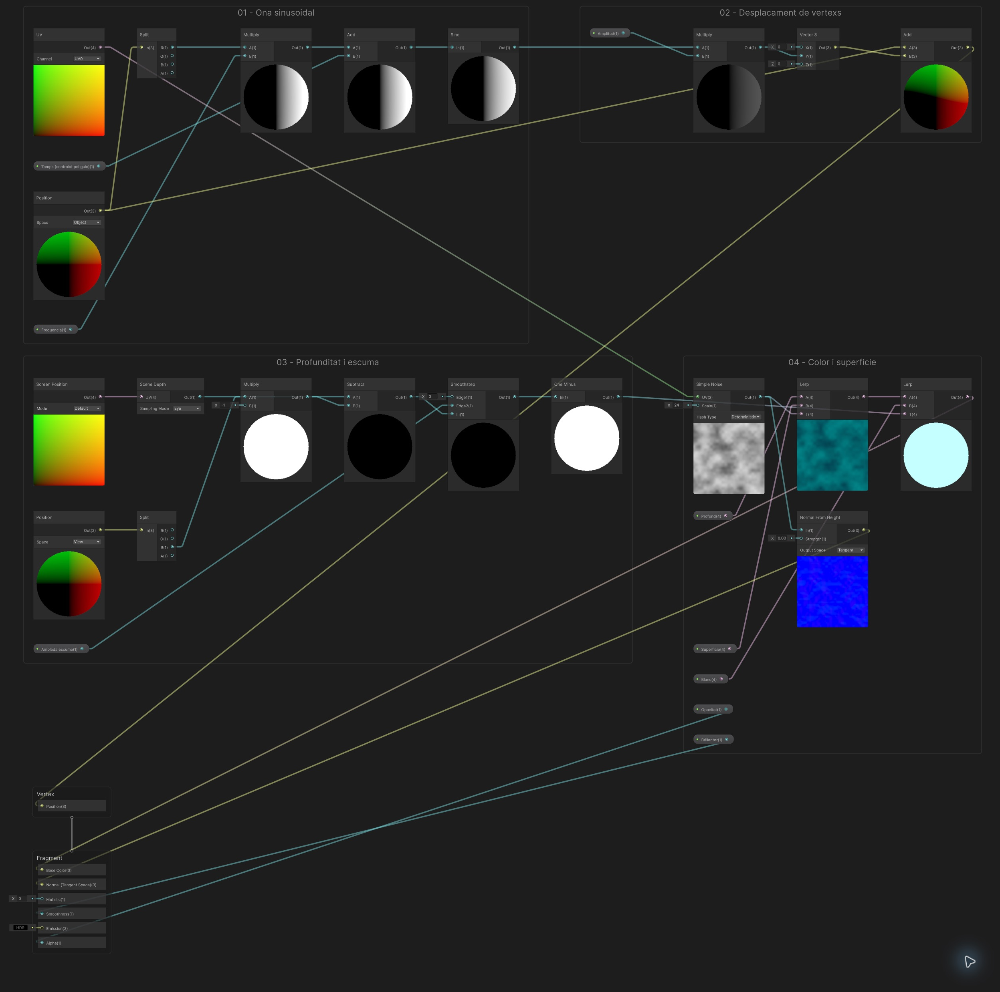
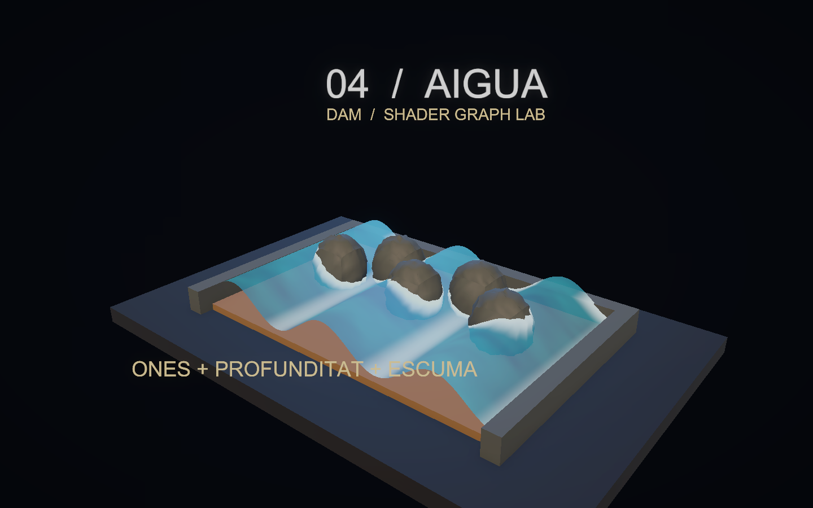
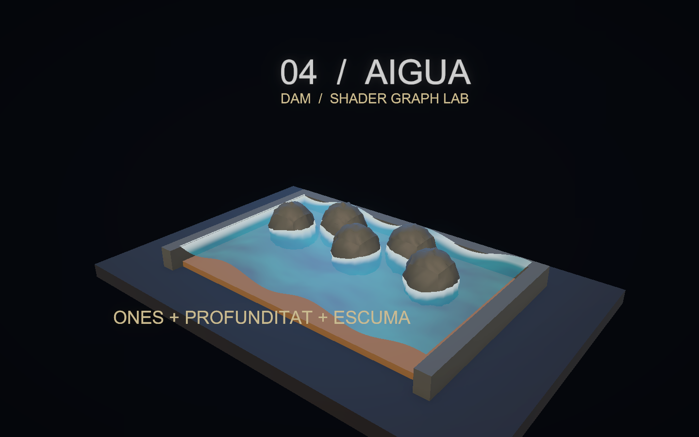
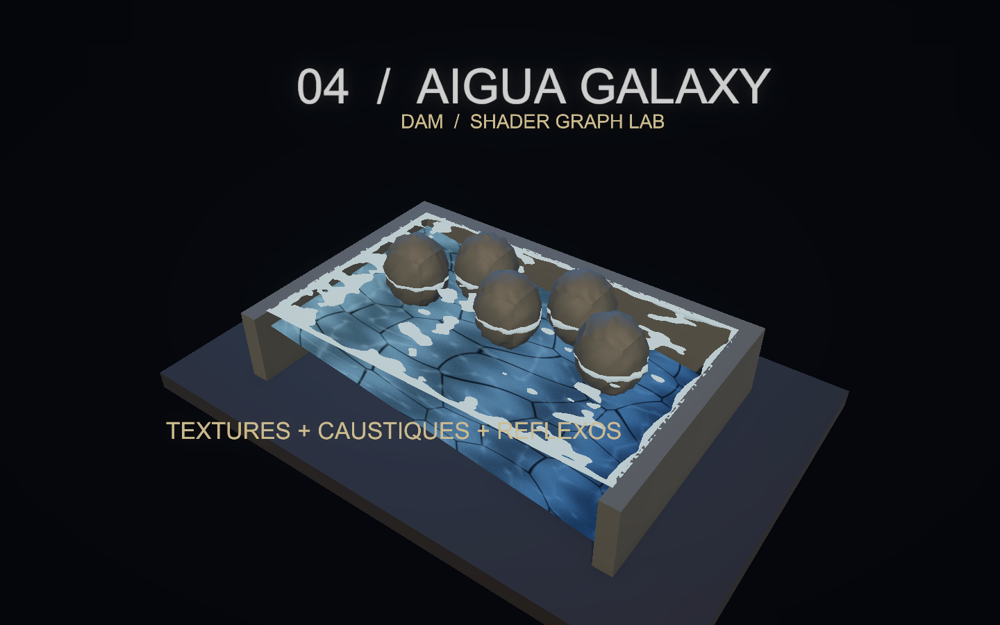
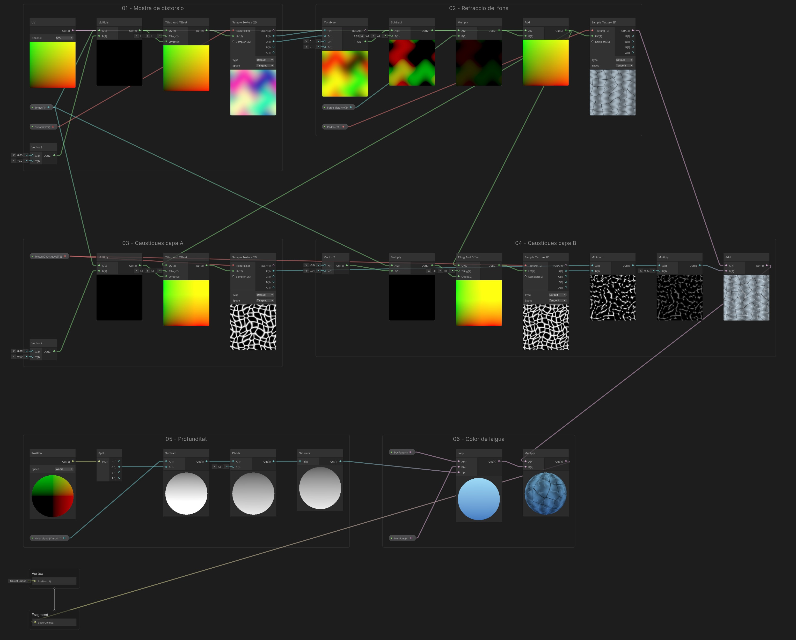
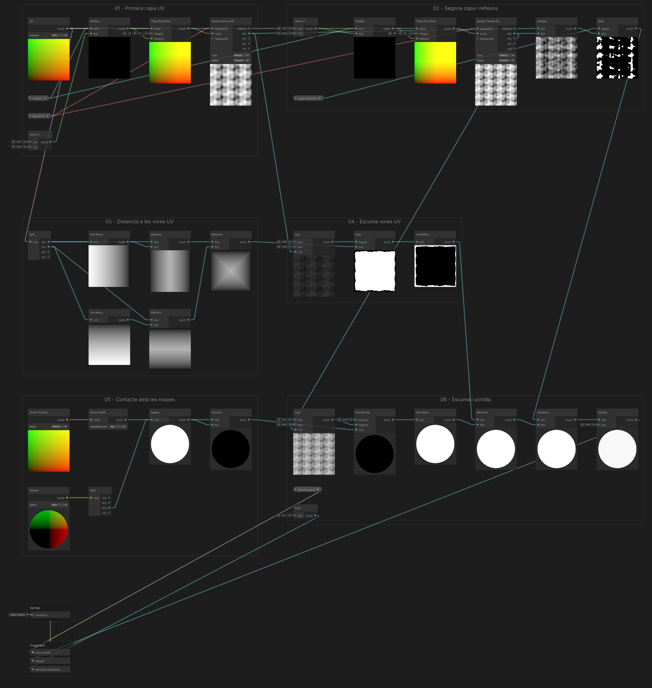
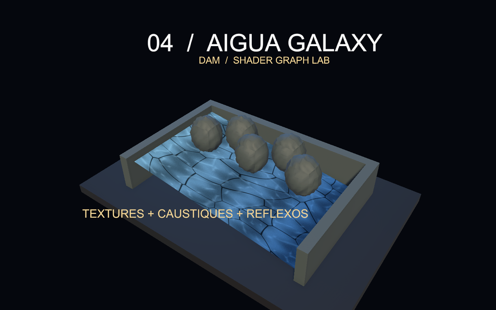
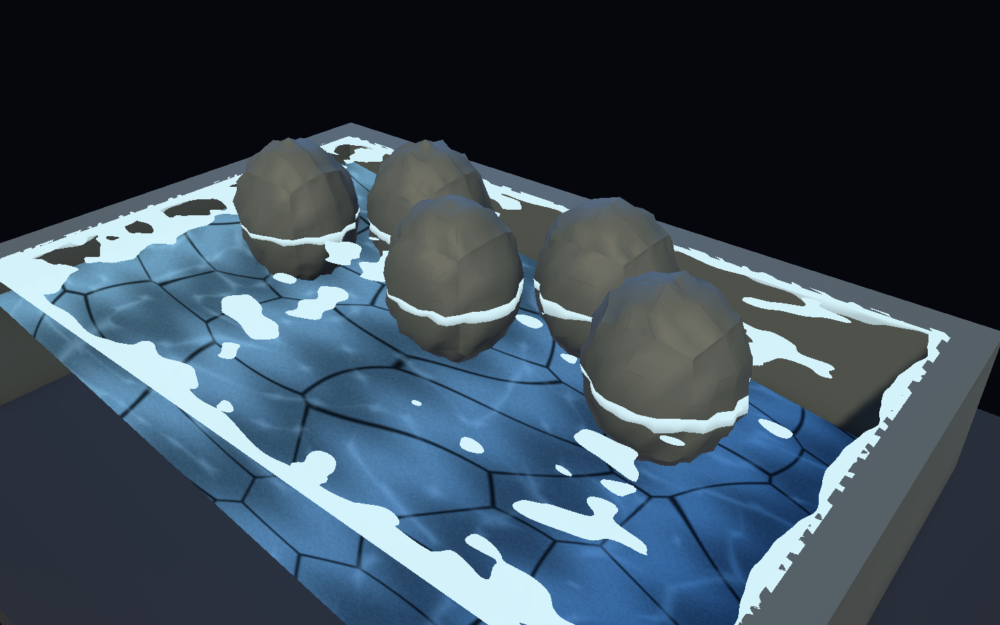
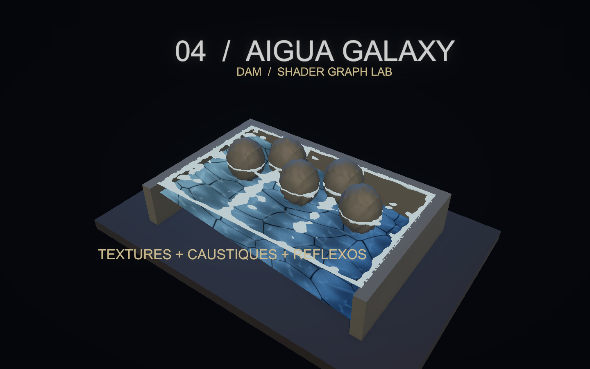
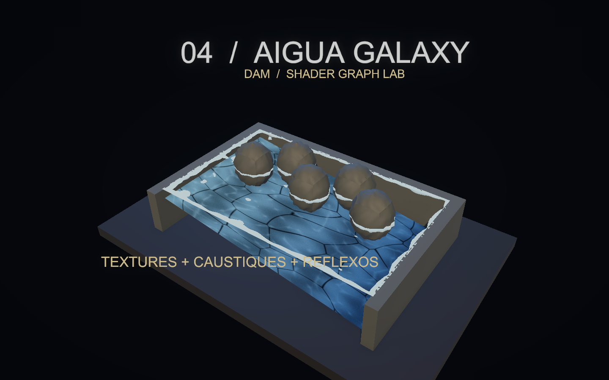

# Demo 4: Aigua: ones i textures animades

Construirem una piscina estilitzada amb una malla subdividida, moviment de vèrtexs i una franja d’escuma al voltant de les roques. La profunditat de l’escena permet detectar proximitat visual amb la riba.

**Projecte acabat:** [Demo-4-Aigua.zip](demos/Demo-4-Aigua.zip). Descomprimeix-lo i obre la carpeta amb Assets, Packages i ProjectSettings des de Unity Hub. La primera importació obre automàticament `Assets/Demos/Aigua/Scenes/DemoAigua.unity`; prem Play. Els materials poden trigar una estona a carregar-se.

<a href="assets/demoaigua-escena.png"></a>

El ZIP inclou també **DemoAiguaGalaxy.unity**, una segona escena amb superfície plana, textures animades, distorsió del fons i escuma de contacte. La seva construcció s’explica a l’apartat 8; comparteix projecte i controls amb aquesta primera versió.

## 1. Partir de Universal 3D

1. Crea un projecte **Universal 3D (URP)**.
2. A **Window > Package Management > Package Manager**, comprova **Universal RP**, **Shader Graph** i **Input System**. Shader Graph arriba com a dependència d’URP.
3. A **Project Settings > Player > Active Input Handling**, selecciona **Input System Package (New)**. Accepta el reinici si Unity el demana.
4. A la finestra **Project**, crea `Assets/Demos/Aigua` (botó dret > **Create > Folder**) amb les carpetes **Shaders**, **Materials**, **Scenes** i **Meshes**. Crea també **Assets/Common** per als scripts.
5. Obre **Assets/Scenes/SampleScene**, que ja inclou **Main Camera**, **Directional Light** i **Global Volume**. Conserva aquests objectes. Amb **File > Save As…**, desa una còpia com a `DemoAigua` dins de Scenes. Més endavant ajustarem la càmera i la llum existents.

## 2. Crear el Shader Graph

A la finestra Project, fes botó dret a la carpeta Shaders i tria **Create > Shader Graph > URP > Lit Shader Graph**, amb nom **SAigua**. Obre’l i, a **Graph Inspector > Graph Settings**, fixa:

| Opció | Valor |
|---|---|
| Target | Universal |
| Material | Lit |
| Surface Type | Transparent |
| Alpha Clipping | Desactivat |
| Render Face | Front |
| Cast Shadows | Desactivat |

Per a Transparent, utilitza Blending Mode **Alpha**.

Afegeix al Blackboard aquestes propietats. Activa **Show In Inspector** i escriu les **Reference exactes**, inclòs el guió baix. Els colors s’indiquen com a **RGB (0–255)**, tal com apareixen al selector de Unity; mantén **Alpha = 255** llevat que s’indiqui un altre valor. Els valors Float i Vector continuen en les seves unitats originals.

| Nom | Tipus | Reference | Valor inicial |
|---|---|---|---|
| Amplada escuma | Float | `_AmpladaEscuma` | 0.6 |
| Amplitud | Float | `_Amplitud` | 0.12 |
| Blanc | Color | `_Blanc` | RGB (204, 255, 255) |
| Brillantor | Float | `_Brillantor` | 0.5 |
| Frequencia | Float | `_Frequencia` | 2.2 |
| Opacitat | Float | `_Opacitat` | 0.8 |
| Profund | Color | `_Profund` | RGB (1, 41, 71) |
| Superficie | Color | `_Superficie` | RGB (4, 166, 166) |
| Temps (controlat pel guio) | Float | `_Temps` | 0 |

Arrossega les propietats al gràfic per crear els seus nodes. La propietat no es crea escrivint-ne el nom en un node Float: s’ha de crear al Blackboard.

## 3. Connectar els nodes

Segueix els passos en ordre dins del mateix Shader Graph. Prem **Espai** per crear un node del tipus indicat; arrossega les propietats des del Blackboard. Els identificadors de les taules serveixen per distingir nodes repetits: no cal canviar els noms dels nodes. Si ho necessites, posa una **Sticky Note** al costat del node amb l’identificador.

A cada fila de cables, arrossega des del **port de sortida** del node origen fins al **port d’entrada** del node destí. Reutilitza els nodes dels passos anteriors. `Out` indica la sortida principal; als nodes de propietat pot mostrar el nom de la propietat.

Per organitzar el graf com a la captura, selecciona els nodes de cada pas i tria **Group Selection** al menú del botó dret. Mantén els grups a prop i deixa prou espai per veure els cables.

Per veure el resultat d’un node, fes-hi botó dret i tria **View > Expand Preview**; amb **Collapse Preview** el pots plegar.

Escriu els valors de la taula als camps sense cable. Si el camp és vectorial i només s’indica un valor, repeteix-lo a tots els components. Clica les captures per veure-les a mida completa.

**Graf complet d’Aigua:** segueix els grups numerats i els cables fins al **Master Stack**. [Obre la captura a mida completa](assets/demoaigua-graf-complet.png) per llegir els ports i els valors.

<a href="assets/demoaigua-graf-complet.png"></a>

### Pas 1. Ona sinusoidal

Construeix la fase amb Position Object.x, Frequencia i Temps; Sine produeix l’ona.

**Nodes que has de crear i valors que has d’escriure:**

| Identificador de la guia | Tipus a cercar a Unity | Configuració / valors sense cable |
|---|---|---|
| `UV` | UV | Channel = UV0 |
| `Posicio` | Position | Space: Object |
| `Eixos` | Split | Valors per defecte |
| `FreqX` | Multiply | Valors per defecte |
| `Fase` | Add | Valors per defecte |
| `Ona` | Sine | Valors per defecte |

**Cables: arrossega de la sortida a l’entrada indicada.**

| Node origen | Port de sortida | Node destí | Port d’entrada |
|---|---|---|---|
| `Posicio` | Out | `Eixos` | In |
| `Eixos` | R | `FreqX` | A |
| `Frequencia` | Out | `FreqX` | B |
| `FreqX` | Out | `Fase` | A |
| `Temps (controlat pel guio)` | Out | `Fase` | B |
| `Fase` | Out | `Ona` | In |

**Comprova el resultat:** Desplega **Sine** (Ona): mostra la variació de gris de l’ona sobre la malla de previsualització. Canvia temporalment Temps al Blackboard per veure com es desplacen; torna’l a 0.

### Pas 2. Desplaçament de vèrtexs

Multiplica l’ona per Amplitud i suma-la només a Y. Aquesta sortida va a Vertex / Position.

**Nodes que has de crear i valors que has d’escriure:**

| Identificador de la guia | Tipus a cercar a Unity | Configuració / valors sense cable |
|---|---|---|
| `Altura` | Multiply | Valors per defecte |
| `Offset` | Vector 3 | X = 0; Z = 0 |
| `PosicioFinal` | Add | Valors per defecte |

**Cables: arrossega de la sortida a l’entrada indicada.**

| Node origen | Port de sortida | Node destí | Port d’entrada |
|---|---|---|---|
| `Ona` | Out | `Altura` | A |
| `Amplitud` | Out | `Altura` | B |
| `Altura` | Out | `Offset` | Y |
| `Posicio` | Out | `PosicioFinal` | A |
| `Offset` | Out | `PosicioFinal` | B |

**Comprova el resultat:** Connecta PosicioFinal al bloc **Vertex / Position** al pas de sortides. Comprova l’ona sobre la malla subdividida de l’escena; un pla sense subdivisions no permet veure’n bé la forma.

### Pas 3. Profunditat i escuma

Scene Depth i Position View han d’utilitzar la mateixa profunditat lineal: Eye i −Z, respectivament.

**Nodes que has de crear i valors que has d’escriure:**

| Identificador de la guia | Tipus a cercar a Unity | Configuració / valors sense cable |
|---|---|---|
| `Pantalla` | Screen Position | Mode = Default |
| `Fons` | Scene Depth | Sampling: Eye |
| `Vista` | Position | Space: View |
| `VistaXYZ` | Split | Valors per defecte |
| `ProfunditatAigua` | Multiply | B = -1 |
| `Separacio` | Subtract | Valors per defecte |
| `Vora` | Smoothstep | Edge1 = 0 |
| `Escuma` | One Minus | Valors per defecte |

**Cables: arrossega de la sortida a l’entrada indicada.**

| Node origen | Port de sortida | Node destí | Port d’entrada |
|---|---|---|---|
| `Pantalla` | Out | `Fons` | UV |
| `Vista` | Out | `VistaXYZ` | In |
| `VistaXYZ` | B | `ProfunditatAigua` | A |
| `Fons` | Out | `Separacio` | A |
| `ProfunditatAigua` | Out | `Separacio` | B |
| `Amplada escuma` | Out | `Vora` | Edge2 |
| `Separacio` | Out | `Vora` | In |
| `Vora` | Out | `Escuma` | In |

**Comprova el resultat:** Aquesta branca necessita la profunditat de l’escena. Comprova l’escuma al contacte amb les roques després de muntar l’escena i activar Depth Texture; la miniatura del node no valida aquest contacte.

### Pas 4. Color i superfície

El soroll barreja els dos blaus; l’escuma força el color clar. Alpha i Smoothness són propietats independents.

**Nodes que has de crear i valors que has d’escriure:**

| Identificador de la guia | Tipus a cercar a Unity | Configuració / valors sense cable |
|---|---|---|
| `Soroll` | Simple Noise | Scale = 24 |
| `Blau` | Lerp | Valors per defecte |
| `ColorFinal` | Lerp | Valors per defecte |
| `Normals` | Normal From Height | Strength = 0.003 |

**Cables: arrossega de la sortida a l’entrada indicada.**

| Node origen | Port de sortida | Node destí | Port d’entrada |
|---|---|---|---|
| `UV` | Out | `Soroll` | UV |
| `Profund` | Out | `Blau` | A |
| `Superficie` | Out | `Blau` | B |
| `Soroll` | Out | `Blau` | T |
| `Blau` | Out | `ColorFinal` | A |
| `Blanc` | Out | `ColorFinal` | B |
| `Escuma` | Out | `ColorFinal` | T |
| `Soroll` | Out | `Normals` | In |

**Comprova el resultat:** Desplega **Simple Noise** (Soroll) i **Lerp** (Blau) per veure com el soroll es converteix en variacions de blau. El color d’escuma es comprova a l’escena.

### Pas 5. Master Stack i connexions finals

Connecta les sortides als blocs del Master Stack indicats a la taula de cables. Al node **Normal From Height**, deixa **Output Space = Tangent**. Els blocs sense cable (Metallic, Emission) conserven el valor per defecte.

**Cables: arrossega de la sortida a l’entrada indicada.**

| Node origen | Port de sortida | Node destí | Port d’entrada |
|---|---|---|---|
| `PosicioFinal` | Out | `Vertex / Position` | Position |
| `ColorFinal` | Out | `Fragment / Base Color` | Base Color |
| `Opacitat` | Out | `Fragment / Alpha` | Alpha |
| `Brillantor` | Out | `Fragment / Smoothness` | Smoothness |
| `Normals` | Out | `Fragment / Normal (Tangent Space)` | Normal (Tangent Space) |

Els números de les entrades són valors literals. En un vector, repeteix el valor a tots els components quan s’indica un únic nombre. A Combine, tria RG per a Vector2; a Split, R/G/B equivalen a X/Y/Z. Desa el graf abans de crear els materials.

**Comprova el resultat:** Desa el graf i comprova el moviment, la transparència i l’escuma amb el material aplicat a l’aigua de l’escena.

## 4. Crear els materials

1. A la finestra Project, fes botó dret a la carpeta **Materials** i tria **Create > Material**. Anomena’l **MAigua**.
2. A l’Inspector, selecciona **Shader > DAM Shaders > SAigua** (o arrossega SAigua del Project sobre el material). Conserva els valors inicials. L’assignaràs a l’objecte Aigua a l’apartat 5.
3. Crea de la mateixa manera el material **Riba**: shader **Universal Render Pipeline > Lit**, Base Map RGB (64, 77, 79), Smoothness 0.25. L’assignaràs a les tres ribes i a les cinc roques.

## 5. Construir l’escena

Crea cada objecte amb el menú **+** de la Hierarchy (**3D Object > Cube** o **3D Object > Sphere**). Les posicions són globals i les escales corresponen a les primitives de Unity. Mantén els objectes a l’arrel, sense un pare escalat. Els textos decoratius es poden ometre: no intervenen en el shader.

| Objecte | Primitiva | Posicio | Escala |
|---|---|---|---|
| Base | Cube | (0, -0.22, 0) | (12, 0.4, 8) |
| FonsPiscina | Cube | (0, 0.05, 0) | (8, 0.2, 5) |
| RibaEsquerra | Cube | (-4.15, 0.3, 0) | (0.4, 0.6, 5.7) |
| RibaDreta | Cube | (4.15, 0.3, 0) | (0.4, 0.6, 5.7) |
| RibaDarrera | Cube | (0, 0.3, 2.65) | (8, 0.6, 0.4) |
| RocaRiba0 | Sphere | (-2.5, 0.5, 0.4) | (1.4, 1.7, 1.3) |
| RocaRiba1 | Sphere | (-1.3, 0.5, 1.3) | (1.4, 1.7, 1.3) |
| RocaRiba2 | Sphere | (-0.1, 0.5, 0.4) | (1.4, 1.7, 1.3) |
| RocaRiba3 | Sphere | (1.1, 0.5, 1.3) | (1.4, 1.7, 1.3) |
| RocaRiba4 | Sphere | (2.3, 0.5, 0.4) | (1.4, 1.7, 1.3) |

Arrossega el material **Riba** del Project sobre les tres ribes i les cinc roques.

### Generar les malles

Crea **Assets/Editor/GenerarMalles.cs** amb aquest codi. Espera que compili. El menú **Demos** permet crear una graella d’aigua i cinc roques; els assets apareixen a **Assets/Meshes**. Al ZIP, les malles també són a **Assets/Meshes**.

```csharp
using UnityEngine;
using UnityEditor;
using System.IO;

// Utilitat opcional per reconstruir les malles dels exemples des de zero.
public static class GenerarMalles
{
    // Afegeix una opció al menú de l'Editor; aquesta utilitat es desa dins d'una carpeta Editor.
    [MenuItem("Demos/Crear malla d'aigua")]
    public static void Aigua()
    {
        // Divideix cada costat en 80 trams per tenir prou vèrtexs per dibuixar les onades.
        const int n = 80;
        var mesh = new Mesh { name = "WaterGrid" };
        // Una graella de n trams necessita n + 1 punts a cada costat.
        var vertices = new Vector3[(n + 1) * (n + 1)];
        // Les UV indiquen on correspon cada vèrtex dins del patró o textura, normalment entre 0 i 1.
        var uv = new Vector2[vertices.Length];
        // Cada casella es dibuixa amb dos triangles de tres índexs cadascun.
        var triangles = new int[n * n * 6];
        for (int z = 0; z <= n; z++)
            for (int x = 0; x <= n; x++)
            {
                // Converteix la fila i la columna de la graella en un índex de la llista de vèrtexs.
                int i = z * (n + 1) + x;
                // Reparteix els punts sobre un rectangle de 8 per 5 unitats centrat a l'origen.
                vertices[i] = new Vector3((float)x / n * 8 - 4, 0, (float)z / n * 5 - 2.5f);
                // Associa cada punt de la graella amb la seva coordenada UV proporcional.
                uv[i] = new Vector2((float)x / n, (float)z / n);
            }
        // Recorre la llista d'índexs per construir les dues cares triangulars de cada casella.
        int k = 0;
        for (int z = 0; z < n; z++)
            for (int x = 0; x < n; x++)
            {
                // Converteix la fila i la columna de la graella en un índex de la llista de vèrtexs.
                int i = z * (n + 1) + x;
                triangles[k++] = i; triangles[k++] = i + n + 1; triangles[k++] = i + 1;
                triangles[k++] = i + 1; triangles[k++] = i + n + 1; triangles[k++] = i + n + 2;
            }
        mesh.vertices = vertices; mesh.uv = uv; mesh.triangles = triangles;
        // Calcula les normals i les tangents que els shaders fan servir per orientar la il·luminació i
        // el relleu.
        mesh.RecalculateNormals(); mesh.RecalculateTangents();
        // Reserva altura al volum visible perquè les onades del shader no quedin fora dels límits de la
        // malla.
        mesh.bounds = new Bounds(Vector3.zero, new Vector3(8, 2, 5));
        Save(mesh, "WaterGrid");
    }

    // Afegeix al menú de l'Editor la generació de cinc variants de roca.
    [MenuItem("Demos/Crear cinc malles de roca")]
    public static void Roques()
    {
        for (int seed = 1; seed <= 5; seed++)
        {
            var temporary = GameObject.CreatePrimitive(PrimitiveType.Sphere);
            // Copia la malla de l'esfera per deformar-la sense modificar la malla original de Unity.
            var mesh = Object.Instantiate(temporary.GetComponent<MeshFilter>().sharedMesh);
            // Elimina l'objecte auxiliar de l'Editor; ja conservem la còpia de la seva malla.
            Object.DestroyImmediate(temporary);
            var vertices = mesh.vertices;
            for (int i = 0; i < vertices.Length; i++)
            {
                // Obtén la direcció del vèrtex des del centre per calcular-ne la deformació.
                Vector3 d = vertices[i].normalized;
                // Combina ones per crear irregularitats; seed produeix una forma diferent a cada roca.
                float factor = 1 + .045f * Mathf.Sin(d.x * 13 + seed) * Mathf.Cos(d.y * 11 + seed)
                    + .035f * Mathf.Sin(d.z * 17 + seed);
                // Acosta o allunya el vèrtex del centre segons la deformació calculada.
                vertices[i] *= factor;
            }
            // Aplica la forma nova i actualitza les normals i el volum que l'envolta.
            mesh.vertices = vertices; mesh.RecalculateNormals(); mesh.RecalculateBounds();
            Save(mesh, "Rock" + seed);
        }
    }

    static void Save(Mesh mesh, string name)
    {
        Directory.CreateDirectory("Assets/Meshes");
        // Genera un nom de fitxer lliure per no sobreescriure una malla creada abans.
        string path = AssetDatabase.GenerateUniqueAssetPath("Assets/Meshes/" + name + ".asset");
        // Desa la malla com a recurs del projecte per poder-la assignar a un Mesh Filter.
        AssetDatabase.CreateAsset(mesh, path);
        AssetDatabase.SaveAssets();
        // Selecciona la malla creada perquè es pugui veure a l'Inspector.
        Selection.activeObject = mesh;
    }
}
```

Executa els dos menús. Crea un objecte buit **Aigua** (**+ > Create Empty**) a **(0,0.65,0)**, escala **(1,1,1)**. Afegeix-hi **Mesh Filter** amb **Mesh = WaterGrid** i **Mesh Renderer** amb el material **MAigua**. Assigna Rock1–Rock5 al **Mesh Filter** de RocaRiba0–RocaRiba4, respectivament. No cal cap collider per a l’aigua.

### Càmera i llums

Posa Main Camera a **(9,8,−11)**, amb projecció **Perspective**, Field of View **40**, Near **0.1**, Far **100** i fons de color sòlid **RGB (5,7,13)**. Orienta-la cap al punt **(0,1.7,0)**. La rotació Euler corresponent és aproximadament **(23.906, -39.289, 0)**.

Selecciona la **Directional Light** existent, canvia-li el nom a **Key Light** i ajusta-la: rotació (45,−30,0), intensitat 2 i color RGB (255,224,189); afegeix una segona llum amb **+ > Light > Directional Light** a la Hierarchy, anomena-la **Fill Light** i configura-la: rotació (25,140,0), intensitat 1 i color RGB (89,171,255). A **Window > Rendering > Lighting**, pestanya **Environment**, posa **Environment Lighting > Source = Color** i **Ambient Color** (82,97,122). Crea el material **Base** amb **Create > Material**, shader **Universal Render Pipeline > Lit**, color gris blavós RGB (14,18,24) i Smoothness 0.25, i assigna’l a l’objecte Base.

A l’URP Asset actiu (**Edit > Project Settings > Quality > Render Pipeline Asset**; en una plantilla Universal 3D és **PC_RPAsset**), activa **Depth Texture**. A Main Camera, a **Rendering > Depth Texture**, tria **On** o **Use Pipeline Settings**, mai Off. **Opaque Texture no és necessària en aquest gràfic**, perquè no utilitza Scene Color. El projecte la té disponible per experimentar. Crea **Sorra** amb **Create > Material**, shader **Universal Render Pipeline > Lit**, RGB (128,99,59), Smoothness 0.25; assigna’l a **FonsPiscina**.

Al **Global Volume** existent, duplica el perfil a la carpeta de la demo (al ZIP es diu **Bloom**) i assigna-hi la còpia. Conserva només **Bloom** i activa Intensity = **0.35**, Threshold = **1** i Scatter = **0.6**. Mantén **HDR** i **Post Processing** activats a Main Camera.

## 6. Afegir els controls

### Càmera orbital i zoom

A la finestra Project, fes botó dret a **Assets/Common** i tria **Create > Scripting > MonoBehaviour Script**. Anomena’l **DemoOrbitCamera**, obre’l i substitueix-ne tot el contingut pel de [DemoOrbitCamera.cs](demos/DemoOrbitCamera.cs). Afegeix el component **Demo Orbit Camera** a **Main Camera**. Al ZIP ja està configurat.

- **Center = (0, 1.7, 0)**: punt fix al voltant del qual gira la càmera.
- **Minimum Distance = 3**, **Maximum Distance = 35**.
- **Rotation Sensitivity = 0.2**, **Zoom Sensitivity = 0.0015**.
- **Minimum Elevation = 5**, **Maximum Elevation = 85**: límits d’inclinació en graus.

En **Play**, clica **Game**. Mantén premut el **botó dret** i arrossega per girar; utilitza la **roda del ratolí** per apropar-te o allunyar-te. **Home** recupera la posició i orientació inicials. El centre no es desplaça i no cal afegir-hi cap objecte Target. La roda positiva apropa la càmera; la negativa l’allunya.

El controlador del panell, que trobaràs a continuació, informa la càmera de quan el punter és sobre els controls perquè el lliscador no mogui el punt de vista. La càmera funciona igualment quan el temps del shader està en pausa.

A **DemoAiguaGalaxy**, utilitza **Center = (0, 1, 0)**. Aquesta escena també porta el component configurat.

A **Assets/Common**, crea **DemoControls** amb **Create > Scripting > MonoBehaviour Script** i substitueix-ne el contingut per aquest codi complet:

```csharp
using UnityEngine;
using UnityEngine.InputSystem;

// Controls comuns a les demos. Crea còpies dels materials per conservar els originals del projecte.
public class DemoControls : MonoBehaviour
{
    public string title;
    public string description;
    // Arrossega els objectes visibles als quals aquest panell modificarà el material.
    public Renderer[] surfaces;
    // Nom intern (Reference) de la propietat del Shader Graph que controlarà el lliscador.
    public string parameter = "_Gruix";
    public float minimum = 0.02f;
    public float maximum = 0.3f;
    public float initialValue = 0.12f;
    public float timeScale = 1f;
    public bool paused;
    // Temps propi de la demo: es pot pausar sense aturar la càmera ni tota la partida.
    public float elapsed;
    public bool showPanel = true;
    Material[] materials;
    float value;

    // Prepara els materials i la connexió amb la càmera quan es carrega el component.
    void Awake()
    {
        // Reserva una entrada per al material de cada superfície assignada a l'Inspector.
        materials = new Material[surfaces.Length];
        // Accedir a .material crea una còpia per a cada Renderer; així es conserven els materials del
        // projecte.
        for (int i = 0; i < surfaces.Length; i++) materials[i] = surfaces[i].material;
        value = initialValue;
        // Busca el controlador orbital a la càmera amb el tag MainCamera, si n'hi ha.
        var orbit = Camera.main ? Camera.main.GetComponent<DemoOrbitCamera>() : null;
        // Passa una funció a la càmera perquè detecti el punter sobre el panell i no mogui la vista en
        // usar-lo.
        if (orbit) orbit.IsPointerOverControls = point => showPanel && new Rect(16, 16, 380, 180).Contains(point);
    }
    void Update()
    {
        // Comprova que hi hagi teclat abans de llegir les tecles de control.
        if (Keyboard.current != null)
        {
            // Alterna la pausa amb una sola pulsació, sense repetir-la mentre la tecla es manté premuda.
            if (Keyboard.current.spaceKey.wasPressedThisFrame) paused = !paused;
            if (Keyboard.current.hKey.wasPressedThisFrame) showPanel = !showPanel;
            if (Keyboard.current.rKey.wasPressedThisFrame) { elapsed = 0; SetParameter(initialValue); }
        }
        // Avança el rellotge de l'efecte només si no està en pausa; timeScale en regula la velocitat.
        if (!paused) elapsed += Time.deltaTime * timeScale;
        // Envia aquest temps als shaders que tenen la propietat _Temps.
        ApplyTime(elapsed);
    }
    public void ApplyTime(float seconds)
    {
        if (materials == null) return;
        foreach (Material material in materials)
            // Comprova que la propietat existeixi abans d'actualitzar l'animació del material.
            if (material.HasProperty("_Temps")) material.SetFloat("_Temps", seconds);
    }
    public void SetParameter(float next)
    {
        // Limita el valor triat al rang permès per a aquesta demo.
        value = Mathf.Clamp(next, minimum, maximum);
        if (materials == null) return;
        foreach (Material material in materials)
            // Actualitza la propietat indicada pel seu nom intern a cada material compatible.
            if (material.HasProperty(parameter)) material.SetFloat(parameter, value);
    }
    // Unity crida OnGUI per dibuixar i gestionar aquest panell senzill de controls.
    void OnGUI()
    {
        if (!showPanel) return;
        GUI.Box(new Rect(16, 16, 380, 180), "");
        // Delimita en píxels l'àrea on GUILayout col·locarà els textos i el lliscador.
        GUILayout.BeginArea(new Rect(30, 25, 350, 162));
        GUILayout.Label(title);
        GUILayout.Label(description);
        GUILayout.Label(parameter + ": " + value.ToString("0.00"));
        // Dibuixa el lliscador i llegeix el valor que l'usuari hi selecciona.
        float next = GUILayout.HorizontalSlider(value, minimum, maximum);
        // Aplica el paràmetre als materials només quan l'usuari en canvia el valor.
        if (next != value) SetParameter(next);
        GUILayout.Label("Espai: pausa | R: reinicia | H: amaga el panell");
        GUILayout.Label("Boto dret: orbita | Roda: zoom | Home: vista inicial");
        GUILayout.EndArea();
    }
    void OnDestroy()
    {
        if (materials == null) return;
        // Allibera les còpies de materials creades a Awake quan es destrueix el component.
        foreach (Material material in materials) Destroy(material);
    }
}
```

Crea un objecte buit **Controls** i afegeix-hi DemoControls. A **Surfaces**, assigna el Mesh Renderer d’Aigua. No hi afegeixis la base ni els textos.

| Camp | Valor |
|---|---|
| Title | 04 / Aigua |
| Description | Compara les variants i modifica el material. |
| Parameter | `_Amplitud` |
| Minimum | 0 |
| Maximum | 0.35 |
| Initial Value | 0.12 |

**Controls:** lliscador per modificar `_Amplitud`; Espai pausa el temps; R reinicia temps i paràmetre; H amaga el panell. En moure el lliscador, el valor s’aplica a la còpia del material de l’aigua. Abans de tocar-lo, l’aigua conserva el valor inicial de MAigua; el panell mostra el valor actual del control.

Els canvis durant Play són temporals. Per canviar els valors inicials de manera permanent, atura Play i edita els assets de material.

## 7. Provar la demo

1. Prem Play i observa que es mou la silueta de l’aigua.
2. Mou Amplitud a 0: desapareix el desplaçament de vèrtexs.
3. Comprova que les roques tenen una franja clara al contacte visual amb l’aigua.
4. Atura Play i desactiva Depth Texture: observa per què la profunditat és un requisit; torna-la a activar.
5. Canvia **Amplada escuma** al material i compara la mida de la franja.

<a href="assets/demoaigua-variant.png"></a>

<a href="assets/demoaigua-animacio.png"></a>

## Si alguna cosa no funciona

Si tota la superfície és blanca, revisa Depth Texture, el mode Eye de Scene Depth i el signe negatiu de Position View.z. Si la superfície és rígida, comprova la malla subdividida i la connexió Vertex/Position.

Si el material és rosa, comprova URP, la compilació del gràfic i la Console. Si el teclat no respon, comprova Input System, entra a Play i clica Game.

## 8. Variant inspirada en Super Mario Galaxy

Aquesta recreació didàctica pren com a referència visual els reflexos i el fons de la [recreació d’Eyan Martucci](https://eyanmartucci.com/stylized-water-shader/). No és el shader original de Nintendo ni una reproducció exacta del joc. Utilitzem textures pròpies incloses al ZIP.

L’efecte separa una superfície plana que retalla taques blanques i un fons amb textura distorsionada, càustiques i tint segons profunditat. Hi afegim escuma de contacte amb Scene Depth per detectar les roques; l’escuma de vores UV de l’article, per si sola, no les detecta.

<a href="assets/demoaigua-galaxy.png"></a>

### 8.1. Textures i importació

Les textures són dins del ZIP del projecte acabat, a `Demo-4-Aigua/Assets/Demos/Aigua/Textures`. Arrossega aquesta carpeta des del ZIP descomprimit fins a **Assets/Demos/Aigua** a la finestra **Project** de Unity. Després, selecciona cada textura al Project i configura-la a l’Inspector segons la taula. No cal descarregar cap textura externa.

| Textura | Ús | sRGB (Color Texture) | Texture Type | Wrap Mode | Filter Mode |
|---|---|---|---|---|---|
| Ripples.png | Camp suau per crear taques de reflexos | Desactivat | Default | Repeat | Trilinear |
| Distorsio.png | R/G codifiquen el desplaçament UV | Desactivat | Default | Repeat | Trilinear |
| Caustiques.png | Il·luminació que es mou pel fons | Desactivat | Default | Repeat | Trilinear |
| Pedres.png | Color de les pedres del fons | Activat | Default | Repeat | Trilinear |

Les quatre imatges són de 512 × 512. Mantén Generate Mip Maps activat i Compression = None en aquesta pràctica. Una Texture2D al Blackboard no substitueix Sample Texture 2D: connecta la propietat al port Texture i les coordenades al port UV del mostrejador.

### 8.2. Shader del fons

A la carpeta Shaders, amb **Create > Shader Graph > URP > Unlit Shader Graph**, crea **SGalaxyFons**. A Graph Settings: Surface Type **Opaque**, Alpha Clipping desactivat, Render Face **Front**, Cast Shadows desactivat. Deixa Vertex / Position sense connectar. El fons està il·luminat artísticament pel mateix color i les càustiques.

| Nom | Tipus | Reference | Valor inicial |
|---|---|---|---|
| Temps | Float | `_Temps` | 0 |
| Distorsio | Texture2D | `_Distorsio` | Distorsio.png |
| Forca distorsio | Float | `_Refraccio` | 0.045 |
| Pedres | Texture2D | `_Pedres` | Pedres.png |
| TexturaCaustiques | Texture2D | `_Caustiques` | Caustiques.png |
| Nivell aigua (Y mon) | Float | `_NivellAigua` | 0.8 |
| PocFons | Color | `_PocFons` | RGB (179, 235, 255) |
| MoltFons | Color | `_MoltFons` | RGB (31, 107, 191) |

**Graf complet de GalaxyFons:** segueix els grups numerats i els cables fins al **Master Stack**. [Obre la captura a mida completa](assets/demoaigua-galaxy-fons-graf-complet.png) per llegir els ports i els valors.

<a href="assets/demoaigua-galaxy-fons-graf-complet.png"></a>

### Pas 1. Mostra de distorsió

Llegeix Distorsio com a dades lineals. No configuris aquesta textura com a normal map: farem servir els seus canals R i G directament.

**Nodes que has de crear i valors que has d’escriure:**

| Identificador de la guia | Tipus a cercar a Unity | Configuració / valors sense cable |
|---|---|---|
| `UV` | UV | Channel = UV0 |
| `DistorsioDireccio` | Vector 2 | X = 0.035; Y = -0.019 |
| `DistorsioOffset` | Multiply | Valors per defecte |
| `DistorsioUV` | Tiling And Offset | Tiling = 1 |
| `MostraDistorsio` | Sample Texture 2D | Valors per defecte |

**Cables: arrossega de la sortida a l’entrada indicada.**

| Node origen | Port de sortida | Node destí | Port d’entrada |
|---|---|---|---|
| `Temps` | Out | `DistorsioOffset` | A |
| `DistorsioDireccio` | Out | `DistorsioOffset` | B |
| `UV` | Out | `DistorsioUV` | UV |
| `DistorsioOffset` | Out | `DistorsioUV` | Offset |
| `Distorsio` | Out | `MostraDistorsio` | Texture |
| `DistorsioUV` | Out | `MostraDistorsio` | UV |

**Comprova el resultat:** Desplega **Sample Texture 2D** (MostraDistorsio): ha de mostrar la textura Distorsio assignada al Blackboard.

### Pas 2. Refracció del fons

Combine recupera RG; Subtract 0.5 centra el vector i Multiply n’ajusta la força. Les UV resultants distorsionen el dibuix de les pedres.

**Nodes que has de crear i valors que has d’escriure:**

| Identificador de la guia | Tipus a cercar a Unity | Configuració / valors sense cable |
|---|---|---|
| `VectorRG` | Combine | Valors per defecte |
| `VectorCentrat` | Subtract | B = 0.5 |
| `Desviacio` | Multiply | Valors per defecte |
| `UVRefractada` | Add | Valors per defecte |
| `MostraPedres` | Sample Texture 2D | Valors per defecte |

**Cables: arrossega de la sortida a l’entrada indicada.**

| Node origen | Port de sortida | Node destí | Port d’entrada |
|---|---|---|---|
| `MostraDistorsio` | R | `VectorRG` | R |
| `MostraDistorsio` | G | `VectorRG` | G |
| `VectorRG` | RG | `VectorCentrat` | A |
| `VectorCentrat` | Out | `Desviacio` | A |
| `Forca distorsio` | Out | `Desviacio` | B |
| `UV` | Out | `UVRefractada` | A |
| `Desviacio` | Out | `UVRefractada` | B |
| `Pedres` | Out | `MostraPedres` | Texture |
| `UVRefractada` | Out | `MostraPedres` | UV |

**Comprova el resultat:** Desplega **Sample Texture 2D** (MostraPedres): ha de mostrar les pedres amb les UV desviades. Canvia temporalment Forca distorsio a 0 per comparar i restaura el valor inicial.

### Pas 3. Càustiques capa A

Les càustiques fan servir les UV ja distorsionades. Aquesta és la primera mostra animada.

**Nodes que has de crear i valors que has d’escriure:**

| Identificador de la guia | Tipus a cercar a Unity | Configuració / valors sense cable |
|---|---|---|
| `CausticaADireccio` | Vector 2 | X = 0.013; Y = 0.007 |
| `CausticaAOffset` | Multiply | Valors per defecte |
| `CausticaAUV` | Tiling And Offset | Tiling = 1.5 |
| `MostraCausticaA` | Sample Texture 2D | Valors per defecte |

**Cables: arrossega de la sortida a l’entrada indicada.**

| Node origen | Port de sortida | Node destí | Port d’entrada |
|---|---|---|---|
| `Temps` | Out | `CausticaAOffset` | A |
| `CausticaADireccio` | Out | `CausticaAOffset` | B |
| `UVRefractada` | Out | `CausticaAUV` | UV |
| `CausticaAOffset` | Out | `CausticaAUV` | Offset |
| `TexturaCaustiques` | Out | `MostraCausticaA` | Texture |
| `CausticaAUV` | Out | `MostraCausticaA` | UV |

**Comprova el resultat:** Desplega **Sample Texture 2D** (MostraCausticaA): ha de mostrar la primera capa de càustiques.

### Pas 4. Càustiques capa B

Una segona mostra es mou en una altra direcció. Minimum selecciona coincidències suaus; Multiply amb 0.22 regula la llum que se suma al fons.

**Nodes que has de crear i valors que has d’escriure:**

| Identificador de la guia | Tipus a cercar a Unity | Configuració / valors sense cable |
|---|---|---|
| `CausticaBDireccio` | Vector 2 | X = -0.01; Y = 0.011 |
| `CausticaBOffset` | Multiply | Valors per defecte |
| `CausticaBUV` | Tiling And Offset | Tiling = 1.8 |
| `MostraCausticaB` | Sample Texture 2D | Valors per defecte |
| `LlumCaustica` | Minimum | Valors per defecte |
| `Caustiques` | Multiply | B = 0.22 |
| `FonsIlluminat` | Add | Valors per defecte |

**Cables: arrossega de la sortida a l’entrada indicada.**

| Node origen | Port de sortida | Node destí | Port d’entrada |
|---|---|---|---|
| `Temps` | Out | `CausticaBOffset` | A |
| `CausticaBDireccio` | Out | `CausticaBOffset` | B |
| `UVRefractada` | Out | `CausticaBUV` | UV |
| `CausticaBOffset` | Out | `CausticaBUV` | Offset |
| `TexturaCaustiques` | Out | `MostraCausticaB` | Texture |
| `CausticaBUV` | Out | `MostraCausticaB` | UV |
| `MostraCausticaA` | R | `LlumCaustica` | A |
| `MostraCausticaB` | R | `LlumCaustica` | B |
| `LlumCaustica` | Out | `Caustiques` | A |
| `MostraPedres` | RGBA | `FonsIlluminat` | A |
| `Caustiques` | Out | `FonsIlluminat` | B |

**Comprova el resultat:** Desplega **Minimum** i **Add** (FonsIlluminat): comprova primer la combinació de càustiques i després les pedres amb aquesta llum afegida.

### Pas 5. Profunditat

La profunditat és vertical en espai de món: Nivell aigua − Position World.y. Divide i Saturate la normalitzen.

**Nodes que has de crear i valors que has d’escriure:**

| Identificador de la guia | Tipus a cercar a Unity | Configuració / valors sense cable |
|---|---|---|
| `PosicioMon` | Position | Space: World |
| `Eixos` | Split | Valors per defecte |
| `Profunditat` | Subtract | Valors per defecte |
| `EscalaProfunditat` | Divide | B = 1.6 |
| `Absorcio` | Saturate | Valors per defecte |

**Cables: arrossega de la sortida a l’entrada indicada.**

| Node origen | Port de sortida | Node destí | Port d’entrada |
|---|---|---|---|
| `PosicioMon` | Out | `Eixos` | In |
| `Nivell aigua (Y mon)` | Out | `Profunditat` | A |
| `Eixos` | G | `Profunditat` | B |
| `Profunditat` | Out | `EscalaProfunditat` | A |
| `EscalaProfunditat` | Out | `Absorcio` | In |

**Comprova el resultat:** La profunditat depèn de la posició World del fons. Comprova’n la distribució sobre la malla del fons quan muntis l’escena.

### Pas 6. Color de l’aigua

Lerp calcula el tint segons profunditat i Multiply el combina amb el fons il·luminat. No modifiquis Vertex / Position.

**Nodes que has de crear i valors que has d’escriure:**

| Identificador de la guia | Tipus a cercar a Unity | Configuració / valors sense cable |
|---|---|---|
| `ColorAigua` | Lerp | Valors per defecte |
| `ColorFinal` | Multiply | Valors per defecte |

**Cables: arrossega de la sortida a l’entrada indicada.**

| Node origen | Port de sortida | Node destí | Port d’entrada |
|---|---|---|---|
| `PocFons` | Out | `ColorAigua` | A |
| `MoltFons` | Out | `ColorAigua` | B |
| `Absorcio` | Out | `ColorAigua` | T |
| `FonsIlluminat` | Out | `ColorFinal` | A |
| `ColorAigua` | Out | `ColorFinal` | B |

**Comprova el resultat:** Desplega **Multiply** (ColorFinal): comprova el fons amb el color de l’aigua aplicat.

### Pas 7. Master Stack i connexions finals

Connecta les sortides als blocs del Master Stack indicats a la taula de cables. Els blocs sense cable conserven el valor per defecte.

**Cables: arrossega de la sortida a l’entrada indicada.**

| Node origen | Port de sortida | Node destí | Port d’entrada |
|---|---|---|---|
| `ColorFinal` | Out | `Fragment / Base Color` | Base Color |

**Comprova el resultat:** Desa el graf del fons abans de crear el material.

### 8.3. Shader de la superfície

A la carpeta Shaders, amb **Create > Shader Graph > URP > Unlit Shader Graph**, crea **SGalaxySuperficie**. A Graph Settings: Surface Type **Transparent**, Blending Mode **Alpha**, **Alpha Clipping activat**, Render Face **Front**, Cast Shadows desactivat. En activar Alpha Clipping, el Master Stack mostra el bloc **Alpha Clip Threshold**. Deixa Vertex / Position sense connectar: no hi ha ones geomètriques.

| Nom | Tipus | Reference | Valor inicial |
|---|---|---|---|
| Temps | Float | `_Temps` | 0 |
| Ripples | Texture2D | `_Ripples` | Ripples.png |
| Llindar reflexos | Float | `_Llindar` | 0.42 |
| BlancEscuma | Color | `_BlancEscuma` | RGB (217, 247, 255) |

**Graf complet de GalaxySuperficie:** segueix els grups numerats i els cables fins al **Master Stack**. [Obre la captura a mida completa](assets/demoaigua-galaxy-superficie-graf-complet.png) per llegir els ports i els valors.

<a href="assets/demoaigua-galaxy-superficie-graf-complet.png"></a>

### Pas 1. Primera capa UV

Mostreja Ripples amb les UV de la primera capa. La textura es repeteix i es desplaça lentament en dos eixos.

**Nodes que has de crear i valors que has d’escriure:**

| Identificador de la guia | Tipus a cercar a Unity | Configuració / valors sense cable |
|---|---|---|
| `UV` | UV | Channel = UV0 |
| `CapaADireccio` | Vector 2 | X = 0.018; Y = 0.011 |
| `CapaAOffset` | Multiply | Valors per defecte |
| `CapaAUV` | Tiling And Offset | Tiling = 1.4 |
| `MostraA` | Sample Texture 2D | Valors per defecte |

**Cables: arrossega de la sortida a l’entrada indicada.**

| Node origen | Port de sortida | Node destí | Port d’entrada |
|---|---|---|---|
| `Temps` | Out | `CapaAOffset` | A |
| `CapaADireccio` | Out | `CapaAOffset` | B |
| `UV` | Out | `CapaAUV` | UV |
| `CapaAOffset` | Out | `CapaAUV` | Offset |
| `Ripples` | Out | `MostraA` | Texture |
| `CapaAUV` | Out | `MostraA` | UV |

**Comprova el resultat:** Desplega **Sample Texture 2D** (MostraA): ha de mostrar la textura Ripples.

### Pas 2. Segona capa i reflexos

Mostreja la mateixa textura amb una altra escala i direcció. Multiply i Step retenen només les taques brillants que superen Llindar reflexos.

**Nodes que has de crear i valors que has d’escriure:**

| Identificador de la guia | Tipus a cercar a Unity | Configuració / valors sense cable |
|---|---|---|
| `CapaBDireccio` | Vector 2 | X = -0.012; Y = 0.016 |
| `CapaBOffset` | Multiply | Valors per defecte |
| `CapaBUV` | Tiling And Offset | Tiling = 1.9 |
| `MostraB` | Sample Texture 2D | Valors per defecte |
| `Interferencia` | Multiply | Valors per defecte |
| `Reflexos` | Step | Valors per defecte |

**Cables: arrossega de la sortida a l’entrada indicada.**

| Node origen | Port de sortida | Node destí | Port d’entrada |
|---|---|---|---|
| `Temps` | Out | `CapaBOffset` | A |
| `CapaBDireccio` | Out | `CapaBOffset` | B |
| `UV` | Out | `CapaBUV` | UV |
| `CapaBOffset` | Out | `CapaBUV` | Offset |
| `Ripples` | Out | `MostraB` | Texture |
| `CapaBUV` | Out | `MostraB` | UV |
| `MostraA` | R | `Interferencia` | A |
| `MostraB` | R | `Interferencia` | B |
| `Llindar reflexos` | Out | `Reflexos` | Edge |
| `Interferencia` | Out | `Reflexos` | In |

**Comprova el resultat:** Desplega **Multiply** (Interferencia) i **Step** (Reflexos): el primer mostra grisos i el segon els converteix en una màscara negra i blanca.

### Pas 3. Distància a les vores UV

Minimum entre U, 1−U, V i 1−V mesura la proximitat al contorn del pla; encara no detecta cap roca.

**Nodes que has de crear i valors que has d’escriure:**

| Identificador de la guia | Tipus a cercar a Unity | Configuració / valors sense cable |
|---|---|---|
| `Eixos` | Split | Valors per defecte |
| `UInvers` | One Minus | Valors per defecte |
| `VoraU` | Minimum | Valors per defecte |
| `VInvers` | One Minus | Valors per defecte |
| `VoraV` | Minimum | Valors per defecte |
| `DistanciaVora` | Minimum | Valors per defecte |

**Cables: arrossega de la sortida a l’entrada indicada.**

| Node origen | Port de sortida | Node destí | Port d’entrada |
|---|---|---|---|
| `UV` | Out | `Eixos` | In |
| `Eixos` | R | `UInvers` | In |
| `Eixos` | R | `VoraU` | A |
| `UInvers` | Out | `VoraU` | B |
| `Eixos` | G | `VInvers` | In |
| `Eixos` | G | `VoraV` | A |
| `VInvers` | Out | `VoraV` | B |
| `VoraU` | Out | `DistanciaVora` | A |
| `VoraV` | Out | `DistanciaVora` | B |

**Comprova el resultat:** Desplega l’últim **Minimum** (DistanciaVora): les vores de les UV han de ser negres i l’interior més clar.

### Pas 4. Escuma vores UV

La textura anima l’amplada de la vora. One Minus deixa escuma blanca a l’exterior de la franja interior.

**Nodes que has de crear i valors que has d’escriure:**

| Identificador de la guia | Tipus a cercar a Unity | Configuració / valors sense cable |
|---|---|---|
| `Amplada` | Lerp | A = 0.008; B = 0.045 |
| `Interior` | Step | Valors per defecte |
| `Escuma` | One Minus | Valors per defecte |

**Cables: arrossega de la sortida a l’entrada indicada.**

| Node origen | Port de sortida | Node destí | Port d’entrada |
|---|---|---|---|
| `MostraA` | R | `Amplada` | T |
| `Amplada` | Out | `Interior` | Edge |
| `DistanciaVora` | Out | `Interior` | In |
| `Interior` | Out | `Escuma` | In |

**Comprova el resultat:** Desplega **One Minus** (Escuma): ha de mostrar una franja blanca al voltant de les vores UV.

### Pas 5. Contacte amb les roques

Scene Depth Eye menys −Position View.z dona la separació visual entre superfície i geometria opaca. El cable Pantalla → ProfunditatEscena ha d’entrar a UV.

**Nodes que has de crear i valors que has d’escriure:**

| Identificador de la guia | Tipus a cercar a Unity | Configuració / valors sense cable |
|---|---|---|
| `Pantalla` | Screen Position | Mode = Default |
| `ProfunditatEscena` | Scene Depth | Sampling: Eye |
| `PosicioVista` | Position | Space: View |
| `VistaXYZ` | Split | Valors per defecte |
| `ProfunditatSuperficie` | Negate | Valors per defecte |
| `SeparacioRoques` | Subtract | Valors per defecte |

**Cables: arrossega de la sortida a l’entrada indicada.**

| Node origen | Port de sortida | Node destí | Port d’entrada |
|---|---|---|---|
| `Pantalla` | Out | `ProfunditatEscena` | UV |
| `PosicioVista` | Out | `VistaXYZ` | In |
| `VistaXYZ` | B | `ProfunditatSuperficie` | In |
| `ProfunditatEscena` | Out | `SeparacioRoques` | A |
| `ProfunditatSuperficie` | Out | `SeparacioRoques` | B |

**Comprova el resultat:** Comprova aquesta branca a l’escena amb les roques i Depth Texture activada; la previsualització del graf no conté la profunditat d’aquests objectes.

### Pas 6. Escuma i sortida

La segona textura varia l’amplada de contacte entre 0.12 i 0.65. Maximum uneix l’escuma de contacte, les vores UV i els reflexos. Alpha Clipping retalla la resta.

**Nodes que has de crear i valors que has d’escriure:**

| Identificador de la guia | Tipus a cercar a Unity | Configuració / valors sense cable |
|---|---|---|
| `AmpladaContacte` | Lerp | A = 0.12; B = 0.65 |
| `VoraContacte` | Smoothstep | Edge1 = 0.035 |
| `EscumaRoques` | One Minus | Valors per defecte |
| `EscumaCompleta` | Maximum | Valors per defecte |
| `Mascara` | Maximum | Valors per defecte |
| `Alpha` | Multiply | B = 0.95 |
| `Retall` | Float | X = 0.5 |

**Cables: arrossega de la sortida a l’entrada indicada.**

| Node origen | Port de sortida | Node destí | Port d’entrada |
|---|---|---|---|
| `MostraB` | R | `AmpladaContacte` | T |
| `AmpladaContacte` | Out | `VoraContacte` | Edge2 |
| `SeparacioRoques` | Out | `VoraContacte` | In |
| `VoraContacte` | Out | `EscumaRoques` | In |
| `Escuma` | Out | `EscumaCompleta` | A |
| `EscumaRoques` | Out | `EscumaCompleta` | B |
| `Reflexos` | Out | `Mascara` | A |
| `EscumaCompleta` | Out | `Mascara` | B |
| `Mascara` | Out | `Alpha` | A |

**Comprova el resultat:** Desplega **Maximum** (Mascara) per inspeccionar la màscara combinada; comprova l’escuma de contacte a l’escena.

### Pas 7. Master Stack i connexions finals

Connecta les sortides als blocs del Master Stack indicats a la taula de cables. Els blocs sense cable conserven el valor per defecte.

**Cables: arrossega de la sortida a l’entrada indicada.**

| Node origen | Port de sortida | Node destí | Port d’entrada |
|---|---|---|---|
| `BlancEscuma` | Out | `Fragment / Base Color` | Base Color |
| `Alpha` | Out | `Fragment / Alpha` | Alpha |
| `Retall` | Out | `Fragment / Alpha Clip Threshold` | Alpha Clip Threshold |

**Comprova el resultat:** Desa el graf de superfície. Comprova la transparència i el retall amb el material assignat a l’aigua.

### 8.4. Muntar la segona escena

1. A la finestra Project, selecciona l’escena DemoAigua, tria **Edit > Duplicate** i reanomena la còpia com **DemoAiguaGalaxy**. Obre-la. No sobreescriguis l’escena amb ones.
2. Amb **Create > Material**, crea **MGalaxyFons** i **MGalaxySuperficie**. Assigna’ls **DAM Shaders > SGalaxyFons** i **DAM Shaders > SGalaxySuperficie**, respectivament. Assigna les quatre textures a les propietats corresponents dels materials.
3. Mantén Aigua amb WaterGrid i escala (1,1,1), situa-la a **(0,0.8,0)** i assigna-hi MGalaxySuperficie. No reutilitzis MAigua: aquell shader mou vèrtexs.
4. Elimina FonsPiscina només d’aquesta escena duplicada. Crea FonsGalaxy a **(0,0,0)** amb Mesh Filter i Mesh Renderer. Assigna-hi FonsInclinat i MGalaxyFons. La malla inclosa al ZIP baixa de Y=0.45 a Y=−0.7 al llarg de X; també es pot generar amb el codi següent.
5. Situa Base a (0,−1,0). A les tres ribes, canvia només la Y a −0.05 i l’escala Y a 1.7. Situa les cinc roques a Y=0.8, conservant X/Z i escala.
6. Situa la càmera a **(8,11,−11)** i orienta-la cap a **(0,1,0)** (rotació aproximada (36.32, -36.03, 0)); mantén FOV 40. Comprova que Depth Texture continua activada a l’URP Asset actiu i a la càmera. Les roques han de continuar sent **opaques** perquè apareguin a la textura de profunditat.
7. A DemoControls, posa Surfaces de mida 2: primer el Renderer d’Aigua, després el de FonsGalaxy. Al ZIP, Title = **04 / AIGUA — TEXTURES** i Description = **Superficie plana + refraccio + caustiques**. Configura Parameter = `_Llindar`, Minimum = **0.05**, Maximum = **0.65** i Initial Value = **0.42** i Time Scale = **2**. El temps avança al doble de velocitat; posa Time Scale = 1 per comparar amb la velocitat inicial. Els dos shaders reben `_Temps`; el lliscador afecta només la superfície.
8. Comprova que `_NivellAigua` del material del fons és **0.8**, la Y global del pla. Si mous el pla, actualitza aquesta propietat.

Per reconstruir el fons sense importar-ne la malla, crea `Assets/Editor/GenerarFonsGalaxy.cs` i executa **Demos > Crear fons inclinat Galaxy**. Assigna l’asset generat a FonsGalaxy. Quatre vèrtexs són suficients perquè el pla no es deforma durant el joc.

```csharp
using UnityEngine;
using UnityEditor;
using System.IO;

public static class GenerarFonsGalaxy
{
    // Crea una opció de menú de l'Editor per generar la superfície del fons.
    [MenuItem("Demos/Crear fons inclinat Galaxy")]
    public static void Crear()
    {
        // Quatre vèrtexs són suficients: aquest shader no deforma la geometria.
        var mesh = new Mesh { name = "FonsInclinat" };
        mesh.vertices = new[] {
            new Vector3(-4, .45f, -2.5f), new Vector3(4, -.7f, -2.5f),
            new Vector3(-4, .45f, 2.5f), new Vector3(4, -.7f, 2.5f)
        };
        // Assigna les quatre cantonades UV per estendre el patró per tota la superfície.
        mesh.uv = new[] { Vector2.zero, Vector2.right, Vector2.up, Vector2.one };
        // Forma el rectangle amb dos triangles que comparteixen una diagonal.
        mesh.triangles = new[] { 0, 2, 1, 1, 2, 3 };
        // Actualitza l'orientació de la superfície i els límits de la malla acabada de crear.
        mesh.RecalculateNormals(); mesh.RecalculateTangents(); mesh.RecalculateBounds();
        Directory.CreateDirectory("Assets/Meshes");
        AssetDatabase.CreateAsset(mesh, AssetDatabase.GenerateUniqueAssetPath("Assets/Meshes/FonsInclinat.asset"));
        AssetDatabase.SaveAssets();
        // Selecciona la malla creada perquè es pugui veure a l'Inspector.
        Selection.activeObject = mesh;
    }
}

```

### 8.5. Comprovar el resultat per capes

Comença amb el Renderer de la superfície desactivat. El fons ha de conservar la textura de pedra, una deformació suau i il·luminació que canvia amb el temps. `_Refraccio = 0` elimina el desplaçament UV; les càustiques continuen animades.

<a href="assets/demoaigua-galaxy-fons.png"></a>

Activa la superfície. Han d’aparèixer taques blanques irregulars, una vora d’escuma i franges de contacte al voltant de les roques. El contorn de contacte prové de Scene Depth, no de les UV de la roca.

<a href="assets/demoaigua-galaxy-contacte.png"></a>

Prem Espai per pausar. La geometria no ha canviat d’alçada; només s’han animat les mostres de textura. Torna a activar el temps per comparar un altre instant:

<a href="assets/demoaigua-galaxy-animacio.png"></a>

Augmenta `_Llindar` cap a 0.65: desapareixen molts reflexos, però es conserva l’escuma. Si desapareix també el contorn de les roques, revisa Maximum entre EscumaCompleta i Reflexos.

<a href="assets/demoaigua-galaxy-llindar.png"></a>
