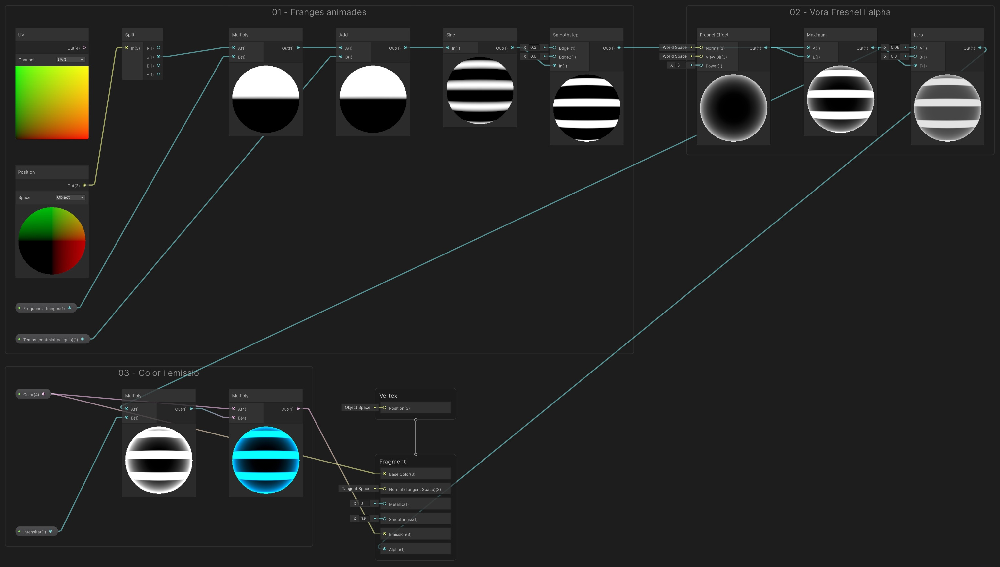
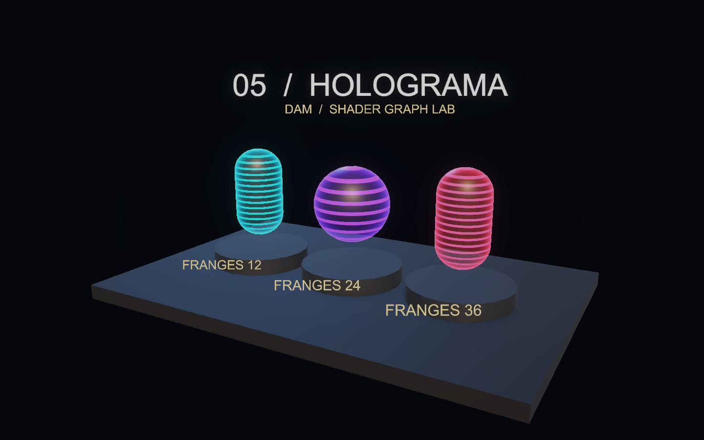
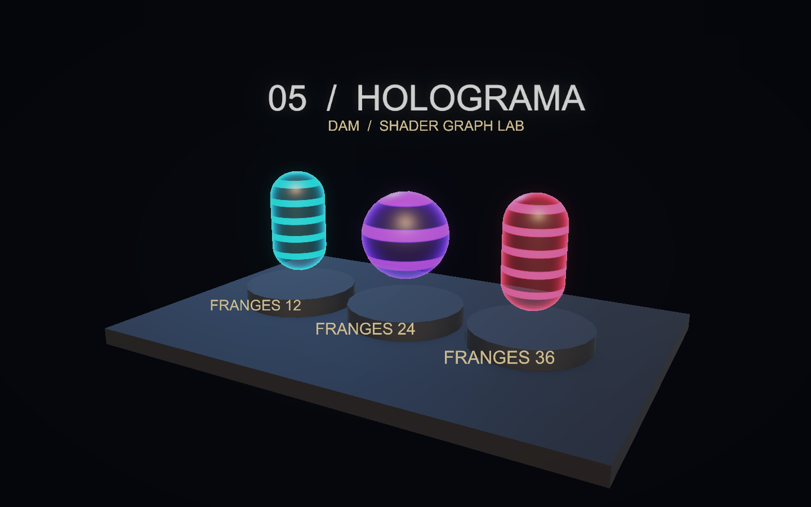

# Demo 5: Holograma: franges i vores lluminoses

Construirem tres figures semitransparents amb franges animades i vores que s’il·luminen segons l’angle de vista. Separarem el patró de franges, Fresnel, emissió i alpha.

**Projecte acabat:** [Demo-5-Holograma.zip](demos/Demo-5-Holograma.zip). Descomprimeix-lo i obre la carpeta amb Assets, Packages i ProjectSettings des de Unity Hub. La primera importació obre automàticament `Assets/Demos/Holograma/Scenes/DemoHolograma.unity`; prem Play. Els materials poden trigar una estona a carregar-se.

<a href="assets/demoholograma-escena.png"></a>

## 1. Partir de Universal 3D

1. Crea un projecte **Universal 3D (URP)**.
2. A **Window > Package Management > Package Manager**, comprova **Universal RP**, **Shader Graph** i **Input System**. Shader Graph arriba com a dependència d’URP.
3. A **Project Settings > Player > Active Input Handling**, selecciona **Input System Package (New)**. Accepta el reinici si Unity el demana.
4. A la finestra **Project**, crea `Assets/Demos/Holograma` (botó dret > **Create > Folder**) amb les carpetes **Shaders**, **Materials**, **Scenes** i **Meshes**. Crea també **Assets/Common** per als scripts.
5. Obre **Assets/Scenes/SampleScene**, que ja inclou **Main Camera**, **Directional Light** i **Global Volume**. Conserva aquests objectes. Amb **File > Save As…**, desa una còpia com a `DemoHolograma` dins de Scenes. Més endavant ajustarem la càmera i la llum existents.

## 2. Crear el Shader Graph

A la finestra Project, fes botó dret a la carpeta Shaders i tria **Create > Shader Graph > URP > Lit Shader Graph**, amb nom **SHolograma**. Obre’l i, a **Graph Inspector > Graph Settings**, fixa:

| Opció | Valor |
|---|---|
| Target | Universal |
| Material | Lit |
| Surface Type | Transparent |
| Alpha Clipping | Desactivat |
| Render Face | Front |
| Cast Shadows | Desactivat |

Per a Transparent, utilitza Blending Mode **Alpha**.

Afegeix al Blackboard aquestes propietats. Activa **Show In Inspector** i escriu les **Reference exactes**, inclòs el guió baix. Els colors s’indiquen com a **RGB (0–255)**, tal com apareixen al selector de Unity; mantén **Alpha = 255** llevat que s’indiqui un altre valor. Els valors Float i Vector continuen en les seves unitats originals.

| Nom | Tipus | Reference | Valor inicial |
|---|---|---|---|
| Color | Color | `_Color` | RGB (4, 179, 255) |
| Frequencia franges | Float | `_Frequencia` | 18 |
| Intensitat | Float | `_Intensitat` | 3 |
| Temps (controlat pel guio) | Float | `_Temps` | 0 |

Arrossega les propietats al gràfic per crear els seus nodes. La propietat no es crea escrivint-ne el nom en un node Float: s’ha de crear al Blackboard.

## 3. Connectar els nodes

Segueix els passos en ordre dins del mateix Shader Graph. Prem **Espai** per crear un node del tipus indicat; arrossega les propietats des del Blackboard. Els identificadors de les taules serveixen per distingir nodes repetits: no cal canviar els noms dels nodes. Si ho necessites, posa una **Sticky Note** al costat del node amb l’identificador.

A cada fila de cables, arrossega des del **port de sortida** del node origen fins al **port d’entrada** del node destí. Reutilitza els nodes dels passos anteriors. `Out` indica la sortida principal; als nodes de propietat pot mostrar el nom de la propietat.

Per organitzar el graf com a la captura, selecciona els nodes de cada pas i tria **Group Selection** al menú del botó dret. Mantén els grups a prop i deixa prou espai per veure els cables.

Per veure el resultat d’un node, fes-hi botó dret i tria **View > Expand Preview**; amb **Collapse Preview** el pots plegar.

Escriu els valors de la taula als camps sense cable. Si el camp és vectorial i només s’indica un valor, repeteix-lo a tots els components. Clica les captures per veure-les a mida completa.

**Graf complet d’Holograma:** segueix els grups numerats fins al **Master Stack**. Les previsualitzacions mostren les franges, el contorn Fresnel, el color i l’alpha. [Obre la imatge a mida completa](assets/demoholograma-graf-complet.png) per llegir els ports i seguir tots els cables.

<a href="assets/demoholograma-graf-complet.png"></a>

### Pas 1. Franges animades

Position Object.y fixa les franges a l’objecte. Temps anima la fase sense moure la geometria.

**Nodes que has de crear i valors que has d’escriure:**

| Identificador de la guia | Tipus a cercar a Unity | Configuració / valors sense cable |
|---|---|---|
| `UV` | UV | Channel = UV0 (apareix a la captura, però no es connecta) |
| `Posicio` | Position | Space: Object |
| `Eixos` | Split | Valors per defecte |
| `Altura` | Multiply | Valors per defecte |
| `Fase` | Add | Valors per defecte |
| `Ona` | Sine | Valors per defecte |
| `Franges` | Smoothstep | Edge1 = 0.3; Edge2 = 0.6 |

**Cables: arrossega de la sortida a l’entrada indicada.**

| Node origen | Port de sortida | Node destí | Port d’entrada |
|---|---|---|---|
| `Posicio` | Out | `Eixos` | In |
| `Eixos` | G | `Altura` | A |
| `Frequencia franges` | Out | `Altura` | B |
| `Altura` | Out | `Fase` | A |
| `Temps (controlat pel guio)` | Out | `Fase` | B |
| `Fase` | Out | `Ona` | In |
| `Ona` | Out | `Franges` | In |

**Comprova el resultat:** Desplega **Sine** i **Smoothstep** (Franges): comprova com les bandes suaus es converteixen en franges delimitades.

### Pas 2. Vora Fresnel i alpha

Maximum combina les franges amb Fresnel. Lerp conserva un mínim d’alpha de 0.08.

**Nodes que has de crear i valors que has d’escriure:**

| Identificador de la guia | Tipus a cercar a Unity | Configuració / valors sense cable |
|---|---|---|
| `Vores` | Fresnel Effect | Power = 3 |
| `Mascara` | Maximum | Valors per defecte |
| `Transparencia` | Lerp | A = 0.08; B = 0.8 |

**Cables: arrossega de la sortida a l’entrada indicada.**

| Node origen | Port de sortida | Node destí | Port d’entrada |
|---|---|---|---|
| `Franges` | Out | `Mascara` | A |
| `Vores` | Out | `Mascara` | B |
| `Mascara` | Out | `Transparencia` | T |

**Comprova el resultat:** Desplega **Fresnel Effect** i **Maximum** (Mascara): en una previsualització esfèrica, el Fresnel il·lumina el contorn i Maximum hi afegeix les franges.

### Pas 3. Color i emissió

Multiplica el color per la màscara i Intensitat per alimentar Emission.

**Nodes que has de crear i valors que has d’escriure:**

| Identificador de la guia | Tipus a cercar a Unity | Configuració / valors sense cable |
|---|---|---|
| `IntensitatFinal` | Multiply | Valors per defecte |
| `Emissio` | Multiply | Valors per defecte |

**Cables: arrossega de la sortida a l’entrada indicada.**

| Node origen | Port de sortida | Node destí | Port d’entrada |
|---|---|---|---|
| `Mascara` | Out | `IntensitatFinal` | A |
| `Intensitat` | Out | `IntensitatFinal` | B |
| `Color` | Out | `Emissio` | A |
| `IntensitatFinal` | Out | `Emissio` | B |

**Comprova el resultat:** Desplega **Multiply** (Emissio): ha de mostrar el color de l’holograma modulat per la màscara.

### Pas 4. Master Stack i connexions finals

Connecta les sortides als blocs del Master Stack indicats a la taula de cables. Els blocs sense cable (Normal (Tangent Space), Metallic, Smoothness) conserven el valor per defecte.

**Cables: arrossega de la sortida a l’entrada indicada.**

| Node origen | Port de sortida | Node destí | Port d’entrada |
|---|---|---|---|
| `Color` | Out | `Fragment / Base Color` | Base Color |
| `Emissio` | Out | `Fragment / Emission` | Emission |
| `Transparencia` | Out | `Fragment / Alpha` | Alpha |

Els números de les entrades són valors literals. En un vector, repeteix el valor a tots els components quan s’indica un únic nombre. A Split, R/G/B equivalen a X/Y/Z. Desa el graf abans de crear els materials.

**Comprova el resultat:** Desa el graf. Comprova la transparència sobre la mostra i la resplendor amb el Bloom de l’escena.

## 4. Crear els materials

1. A la finestra Project, fes botó dret a la carpeta **Materials** i tria **Create > Material**. Anomena’l **MHolograma0**.
2. A l’Inspector, selecciona **Shader > DAM Shaders > SHolograma** (o arrossega SHolograma del Project sobre el material).
3. Repeteix-ho per crear **MHolograma1** i **MHolograma2**.
4. Configura cada material segons la taula. Intensitat es manté a **3**.

| Material | Frequencia franges | Color |
|---|---|---|
| MHolograma0 | 12 | RGB (5, 204, 255) |
| MHolograma1 | 24 | RGB (102, 38, 255) |
| MHolograma2 | 36 | RGB (255, 46, 89) |

Assignaràs MHolograma0, MHolograma1 i MHolograma2 a Holograma0, Holograma1 i Holograma2, respectivament, a l’apartat 5.

## 5. Construir l’escena

Crea cada objecte amb el menú **+** de la Hierarchy (**3D Object > Cube**, **Capsule**, **Sphere** o **Cylinder**). Les posicions són globals i les escales corresponen a les primitives de Unity. Mantén els objectes a l’arrel, sense un pare escalat. Els textos decoratius es poden ometre: no intervenen en el shader.

| Objecte | Primitiva | Posicio | Escala |
|---|---|---|---|
| Base | Cube | (0, -0.22, 0) | (12, 0.4, 8) |
| Holograma0 | Capsule | (-3.2, 2.15, 0) | (1.4, 1.3, 1.4) |
| Peanya0 | Cylinder | (-3.2, 0.24, 0) | (2.85, 0.23, 2.85) |
| Holograma1 | Sphere | (0, 2.15, 0) | (2.1, 2.1, 2.1) |
| Peanya1 | Cylinder | (0, 0.24, 0) | (2.85, 0.23, 2.85) |
| Holograma2 | Capsule | (3.2, 2.15, 0) | (1.4, 1.3, 1.4) |
| Peanya2 | Cylinder | (3.2, 0.24, 0) | (2.85, 0.23, 2.85) |

Arrossega MHolograma0, MHolograma1 i MHolograma2 del Project sobre Holograma0, Holograma1 i Holograma2, respectivament.

### Càmera i llums

Posa Main Camera a **(8,6,−14)**, amb projecció **Perspective**, Field of View **40**, Near **0.1**, Far **100** i fons de color sòlid **RGB (5,7,13)**. Orienta-la cap al punt **(0,1.7,0)**. La rotació Euler corresponent és aproximadament **(14.932, -29.745, 0)**.

Selecciona la **Directional Light** existent, canvia-li el nom a **Key Light** i ajusta-la: rotació (45,−30,0), intensitat 2 i color RGB (255,224,189); afegeix una segona llum amb **+ > Light > Directional Light** a la Hierarchy, anomena-la **Fill Light** i configura-la: rotació (25,140,0), intensitat 1 i color RGB (89,171,255). A **Window > Rendering > Lighting**, pestanya **Environment**, posa **Environment Lighting > Source = Color** i **Ambient Color** (82,97,122). Crea els materials **Base** i **Pedestal** amb **Create > Material** i shader **Universal Render Pipeline > Lit**: Base, gris blavós RGB (14,18,24); Pedestal, RGB (26,36,48); tots dos amb Smoothness 0.25. Assigna Base a l’objecte Base i Pedestal a les tres peanyes.

Activa **HDR** i **Post Processing** a la càmera existent. Selecciona el **Global Volume** existent; duplica el seu perfil a la carpeta de la demo (al ZIP es diu **Bloom**) i assigna-hi la còpia. Conserva només **Bloom** al perfil de la demo (elimina els altres overrides per reproduir aquesta il·luminació) i activa els seus overrides: Intensity **0.35**, Threshold **1**, Scatter **0.6**.

## 6. Afegir els controls

### Càmera orbital i zoom

A la finestra Project, fes botó dret a **Assets/Common** i tria **Create > Scripting > MonoBehaviour Script**. Anomena’l **DemoOrbitCamera**, obre’l i substitueix-ne tot el contingut pel de [DemoOrbitCamera.cs](demos/DemoOrbitCamera.cs). Afegeix el component **Demo Orbit Camera** a **Main Camera**. Al ZIP ja està configurat.

- **Center = (0, 1.7, 0)**: punt fix al voltant del qual gira la càmera.
- **Minimum Distance = 3**, **Maximum Distance = 35**.
- **Rotation Sensitivity = 0.2**, **Zoom Sensitivity = 0.0015**.
- **Minimum Elevation = 5**, **Maximum Elevation = 85**: límits d’inclinació en graus.

En **Play**, clica **Game**. Mantén premut el **botó dret** i arrossega per girar; utilitza la **roda del ratolí** per apropar-te o allunyar-te. **Home** recupera la posició i orientació inicials. El centre no es desplaça i no cal afegir-hi cap objecte Target. La roda positiva apropa la càmera; la negativa l’allunya.

El controlador del panell, que trobaràs a continuació, informa la càmera de quan el punter és sobre els controls perquè el lliscador no mogui el punt de vista. La càmera funciona igualment quan el temps del shader està en pausa.

A **Assets/Common**, crea **DemoControls** amb **Create > Scripting > MonoBehaviour Script** i substitueix-ne el contingut per aquest codi complet:

```csharp
using UnityEngine;
using UnityEngine.InputSystem;

// Controls comuns a les demos. Crea còpies dels materials per conservar els originals del projecte.
public class DemoControls : MonoBehaviour
{
    public string title;
    public string description;
    // Arrossega els objectes visibles als quals aquest panell modificarà el material.
    public Renderer[] surfaces;
    // Nom intern (Reference) de la propietat del Shader Graph que controlarà el lliscador.
    public string parameter = "_Gruix";
    public float minimum = 0.02f;
    public float maximum = 0.3f;
    public float initialValue = 0.12f;
    public float timeScale = 1f;
    public bool paused;
    // Temps propi de la demo: es pot pausar sense aturar la càmera ni tota la partida.
    public float elapsed;
    public bool showPanel = true;
    Material[] materials;
    float value;

    // Prepara els materials i la connexió amb la càmera quan es carrega el component.
    void Awake()
    {
        // Reserva una entrada per al material de cada superfície assignada a l'Inspector.
        materials = new Material[surfaces.Length];
        // Accedir a .material crea una còpia per a cada Renderer; així es conserven els materials del
        // projecte.
        for (int i = 0; i < surfaces.Length; i++) materials[i] = surfaces[i].material;
        value = initialValue;
        // Busca el controlador orbital a la càmera amb el tag MainCamera, si n'hi ha.
        var orbit = Camera.main ? Camera.main.GetComponent<DemoOrbitCamera>() : null;
        // Passa una funció a la càmera perquè detecti el punter sobre el panell i no mogui la vista en
        // usar-lo.
        if (orbit) orbit.IsPointerOverControls = point => showPanel && new Rect(16, 16, 380, 180).Contains(point);
    }
    void Update()
    {
        // Comprova que hi hagi teclat abans de llegir les tecles de control.
        if (Keyboard.current != null)
        {
            // Alterna la pausa amb una sola pulsació, sense repetir-la mentre la tecla es manté premuda.
            if (Keyboard.current.spaceKey.wasPressedThisFrame) paused = !paused;
            if (Keyboard.current.hKey.wasPressedThisFrame) showPanel = !showPanel;
            if (Keyboard.current.rKey.wasPressedThisFrame) { elapsed = 0; SetParameter(initialValue); }
        }
        // Avança el rellotge de l'efecte només si no està en pausa; timeScale en regula la velocitat.
        if (!paused) elapsed += Time.deltaTime * timeScale;
        // Envia aquest temps als shaders que tenen la propietat _Temps.
        ApplyTime(elapsed);
    }
    public void ApplyTime(float seconds)
    {
        if (materials == null) return;
        foreach (Material material in materials)
            // Comprova que la propietat existeixi abans d'actualitzar l'animació del material.
            if (material.HasProperty("_Temps")) material.SetFloat("_Temps", seconds);
    }
    public void SetParameter(float next)
    {
        // Limita el valor triat al rang permès per a aquesta demo.
        value = Mathf.Clamp(next, minimum, maximum);
        if (materials == null) return;
        foreach (Material material in materials)
            // Actualitza la propietat indicada pel seu nom intern a cada material compatible.
            if (material.HasProperty(parameter)) material.SetFloat(parameter, value);
    }
    // Unity crida OnGUI per dibuixar i gestionar aquest panell senzill de controls.
    void OnGUI()
    {
        if (!showPanel) return;
        GUI.Box(new Rect(16, 16, 380, 180), "");
        // Delimita en píxels l'àrea on GUILayout col·locarà els textos i el lliscador.
        GUILayout.BeginArea(new Rect(30, 25, 350, 162));
        GUILayout.Label(title);
        GUILayout.Label(description);
        GUILayout.Label(parameter + ": " + value.ToString("0.00"));
        // Dibuixa el lliscador i llegeix el valor que l'usuari hi selecciona.
        float next = GUILayout.HorizontalSlider(value, minimum, maximum);
        // Aplica el paràmetre als materials només quan l'usuari en canvia el valor.
        if (next != value) SetParameter(next);
        GUILayout.Label("Espai: pausa | R: reinicia | H: amaga el panell");
        GUILayout.Label("Boto dret: orbita | Roda: zoom | Home: vista inicial");
        GUILayout.EndArea();
    }
    void OnDestroy()
    {
        if (materials == null) return;
        // Allibera les còpies de materials creades a Awake quan es destrueix el component.
        foreach (Material material in materials) Destroy(material);
    }
}
```

Crea un objecte buit **Controls** i afegeix-hi DemoControls. A **Surfaces**, assigna els Mesh Renderers de Holograma0, Holograma1 i Holograma2, en aquest ordre. No hi afegeixis la base, els textos ni les peanyes.

| Camp | Valor |
|---|---|
| Title | 05 / Holograma |
| Description | Compara les variants i modifica el material. |
| Parameter | `_Frequencia` |
| Minimum | 3 |
| Maximum | 50 |
| Initial Value | 18 |

**Controls:** lliscador per modificar `_Frequencia`; Espai pausa el temps; R reinicia temps i paràmetre; H amaga el panell. En moure el lliscador, el valor s’aplica a totes les mostres. Abans de tocar-lo, cada material conserva les variants de l’apartat 4. Els rètols de l’escena identifiquen aquestes variants inicials; el panell mostra el valor actual del control.

Els canvis durant Play són temporals. Per canviar els valors inicials de manera permanent, atura Play i edita els assets de material.

## 7. Provar la demo

1. Comprova les franges de les tres figures i l’animació vertical.
2. Prem Espai per congelar el temps.
3. Mou el lliscador `_Frequencia`: augmenta o disminueix la densitat de les franges.
4. Gira la càmera amb el botó dret a la vista Game: Fresnel continua destacant les zones vistes de gairell.

<a href="assets/demoholograma-variant.png"></a>

<a href="assets/demoholograma-animacio.png"></a>

## Si alguna cosa no funciona

Si és opac, revisa Surface Type Transparent i la connexió Alpha. Si les franges no avancen, comprova `_Temps` i Surfaces.

Si el material és rosa, comprova URP, la compilació del gràfic i la Console. Si el teclat no respon, comprova Input System, entra a Play i clica Game.
