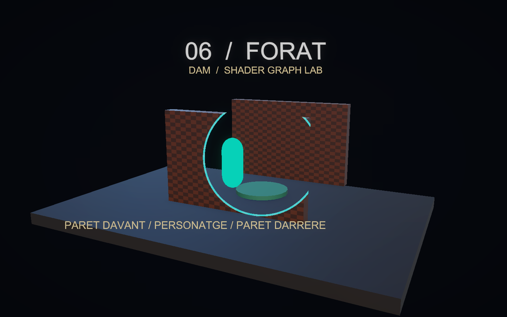
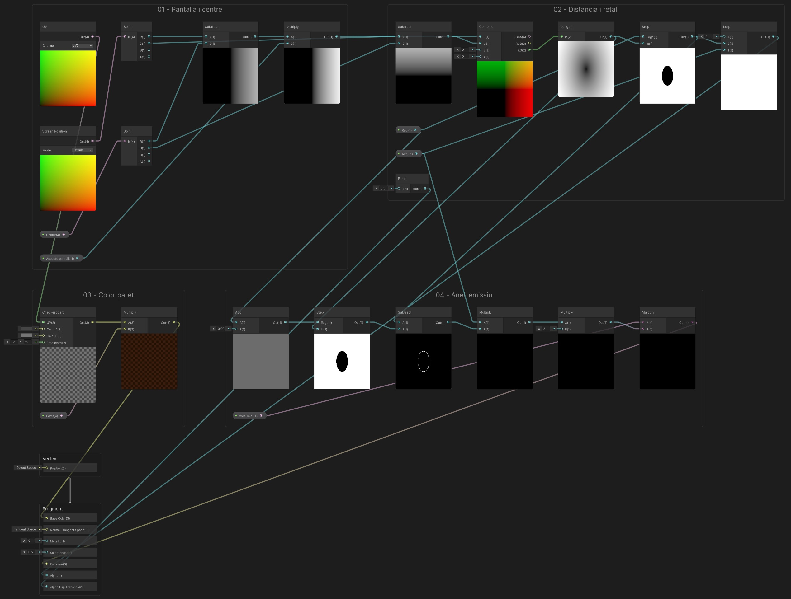
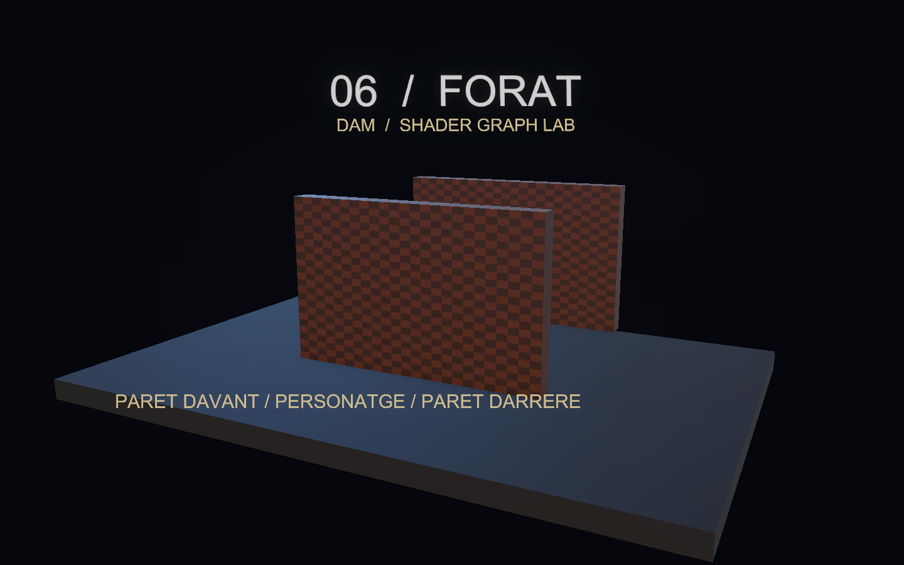
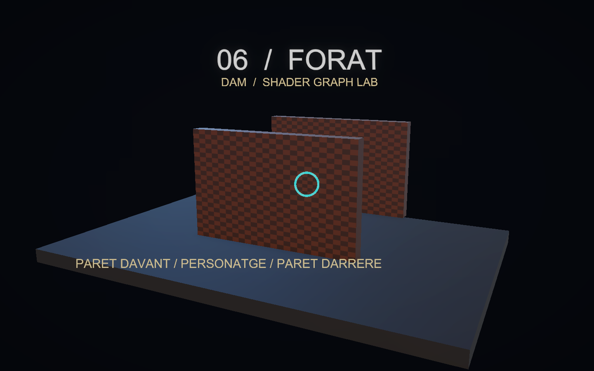
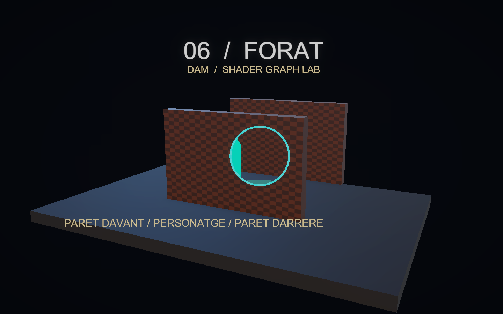

# Demo 6: Forat: veure el personatge darrere d’una paret

Construirem una paret que es retalla al voltant del personatge quan l’oculta. Una segona paret, situada darrere del personatge i amb el mateix material, permet comprovar que només s’activa la paret interposada.

**Projecte acabat:** [Demo-6-Forat.zip](demos/Demo-6-Forat.zip). Descomprimeix-lo i obre la carpeta amb Assets, Packages i ProjectSettings des de Unity Hub. La primera importació obre automàticament `Assets/Demos/Forat/Scenes/DemoForat.unity`; prem Play. Els materials poden trigar una estona a carregar-se.

<a href="assets/demoforat-escena.png"></a>

## 1. Partir de Universal 3D

1. Crea un projecte **Universal 3D (URP)**.
2. A **Window > Package Management > Package Manager**, comprova **Universal RP**, **Shader Graph** i **Input System**. Shader Graph arriba com a dependència d’URP.
3. A **Edit > Project Settings > Player > Other Settings > Active Input Handling**, selecciona **Input System Package (New)**. Accepta el reinici si Unity el demana.
4. A la finestra **Project**, crea `Assets/Demos/Forat` amb les carpetes **Shaders**, **Materials** i **Scenes** (botó dret > **Create > Folder**). Crea també **Assets/Common** per als scripts.
5. Obre **Assets/Scenes/SampleScene**, que ja inclou **Main Camera**, **Directional Light** i **Global Volume**. Conserva aquests objectes. Amb **File > Save As…**, desa una còpia com a `DemoForat` dins de Scenes. Més endavant ajustarem la càmera i la llum existents.

## 2. Crear el Shader Graph

A la finestra Project, fes botó dret a la carpeta **Shaders** i tria **Create > Shader Graph > URP > Lit Shader Graph**, amb nom **SForat**. Fes-hi doble clic per obrir-lo. Al Blackboard, fes doble clic al camí que hi ha sota el nom del gràfic i escriu `DAM Shaders` (així el shader apareixerà a **Shader > DAM Shaders > SForat**). A **Graph Inspector > Graph Settings**, fixa:

| Opció | Valor |
|---|---|
| Target | Universal |
| Material | Lit |
| Surface Type | Opaque |
| Alpha Clipping | Activat (el llindar 0.5 arriba del node `Llindar`, pas 5) |
| Render Face | Front |
| Cast Shadows | Desactivat |

Afegeix al Blackboard aquestes propietats. Activa **Show In Inspector** i escriu les **Reference exactes**, inclòs el guió baix. Els colors s’indiquen com a **RGB (0–255)**, tal com apareixen al selector de Unity; mantén **Alpha = 255** llevat que s’indiqui un altre valor. Els valors Float i Vector continuen en les seves unitats originals.

| Nom | Tipus | Reference | Valor inicial |
|---|---|---|---|
| Actiu | Float | `_Actiu` | 0 |
| Aspecte pantalla | Float | `_Aspecte` | 1.778 |
| Centre | Vector4 | `_Centre` | (0.5, 0.5, 0, 0) |
| Paret | Color | `_Paret` | RGB (140, 71, 31) |
| Radi | Float | `_Radi` | 0.18 |
| VoraColor | Color | `_VoraColor` | RGB (8, 255, 255) |

Arrossega les propietats al gràfic per crear els seus nodes. La propietat no es crea escrivint-ne el nom en un node Float: s’ha de crear al Blackboard.

## 3. Connectar els nodes

Segueix els passos en ordre dins del mateix Shader Graph. Prem **Espai** per crear un node del tipus indicat; arrossega les propietats des del Blackboard. Els identificadors de les taules serveixen per distingir nodes repetits: no cal canviar els noms dels nodes. Si ho necessites, posa una **Sticky Note** al costat del node amb l’identificador.

A cada fila de cables, arrossega des del **port de sortida** del node origen fins al **port d’entrada** del node destí. Reutilitza els nodes dels passos anteriors. `Out` indica la sortida principal; als nodes de propietat pot mostrar el nom de la propietat.

Per organitzar el graf com a la captura, selecciona els nodes de cada pas i tria **Group Selection** al menú del botó dret. Mantén els grups a prop i deixa prou espai per veure els cables.

Per veure el resultat d’un node, fes-hi botó dret i tria **View > Expand Preview**; amb **Collapse Preview** el pots plegar.

Escriu els valors de la taula als camps sense cable. Si el camp és vectorial i només s’indica un valor, repeteix-lo a tots els components. Clica les captures per veure-les a mida completa.

**Graf complet:** segueix els grups numerats fins al **Master Stack**. Les previsualitzacions mostren la distància al centre, el retall, el color de la paret i l’anell. [Obre la imatge a mida completa](assets/demoforat-graf-complet.png) per llegir els ports i seguir tots els cables.

<a href="assets/demoforat-graf-complet.png"></a>

### Pas 1. Pantalla i centre

Resta el centre enviat pel controlador a Screen Position. Multiplica només X per Aspecte.

**Nodes que has de crear i valors que has d’escriure:**

| Identificador de la guia | Tipus a cercar a Unity | Configuració / valors sense cable |
|---|---|---|
| `UV` | UV | Channel = UV0 |
| `Pantalla` | Screen Position | Mode = Default |
| `SP` | Split | Valors per defecte |
| `CP` | Split | Valors per defecte |
| `RestaX` | Subtract | Valors per defecte |
| `DX` | Multiply | Valors per defecte |

**Cables: arrossega de la sortida a l’entrada indicada.**

| Node origen | Port de sortida | Node destí | Port d’entrada |
|---|---|---|---|
| `Pantalla` | Out | `SP` | In |
| `Centre` | Out | `CP` | In |
| `SP` | R | `RestaX` | A |
| `CP` | R | `RestaX` | B |
| `RestaX` | Out | `DX` | A |
| `Aspecte` | Out | `DX` | B |

**Comprova el resultat:** Aquesta branca calcula coordenades de pantalla. El centre del forat el fixarà el controlador de l’escena; no el validis només amb la miniatura del graf.

### Pas 2. Distància i retall

Length dona una distància circular corregida. Actiu decideix si s’aplica el retall.

**Nodes que has de crear i valors que has d’escriure:**

| Identificador de la guia | Tipus a cercar a Unity | Configuració / valors sense cable |
|---|---|---|
| `DY` | Subtract | Valors per defecte |
| `Delta` | Combine | Valors per defecte |
| `Distancia` | Length | Valors per defecte |
| `Fora` | Step | Valors per defecte |
| `AlphaFinal` | Lerp | A = 1 |
| `Llindar` | Float | X = 0.5 |

**Cables: arrossega de la sortida a l’entrada indicada.**

| Node origen | Port de sortida | Node destí | Port d’entrada |
|---|---|---|---|
| `SP` | G | `DY` | A |
| `CP` | G | `DY` | B |
| `DX` | Out | `Delta` | R |
| `DY` | Out | `Delta` | G |
| `Delta` | RG | `Distancia` | In |
| `Radi` | Out | `Fora` | Edge |
| `Distancia` | Out | `Fora` | In |
| `Fora` | Out | `AlphaFinal` | B |
| `Actiu` | Out | `AlphaFinal` | T |

`Llindar` és l’àlies d’aquest node Float constant; al graf del projecte el node es mostra com a **Float**, dins del grup 02. No és una propietat del Blackboard.

**Comprova el resultat:** Desplega **Length** (Distancia) i **Step** (Fora) per inspeccionar la distància i el tall. Comprova la posició definitiva del cercle amb la càmera de l’escena.

### Pas 3. Color paret

Checkerboard aporta textura a la paret i Multiply la tenyeix.

**Nodes que has de crear i valors que has d’escriure:**

| Identificador de la guia | Tipus a cercar a Unity | Configuració / valors sense cable |
|---|---|---|
| `Maons` | Checkerboard | Color A = RGB (77,77,77); Color B = RGB (128,128,128); Frequency = 12 |
| `ColorFinal` | Multiply | Valors per defecte |

**Cables: arrossega de la sortida a l’entrada indicada.**

| Node origen | Port de sortida | Node destí | Port d’entrada |
|---|---|---|---|
| `UV` | Out | `Maons` | UV |
| `Maons` | Out | `ColorFinal` | A |
| `Paret` | Out | `ColorFinal` | B |

**Comprova el resultat:** Desplega **Checkerboard** i **Multiply** (ColorFinal): comprova el patró i el tint de la paret.

### Pas 4. Anell emissiu

La diferència entre dos Step forma un anell estret. Actiu també controla aquesta emissió.

**Nodes que has de crear i valors que has d’escriure:**

| Identificador de la guia | Tipus a cercar a Unity | Configuració / valors sense cable |
|---|---|---|
| `RadiVora` | Add | B = 0.006 |
| `Exterior` | Step | Valors per defecte |
| `Vora` | Subtract | Valors per defecte |
| `Anell` | Multiply | Valors per defecte |
| `IntensitatVora` | Multiply | B = 2 |
| `Emissio` | Multiply | Valors per defecte |

**Cables: arrossega de la sortida a l’entrada indicada.**

| Node origen | Port de sortida | Node destí | Port d’entrada |
|---|---|---|---|
| `Radi` | Out | `RadiVora` | A |
| `RadiVora` | Out | `Exterior` | Edge |
| `Distancia` | Out | `Exterior` | In |
| `Fora` | Out | `Vora` | A |
| `Exterior` | Out | `Vora` | B |
| `Actiu` | Out | `Anell` | A |
| `Vora` | Out | `Anell` | B |
| `Anell` | Out | `IntensitatVora` | A |
| `VoraColor` | Out | `Emissio` | A |
| `IntensitatVora` | Out | `Emissio` | B |

**Comprova el resultat:** Desplega **Subtract** (Vora): amb el forat actiu, la màscara ha de delimitar un anell estret. Comprova’n la posició a l’escena.

### Pas 5. Master Stack i connexions finals

Connecta les sortides als blocs del Master Stack indicats a la taula de cables. Els blocs sense cable (Position, Normal (Tangent Space), Metallic = 0, Smoothness = 0.5) conserven el valor per defecte.

**Cables: arrossega de la sortida a l’entrada indicada.**

| Node origen | Port de sortida | Node destí | Port d’entrada |
|---|---|---|---|
| `AlphaFinal` | Out | `Fragment / Alpha` | Alpha |
| `Llindar` | Out | `Fragment / Alpha Clip Threshold` | Alpha Clip Threshold |
| `ColorFinal` | Out | `Fragment / Base Color` | Base Color |
| `Emissio` | Out | `Fragment / Emission` | Emission |

Els números de les entrades són valors literals. En un vector, repeteix el valor a tots els components quan s’indica un únic nombre. A Combine, tria RG per a Vector2; a Split, R/G/B equivalen a X/Y/Z. Desa el graf abans de crear els materials.

**Comprova el resultat:** Desa el graf. Amb l’escena i els controls muntats, comprova el retall de la paret i l’anell emissiu.

## 4. Crear els materials

1. A la finestra Project, fes botó dret a la carpeta **Materials** i tria **Create > Material**. Anomena’l `MParet`.
2. A l’Inspector, selecciona **Shader > DAM Shaders > SForat** (o arrossega SForat del Project sobre el material). Aquest únic material s’assignarà a les dues parets.
3. Crea un altre material, `Jugador`, amb **Shader > Universal Render Pipeline > Unlit** i Base Map RGB (5,255,204). És el material del personatge: no hi assignis el shader SForat.

## 5. Construir l’escena

Crea cada objecte amb el botó **+** de la Hierarchy > **3D Object** > primitiva indicada. Les posicions són globals i les escales corresponen a les primitives de Unity. Mantén els objectes a l’arrel, sense un pare escalat. Els elements decoratius i textos es poden ometre: no intervenen en el shader.

| Objecte | Primitiva | Posició | Escala |
|---|---|---|---|
| Base | Cube | (0, -0.22, 0) | (12, 0.4, 8) |
| Personatge | Capsule | (0, 1.05, 1.5) | (0.85, 1, 0.85) |
| ParetDavant | Cube | (0, 1.65, -0.7) | (5.2, 3.3, 0.4) |
| ParetDarrera | Cube | (0, 1.65, 4) | (5.2, 3.3, 0.4) |
| Destinacio | Cylinder | (0, 0.1, 1.5) | (2, 0.08, 2) |

### Càmera i llums

Posa Main Camera a **(7,5,−13)**, amb projecció **Perspective**, Field of View **40**, Near **0.1**, Far **100** i fons de color sòlid **RGB (5,7,13)**. Orienta-la cap al punt **(0,1.5,0.8)**. La rotació Euler corresponent és aproximadament **(12.745, -26.896, 0)**.

Selecciona la **Directional Light** existent, canvia-li el nom a **Key Light** i ajusta-la: rotació (45,−30,0), intensitat 2 i color RGB (255,224,189); afegeix una segona llum amb **GameObject > Light > Directional Light**, anomena-la **Fill Light** i configura-la: rotació (25,140,0), intensitat 1 i color RGB (89,171,255). A **Window > Rendering > Lighting > Environment**, posa **Environment Lighting > Source = Color** i **Ambient Color** (82,97,122). Crea a Materials el material `Base` (**Create > Material**, shader **Universal Render Pipeline > Lit**, RGB (14,18,24), Smoothness 0.25) i assigna’l a **Base**. Crea un altre material Lit, `Marca`, per a **Destinacio**: RGB (26,115,102), Smoothness 0.25.

Activa **HDR** i **Post Processing** a la càmera existent. Selecciona el **Global Volume** existent. A la finestra Project, selecciona el perfil que fa servir (a **Assets/Settings**), duplica’l amb **Edit > Duplicate**, mou la còpia a `Assets/Demos/Forat`, anomena-la `Bloom` i assigna-la al camp **Profile** del Global Volume. Conserva només **Bloom** al perfil de la demo (elimina els altres overrides per reproduir aquesta il·luminació) i activa els seus overrides: Intensity **0.35**, Threshold **1**, Scatter **0.6**.

## 6. Afegir els controls

### Càmera orbital i zoom

A la finestra Project, fes botó dret a **Assets/Common** i tria **Create > Scripting > MonoBehaviour Script**, amb nom `DemoOrbitCamera`. Obre’l i substitueix-ne tot el contingut pel de [DemoOrbitCamera.cs](demos/DemoOrbitCamera.cs). Afegeix el component **Demo Orbit Camera** a **Main Camera**. Al ZIP ja està configurat.

- **Center = (0, 1.5, 0.8)**: punt fix al voltant del qual gira la càmera.
- **Minimum Distance = 3**, **Maximum Distance = 35**.
- **Rotation Sensitivity = 0.2**, **Zoom Sensitivity = 0.0015**.
- **Minimum Elevation = 5**, **Maximum Elevation = 85**: límits d’inclinació en graus.

En **Play**, clica **Game**. Mantén premut el **botó dret** i arrossega per girar; utilitza la **roda del ratolí** per apropar-te o allunyar-te. **Home** recupera la posició i orientació inicials. El centre no es desplaça i no cal afegir-hi cap objecte Target. La roda positiva apropa la càmera; la negativa l’allunya.

El controlador del panell, que trobaràs a continuació, informa la càmera de quan el punter és sobre els controls perquè el lliscador no mogui el punt de vista. La càmera funciona igualment quan el temps del shader està en pausa.

La càmera té ordre d’execució **−100** i es mou abans del `LateUpdate` de ForatController. Així, el retall utilitza la posició nova de la càmera en el mateix fotograma.

A **Assets/Common**, crea un altre script amb **Create > Scripting > MonoBehaviour Script**, anomena’l `ForatController` i substitueix-ne el contingut per aquest codi complet:

```csharp
using UnityEngine;
using UnityEngine.InputSystem;
using System.Collections.Generic;

// El codi decideix quina paret oculta el jugador; el shader calcula el cercle.
public class ForatController : MonoBehaviour
{
    public Camera viewCamera;
    public Transform player;
    public Renderer[] walls;
    // Filtra les deteccions a la capa 8; 1 << 8 activa el bit d'aquesta capa.
    public LayerMask wallMask = 1 << 8;
    public float radius = 0.18f;
    [Min(0)] public float transitionDuration = 0.35f;
    public bool effectEnabled = true;
    public bool autoMove = true;
    public bool showPanel = true;
    public int activeWalls;
    MaterialPropertyBlock block;
    float elapsed;
    // Cada paret conserva el seu progrés i l'últim centre per poder tancar-se sense saltar.
    class HoleState { public float progress; public Vector4 center; }
    readonly Dictionary<Renderer, HoleState> holeStates = new Dictionary<Renderer, HoleState>();

    void Awake()
    {
        // Prepara propietats particulars per a cada paret sense crear còpies del material compartit.
        block = new MaterialPropertyBlock();
        var orbit = viewCamera ? viewCamera.GetComponent<DemoOrbitCamera>() : null;
        // Indica a la càmera si el punter és sobre el panell per evitar moure-la en usar els controls.
        if (orbit) orbit.IsPointerOverControls = point => showPanel && new Rect(16, 16, 450, 140).Contains(point);
    }
    void Update()
    {
        elapsed += Time.deltaTime;
        var keyboard = Keyboard.current;
        if (keyboard != null)
        {
            if (keyboard.fKey.wasPressedThisFrame) effectEnabled = !effectEnabled;
            if (keyboard.spaceKey.wasPressedThisFrame) autoMove = !autoMove;
            if (keyboard.hKey.wasPressedThisFrame) showPanel = !showPanel;
            // Converteix A i D en un valor de moviment: -1 a l'esquerra, 1 a la dreta i 0 si es
            // compensen.
            float input = (keyboard.dKey.isPressed ? 1 : 0) - (keyboard.aKey.isPressed ? 1 : 0);
            if (input != 0)
            {
                // Quan el jugador prem A o D, passa a controlar manualment el moviment.
                autoMove = false;
                Vector3 p = player.position;
                // Mou el personatge horitzontalment sense sortir dels límits de la demo.
                p.x = Mathf.Clamp(p.x + input * Time.deltaTime * 2, -3.4f, 3.4f);
                player.position = p;
            }
            if (keyboard.rKey.wasPressedThisFrame) { elapsed = 0; autoMove = true; effectEnabled = true; }
        }
        // El sinus crea un moviment automàtic d'anada i tornada entre els dos extrems.
        if (autoMove) player.position = new Vector3(Mathf.Sin(elapsed * 0.6f) * 3.4f, player.position.y, player.position.z);
    }
    // Recalcula les parets afectades després dels moviments fets a Update.
    void LateUpdate() { RefreshMask(Time.unscaledDeltaTime); }
    // Recalcula la detecció sense avançar l'animació; útil després de moure la càmera.
    public void RefreshMask() { RefreshMask(0); }
    // deltaTime permet avançar la transició de manera explícita en les comprovacions.
    public void RefreshMask(float deltaTime)
    {
        if (block == null) block = new MaterialPropertyBlock();
        // Situa el centre del forat una mica per sobre del pivot del personatge.
        Vector3 target = player.position + Vector3.up * 0.35f;
        // Converteix la posició 3D a coordenades de la vista: X i Y van de 0 a 1 dins de la imatge.
        Vector3 viewport = viewCamera.WorldToViewportPoint(target);
        Vector3 segment = target - viewCamera.transform.position;
        // Actualitza la informació física dels colliders amb els canvis de posició.
        Physics.SyncTransforms();
        // Busca tots els colliders de les capes indicades entre la càmera i el personatge.
        RaycastHit[] hits = Physics.RaycastAll(viewCamera.transform.position, segment.normalized,
            segment.magnitude, wallMask, QueryTriggerInteraction.Ignore);
        activeWalls = 0;
        foreach (Renderer wall in walls)
        {
            if (!wall) continue;
            if (!holeStates.TryGetValue(wall, out HoleState state))
            {
                state = new HoleState(); holeStates.Add(wall, state);
            }
            bool blocked = false;
            // Només obre forats si l'efecte està activat i el personatge queda davant de la càmera.
            if (effectEnabled && viewport.z > 0)
                foreach (RaycastHit hit in hits)
                    // Relaciona cada impacte amb una paret de la llista; el Renderer i el collider són
                    // al mateix objecte.
                    if (hit.collider.GetComponent<Renderer>() == wall) { blocked = true; break; }
            if (blocked) activeWalls++;
            // Conserva l'últim centre durant el tancament. Una nova oclusió pot invertir la transició.
            if (blocked) state.center = new Vector4(viewport.x, viewport.y, 0, 0);
            float destination = blocked ? 1 : 0;
            state.progress = transitionDuration <= 0 ? destination : Mathf.MoveTowards(
                state.progress, destination, Mathf.Max(0, deltaTime) / transitionDuration);
            // SmoothStep suavitza l'inici i el final; el radi creix de zero al valor del lliscador.
            float animatedRadius = Mathf.Max(0, radius) * Mathf.SmoothStep(0, 1, state.progress);
            // Recupera les propietats de la paret abans de modificar les del forat.
            wall.GetPropertyBlock(block);
            // Envia al shader el centre del cercle en coordenades de pantalla normalitzades.
            block.SetVector("_Centre", state.center);
            // Envia la proporció amplada/altura perquè el shader pugui mantenir el cercle rodó.
            block.SetFloat("_Aspecte", viewCamera.aspect);
            block.SetFloat("_Radi", animatedRadius);
            // Manté el retall fins que el cercle s’ha tancat del tot.
            block.SetFloat("_Actiu", state.progress > 0 ? 1 : 0);
            // Aplica els valors a aquesta paret perquè el shader dibuixi el forat.
            wall.SetPropertyBlock(block);
        }
    }
    // En desactivar el component, tanca els forats que haguessin quedat oberts.
    void OnDisable()
    {
        if (walls == null) return;
        if (block == null) block = new MaterialPropertyBlock();
        foreach (Renderer wall in walls)
        {
            if (!wall) continue;
            wall.GetPropertyBlock(block); block.SetFloat("_Actiu", 0); block.SetFloat("_Radi", 0); wall.SetPropertyBlock(block);
        }
        holeStates.Clear();
    }
    // Unity crida OnGUI per dibuixar i gestionar aquest panell senzill de controls.
    void OnGUI()
    {
        if (!showPanel) return;
        GUI.Box(new Rect(16, 16, 450, 140), "");
        GUILayout.BeginArea(new Rect(30, 25, 420, 124));
        GUILayout.Label("06 / FORAT — Parets actives: " + activeWalls);
        GUILayout.Label("A / D: moure | F: efecte | Espai: automatic | R: reinicia");
        GUILayout.Label("Radi: " + radius.ToString("0.00") + " | H: amaga panell");
        // Permet canviar la mida del forat; RefreshMask enviarà el nou radi al shader.
        radius = GUILayout.HorizontalSlider(radius, 0.06f, 0.3f);
        GUILayout.Label("Boto dret: orbita | Roda: zoom | Home: vista inicial");
        GUILayout.EndArea();
    }
}
```

Crea un objecte buit amb el botó **+** de la Hierarchy > **Create Empty**, anomena’l **ControlForat** i afegeix-hi el component **Forat Controller**. Configura:

| Camp | Assignació |
|---|---|
| View Camera | Main Camera |
| Player | Personatge (Transform) |
| Walls, Size 2 | ParetDavant i ParetDarrera (Renderer) |
| Wall Mask | Només la capa **8: DioramaWalls** |
| Radius | 0.18 |
| Transition Duration | 0.35 segons |
| Effect Enabled / Auto Move | Activats |

Crea **DioramaWalls a l’índex 8** a **Edit > Project Settings > Tags and Layers** (User Layer 8) i assigna aquesta capa a les dues parets. Mantén els Box Collider de les parets amb Is Trigger desactivat. El personatge queda a Default. La consulta és un segment central; no comprova tota la silueta ni fa que el personatge travessi físicament la paret.

El forat creix de radi zero fins a **Radius** en **Transition Duration** segons, i es tanca amb el recorregut invers. **F** o la sortida del personatge de darrere la paret inicien el tancament; si torna a quedar ocult abans d’acabar, el cercle inverteix el moviment des de la mida actual. Durant el tancament es conserva l’últim centre. Posa Transition Duration = **0** per recuperar el canvi instantani. El comptador indica les parets que tapen el personatge, encara que un cercle estigui acabant de tancar-se.

**Controls:** A/D mouen lateralment i aturen el moviment automàtic; Espai alterna automàtic/manual; F activa l’efecte; R reinicia; H amaga el panell. El lliscador modifica el radi.

## 7. Provar la demo

1. Amb el personatge centrat, el comptador ha de mostrar una paret activa i s’ha de veure el personatge pel retall.
2. Prem F: el forat disminueix fins a desaparèixer en 0.35 segons i la paret torna a ocultar el personatge. Prem F de nou: el cercle creix fins al radi del lliscador.
3. Prem A o D fins a sortir del darrere de la paret: el comptador torna a zero.
4. Comprova que la paret posterior continua sencera, tot i compartir material.
5. Varia el radi; el forat ha de mantenir la forma circular en diferents proporcions de Game View.
6. Alterna F abans d’acabar una transició: el radi ha de canviar de sentit sense saltar.
7. Desactiva ForatController: restaura la paret immediatament per no deixar propietats de retall sense un controlador actiu.

<a href="assets/demoforat-sense.png"></a>

### Transició del radi

Durant l’obertura, el radi passa de zero al valor del lliscador; durant el tancament, recorre el camí invers. Aquestes captures mostren un instant d’obertura i un instant de tancament:

<a href="assets/demoforat-obertura.png"></a>

<a href="assets/demoforat-tancament.png"></a>

## Si alguna cosa no funciona

Si no s’activa, comprova la capa 8 dels colliders, Wall Mask, Player i View Camera. Si es retallen les dues parets, revisa que el codi utilitzi MaterialPropertyBlock. Si apareix una el·lipse, comprova `_Aspecte` i la multiplicació de Delta.x.

Si el material és rosa, comprova URP, la compilació del gràfic i la Console. Si el teclat no respon, comprova Input System, entra a Play i clica Game.
