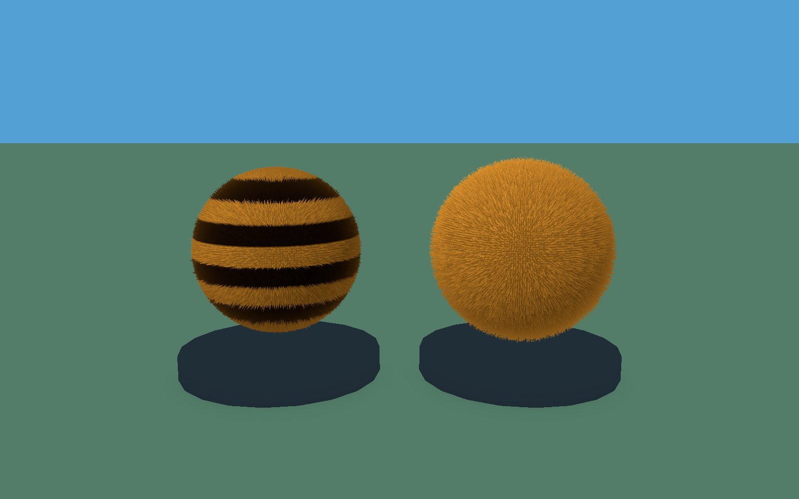
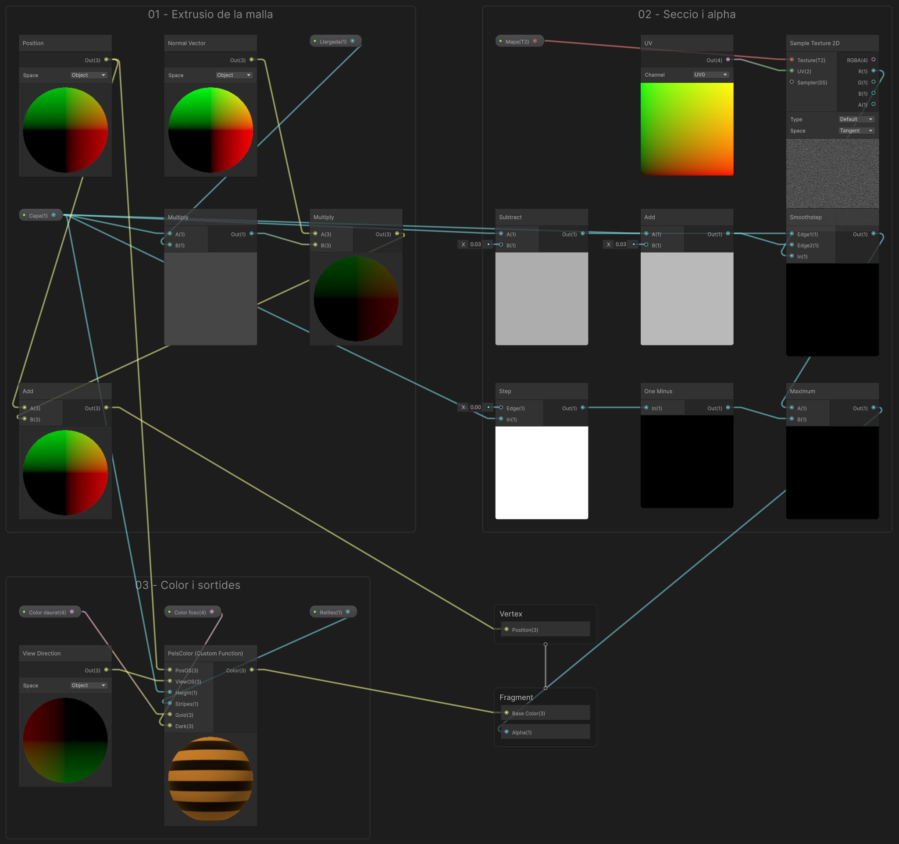
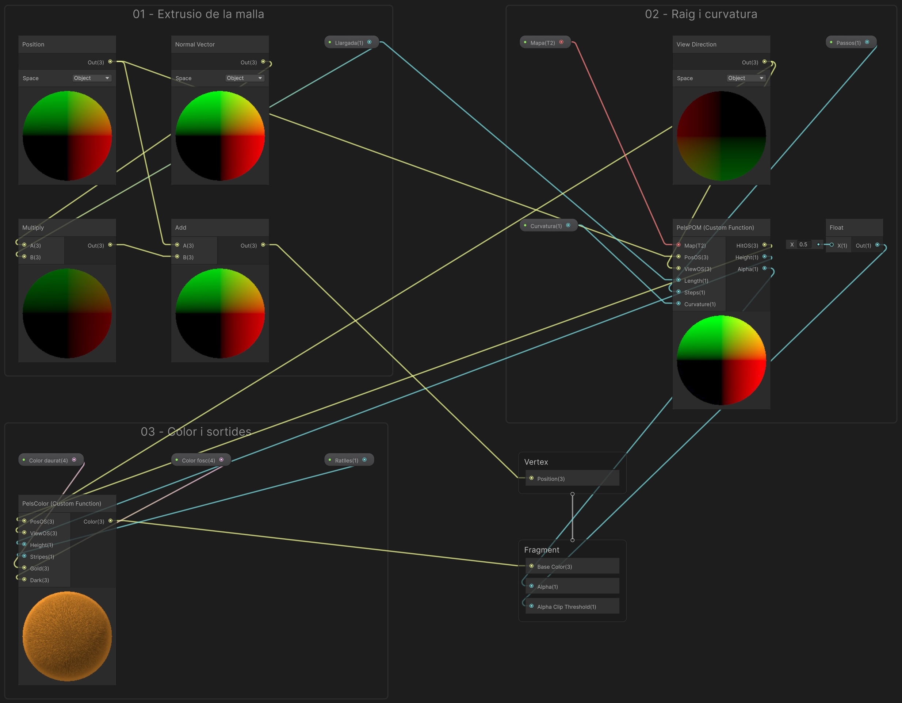
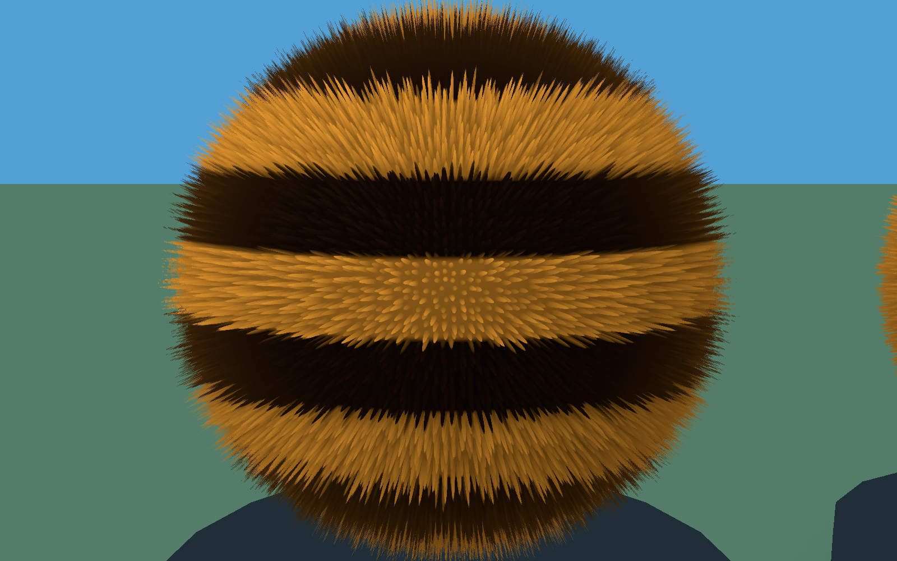
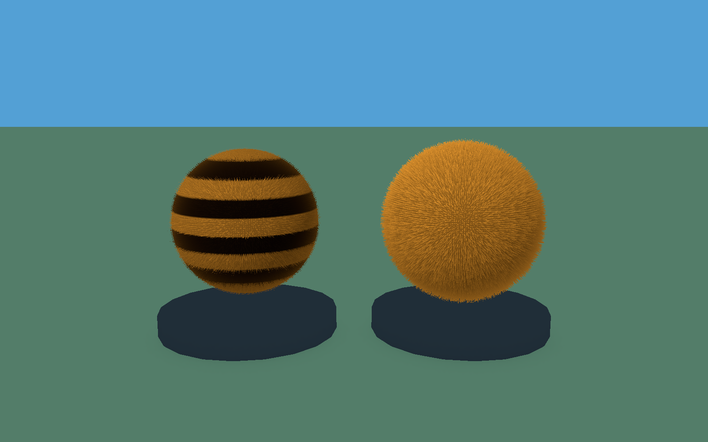
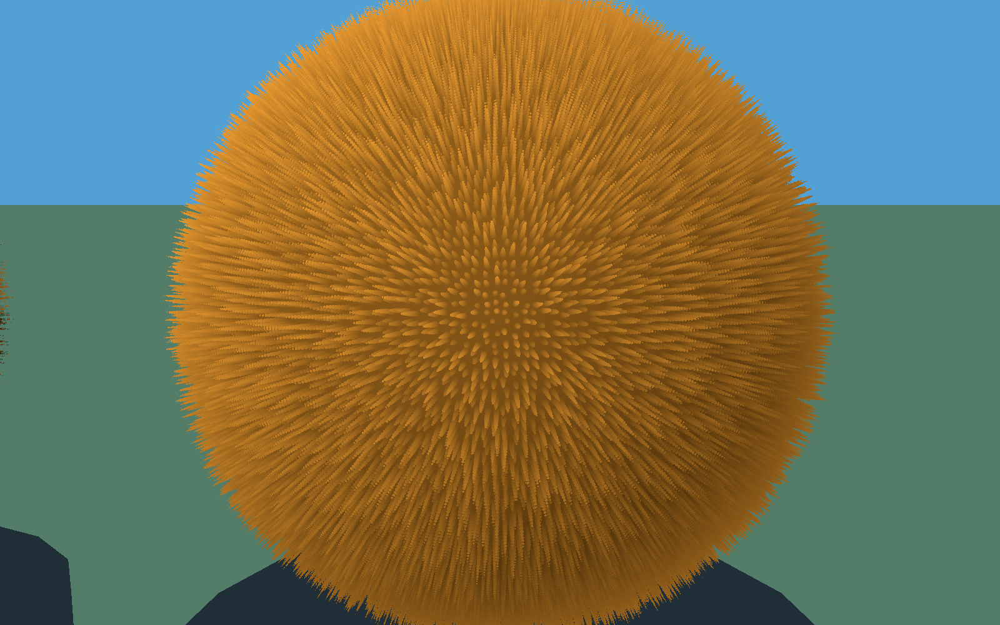
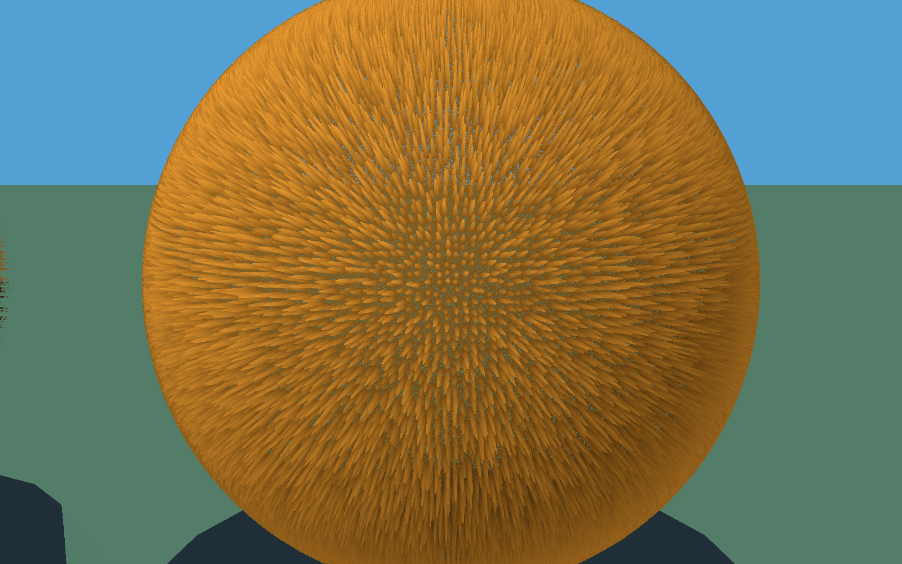

# Demo 8: Pèls — shells i POM amb curvatura

**Vídeo de referència:** [Com es simula el pèl als videojocs](https://www.youtube.com/watch?v=SSoedKq6wt0). Les shells s’expliquen a partir de **00:27** i el POM amb curvatura a partir de **04:34**, especialment **06:09–06:29**.

Construirem una escena amb dues esferes peludes: a l’esquerra, capes semitransparents amb ratlles inspirades en l’abella; a la dreta, pèl daurat amb Parallax Occlusion Mapping i retall de silueta.

**Projecte acabat:** [Demo-8-Pels.zip](demos/Demo-8-Pels.zip). Descomprimeix-lo, afegeix la carpeta amb Assets, Packages i ProjectSettings a Unity Hub i obre-la amb **Unity**. L’escena és `Assets/Demos/Pels/Scenes/DemoPels.unity`.

La guia inclou el codi complet: pots començar amb un projecte buit de la plantilla indicada, sense importar el ZIP. Els grafs són editables. El POM utilitza una **Custom Function HLSL**, amb els ports i connexions detallats més avall.

<a href="assets/demopels-escena.png"></a>

## 1. Crear el projecte des de zero

1. Crea un projecte **Universal 3D (URP)** anomenat **Demo-8-Pels**. No triïs Built-in ni HDRP.
2. A **Window > Package Management > Package Manager**, comprova **Universal RP**, **Shader Graph** i **Input System**. Espera que acabin la importació i la compilació.
3. A **Edit > Project Settings > Player > Other Settings > Active Input Handling**, selecciona **Input System Package (New)**. Accepta el reinici si es demana. A **Player > Resolution and Presentation**, activa **Run In Background**.
4. A **Project Settings > Graphics**, conserva l’URP Asset de la plantilla. A **Quality**, el nivell actiu ha d’utilitzar **PC_RPAsset**, dins d’Assets/Settings.
5. Crea **Assets/Demos/Pels**, amb les carpetes **Shaders**, **Materials**, **Textures**, **Meshes**, **Scripts** i **Scenes**. Crea també **Assets/Common**.
6. Obre **Assets/Scenes/SampleScene.unity**. Conserva **Main Camera**, **Directional Light** i **Global Volume**. Amb **File > Save As…**, desa l’escena com a **Assets/Demos/Pels/Scenes/DemoPels.unity**.
7. Desactiva **Global Volume** amb la casella al costat del nom a l’Inspector. La demo no necessita postprocessament, Scene Depth ni Opaque Texture.

## 2. Preparar les dimensions de les esferes

Les dues esferes comparteixen el mateix mapa. La base té **radi 1**, la llargada màxima és **0.16 unitats locals** i l’envolupant exterior arriba a **radi 1.16**. No utilitzarem directament la Sphere de Unity, que té radi 0.5: generarem una malla de radi 1 amb UV coherents amb la funció POM.

La curvatura d’aquesta demo és **esfèrica**, coneguda a partir de la posició en espai Object. Amb Curvatura = 1 el raig travessa un camp d’altures radial; amb Curvatura = 0 comparem amb una aproximació plana local, per veure el problema del contorn. El control és binari: utilitza **0 o 1**, no valors intermedis.

## 3. Generar la malla i el mapa de pèl fi

Crea **Assets/Demos/Pels/Scripts/GenerarRecursosPels.cs**, substitueix-ne tot el contingut pel codi següent i desa’l. La directiva `UNITY_EDITOR` impedeix que les dependències de l’editor entrin en una compilació del joc.

```csharp
#if UNITY_EDITOR
using System.IO;
using UnityEngine;
using UnityEditor;

public static class GenerarRecursosPels
{
    public const string Root = "Assets/Demos/Pels";
    [MenuItem("Demos/Pels/1 - Generar malla i mapa")]
    public static void Generate()
    {
        Directory.CreateDirectory(Root + "/Meshes");
        Directory.CreateDirectory(Root + "/Textures");
        const int columns = 128, rows = 64;
        var vertices = new Vector3[(columns + 1) * (rows + 1)];
        var normals = new Vector3[vertices.Length];
        var uv = new Vector2[vertices.Length];
        var triangles = new int[columns * rows * 6];
        for (int y = 0; y <= rows; y++) for (int x = 0; x <= columns; x++)
        {
            float u = x / (float)columns, v = y / (float)rows;
            float lon = (u - .5f) * Mathf.PI * 2, lat = (v - .5f) * Mathf.PI;
            int i = y * (columns + 1) + x;
            vertices[i] = normals[i] = new Vector3(Mathf.Cos(lat) * Mathf.Cos(lon), Mathf.Sin(lat), Mathf.Cos(lat) * Mathf.Sin(lon));
            uv[i] = new Vector2(u, v);
        }
        int k = 0;
        for (int y = 0; y < rows; y++) for (int x = 0; x < columns; x++)
        {
            int a = y * (columns + 1) + x, b = a + columns + 1;
            triangles[k++] = a; triangles[k++] = b; triangles[k++] = a + 1;
            triangles[k++] = a + 1; triangles[k++] = b; triangles[k++] = b + 1;
        }
        var mesh = new Mesh { name = "EsferaRadi1", vertices = vertices, normals = normals, uv = uv, triangles = triangles };
        mesh.RecalculateTangents();
        // La GPU extrudeix fins a 0.25: amplia el culling, sense alterar els vertexs.
        mesh.bounds = new Bounds(Vector3.zero, Vector3.one * 2.6f);
        string meshPath = Root + "/Meshes/EsferaRadi1.asset";
        var existing = AssetDatabase.LoadAssetAtPath<Mesh>(meshPath);
        if (existing) { EditorUtility.CopySerialized(mesh, existing); Object.DestroyImmediate(mesh); }
        else AssetDatabase.CreateAsset(mesh, meshPath);
        const int width = 2048, height = 1024, cell = 8;
        var tex = new Texture2D(width, height, TextureFormat.RGB24, false, true);
        var pixels = new Color[width * height];
        var random = new System.Random(831);
        for (int cy = 0; cy < height / cell; cy++) for (int cx = 0; cx < width / cell; cx++)
        {
            float centerX = 3.5f + ((float)random.NextDouble() - .5f) * 4.2f;
            float centerY = 3.5f + ((float)random.NextDouble() - .5f) * 4.2f;
            float tip = .35f + (float)random.NextDouble() * .65f;
            for (int y = 0; y < cell; y++) for (int x = 0; x < cell; x++)
            {
                float distance = new Vector2(x - centerX, y - centerY).magnitude;
                float h = tip * Mathf.Pow(Mathf.Clamp01(1 - distance / 2.2f), .35f);
                pixels[(cy * cell + y) * width + cx * cell + x] = new Color(h, h, h);
            }
        }
        tex.SetPixels(pixels); tex.Apply();
        string path = Root + "/Textures/MapaPels.png";
        File.WriteAllBytes(path, tex.EncodeToPNG()); Object.DestroyImmediate(tex);
        AssetDatabase.ImportAsset(path);
        var importer = (TextureImporter)AssetImporter.GetAtPath(path);
        importer.sRGBTexture = false; importer.mipmapEnabled = true;
        importer.textureCompression = TextureImporterCompression.Uncompressed;
        importer.wrapModeU = TextureWrapMode.Repeat; importer.wrapModeV = TextureWrapMode.Clamp;
        importer.filterMode = FilterMode.Bilinear; importer.maxTextureSize = 2048;
        importer.SaveAndReimport(); AssetDatabase.SaveAssets();
    }
}
#endif
```

Espera la compilació i executa **Demos > Pels > 1 - Generar malla i mapa**. S’han de crear:

- **Meshes/EsferaRadi1.asset**, amb 128 segments horitzontals i 64 verticals.
- **Textures/MapaPels.png**, de **2048 × 1024 píxels**.

Selecciona MapaPels i comprova a l’Inspector: **sRGB desactivat**, **Compression = None**, **Filter Mode = Bilinear**, **Max Size = 2048**, **Generate Mip Maps activat**, **Wrap U = Repeat** i **Wrap V = Clamp**. Si has canviat res, prem Apply. El generador ja deixa aquests valors configurats.

### Valors definitius del pèl fi

| Paràmetre del generador | Valor | Efecte |
|---|---:|---|
| Resolució | 2048 × 1024 | Detall suficient per a molts fils estrets |
| Cel·la | 8 × 8 píxels | 256 × 128 posicions de pèl: 32.768 fils potencials |
| Desplaçament aleatori del centre | ±2.1 píxels | Redueix l’aspecte de quadrícula |
| Radi de la base del fil | 2.2 píxels | Secció estreta dins de cada cel·la |
| Exponent del perfil | 0.35 | Cos prim amb disminució d’altura cap a la vora |
| Altura de cada punta | 0.35–1.00 | Longituds variables |
| Llavor | 831 | El mateix resultat cada vegada |

Aquests són els valors actualitzats: no facis servir un mapa de 1024 × 512 ni el perfil ample de la primera prova. L’altura final de cada fil depèn també de la distància al centre, del mostreig de la textura i de Llargada. El nombre de capes no controla directament el gruix del fil.

## 4. Crear les funcions HLSL compartides

Crea **Assets/Demos/Pels/Shaders/Pels.hlsl** amb un editor de text. Si Unity no ofereix una plantilla HLSL, crea el fitxer des de l’editor extern i comprova que no quedi amb extensió `.txt`. Copia-hi tot aquest codi:

```hlsl
#ifndef DAM_PELS_INCLUDED
#define DAM_PELS_INCLUDED
// Mapa esferic coherent amb GenerarRecursosPels: eix vertical Y, radi base 1.
float2 PelsUV(float3 p)
{
    float3 n = normalize(p);
    return float2(atan2(n.z, n.x) / 6.28318530718 + 0.5,
                  asin(clamp(n.y, -1.0, 1.0)) / 3.14159265359 + 0.5);
}
float PelsHeight(UnityTexture2D Map, float2 uv)
{
    return SAMPLE_TEXTURE2D_LOD(Map.tex, Map.samplerstate, uv, 0).r;
}
void PelsColor_float(float3 PosOS, float3 ViewOS, float Height, float Stripes,
                     float3 Gold, float3 Dark, out float3 Color)
{
    float3 n = normalize(PosOS);
    float stripe = smoothstep(-0.15, 0.15, sin(n.y * 14.0 + 0.4));
    float3 tint = lerp(Gold, lerp(Dark, Gold, stripe), saturate(Stripes));
    // Il·luminacio artistica en espai objecte, compartida per les dues tecniques.
    float diffuse = saturate(dot(n, normalize(float3(-0.45, 0.8, -0.65))));
    float rim = pow(1.0 - saturate(dot(n, normalize(ViewOS))), 3.0);
    Color = tint * (0.28 + 0.72 * diffuse) * lerp(0.35, 1.15, saturate(Height))
          + Gold * rim * 0.12;
}
// Distance > 0: el raig encara es troba per sobre del mapa d'altures.
float PelsDistance(UnityTexture2D Map, float3 p, float3 n, float3 tangent,
                   float3 bitangent, float2 uv0, float Length, float Curvature)
{
    float radial = lerp(dot(p, n), length(p), saturate(Curvature));
    float3 delta = p - n * (1.0 + Length);
    float2 flatUV = uv0 + float2(dot(delta, tangent) /
        (6.28318530718 * max(0.05, length(n.xz))), dot(delta, bitangent) / 3.14159265359);
    float2 uv = Curvature > 0.5 ? PelsUV(p) : flatUV;
    return radial - (1.0 + Length * PelsHeight(Map, uv));
}
void PelsPOM_float(UnityTexture2D Map, float3 PosOS, float3 ViewOS,
                    float Length, float Steps, float Curvature,
                    out float3 HitOS, out float Height, out float Alpha)
{
    Length = max(Length, 0.0001);
    float3 n = normalize(PosOS);
    float3 start = n * (1.0 + Length);
    float3 ray = -normalize(ViewOS);
    float3 tangent = normalize(float3(-n.z, 0, n.x) + float3(1e-6,0,0));
    float3 bitangent = normalize(cross(tangent, n));
    float2 uv0 = PelsUV(n);
    // Sortida de l'esfera exterior: evita continuar el raig fora del volum.
    float maxTravel = max(0.0, -2.0 * dot(start, ray));
    if (Curvature < 0.5) maxTravel = min(2.5, Length / max(0.025, -dot(n, ray)));
    int count = (int)clamp(Steps, 16.0, 256.0);
    float stride = maxTravel / count;
    HitOS = start; Height = 1.0; Alpha = 0.0;
    float previous = 0.0;
    [loop] for (int i = 0; i <= count; ++i)
    {
        float travel = i * stride;
        float3 p = start + ray * travel;
        if (PelsDistance(Map, p, n, tangent, bitangent, uv0, Length, Curvature) <= 0.0)
        {
            float low = previous, high = travel;
            // Refina el primer encreuament; no recupera fils saltats entre mostres.
            [unroll] for (int j = 0; j < 5; ++j)
            {
                float mid = (low + high) * 0.5;
                if (PelsDistance(Map, start + ray * mid, n, tangent, bitangent, uv0, Length, Curvature) > 0.0)
                    low = mid;
                else high = mid;
            }
            HitOS = start + ray * high;
            float radial = Curvature > 0.5 ? length(HitOS) : dot(HitOS, n);
            Height = saturate((radial - 1.0) / Length);
            Alpha = 1.0;
            return;
        }
        previous = travel;
    }
    // Sense interseccio: Alpha Clipping deixa veure el fons.
}
#endif
```

**PelsColor** calcula un color artístic compartit: ratlles opcionals, arrel més fosca i una llum fixa en espai Object. Per això els dos grafs seran **Unlit**. La Directional Light no controla aquest color; no és un model físic del pèl.

**PelsPOM** avança dins de l’envolupant, compara el radi amb `1 + Llargada × alturaDelMapa` i refina el primer encreuament amb cinc passos binaris. Quan el raig surt sense tocar pèl ni base, retorna Alpha = 0. El mapa es mostreja amb LOD 0 per conservar els fils fins: no hi ha un sistema de LOD a distància en aquesta demo.

## 5. Shader Graph de shells

Crea **Shaders/SPelsShells** amb **Create > Shader Graph > URP > Unlit Shader Graph**. Obre’l. A Graph Inspector fixa **Precision = Single** i aquestes opcions:

| Opció | Valor |
|---|---|
| Target / Material | Universal / Unlit |
| Surface Type | Transparent |
| Blending Mode | Alpha |
| Alpha Clipping | Desactivat |
| Render Face | Front |
| Depth Write | Auto, sense escriptura de profunditat en Transparent |
| Depth Test | LEqual |
| Cast Shadows | Desactivat |

Al Blackboard crea les propietats següents. Activa **Exposed**; les Reference han de coincidir exactament, incloent majúscules. Els colors s’indiquen com a **RGB 0–255**, amb alpha 255.

| Nom | Tipus | Reference | Valor inicial |
|---|---|---|---|
| Llargada | Float | `_Llargada` | 0.16 |
| Capa | Float | `_Capa` | 0.5 |
| Mapa | Texture2D | `_Mapa` | MapaPels.png |
| Color daurat | Color | `_Or` | (232,153,48) |
| Color fosc | Color | `_Fosc` | (28,15,6) |
| Ratlles | Float | `_Ratlles` | 1 |

**Capa = 0.5 és només el valor de previsualització del material.** El component PelsShells enviarà a cada còpia el seu índex normalitzat: 0 per a la base i 1/40…40/40 per a les capes. Llargada i Ratlles també es controlaran des del component.

Segueix els passos en ordre dins del mateix Shader Graph. Prem **Espai** per crear un node del tipus indicat; arrossega les propietats des del Blackboard. Els identificadors de les taules serveixen per distingir nodes repetits: no cal canviar els noms dels nodes. Si ho necessites, posa una **Sticky Note** al costat del node amb l’identificador.

A cada fila de cables, arrossega des del **port de sortida** del node origen fins al **port d’entrada** del node destí. Reutilitza els nodes dels passos anteriors. `Out` indica la sortida principal; als nodes de propietat pot mostrar el nom de la propietat.

Per organitzar el graf com a la captura, selecciona els nodes de cada pas i tria **Group Selection** al menú del botó dret. Mantén els grups a prop i deixa prou espai per veure els cables.

Per veure el resultat d’un node, fes-hi botó dret i tria **View > Expand Preview**; amb **Collapse Preview** el pots plegar.

Escriu els valors de la taula als camps sense cable. Si el camp és vectorial i només s’indica un valor, repeteix-lo a tots els components. Clica les captures per veure-les a mida completa.

**Graf complet de Shells:** segueix els grups numerats i els cables fins al **Master Stack**. [Obre la captura a mida completa](assets/demopels-shells-graf-complet.png) per llegir els ports i els valors.

<a href="assets/demopels-shells-graf-complet.png"></a>

### Pas 1. Extrusió al llarg de la normal

**Nodes que has de crear i valors que has d’escriure:**

| Identificador de la guia | Tipus a cercar a Unity | Configuració / valors sense cable |
|---|---|---|
| `Posicio` | Position | Space = Object |
| `Normal` | Normal Vector | Space = Object |
| `Llargada` | Property | Llargada |
| `Capa` | Property | Capa |
| `AlturaCapa` | Multiply | Valors per defecte |
| `Extrusio` | Multiply | Valors per defecte |
| `PosicioFinal` | Add | Valors per defecte |

**Cables: arrossega de la sortida a l’entrada indicada.**

| Node origen | Port de sortida | Node destí | Port d’entrada |
|---|---|---|---|
| `Capa` | Out | `AlturaCapa` | A |
| `Llargada` | Out | `AlturaCapa` | B |
| `Normal` | Out | `Extrusio` | A |
| `AlturaCapa` | Out | `Extrusio` | B |
| `Posicio` | Out | `PosicioFinal` | A |
| `Extrusio` | Out | `PosicioFinal` | B |
| `PosicioFinal` | Out | `Vertex / Position` | Position |

Connecta **PosicioFinal:Out → Vertex / Position**. Es connecta la posició final, no només l’increment. Mantén Vertex / Normal i Tangent amb els valors inicials.

**Comprova el resultat:** Comprova l’extrusió en la previsualització principal després de connectar Vertex / Position. La distribució de totes les capes es comprova a l’escena amb PelsShells.

### Pas 2. Secció del pèl i opacitat

**Nodes que has de crear i valors que has d’escriure:**

| Identificador de la guia | Tipus a cercar a Unity | Configuració / valors sense cable |
|---|---|---|
| `Mapa` | Property | Mapa |
| `UV` | UV | Channel = UV0 |
| `Mostra` | Sample Texture 2D | Type = Default; Sampler sense connectar |
| `Inici` | Subtract | B = 0.035 |
| `Final` | Add | B = 0.035 |
| `TallSuau` | Smoothstep | Valors per defecte |
| `EsCapa` | Step | Edge = 0.0001 |
| `EsBase` | One Minus | Valors per defecte |
| `Opacitat` | Maximum | Valors per defecte |

**Cables: arrossega de la sortida a l’entrada indicada.**

| Node origen | Port de sortida | Node destí | Port d’entrada |
|---|---|---|---|
| `Mapa` | Out | `Mostra` | Texture |
| `UV` | Out | `Mostra` | UV |
| `Capa` | Out | `Inici` | A |
| `Capa` | Out | `Final` | A |
| `Inici` | Out | `TallSuau` | Edge1 |
| `Final` | Out | `TallSuau` | Edge2 |
| `Mostra` | R | `TallSuau` | In |
| `Capa` | Out | `EsCapa` | In |
| `EsCapa` | Out | `EsBase` | In |
| `TallSuau` | Out | `Opacitat` | A |
| `EsBase` | Out | `Opacitat` | B |
| `Opacitat` | Out | `Fragment / Alpha` | Alpha |

Connecta **Opacitat:Out → Fragment / Alpha**. No utilitzis la sortida A de la textura: el mapa d’altures es llegeix pel canal **R**. La base té opacitat 1; les altres capes són visibles només on el mapa arriba a aquella altura. L’interval ±0.035 suavitza la transició entre seccions. Els camps estrets de Unity poden mostrar els decimals retallats a la captura: escriu **0.035** a Inici i Final i **0.0001** a EsCapa, tal com indica la taula.

**Comprova el resultat:** Desplega **Sample Texture 2D**, **Smoothstep** i **Maximum** (Opacitat): comprova el mapa d’altures, el tall suau i la màscara final. Amb Capa = 0, Opacitat ha de ser blanca.

### Pas 3. Color del pèl

Crea una **Custom Function** amb **Type = File**, **Source = Pels.hlsl**, **Name = PelsColor** i **Precision = Single**. Al camp Name no escriguis `_float`: Shader Graph afegeix aquest sufix. Al codi, la funció sí que es diu `PelsColor_float`.

A la llista Inputs afegeix, en aquest ordre: **PosOS (Vector3)**, **ViewOS (Vector3)**, **Height (Float)**, **Stripes (Float)**, **Gold (Vector3)** i **Dark (Vector3)**. A Outputs afegeix **Color (Vector3)**. Els noms distingeixen majúscules de minúscules. Anomenarem aquest node **Llum** a les taules.

**Nodes que has de crear i valors que has d’escriure:**

| Identificador de la guia | Tipus a cercar a Unity | Configuració / valors sense cable |
|---|---|---|
| `Vista` | View Direction | Space = Object |
| `Or` | Property | Color daurat |
| `Fosc` | Property | Color fosc |
| `Ratlles` | Property | Ratlles |
| `Llum` | Custom Function | File = Pels.hlsl; Name = PelsColor; Precision = Single |

**Cables: arrossega de la sortida a l’entrada indicada.**

| Node origen | Port de sortida | Node destí | Port d’entrada |
|---|---|---|---|
| `Posicio` | Out | `Llum` | PosOS |
| `Vista` | Out | `Llum` | ViewOS |
| `Capa` | Out | `Llum` | Height |
| `Ratlles` | Out | `Llum` | Stripes |
| `Or` | Out | `Llum` | Gold |
| `Fosc` | Out | `Llum` | Dark |
| `Llum` | Color | `Fragment / Base Color` | Base Color |

Desa el gràfic.

**Comprova el resultat:** Comprova el color daurat i les ratlles en la previsualització principal i sobre les capes de l’escena.

## 6. Shader Graph de POM amb curvatura

Crea un **nou** URP Unlit Shader Graph anomenat **SPelsPOM**. Precision = **Single**. No dupliquis simplement el material transparent: aquest gràfic utilitza **Surface Type = Opaque**, **Alpha Clipping activat**, **Render Face = Front**, **Depth Write = Auto**, **Depth Test = LEqual** i **Cast Shadows desactivat**.

Crea aquestes propietats exposades:

| Nom | Tipus | Reference | Valor inicial |
|---|---|---|---|
| Llargada | Float | `_Llargada` | 0.16 |
| Mapa | Texture2D | `_Mapa` | MapaPels.png |
| Passos | Float | `_Passos` | 128 |
| Curvatura | Float | `_Curvatura` | 1 |
| Color daurat | Color | `_Or` | (232,153,48) |
| Color fosc | Color | `_Fosc` | (28,15,6) |
| Ratlles | Float | `_Ratlles` | 0 |

**Graf complet de POM:** segueix els grups numerats i els cables fins al **Master Stack**. [Obre la captura a mida completa](assets/demopels-pom-graf-complet.png) per llegir els ports i els valors.

<a href="assets/demopels-pom-graf-complet.png"></a>

### Pas 1. Crear l’envolupant exterior

**Nodes que has de crear i valors que has d’escriure:**

| Identificador de la guia | Tipus a cercar a Unity | Configuració / valors sense cable |
|---|---|---|
| `Posicio` | Position | Space = Object |
| `Normal` | Normal Vector | Space = Object |
| `Llargada` | Property | Llargada |
| `Extrusio` | Multiply | Valors per defecte |
| `PosicioFinal` | Add | Valors per defecte |

**Cables: arrossega de la sortida a l’entrada indicada.**

| Node origen | Port de sortida | Node destí | Port d’entrada |
|---|---|---|---|
| `Normal` | Out | `Extrusio` | A |
| `Llargada` | Out | `Extrusio` | B |
| `Posicio` | Out | `PosicioFinal` | A |
| `Extrusio` | Out | `PosicioFinal` | B |
| `PosicioFinal` | Out | `Vertex / Position` | Position |

Connecta **PosicioFinal:Out → Vertex / Position**. Aquí no hi ha Capa ni AlturaCapa: es dibuixa una sola esfera exterior.

**Comprova el resultat:** Comprova l’envolupant en la previsualització principal; ha d’incloure el desplaçament de tota la malla.

### Pas 2. Recórrer el mapa d’altures

Afegeix una Custom Function: **Type = File**, **Source = Pels.hlsl**, **Name = PelsPOM**, **Precision = Single**. Anomenarem aquest node **Recorregut**.

Configura els ports en l’ordre exacte:

| Direcció | Nom exacte | Tipus |
|---|---|---|
| Input | Map | Texture2D |
| Input | PosOS | Vector3 |
| Input | ViewOS | Vector3 |
| Input | Length | Float |
| Input | Steps | Float |
| Input | Curvature | Float |
| Output | HitOS | Vector3 |
| Output | Height | Float |
| Output | Alpha | Float |

Mantén el port Texture2D en el format habitual de Shader Graph, compatible amb `UnityTexture2D`; no activis una opció de textura bare/legacy. No cal un port SamplerState separat.

**Nodes que has de crear i valors que has d’escriure:**

| Identificador de la guia | Tipus a cercar a Unity | Configuració / valors sense cable |
|---|---|---|
| `Mapa` | Property | Mapa |
| `Vista` | View Direction | Space = Object |
| `Passos` | Property | Passos |
| `Curvatura` | Property | Curvatura |
| `Recorregut` | Custom Function | PelsPOM, File = Pels.hlsl, Single |
| `Llindar` | Float | X = 0.5; constant, no propietat del Blackboard |

**Cables: arrossega de la sortida a l’entrada indicada.**

| Node origen | Port de sortida | Node destí | Port d’entrada |
|---|---|---|---|
| `Mapa` | Out | `Recorregut` | Map |
| `Posicio` | Out | `Recorregut` | PosOS |
| `Vista` | Out | `Recorregut` | ViewOS |
| `Llargada` | Out | `Recorregut` | Length |
| `Passos` | Out | `Recorregut` | Steps |
| `Curvatura` | Out | `Recorregut` | Curvature |
| `Recorregut` | Alpha | `Fragment / Alpha` | Alpha |
| `Llindar` | Out | `Fragment / Alpha Clip Threshold` | Alpha Clip Threshold |

**Posicio és Position en Object**, no la sortida PosicioFinal. En el fragment shader la posició interpolada ja correspon a la malla extrudida; la funció en normalitza la direcció i reconstrueix l’envolupant.

**Comprova el resultat:** Comprova el POM sobre l’esfera de l’escena des de diversos angles. La funció té diverses sortides; valida també Alpha i Alpha Clip Threshold al material.

### Pas 3. Color del punt trobat

Crea una altra Custom Function **PelsColor**, amb exactament els mateixos sis inputs i la mateixa sortida del pas 5.3. No la connectis a la posició i altura originals: ha d’utilitzar el punt que ha trobat el POM.

**Nodes que has de crear i valors que has d’escriure:**

| Identificador de la guia | Tipus a cercar a Unity | Configuració / valors sense cable |
|---|---|---|
| `Or` | Property | Color daurat |
| `Fosc` | Property | Color fosc |
| `Ratlles` | Property | Ratlles |
| `Llum` | Custom Function | PelsColor, File = Pels.hlsl, Single |

**Cables: arrossega de la sortida a l’entrada indicada.**

| Node origen | Port de sortida | Node destí | Port d’entrada |
|---|---|---|---|
| `Recorregut` | HitOS | `Llum` | PosOS |
| `Vista` | Out | `Llum` | ViewOS |
| `Recorregut` | Height | `Llum` | Height |
| `Ratlles` | Out | `Llum` | Stripes |
| `Or` | Out | `Llum` | Gold |
| `Fosc` | Out | `Llum` | Dark |
| `Llum` | Color | `Fragment / Base Color` | Base Color |

Desa el gràfic.

**Comprova el resultat:** Comprova el color sobre el punt d’intersecció del POM a l’escena; ha de seguir el relleu aparent en moure la càmera.

## 7. Materials i objectes de l’escena

A **Materials**, crea quatre materials amb **Create > Rendering > Material**:

| Material | Shader | Valors |
|---|---|---|
| MPelsShells | SPelsShells | Mapa = MapaPels; Llargada = 0.16; Capa = 0.5; Ratlles = 1; colors de la taula |
| MPelsPOM | SPelsPOM | Mapa = MapaPels; Llargada = 0.16; Passos = 128; Curvatura = 1; Ratlles = 0; colors de la taula |
| MTerra | Universal Render Pipeline/Unlit | Base Map RGB (83,125,105), alpha 255 |
| MPedestal | Universal Render Pipeline/Unlit | Base Map RGB (32,46,56), alpha 255 |

Arrossega cada Shader Graph sobre el material corresponent. Al ZIP els trobaràs sota **DAM Shaders/SPelsShells** i **DAM Shaders/SPelsPOM**. Els noms del menú poden ser diferents si no has definit un Path al gràfic; això no afecta el resultat.

Crea aquests objectes **a l’arrel de la jerarquia**, amb Rotation = (0,0,0). Les posicions són globals:

| Objecte | Tipus | Position | Scale | Material |
|---|---|---|---|---|
| Terra | Cube | (0,-0.15,0) | (200,0.2,200) | MTerra |
| PedestalShells | Cylinder | (-1.5,0.1,0) | (2.5,0.15,2.5) | MPedestal |
| PedestalPOM | Cylinder | (1.5,0.1,0) | (2.5,0.15,2.5) | MPedestal |
| EsferaShells | Empty | (-1.5,1.5,0) | (1,1,1) | — |
| EsferaPOM | Empty | (1.5,1.5,0) | (1,1,1) | MPelsPOM |
| ControlPels | Empty | (0,0,0) | (1,1,1) | — |

A **EsferaPOM**, afegeix **Mesh Filter** i **Mesh Renderer**. Assigna **EsferaRadi1** al Mesh Filter i **MPelsPOM** al primer material del Mesh Renderer. A Lighting, posa **Cast Shadows = Off** i desactiva **Receive Shadows**. No necessita Collider.

No escalis una Sphere de Unity per substituir aquesta malla: el POM necessita el radi i les UV del recurs generat.

## 8. Generar i controlar les shells

Crea **Scripts/PelsShells.cs** amb aquest codi:

```csharp
using UnityEngine;
using UnityEngine.Rendering;

[ExecuteAlways]
public class PelsShells : MonoBehaviour
{
    public Mesh mesh;
    public Material material;
    [Range(4, 64)] public int layers = 40;
    [Range(.01f, .25f)] public float length = .16f;
    [Range(0, 1)] public float stripes = 1;
    MaterialPropertyBlock block;

    [ContextMenu("Reconstruir capes")]
    public void Rebuild()
    {
        // Aquest objecte nomes ha de contenir les capes generades.
        for (int i = transform.childCount - 1; i >= 0; i--)
        {
            var child = transform.GetChild(i).gameObject;
            child.SetActive(false);
            if (Application.isPlaying) Destroy(child); else DestroyImmediate(child);
        }
        if (!mesh || !material) return;
        for (int i = 0; i <= layers; i++)
        {
            var go = new GameObject(i == 0 ? "Base" : "Shell " + i.ToString("00"));
            go.transform.SetParent(transform, false);
            go.AddComponent<MeshFilter>().sharedMesh = mesh;
            var renderer = go.AddComponent<MeshRenderer>();
            renderer.sharedMaterial = material; renderer.sortingOrder = i;
            renderer.shadowCastingMode = ShadowCastingMode.Off; renderer.receiveShadows = false;
        }
        Apply();
    }
    void OnEnable() { Apply(); }
    void OnValidate() { layers = Mathf.Clamp(layers, 4, 64); length = Mathf.Clamp(length, .01f, .25f); }
    public void Apply()
    {
        if (block == null) block = new MaterialPropertyBlock();
        int count = 0;
        foreach (Transform child in transform)
        {
            if (!child.gameObject.activeSelf) continue;
            var renderer = child.GetComponent<Renderer>();
            if (!renderer) continue;
            block.Clear(); block.SetFloat("_Capa", count / (float)layers);
            block.SetFloat("_Llargada", length); block.SetFloat("_Ratlles", stripes);
            renderer.SetPropertyBlock(block); count++;
        }
    }
    void Update() { Apply(); }
}
```

Afegeix **PelsShells** a **EsferaShells** i configura:

| Camp | Valor |
|---|---|
| Mesh | EsferaRadi1 |
| Material | MPelsShells |
| Layers | 40 |
| Length | 0.16 |
| Stripes | 1 |

Al menú dels tres punts del component, prem **Reconstruir capes**. Han d’aparèixer **41 fills**, des de **Base** fins a **Shell 40**, tots amb Local Position (0,0,0), Local Rotation (0,0,0) i Local Scale (1,1,1). El seu desplaçament es fa al shader.

Aquest objecte només ha de contenir les capes: Reconstruir capes reemplaça tots els seus fills. Quan canviïs Layers a l’Inspector fora de Play, torna a executar aquest menú. Length i Stripes s’apliquen automàticament. `MaterialPropertyBlock` permet compartir un sol material sense crear 41 materials diferents.

## 9. Càmera i controls de comparació

Configura Main Camera:

| Opció | Valor |
|---|---|
| Position | (0,3.05,-8.8) |
| Rotation | (9.9895,0,0) |
| Field of View | 38 |
| Background Type | Solid Color |
| Background | RGB (83,160,213) |
| Post Processing | Desactivat |

La rotació apunta a **(0,1.5,0)**. Conserva Audio Listener i Universal Additional Camera Data. A Directional Light posa Rotation = (40,-35,0) i Intensity = 1.4; els materials d’aquesta demo són Unlit, de manera que aquesta llum queda disponible per a futures ampliacions. Mantén Global Volume desactivat.

Copia [DemoOrbitCamera.cs](demos/DemoOrbitCamera.cs) a **Assets/Common** i afegeix-lo a Main Camera. Configura **Center = (0,1.5,0)** i **Minimum Distance = 2.8**; conserva la resta de valors inicials.

Crea **Scripts/PelsController.cs**:

```csharp
using UnityEngine;
using UnityEngine.InputSystem;

public class PelsController : MonoBehaviour
{
    public PelsShells shells;
    public Renderer pom;
    public Camera viewCamera;
    public bool showPanel = true;
    public bool curvature = true;
    [Range(16,256)] public int steps = 128;
    MaterialPropertyBlock block;
    Rect Panel => new Rect(16,16,580,220);
    void Awake()
    {
        block = new MaterialPropertyBlock();
        var orbit = viewCamera.GetComponent<DemoOrbitCamera>();
        if (orbit) orbit.IsPointerOverControls = p => showPanel && Panel.Contains(p);
        Apply();
    }
    public void Apply()
    {
        if (block == null) block = new MaterialPropertyBlock();
        block.Clear(); block.SetFloat("_Llargada", shells.length);
        block.SetFloat("_Passos", steps); block.SetFloat("_Curvatura", curvature ? 1 : 0);
        pom.SetPropertyBlock(block); shells.Apply();
    }
    void Update()
    {
        var k = Keyboard.current;
        if (k != null)
        {
            if (k.hKey.wasPressedThisFrame) showPanel = !showPanel;
            if (k.cKey.wasPressedThisFrame) curvature = !curvature;
            if (k.rKey.wasPressedThisFrame)
            {
                shells.length = .16f; shells.layers = 40; shells.Rebuild();
                steps = 128; curvature = true; viewCamera.GetComponent<DemoOrbitCamera>().ResetView();
            }
        }
        Apply();
    }
    void OnGUI()
    {
        if (!showPanel) return;
        GUI.Box(Panel, "");
        GUILayout.BeginArea(new Rect(30,25,552,202));
        GUILayout.Label("08 / PELS    Esquerra: SHELLS    Dreta: POM AMB CURVATURA");
        GUILayout.Label("Boto dret: orbita | Roda: zoom | Home: vista inicial | H: panell");
        GUILayout.Label("Llargada comuna: " + shells.length.ToString("0.00"));
        shells.length = GUILayout.HorizontalSlider(shells.length,.01f,.25f);
        GUILayout.BeginHorizontal();
        GUILayout.Label("Capes: " + shells.layers);
        foreach(int count in new[]{8,24,40,64})
            if(GUILayout.Button(count.ToString())) { shells.layers=count; shells.Rebuild(); }
        GUILayout.EndHorizontal();
        GUILayout.BeginHorizontal();
        GUILayout.Label("Passos POM: " + steps);
        foreach(int count in new[]{32,64,128,256}) if(GUILayout.Button(count.ToString())) steps=count;
        GUILayout.EndHorizontal();
        curvature = GUILayout.Toggle(curvature,"C: curvatura i retall de silueta    |    R: reiniciar");
        GUILayout.EndArea();
    }
}
```

Afegeix PelsController a **ControlPels**:

| Camp | Valor |
|---|---|
| Shells | Component PelsShells d’EsferaShells |
| Pom | Mesh Renderer d’EsferaPOM |
| View Camera | Main Camera |
| Show Panel | Activat |
| Curvature | Activat |
| Steps | 128 |

Desa l’escena. A **File > Build Profiles > Scene List**, afegeix DemoPels amb **Add Open Scenes** i deixa-la activada. No cal construir un executable per provar-la.

## 10. Provar les dues tècniques

1. Prem **Play** i clica **Game**. Esquerra = shells amb ratlles; dreta = POM daurat.
2. Mou el lliscador de llargada. Modifica **les dues esferes**, entre 0.01 i 0.25. El valor inicial és **0.16**.
3. Prova **8, 24, 40 i 64 capes**. Amb poques capes, especialment de prop i al contorn, es veuen les seccions. Recupera **40**.
4. Prova **32, 64, 128 i 256 passos POM**. Amb pocs passos, un raig pot saltar-se fils fins; el refinament binari no recupera interseccions que no s’han detectat. Recupera **128**.
5. Prem **C** o la casella de curvatura. Amb el retall esfèric desactivat, l’aproximació plana omple el contorn exterior; amb curvatura activada es veuen les puntes irregulars. Torna a activar-la.
6. Orbita amb **botó dret + arrossegar** i fes zoom amb la **roda**. **Home** recupera la vista inicial.
7. **H** amaga o mostra el panell; **R** restaura llargada 0.16, 40 capes, 128 passos, curvatura activada i càmera inicial.
8. Atura Play abans de desar canvis. Durant Play, el controlador envia Llargada, Passos i Curvatura amb un MaterialPropertyBlock: editar aquests valors al material no substitueix el que envia el controlador.

### Shells de prop

<a href="assets/demopels-shells.png"></a>

<a href="assets/demopels-8capes.png"></a>

### POM de prop: curvatura activada i desactivada

<a href="assets/demopels-pom.png"></a>

<a href="assets/demopels-pom-sense-curvatura.png"></a>

## 11. Límits i errors habituals

- **Material rosa:** espera la compilació i comprova URP, el fitxer Pels.hlsl, els noms i l’ordre dels ports, i Precision = Single. El nom del node és PelsPOM o PelsColor, sense `_float`.
- **Shells invisibles:** cal executar Reconstruir capes i assignar mesh i material. Alpha Clipping ha d’estar desactivat al gràfic de shells.
- **POM amb una esfera llisa:** comprova MapaPels al material, Curvatura = 1, Alpha Clipping activat, Recorregut:Alpha connectat a Alpha i llindar 0.5.
- **Pèls massa gruixuts:** utilitza el mapa definitiu de 2048 × 1024, cel·la 8, radi 2.2 i exponent 0.35. Si només augmentes Llargada, obtindràs fils més llargs però no més estrets.
- **Canviar Layers no crea nous fills:** fora de Play cal tornar a executar Reconstruir capes. Els botons del panell sí que ho fan.
- **Contorn amb soroll:** augmenta els passos del POM o redueix la llargada; és una limitació de mostreig. Les UV esfèriques comprimeixen el patró prop dels pols i hi pot haver una costura a la unió U.
- **Una malla arbitrària falla amb el POM:** aquesta funció assumeix una esfera de radi 1 centrada a l’origen local. No és un POM amb curvatura genèrica per a qualsevol personatge. Per reutilitzar-la, conserva aquesta geometria i una escala uniforme.
- **Profunditat i ombres:** el POM retalla la silueta però escriu la profunditat de l’envolupant; no retorna SV_Depth del punt trobat. Les shells no escriuen profunditat i poden tenir problemes d’ordre amb altres transparents. Les esferes no projecten ombres de pèl en aquesta demo.
- **Distància i rendiment:** el POM força LOD 0 i no inclou antialiàsing temporal ni LOD adaptatiu. Les shells multipliquen la geometria i l’overdraw. Cap de les dues tècniques és gratuïta.

Les **fins** i les **hair cards** del vídeo són altres recursos per millorar siluetes o construir cabell llarg; no formen part d’aquestes dues esferes.
