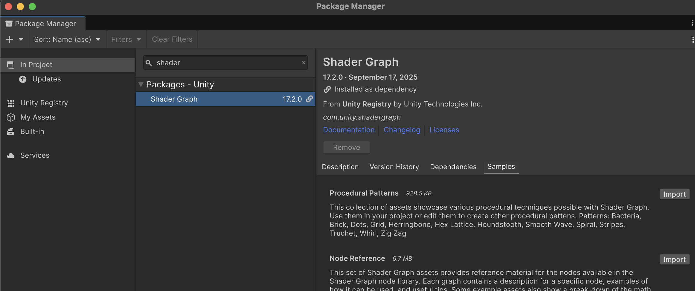
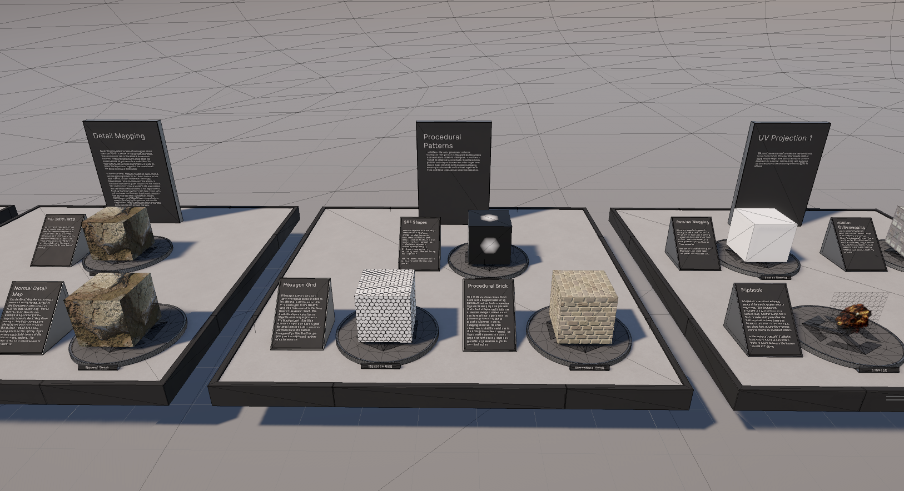
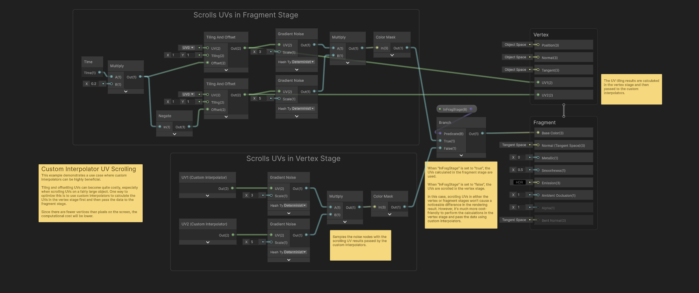
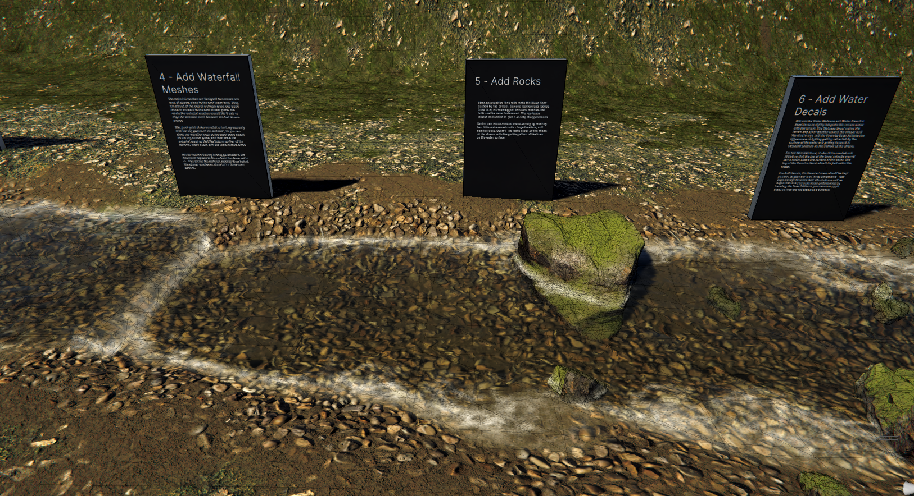

# Recursos: mostres de Shader Graph

**Unity** té un paquet amb shaders professionals predefinits, per a veure tècniques i aprendre a fer-ne de nous.

1. Obre el Package Manager amb **Window > Package Management > Package Manager**.
2. Selecciona la secció **In Project** i escriu **Shader Graph** al cercador. En un projecte URP, Shader Graph ja apareix instal·lat.
3. Selecciona **Shader Graph** i obre la pestanya **Samples**.
4. Prem **Import** al costat de **Feature Examples** i de **Production Ready Shaders** (les mostres que es fan servir a continuació). Les altres mostres són opcionals.

 

## Feature Examples

Les mostres s'importen a **Assets/Samples/Shader Graph/XX.Y.Z**, on XX.Y.Z és la versió instal·lada de Shader Graph (a la captura, 17.2.0).

Exemples simples. Obre l'escena de demostració des de la finestra **Project**:

*Assets > Samples > Shader Graph > XX.Y.Z > Feature Examples > Scenes > URPFeatureExamplesScene.unity*

 

Els shaders estan comentats amb notes explicatives:

 

## Production Ready

Exemples professionals avançats. Obre l'escena de demostració des de la finestra **Project**:

*Assets > Samples > Shader Graph > XX.Y.Z > Production Ready Shaders > Scenes > URPProductionReadyShaders.unity*

 

Alguns materials es poden fer servir directament sobre objectes. Per exemple, arrossega aquest material des de la finestra **Project** a sobre d'un cub:

*Assets > Samples > Shader Graph > XX.Y.Z > Production Ready Shaders > Environment > Ice > Ice Shader.mat*

<video src="./assets/libs-icematerial.mov" width="500" controls></video>

## Com estudiar una mostra

1. Obre l’escena compatible amb URP i localitza el material de l’efecte.
2. Segueix el gràfic des de les coordenades fins a la sortida.
3. Identifica propietats, màscares i textures. Canvia un paràmetre cada vegada.
4. Extreu una idea petita que puguis explicar i reconstruir.

Les mostres no substitueixen les demos guiades del curs.
