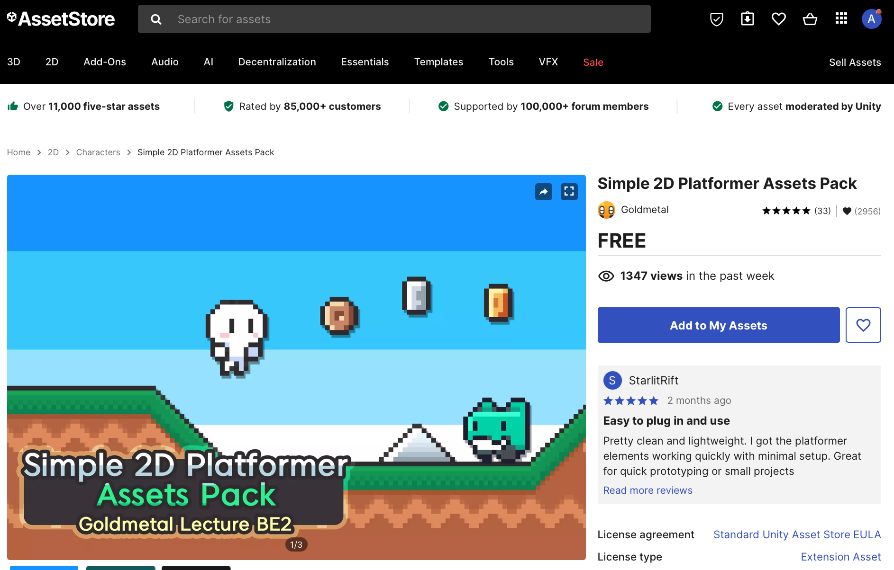
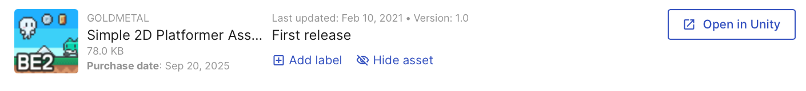
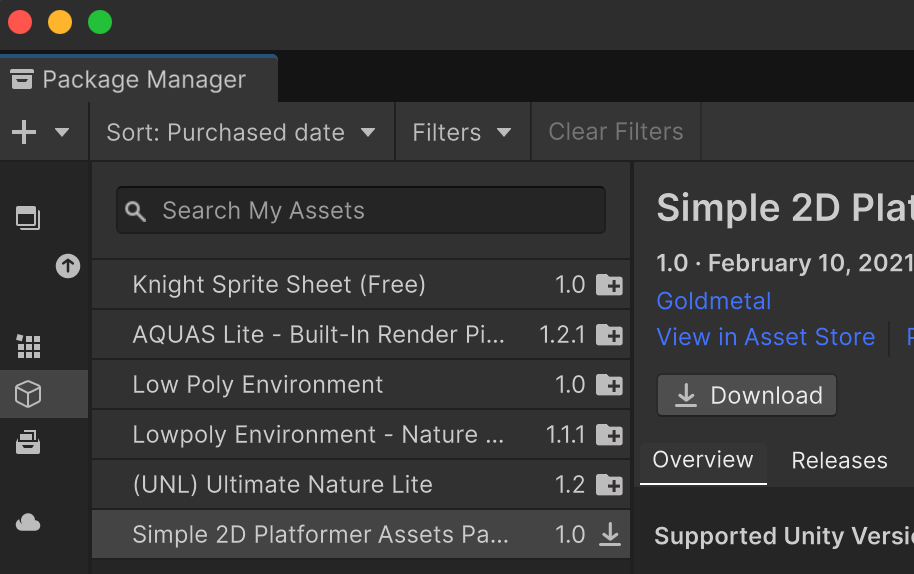
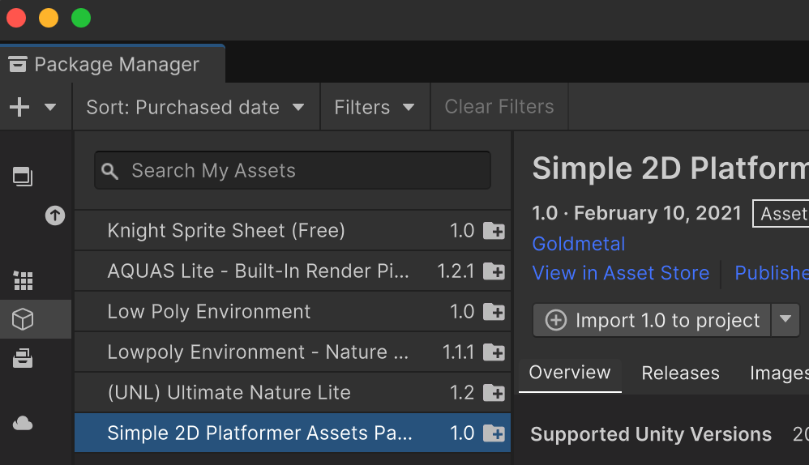
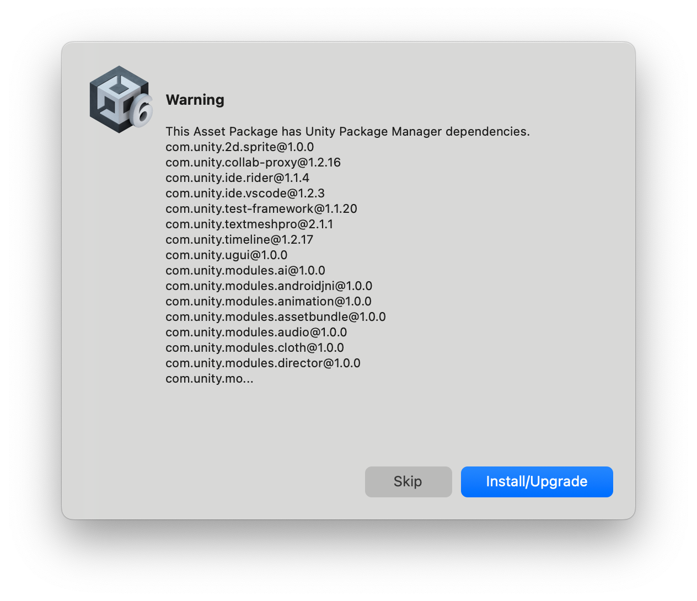
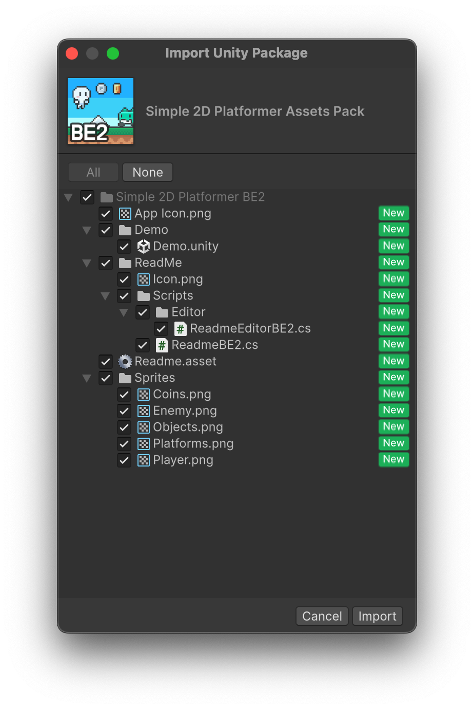
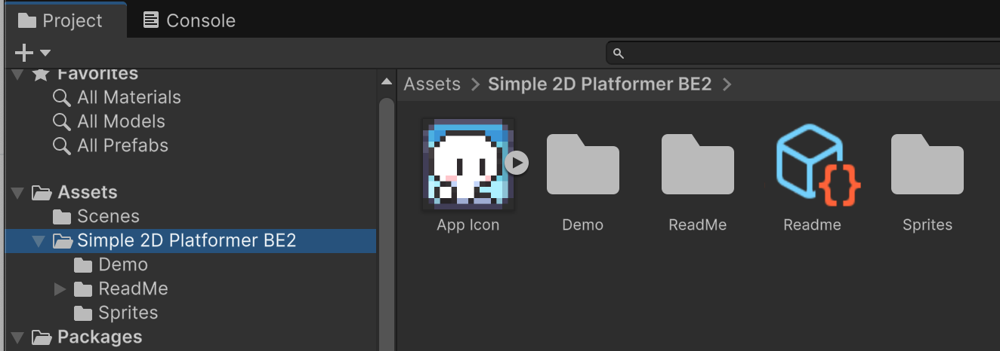

# Plataformes

En aquest tema construirem un joc de plataformes 2D. Treballarem amb **Unity 6.6**, el nou **Input System** i la UI de Canvas (uGUI). Algunes captures antigues dels recursos poden tenir menús lleugerament diferents.

## Ordre de treball

Aquest bloc construeix **un únic joc de manera progressiva**, dins de l'escena **Nivell01**. Segueix els fitxers en ordre: primer les bases, després la partida completa i finalment les plataformes mòbils i les ajudes de salt. El capítol 10 afegeix el decorat amb Tilemaps i parallax.

| Pas | Tutorial | Resultat |
|---|---|---|
| 1 | [Assets](./00-Assets.md) | Projecte, sprites i escena |
| 2 | [Tilemap](./01-Tilemap.md) | Terreny i col·lisions |
| 3 | [Player](./02-Player.md) | Entrada, moviment i salt bàsic |
| 4 | [Animacions](./03-Animacions.md) | Quiet, caminar, saltar i caure |
| 5 | [Càmera](./04-Camera.md) | Seguiment dins dels límits |
| 6 | [Items](./05-Items.md) | Recollir monedes |
| 7 | [Trampes](./06-Trampes.md) | Vida i dany |
| 8 | [HUD](./07-HUD.md) | Mostrar les dades del jugador |
| 9 | [Game Over](./08-GameOver.md) | Morir i reiniciar |
| 10 | [Plataformes mòbils](./09-Plataformes.md) | Transportar el jugador |
| 11 | [Parallax](./10-Parallax.md) | Tilemaps de fons i primer pla |
| 12 | [Millores del salt](./11-MilloresSalt.md) | Coyote time, buffer i altura variable |
| 13 | [Final de partida](./12-FinalPartida.md) | Meta, victòria i reinici |
| Consulta | [Resum de tècniques](./13-Tècniques.md) | Relació entre components |

El pack de decoració del capítol 10 es descarrega des del mateix tutorial.

Quan s'indica «substitueix l'script», reemplaça tot el contingut del fitxer; no afegeixis una segona classe ni dupliquis mètodes. Desa cada fitxer i espera que Unity acabi de compilar. Fes els canvis amb **Play aturat** i desa l'escena després de cada tutorial.

Les captures del nivell fan servir els sprites originals de **Simple 2D Platformer BE2**: el personatge, les rajoles de terra, les monedes i les trampes del mateix paquet que importarem.

## Nou projecte

Crea un nou projecte Unity "Universal 2D" anomenat "Platform".

Si aquesta versió de la plantilla mostra un avís sobre **In App Purchasing 4**, obre Package Manager, selecciona aquest paquet i fes **Manage > Remove**. Aquest joc no utilitza compres integrades. No cal actualitzar tots els paquets per resoldre aquest avís.

## Carpetes

Crea aquestes carpetes als **"Assets"**

- Animations
- Sprites
- Prefabs
- Scripts
- Scenes
- Tiles

## Decorat de profunditat

Al [capítol 10](./10-Parallax.md) importarem **ParallaxTiles.zip**, amb els nous fons i l'eina per convertir-los en Tilemaps. [BackgroundImages.zip](./BackgroundImages.zip) conté només les imatges noves, per si les vols consultar; no cal importar-lo ara ni duplicar-lo amb el pack complet.

## Unity Asset Store

Farem servir un asset gratuït de la Unity Asset Store anomenat.

[Simple 2d platformer](https://assetstore.unity.com/packages/2d/characters/simple-2d-platformer-assets-pack-188518)

Posa'l a

 

Els assets s'afegeixen al teu compte de 'Unity', i cal obrir-los amb Unity per poder descarregar-los.

 

Unity té una utilitat que es diu **"Package Manager"** que serveix per gestionar els assets del teu compte.

Cal descarregar l'asset a l'ordinador.

 

Un cop descarregat, cal importar-lo al projecte.

 

Si Unity proposa canvis de paquets, comprova què actualitzarà. Aquest tutorial fa servir les versions compatibles amb Unity 6.6; no cal actualitzar tots els paquets per importar sprites.

Quan fas la importació pots escollir què vols importar exàctament, en aquest cas ho importarem tot.

Un cop importat, veuràs que s'ha creat una carpeta nova dins la carpeta **Assets** del projecte.

 

Ara ja hi ha els assets dins el projecte i els podem utilitzar.

## Preparar l'escena i els sprites

1. Fes **File > New Scene**, escull una escena bàsica 2D de la plantilla i desa-la amb **File > Save As > Assets/Scenes/Nivell01.unity**. Si la plantilla ja ha obert una escena 2D, pots desar-la amb aquest nom.
2. Selecciona **Main Camera**. Comprova **Projection = Orthographic**, **Size = 5**, **Position = (0, 0, -10)** i **Rotation = (0, 0, 0)**. Orthographic fa que la mida dels sprites no depengui de la distància a la càmera.
3. Si utilitzes materials **Sprite-Lit-Default** de Universal 2D, conserva la **Global Light 2D**. Sense llum, aquests sprites poden quedar foscos. Els materials Sprite-Unlit no necessiten aquesta llum.
4. Selecciona una imatge a Project: **Texture Type = Sprite (2D and UI)**. **Single** serveix per a una sola imatge; **Multiple**, per a un full amb diversos sprites.
5. **Pixels Per Unit (PPU)** indica quants píxels de la imatge ocupen una unitat del món. Per exemple, una rajola de 16 × 16 píxels amb PPU 16 ocupa una cel·la d'1 × 1. Mantén el criteri a tots els sprites que han d'encaixar.
6. Per a pixel art, prova **Filter Mode = Point (no filter)** i **Compression = None**. Per a dibuixos suaus, Bilinear pot ser més adequat. Prem **Apply** després dels canvis.

No redimensionis les imatges originals ni canviïs tots els PPU a cegues: el paquet ja pot portar la importació preparada. Primer comprova la mida d'una rajola al següent apartat.

## Comprovar el resultat

El projecte té una escena desada i els sprites importats.

1. Obre **Console** i comprova que no hi ha errors vermells.
2. Localitza **Platforms** i desplega els sprites del seu interior.

## Errors habituals

- Si no apareixen sprites individuals, revisa **Sprite Mode = Multiple** i el retall a Sprite Editor.
- Si veus la plantilla 3D, comprova que el projecte sigui **Universal 2D**.
