# Construir el nivell amb Tilemaps

**Punt de partida:** projecte i escena Level01 de [Assets](./00-Assets.md). Pintarem el terra on després caminarà el jugador.

## Què és cada cosa?

| Concepte | Significat |
|---|---|
| Sprite | Una imatge que Unity pot dibuixar |
| Tileset | Conjunt d'imatges per construir un nivell; sovint estan en un mateix full |
| Tile | Recurs que associa un sprite amb propietats d'una rajola, com la col·lisió |
| Tile Palette | Paleta des d'on escollim les rajoles que pintarem |
| Grid | Graella que defineix la mida i la disposició de les cel·les |
| Tilemap | Mapa que guarda quina rajola hi ha a cada cel·la |

## Revisar el tileset

El tileset d'aquest joc és el full **Platforms.png** del paquet. Ja ve preparat: només cal comprovar-lo.

1. A Project, obre **Assets > Simple 2D Platformer BE2 > Sprites** i selecciona **Platforms**.
2. A l'Inspector comprova: **Texture Type = Sprite (2D and UI)**, **Sprite Mode = Multiple**, **Pixels Per Unit = 16**, **Filter Mode = Point (no filter)** i **Compression = None**. Si canvies res, prem **Apply**.

<center>
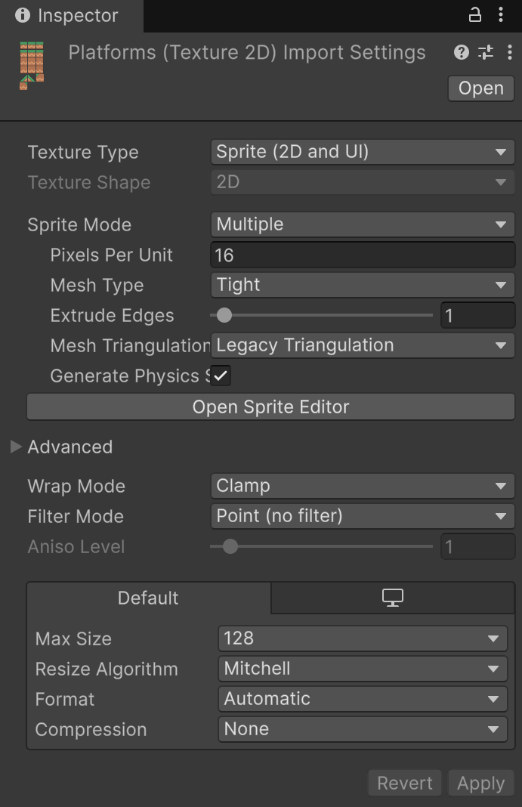
</center>
<br/>

3. Prem **Open Sprite Editor**. El full ja està retallat en 16 sprites de **16 × 16 píxels** amb nom: **Single Left**, **Single**, **Single Right**, **Top Left**, **Top**, **Top Right**, **Middle Left**, **Middle**, **Middle Right**, **Bottom Left**, **Bottom**, **Bottom Right** i quatre peces de pendent (**Slope**). Fes clic en una peça per veure'n el **Name** i la mida (**W**, **H**). Tanca la finestra sense prémer Apply.

<center>
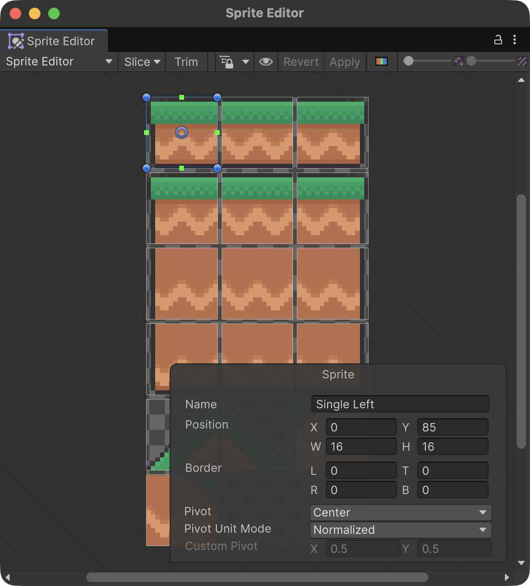
</center>
<br/>

**No tornis a retallar el full.** Entre les peces hi ha 1 píxel de separació: un **Slice > Grid By Cell Size** de `16 × 16` sense **Padding = 1** les desplaçaria i, a més, perdries els noms.

Com que cada peça fa 16 píxels i **Pixels Per Unit = 16**, cada rajola ocupa exactament **una unitat**: una cel·la d'un Grid amb **Cell Size = (1, 1, 0)**.

## Del full d'imatges al nivell

Abans de començar, aquest és el camí que farem. Cada pas crea una cosa diferent:

```text
Platforms.png          el tileset: un full d'imatges (ja el tenim)
   │  retall (Sprite Editor)
   ▼
Sprites                Single Left, Top, Middle...  (ja retallats al paquet)
   │  arrossegar a la paleta
   ▼
Tiles (.asset)         un fitxer per rajola, a Assets/Tiles/Terrain
   │  es col·loquen a
   ▼
Paleta Terrain         la "caixa de pintures" (Assets/Tiles/Terrain.prefab)
   │  pintar amb el pinzell
   ▼
Grid > Ground          el nivell de l'escena (Tilemap)
```

A Unity no existeix cap recurs anomenat "tileset": el tileset és el full PNG. Els **Tiles** i la **paleta** els crea Unity automàticament quan hi arrosseguem el full.

## Crear el mapa buit

Primer creem el lloc on pintarem. Així, quan obrim la paleta, ja tindrà on pintar.

1. A Hierarchy, fes clic dret > **2D Object > Tilemap > Rectangular**.

<center>
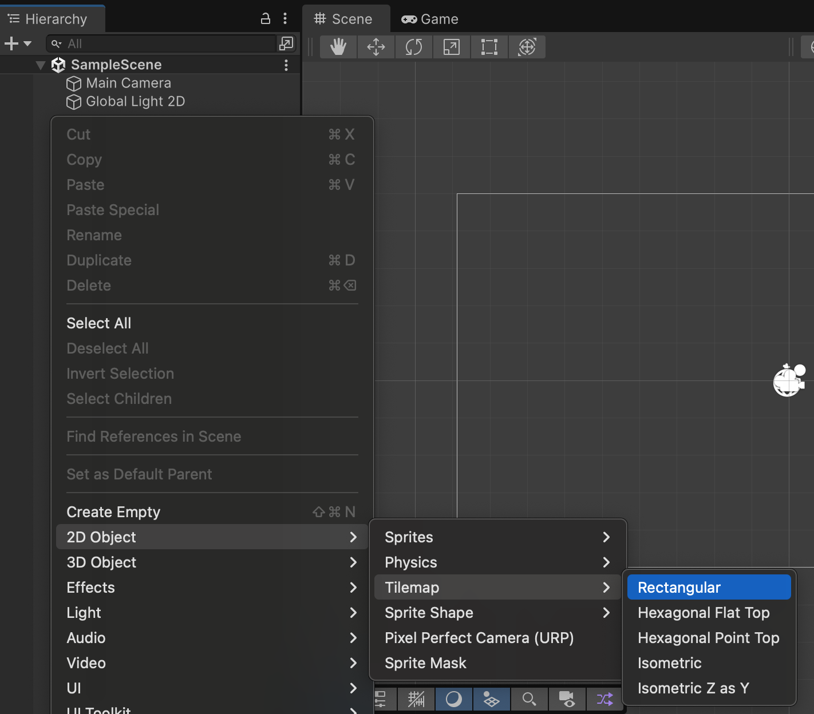 Tilemap > Rectangular" style="width: 90%; max-width: 500px">
</center>
<br/>

2. Unity crea dos objectes: **Grid** (la graella) i un fill **Tilemap** (el mapa). Canvia el nom del fill a **Ground**.
3. Selecciona **Grid** i comprova **Cell Size = (1, 1, 0)**. Deixa Grid i Ground amb Position `(0, 0, 0)`, Rotation `(0, 0, 0)` i Scale `(1, 1, 1)`.

```text
Level01
    Main Camera
    Global Light 2D
    Grid
        Ground
```

<center>
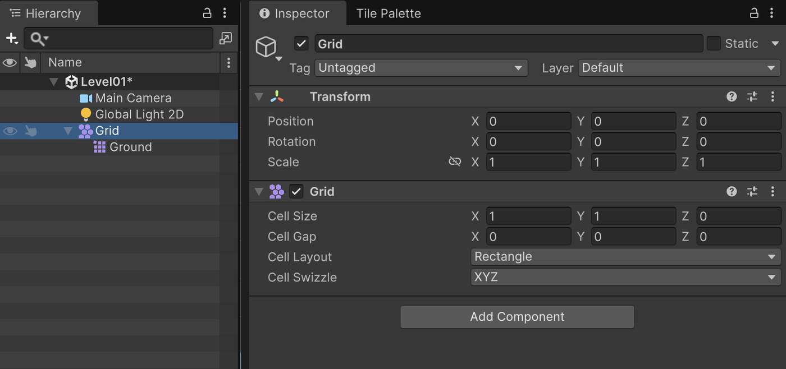
</center>
<br/>

## Crear la paleta

### 1. Obrir la finestra

Obre **Window > 2D > Tile Palette**. Si el menú no existeix, revisa a **Window > Package Management > Package Manager** que hi hagi **2D Tilemap Editor** i **2D Sprite**.

<center>
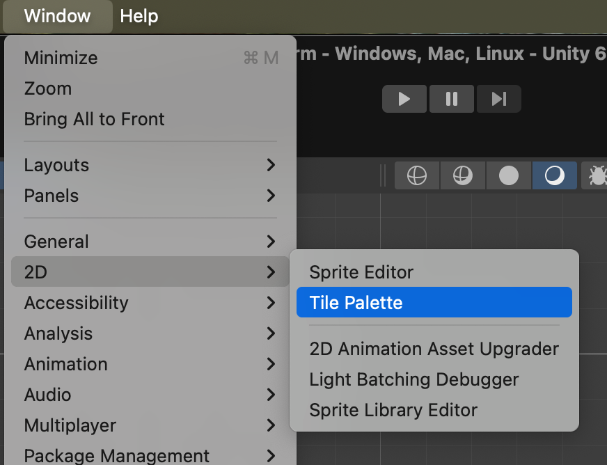 2D > Tile Palette" style="width: 90%; max-width: 450px">
</center>
<br/>

Acobla la finestra al costat de l'Inspector: arrossega la pestanya **Tile Palette** fins a la barra de pestanyes on hi ha **Inspector**. La farem servir alhora que la vista Scene.

Com que ja existeix Ground, el desplegable **Active Tilemap** ja el mostra. La zona central és buida perquè encara no hi ha cap paleta.

<center>
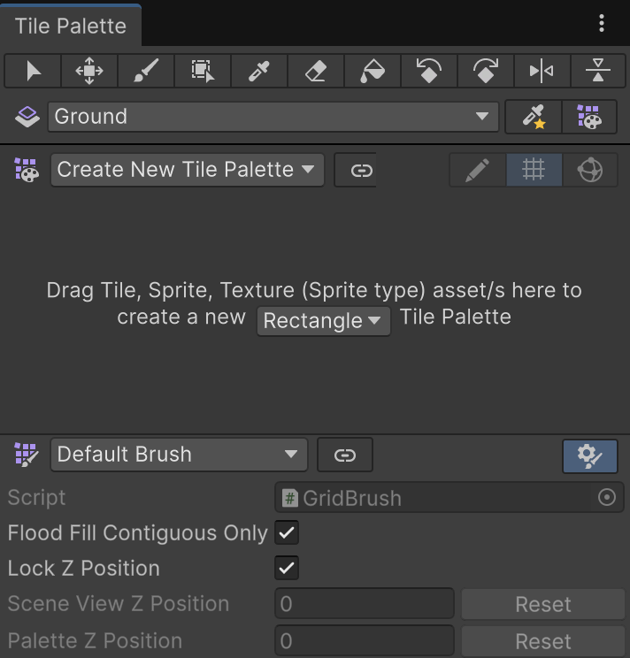
</center>
<br/>

### 2. Crear una paleta buida

1. Al desplegable de la paleta, escull **Create New Tile Palette**.

<center>
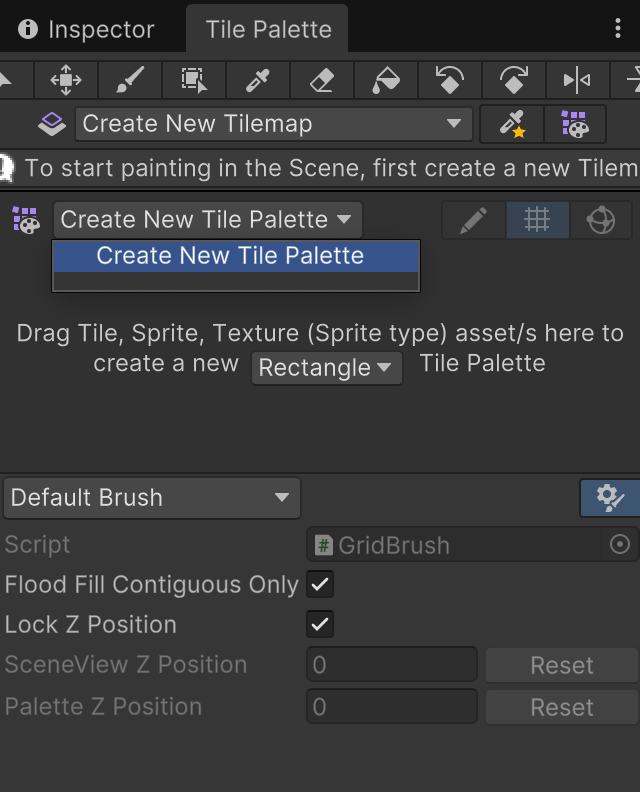
</center>
<br/>

2. Omple el formulari: **Name = Terrain**, **Grid = Rectangle**, **Cell Size = Automatic**. Prem **Create**.

<center>
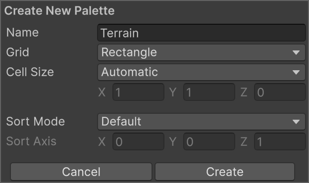
</center>
<br/>

3. Unity demana una carpeta: escull **Assets/Tiles** i prem **Choose**. Unity hi desa la paleta com a **Terrain.prefab**.

<center>
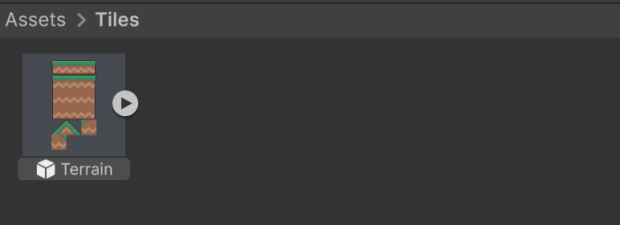
</center>
<br/>

### 3. Omplir la paleta amb les rajoles

1. A Project, obre **Assets > Simple 2D Platformer BE2 > Sprites**.
2. Arrossega **el full Platforms** sencer (no els sprites un per un) a l'espai buit de la Tile Palette. Així les peces conserven la disposició del full i les trobaràs on les esperes.

<center>
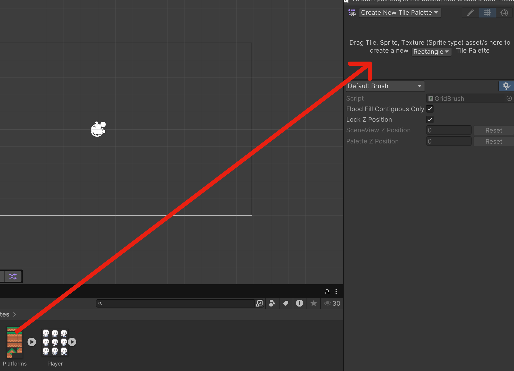
</center>
<br/>

3. Unity obre el diàleg **Generate tiles into folder**. Entra a **Assets/Tiles**, prem **New Folder**, escriu **Terrain**, prem **Create** i després **Choose**.

<center>
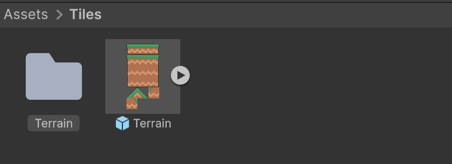
</center>
<br/>

4. Espera que acabi. Ara tens:

```text
Assets/Tiles
    Terrain.prefab          la paleta
    Terrain/                un recurs Tile per cada sprite
        Bottom.asset
        Middle.asset
        Top Left.asset
        ...                 (16 tiles, amb el nom de cada sprite)
```

<center>
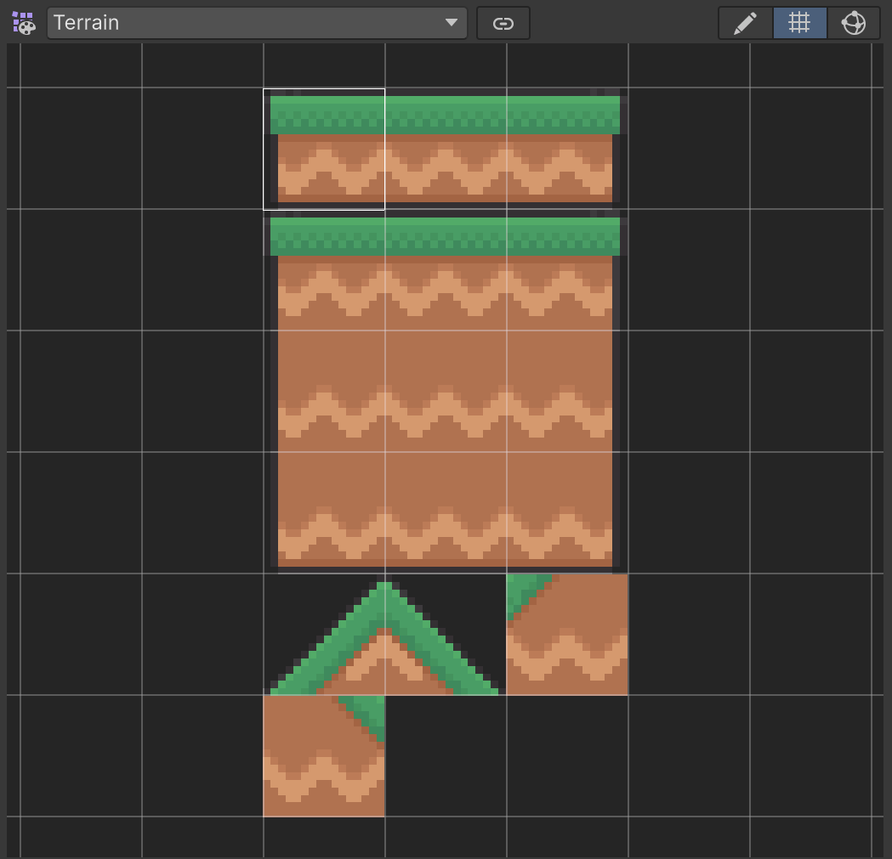
</center>
<br/>

<center>
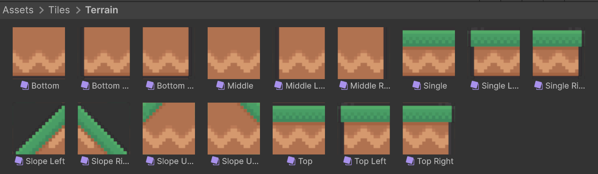
</center>
<br/>

La paleta és una caixa de pintures: el que hi ha a dins **no** apareix al joc. Si en fer clic dins de la paleta en canvies les peces, desactiva el botó del **llapis** de la dreta del nom de la paleta: és el mode d'edició de la paleta.

## Pintar el terra

### Les eines

| Eina | Tecla | Per a què |
|---|---|---|
| Select an area of the grid | S | Seleccionar cel·les i veure'n la posició |
| Paint with active brush | B | Pintar cel·la a cel·la (pinzell) |
| Paint a filled box with active brush | U | Omplir un rectangle arrossegant |
| Pick or marquee select new brush | I | Agafar una peça ja pintada a Scene |
| Erase with active brush | D | Esborrar cel·les (goma) |
| Flood fill with active brush | G | Omplir una zona tancada; en una zona oberta omple tot el mapa |

Són els noms que mostra Unity en passar el ratolí per sobre de cada botó.

<center>
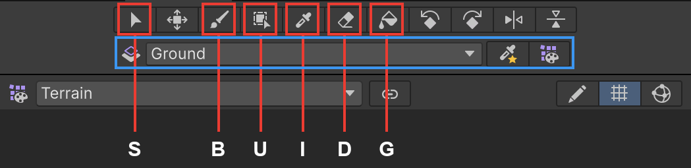
</center>
<br/>

### Abans de pintar

1. A la Tile Palette, comprova que el desplegable **Active Tilemap** (sota la barra d'eines, marcat en blau a la captura) diu **Ground**. Si diu un altre mapa, pintaràs al lloc equivocat.
2. A Scene, activa el botó **2D** i el botó de graella (**Grid**) perquè es vegin les cel·les.

### Quina peça va a cada lloc

Un bloc de terra de diverses files es construeix així:

```text
Top Left     Top     Top     Top Right       ← herba
Middle Left  Middle  Middle  Middle Right
Bottom Left  Bottom  Bottom  Bottom Right    ← base
```

Una plataforma d'una sola fila fa servir **Single Left / Single / Single Right**.

### Pintar un bloc pas a pas

La manera més ràpida és omplir primer tot el rectangle i després corregir-ne les vores:

1. Escull **Paint a filled box** (U) i, a la paleta, la peça **Middle**. Arrossega a Scene des de la cantonada inferior esquerra fins a la superior dreta del bloc.
2. Escull **Top** i, amb la mateixa eina, arrossega per la fila superior. Fes el mateix amb **Bottom** a la fila inferior.
3. Escull **Middle Left** i **Middle Right** i pinta les columnes laterals.
4. Amb **Paint with active brush** (B), posa les quatre cantonades: **Top Left**, **Top Right**, **Bottom Left** i **Bottom Right**.
5. Si t'equivoques, tria **Erase** (D) i esborra la cel·la, o pinta-hi directament la peça correcta.

<center>
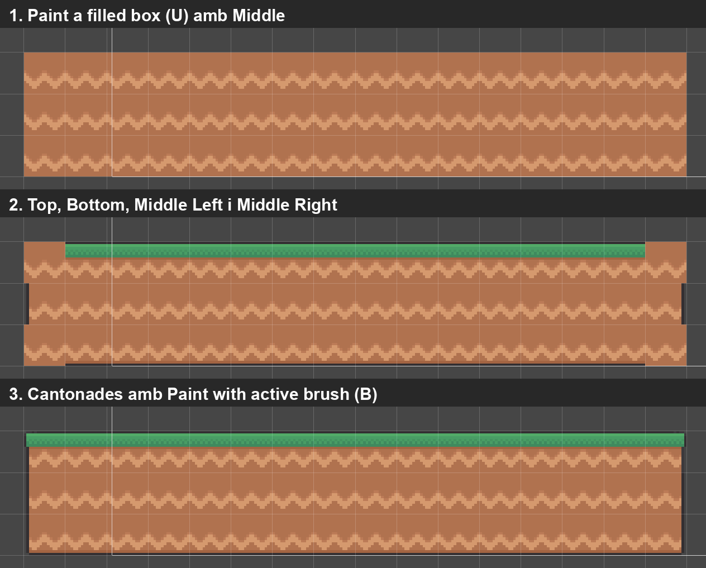
</center>
<br/>

### Saber a quina cel·la ets

Amb l'eina **Select an area of the grid** (S), fes clic sobre una cel·la: l'Inspector mostra **Grid Selection > Position**. Si arrossegues, també en mostra la mida (**Size**). Fes-la servir per comprovar que cada bloc comença i acaba on toca. La cel·la `(0, 0)` és la que té la cantonada inferior esquerra a l'origen del món.

<center>
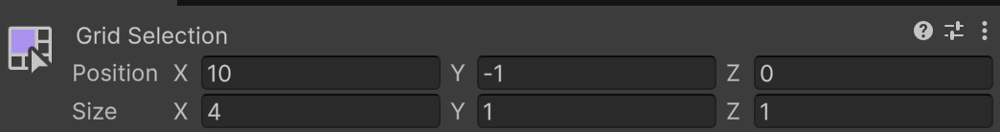
</center>

A la captura s'ha seleccionat la tercera plataforma: comença a la cel·la **(10, -1)** i fa **4 × 1** cel·les. Si l'Inspector no la mostra, fes clic a la pestanya **Inspector**: quan Tile Palette i Inspector comparteixen grup, només se'n veu una.
<br/>

## Un nivell de comprovació reproduïble

Per comprovar el mateix recorregut que les captures, pinta aquests rectangles a Ground amb el procediment anterior. X i Y són els **números de les cel·les** que veus a Grid Selection; els dos extrems de cada interval s'inclouen. Una cel·la amb Y = -1 ocupa del -1 al 0, i per tant la seva superfície superior és Y = 0.

| Tram | Columnes X | Files Y | Superfície superior |
|---|---|---|---|
| Terra esquerre | -10 a 5 | -5 a -3 | -2 |
| Terra central | 8 a 17 | -5 a -3 | -2 |
| Terra dret | 20 a 29 | -5 a -3 | -2 |
| Primera plataforma | -5 a -2 | -1 | 0 |
| Segona plataforma | 1 a 4 | 1 | 2 |
| Tercera plataforma | 10 a 13 | -1 | 0 |

Els forats són les columnes 6–7 i 18–19. Les plataformes elevades són sòlides: cal entrar-hi **pel costat mentre puges**, no travessar-les des de sota. No afegeixis Platform Effector 2D en aquest exemple.

<center>
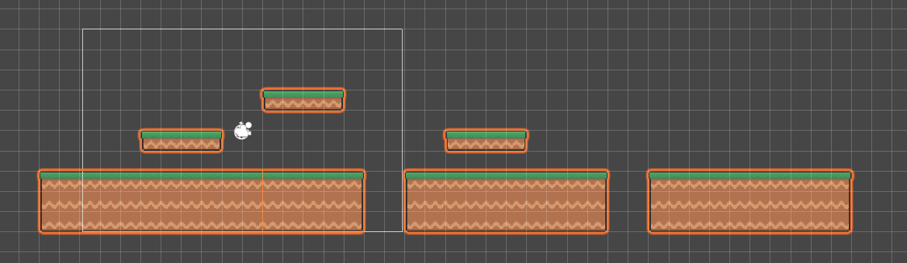
</center>
<br/>

Al capítol següent comprovarem les pujades de 2 unitats i els forats de 2 cel·les abans de posar-hi monedes o trampes. Després podràs ampliar el nivell, comprovant cada salt nou amb el personatge real.

## Unir les col·lisions del terra

1. Selecciona **Ground**, no Grid, i afegeix **Tilemap Collider 2D**.
2. Afegeix **Rigidbody 2D** i posa **Body Type = Static**: el terreny no es mourà.
3. Afegeix **Composite Collider 2D** al mateix Ground.
4. Al **Tilemap Collider 2D**, posa **Composite Operation = Merge**.
5. Al **Composite Collider 2D**, deixa **Is Trigger desactivat** i escull **Geometry Type = Polygons** per a terra sòlid.
6. Selecciona un recurs **Tile** d'Assets/Tiles/Terrain. Per defecte té **Collider Type = Sprite**. **Grid** omple la cel·la; **Sprite** utilitza la forma física del sprite i **None** no genera col·lisió. Per al terra rectangular, selecciona tots els tiles de la carpeta (Ctrl+A / Cmd+A) i posa **Collider Type = Grid**. Les pendents (Slope) necessiten **Sprite**.
7. A Scene, activa **Gizmos** i selecciona Ground: comprova que el contorn del terra queda unit, sense vores interiors entre les rajoles adjacents.

<center>
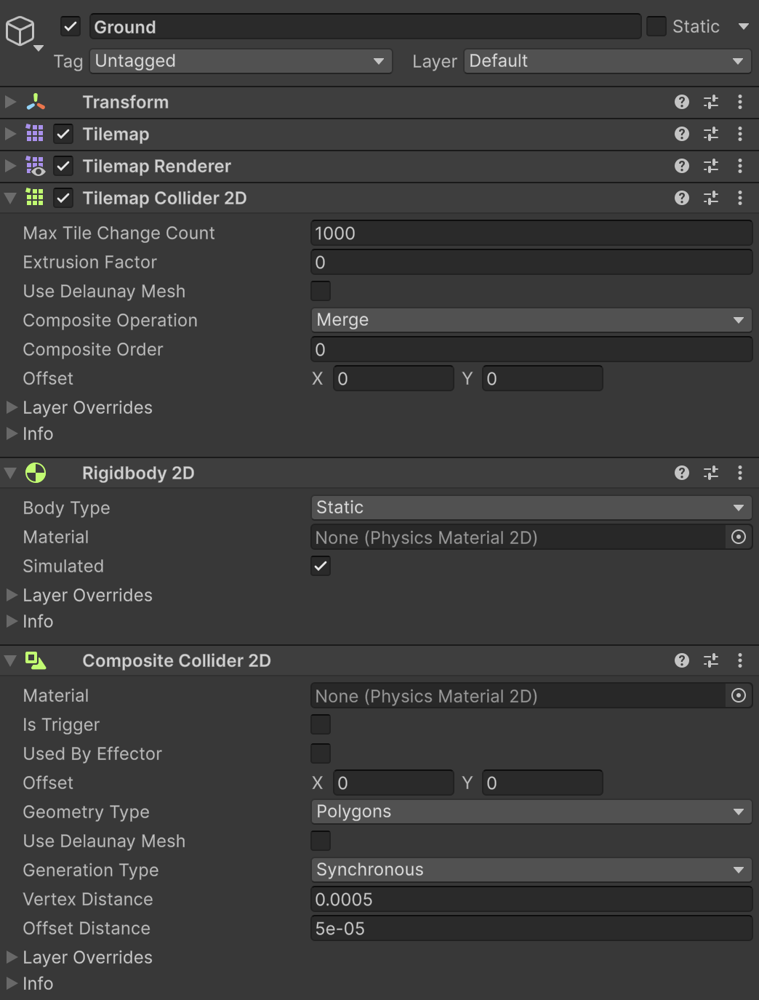
</center>
<br/>

El Tilemap Collider genera les peces i el Composite les uneix. Això redueix les juntes on el jugador pot enganxar-se i simplifica les formes de col·lisió. No s'aconsegueix només arrodonint el collider del jugador.

[Referència de Tilemap Collider 2D](https://docs.unity.com/en-us/engine/6000.6/manual/unity2d/tilemaps/tilemap-collider-2d/reference).

## Evitar línies entre les imatges de les rajoles

Encara que les cel·les encaixin, poden aparèixer ratlles molt fines quan es mou la càmera. Unity pot arribar a llegir el marge transparent que hi ha al costat d'un sprite dins del full. És una unió **visual**: el Composite Collider no la corregeix, perquè només controla les col·lisions.

Un **Sprite Atlas** és un recurs que Unity prepara agrupant sprites i reservant un marge entre ells. Les rajoles continuen fent servir els mateixos sprites.

1. A Project, fes **Assets > Create > 2D > Sprite Atlas** i anomena'l **TerrainAtlas**. Desa'l a Assets/Tiles. No el diguis només Terrain: aquest nom ja és el de la paleta.
2. A l'Inspector de l'atles, desactiva **Allow Rotation** i **Tight Packing**. Posa **Padding = 4**.
3. Posa **Filter Mode = Point (no filter)**, desactiva **Generate Mip Maps** i posa **Compression = None** a la configuració de textura de l'atles. Deixa **Include in Build** activat.
4. A **Objects for Packing**, afegeix el full **Platforms.png** del paquet original. No cal arrossegar-hi cada rajola per separat.
5. Prem **Pack Preview**. Quan entrem a Play, Unity utilitzarà els sprites de l'atles automàticament; no cal tornar a pintar el Tilemap.
6. Als capítols de jugador i càmera, comprova les unions mentre camines. Mantén **Cell Gap = (0, 0, 0)** i **Scale = (1, 1, 1)**: no facis les rajoles més grosses ni les superposis per tapar les ratlles.

[Referència de les propietats de Sprite Atlas](https://docs.unity.com/en-us/engine/6000.6/manual/unity2d/sprite/atlas/sprite-atlas-reference).

## Separar terreny i decoració

1. Crea un altre Tilemap rectangular i anomena'l **Decoration**. Si Unity crea un altre Grid, pots moure Decoration sota el Grid existent i deixar el seu Transform a posició zero, rotació zero i escala u.
2. Deixa Decoration **sense colliders**. Pinta-hi elements que no han de bloquejar el jugador.
3. A **Tilemap Renderer > Additional Settings**, posa Ground amb **Order in Layer = 0** i Decoration amb **Order in Layer = -10**, deixant tots dos a **Sorting Layer = Default**.
4. Abans de pintar, comprova sempre **Active Tilemap**. El jugador farà servir Order `10` i les monedes `20`.

Una **Sorting Layer** controla el dibuix. La **Layer** de la part superior de l'Inspector controla, entre altres coses, consultes i col·lisions. No són la mateixa propietat.

## Ampliació: Rule Tiles

Quan ja sàpigues pintar, pots automatitzar l'elecció de cantonades i vores amb **Rule Tiles**. Fan servir el paquet **2D Tilemap Extras**, que la plantilla Universal 2D ja inclou. Un Rule Tile escull el sprite segons les rajoles veïnes; no crea per si sol el disseny del nivell. Aquesta ampliació és opcional i no la necessitem als següents passos.

## Comprovar el resultat

A Scene es veu un nivell pintat, amb un contorn de col·lisió continu només al terra.

1. Esborra una rajola de Ground i comprova que canvia el contorn.
2. Pinta a Decoration i comprova que no apareix col·lisió.
3. Desa Level01. Al següent apartat provarem el terra amb un jugador.

## Errors habituals

- Si les rajoles no encaixen, revisa PPU, retall, Cell Size i Scale.
- Si tot el terreny cau, posa el seu Rigidbody2D a Static.
- Si no hi ha contorn, revisa Collider Type del Tile, Merge i Gizmos.
