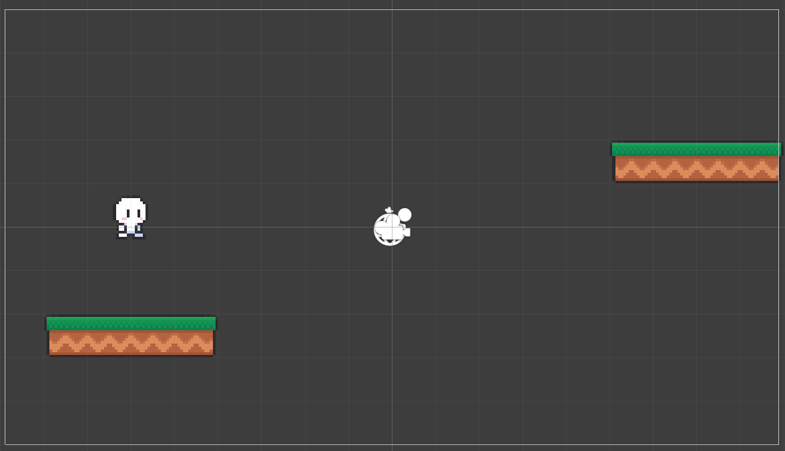
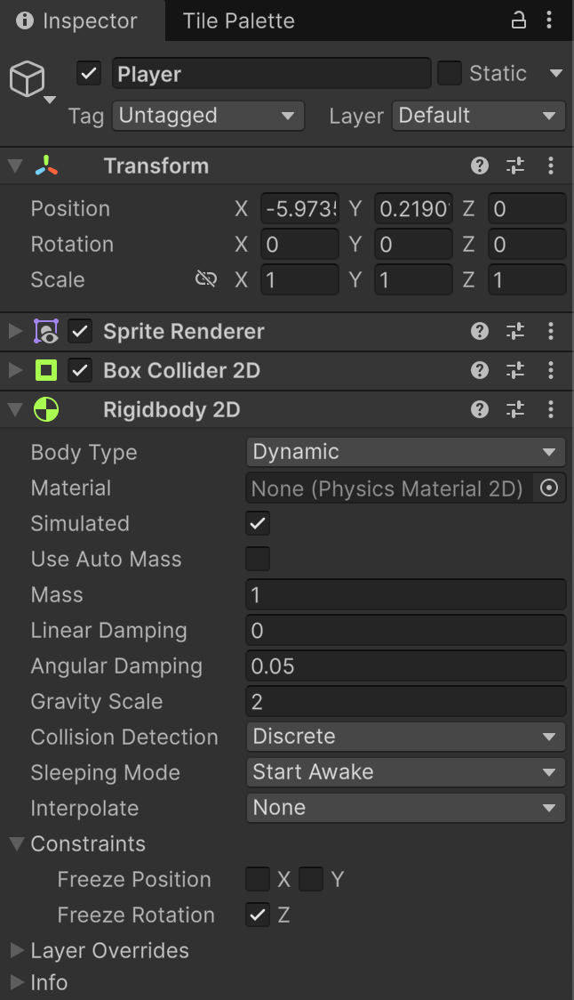
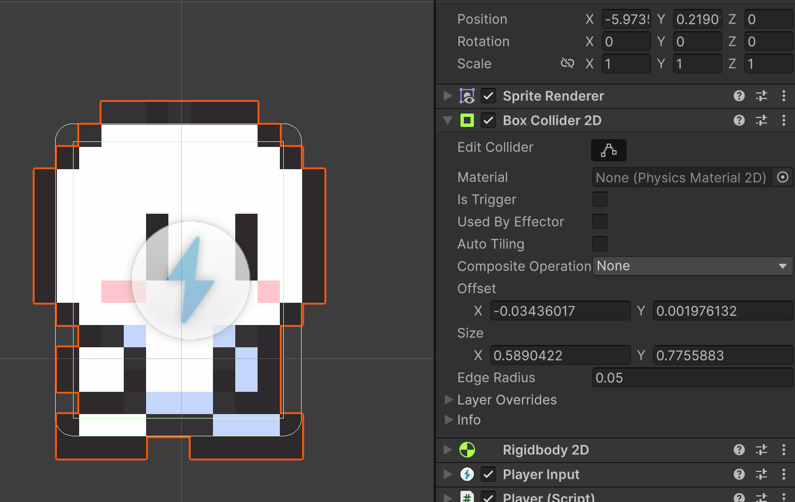
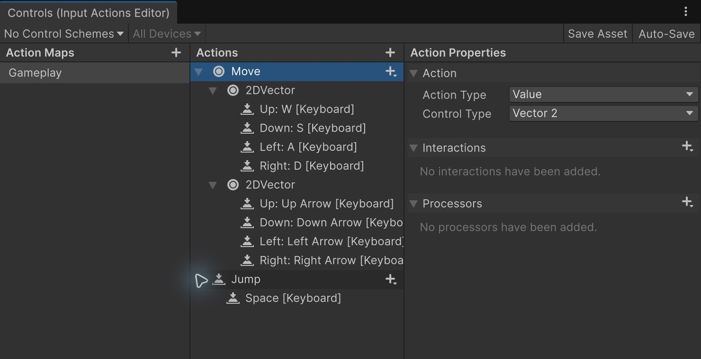
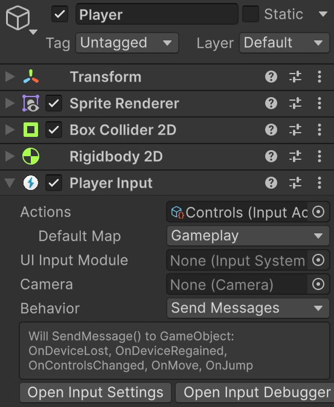

# Entrada, moviment i salt bàsic

**Punt de partida:** Nivell01 amb el Tilemap Ground.

Afegirem un personatge animat al joc, a partir d'imatges d'sprite.

## Nou personatge

Per afegir un personatge al joc, cal crear un objecte.

El crearem arrossegant un **Sprite** de personatge a l'escena. Busca l'asset **"Idle 0"** dins de:

*Assets > Simple 2D Platformer BE2 > Sprites > Player > Idle 0*

Arrossega'l a sobre del terreny Ground i anomena'l **Player**. Per al nivell de comprovació, posa **Position = (-6, -1.5, 0)** i **Scale = (1, 1, 1)**. Al full Player conserva **PPU = 16**; a Sprite Renderer posa **Order in Layer = 10**.

<center>

</center>
<br/>

Afegeix-li dos components:

- Un component de tipus **BoxCollider2D**.
- Un component de tipus **Rigidbody2D**.

Per tal d'evitar que el personatge giri amb la física, defineix:

- Body Type: Dynamic
- Mass: 1
- Linear Damping: 0
- Gravity Scale: 2, per fer que la gravetat l’acceleri més de pressa en caure
- Interpolate: Interpolate, per suavitzar la representació entre passos de física
- *Constraints > Freeze Rotation Z*, per tal que no roti


<center>

</center>
<br/>

Edita la caixa de col·lisió del personatge, amb el botó de **Edit Collider**:

- Per al sprite original: **Size = (0.65, 0.9)**, **Offset = (0, -0.02)** i **Edge Radius = 0.03**.
- Comprova visualment que la caixa cobreix el cos i arriba als peus.

<center>

</center>
<br/>

La caixa visible i el collider no han de coincidir exactament. Ajusta el collider al cos i deixa fora detalls com cabells o armes; no el facis tan petit que els peus travessin el terra. El Composite del Tilemap resol les juntes entre rajoles.

## Evitar que quedi enganxat als laterals

1. A Assets, fes **Create > 2D > Physics Material 2D** i anomena'l **PlayerSenseFriccio**.
2. Posa **Friction = 0** i **Bounciness = 0**.
3. Assigna'l al camp **Material** del BoxCollider2D de Player.

És necessari per a aquest controlador: quan mantenim una direcció contra el lateral d'una plataforma, la fricció no ha de frenar la pujada i deixar el personatge enganxat. El transport de les plataformes mòbils es farà amb el seu moviment, no amb la fricció.

## Configurar Input System

1. Obre **Window > Package Management > Package Manager** i comprova que hi ha **Input System**. A **Edit > Project Settings > Player > Other Settings > Active Input Handling**, utilitza **Input System Package (New)**. Si has de canviar-ho i Unity demana reiniciar, desa abans.
2. A **Assets**, fes **Create > Input Actions** i anomena el recurs **Controls**. Obre'l amb doble clic.
3. Crea un **Action Map** anomenat **Gameplay**.
4. Dins seu, crea **Move**, amb **Action Type = Value** i **Control Type = Vector2**. Afegeix un **2D Vector Composite**: Up `W`, Down `S`, Left `A`, Right `D`. Afegeix un segon composite per a les quatre fletxes.
5. Crea **Jump**, amb **Action Type = Button**, i un binding **Space**. A **Interactions**, afegeix **Press** i posa **Trigger Behavior = Press And Release**. Amb **Send Messages**, aquesta opció fa arribar tant la pulsació com l'alliberament; el salt bàsic ignora l'alliberament i el capítol 11 el farà servir per al salt curt. Desa l'asset amb **Save Asset**.
6. Selecciona Player i afegeix **Player Input**. Arrossega Controls al camp **Actions**, escull **Default Map = Gameplay** i **Behavior = Send Messages**. Per a aquest primer exemple de teclat no cal crear Control Schemes.

`Move` cridarà `OnMove` i `Jump` cridarà `OnJump` als components del mateix objecte Player. Afegir PlayerInput sense assignar aquestes accions no configura els controls.

<center>

</center>
<br/>


<center>

</center>
<br/>

## Moviment horitzontal

Crea **Assets/Scripts/Player.cs**, substitueix-ne el contingut pel codi complet i afegeix-lo a Player. El nom del fitxer i el de la classe han de coincidir.

```csharp
using UnityEngine;
using UnityEngine.InputSystem;

[RequireComponent(typeof(Rigidbody2D), typeof(PlayerInput))]
public class Player : MonoBehaviour
{
    public float moveSpeed = 5f;
    public int coins { get; private set; }
    public float MoveX { get; private set; }
    private Rigidbody2D rb;

    void Awake() => rb = GetComponent<Rigidbody2D>();

    public void OnMove(InputValue value)
    {
        MoveX = value.Get<Vector2>().x;
    }

    void FixedUpdate()
    {
        rb.linearVelocity = new Vector2(MoveX * moveSpeed, rb.linearVelocity.y);
    }

    public void AddCoin() => coins++;
}
```
`OnMove` guarda la direcció demanada. `FixedUpdate` aplica el moviment al cos físic i conserva la velocitat vertical. `coins` i `AddCoin` preparen el comptador que utilitzarem més endavant; encara val zero.

## Preparar el salt

1. Selecciona Ground. A **Layer > Add Layer**, crea **Jumpable**, torna a Ground i assigna-li aquesta Layer. Crear-la no l'assigna automàticament.
2. Crea **PlayerJump.cs**, copia el codi següent i afegeix-lo al mateix Player.
3. Al component PlayerJump, marca **Jumpable** a **Jumpable Layers** i posa **Jump Speed = 10**.
4. No cal cap objecte GroundCheck. Consultarem els contactes reals del Rigidbody2D amb el terra.

```csharp
using UnityEngine;
using UnityEngine.InputSystem;

[DefaultExecutionOrder(-100)]
[RequireComponent(typeof(Rigidbody2D))]
public class PlayerJump : MonoBehaviour
{
    public float jumpSpeed = 10f;
    public LayerMask jumpableLayers;
    public bool isGrounded { get; private set; }
    public Collider2D GroundCollider { get; private set; }

    private Rigidbody2D rb;
    private readonly ContactPoint2D[] contacts = new ContactPoint2D[16];
    private bool jumpRequested;
    private bool jumpConsumed;
    private bool wasSupported;

    void Awake() => rb = GetComponent<Rigidbody2D>();

    public void OnJump(InputValue value)
    {
        if (value.isPressed) jumpRequested = true;
    }

    void FixedUpdate()
    {
        UpdateGrounded();
        if (jumpRequested && isGrounded)
        {
            jumpConsumed = true;
            isGrounded = false;
            GroundCollider = null;
            rb.linearVelocity = new Vector2(rb.linearVelocity.x, jumpSpeed);
        }
        // En el salt bàsic no guardem una pulsació feta a l'aire.
        jumpRequested = false;
    }

    private void UpdateGrounded()
    {
        GroundCollider = null;
        float bestNormalY = 0.5f;
        int count = rb.GetContacts(contacts);
        for (int i = 0; i < count; i++)
        {
            var contact = contacts[i];
            var other = contact.collider;
            if (!other || other.attachedRigidbody == rb) continue;
            bool jumpable = (jumpableLayers.value & (1 << other.gameObject.layer)) != 0;
            if (jumpable && contact.normal.y > bestNormalY)
            {
                bestNormalY = contact.normal.y;
                GroundCollider = other;
            }
        }
        bool supported = GroundCollider != null;
        // Només una nova arribada al terra torna a donar dret a saltar.
        if (supported && !wasSupported) jumpConsumed = false;
        wasSupported = supported;
        isGrounded = supported && !jumpConsumed;
        if (!isGrounded) GroundCollider = null;
    }
}
```
**Com sap que toca terra?** `GetContacts` recull els punts de contacte. Només acceptem objectes de les capes seleccionades i superfícies que ens sostenen des de sota. `normal.y` indica quant apunta amunt la superfície: una paret vertical no compta com a terra. El mateix contacte proporciona **GroundCollider**, que després identificarà una plataforma mòbil.

`jumpConsumed` impedeix tornar a saltar fins a aterrar. `DefaultExecutionOrder(-100)` fa que aquesta comprovació s'executi abans del moviment normal del jugador. No cal canviar l'ordre a Project Settings.

**Amb aquests valors, el salt puja aproximadament 2,45 unitats.** Les dues primeres pujades del nivell de comprovació són de 2 unitats; deixa marge, no col·loquis les plataformes just a l'altura màxima. Mantén Espai als salts llargs quan activem l'altura variable al capítol 11.

Aquest és un **salt bàsic d'altura fixa**: una pulsació, un salt. Les ajudes per saltar una mica tard o abans d'aterrar s'explicaran al final del bloc.

[Referència de PlayerInput](https://docs.unity3d.com/Packages/com.unity.inputsystem@1.11/manual/PlayerInput.html).

## Comprovar el resultat

El jugador cau sobre el terra, camina i salta amb Espai.

1. Prem Play i fes clic a Game per donar-li el focus.
2. Prova A/D i les fletxes.
3. Salta; torna a prémer Espai a l’aire: no ha de fer un segon salt.
4. Apropa’t a una paret i comprova que tocar-la lateralment no habilita el salt.

## Errors habituals

- Sense moviment: comprova Actions, Default Map i Send Messages.
- Sense salt: revisa Jumpable a Ground i Jumpable Layers al component.
- Si travessa el terra, comprova que tots els components de física siguin **2D** i Is Trigger estigui desactivat.
- Si s’enganxa a les parets, comprova que PlayerSenseFriccio està assignat al collider del jugador.
