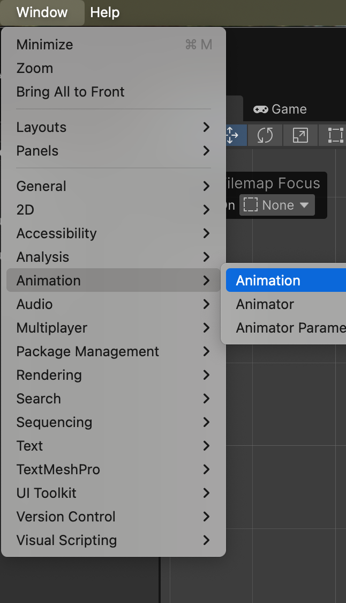
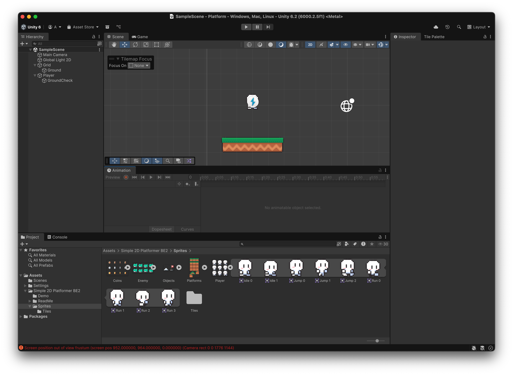
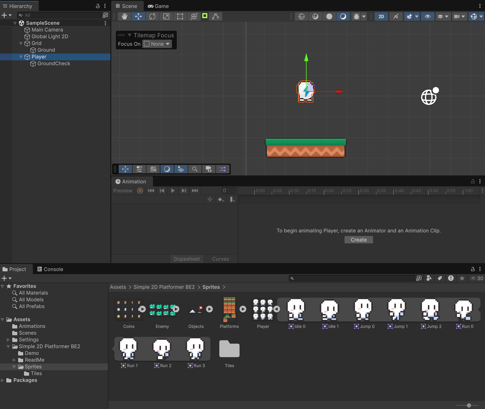
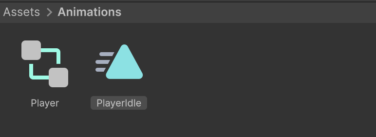
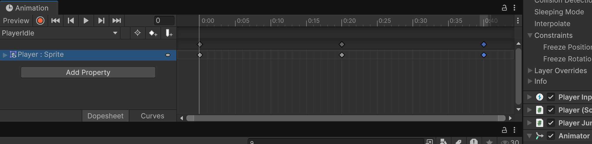
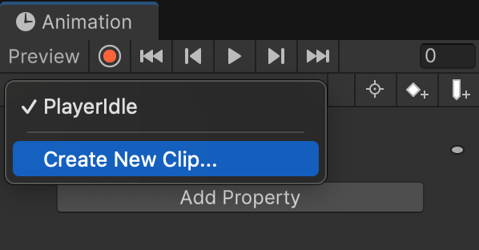
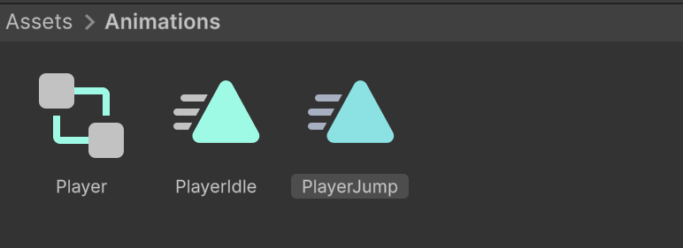
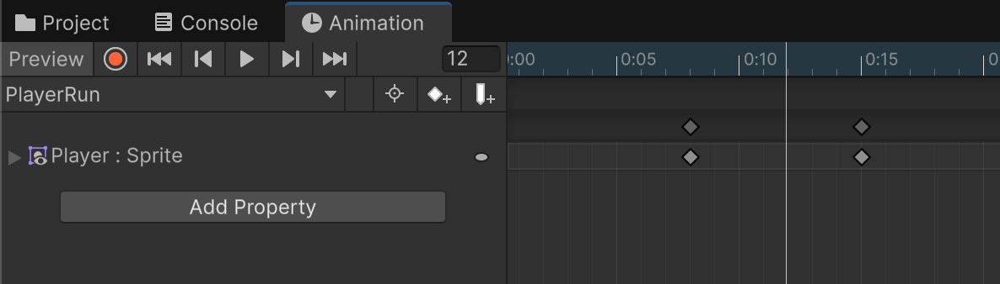

# Animacions

**Punt de partida:** jugador amb Player i PlayerJump del tutorial anterior.

Les animacions es formen a partir de diverses imatges que es van mostrant en seqüència.

Es canvia d'animació, segons l'estat del personatge (quiet, caminant, saltant...).

## Animació per defecte (PlayerIdle)

Obra la finestra d'animacions:

*Window > Animation > Animation*

<center>

</center>
<br/>

Arrossega la pestanya **"animation"** a l'editor de Unity, per tenir-la a mà.

<center>

</center>
<br/>

A **"Assets"**, crea una carpeta nova anomenada **"Animations"**.

Selecciona el personatge "Player" i apreta el botó **"Create"** de la finestra d'animacions.

<center>

</center>
<br/>

Guarda l'animació a la nova carpeta **"Animations"** amb el nom **"PlayerIdle"**.

<center>

</center>
<br/>

Arrosega els sprites:

- "Idle 0" a la posició 0:00
- "Idle 1" a la posició 0:20
- "Idle 0" a la posició 0:40

Assegura't que el "check" de animator està activat.

<center>

</center>
<br/>

Si proves el joc, veuràs que el personatge es mou.

## Definir més animacions

Cal definir les diferents animacions del personatge.

### PlayerJump

A la secció d'animacions, crea un nou clip anomenat **"PlayerJump"**.

<center>

</center>
<br/>

Guarda'l a la carpeta **"Animations"**.

<center>

</center>

Posa-hi els següents sprites:

- "Jump 0" a la posició 0:00
- "Jump 1" a la posició 0:10


Desactiva **Loop Time** al clip PlayerJump. En acabar, conserva l’última postura fins que el codi escull PlayerFall; no cal allargar-lo artificialment fins a cinc segons.

### PlayerFall

A la secció d'animacions, crea un nou clip anomenat **"PlayerFall"**. Guarda'l a la carpeta **"Animations"**.

Posa-hi el següent sprite:

- "Jump 2" a la posició 0:00

### PlayerRun

A la secció d'animacions, crea un nou clip anomenat **"PlayerRun"**. Guarda'l a la carpeta **"Animations"**.

Posa-hi els següents sprites:

- "Run 0" a la posició 0:00
- "Run 1" a la posició 0:08
- "Run 2" a la posició 0:15
- "Run 3" a la posició 0:22
- "Run 3" a la posició 0:30

Aparta la pestanya d'animacions amb els *"tabs"* de projecte i consola, o tancal-la.

<center>

</center>
<br/>

## Entendre el temps dels clips

A Animation, obre el menú de la finestra i activa **Show Sample Rate** si no veus **Samples**. Posa **Samples = 60** als clips d'aquest exemple. `0:20` significa segon zero, fotograma vint; no són vint segons. Les posicions anteriors només tenen el mateix ritme si fem servir el mateix nombre de fotogrames per segon.

Selecciona cada clip a Project i configura **Loop Time**:

| Clip | Loop Time | Ús |
|---|---|---|
| PlayerIdle | Activat | Repetir mentre està quiet |
| PlayerRun | Activat | Repetir mentre camina |
| PlayerJump | Desactivat | Conservar l'últim fotograma en pujar |
| PlayerFall | Activat | Una sola postura mentre cau |

Obre **Window > Animation > Animator**. Comprova que hi ha un estat per a cada clip amb aquests noms exactes i que el controlador està assignat al component Animator de Player. Aquest exemple selecciona els estats des del codi; no cal crear transicions automàtiques entre ells.

## Codi complet d'animacions

Crea **PlayerAnimation.cs** i afegeix-lo a Player:

```csharp
using UnityEngine;

[RequireComponent(typeof(Rigidbody2D), typeof(Animator), typeof(SpriteRenderer))]
[RequireComponent(typeof(Player), typeof(PlayerJump))]
public class PlayerAnimation : MonoBehaviour
{
    private Rigidbody2D rb;
    private Player player;
    private PlayerJump jump;
    private Animator animator;
    private SpriteRenderer spriteRenderer;
    private string currentState;

    void Awake()
    {
        rb = GetComponent<Rigidbody2D>();
        player = GetComponent<Player>();
        jump = GetComponent<PlayerJump>();
        animator = GetComponent<Animator>();
        spriteRenderer = GetComponent<SpriteRenderer>();
    }

    void Update()
    {
        // La plataforma pot transportar-nos sense que vulguem caminar.
        float direction = player.MoveX;
        if (Mathf.Abs(direction) > 0.01f) spriteRenderer.flipX = direction < 0f;
        string state = jump.isGrounded
            ? (Mathf.Abs(direction) > 0.01f ? "PlayerRun" : "PlayerIdle")
            : (rb.linearVelocity.y > 0f ? "PlayerJump" : "PlayerFall");
        if (state == currentState) return;
        animator.Play(state);
        currentState = state;
    }
}
```
La direcció i l'animació de caminar utilitzen **MoveX**, la intenció del jugador. Així una plataforma que el transporta no li canvia l'orientació ni el fa caminar visualment quan no prem cap tecla. `flipX` gira només el dibuix, sense invertir la física ni la jerarquia.

## Comprovar el resultat

Es veuen quatre estats diferents i el personatge mira cap a la direcció que demanes.

1. Queda’t quiet, camina, salta i deixa’l caure d’una vora.
2. Comprova cada estat a Animator mentre jugues.

## Errors habituals

- Si un estat no apareix, comprova el nom exacte a Animator.
- Si la velocitat de l’animació és incorrecta, revisa Samples.
- Si es reinicia contínuament, comprova que només canvies d’estat quan el nom és diferent.
