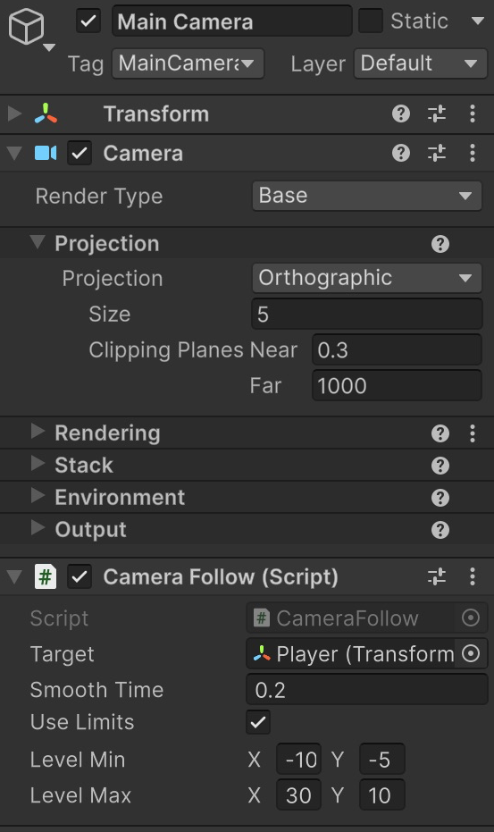

# Càmera ortogràfica i límits del nivell

**Punt de partida:** jugador animat dins de Nivell01. Farem que la càmera el segueixi sense ensenyar fora del rectangle del nivell.

1. Selecciona **Main Camera**. Posa **Projection = Orthographic**, **Size = 5**, **Rotation = (0, 0, 0)** i **Position Z = -10**.
2. Crea **CameraFollow.cs**, copia el codi complet i afegeix-lo a Main Camera.
3. Assigna Player al camp **Target**. Posa **Smooth Time = 0.2**.
4. Defineix **Level Min** com la cantonada inferior esquerra del nivell i **Level Max** com la superior dreta. Per exemple, `(-10, -5)` i `(30, 10)`. Adapta aquests valors al terreny que has pintat.
5. Activa **Use Limits**. Aquests límits descriuen el nivell complet, no el recorregut del centre de la càmera.

```csharp
using UnityEngine;

[RequireComponent(typeof(Camera))]
public class CameraFollow : MonoBehaviour
{
    [SerializeField] private Transform target;
    [SerializeField] private float smoothTime = 0.2f;
    [SerializeField] private bool useLimits = true;
    [SerializeField] private Vector2 levelMin = new Vector2(-10f, -5f);
    [SerializeField] private Vector2 levelMax = new Vector2(30f, 10f);
    private Camera cam;
    private Vector3 velocity;

    void Awake() => cam = GetComponent<Camera>();

    void LateUpdate()
    {
        if (!target) return;
        Vector3 desired = new Vector3(target.position.x, target.position.y, transform.position.z);
        Vector3 position = Vector3.SmoothDamp(transform.position, desired, ref velocity, smoothTime);
        if (useLimits && cam.orthographic)
        {
            float halfHeight = cam.orthographicSize;
            float halfWidth = halfHeight * cam.aspect;
            position.x = KeepInside(position.x, levelMin.x, levelMax.x, halfWidth);
            position.y = KeepInside(position.y, levelMin.y, levelMax.y, halfHeight);
        }
        transform.position = position;
    }

    private float KeepInside(float value, float min, float max, float halfView)
    {
        // Si el nivell és més petit que la vista, el centrem.
        if (max - min <= 2f * halfView) return (min + max) * 0.5f;
        return Mathf.Clamp(value, min + halfView, max - halfView);
    }
}
```
**Size** és la meitat de l'alçada visible. L'amplada també depèn de la forma de la finestra. El codi deixa aquest espai entre el centre de la càmera i les vores del nivell; recalcula l'amplada quan canvia la proporció de Game.

Si el nivell és més petit que la pantalla, no hi ha cap posició que eviti mostrar-ne l'exterior: el codi el centra. Per cobrir tota la pantalla, amplia el nivell o redueix Size. No cal calcular aquests límits a mà a partir de la càmera.

<center>

</center>
<br/>


## Comprovar el resultat

La càmera segueix el jugador i s’atura abans que la vista sobrepassi els límits.

1. Camina fins a les dues vores.
2. Prova Game a **16:9** i **4:3**.
3. Comprova que els límits continuen tenint en compte tota la pantalla.

## Errors habituals

- Si no segueix el jugador, assigna Target.
- Si els límits no coincideixen amb el terreny, revisa Level Min i Level Max en coordenades del món.
- Si tremola, comprova Interpolate al Rigidbody2D del jugador i que només un component mogui la càmera.
