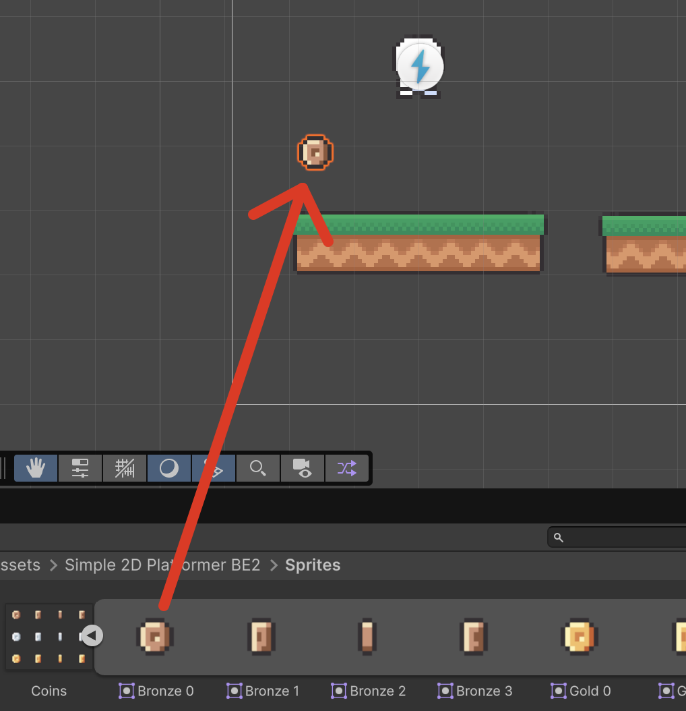
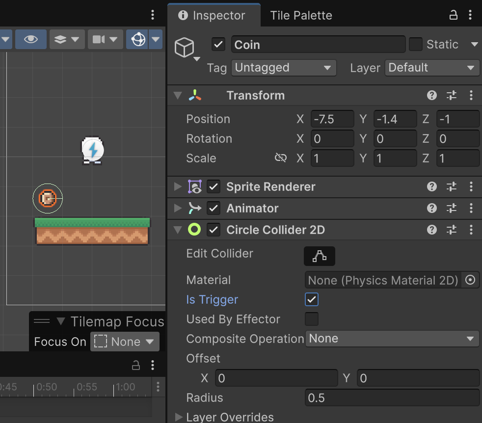
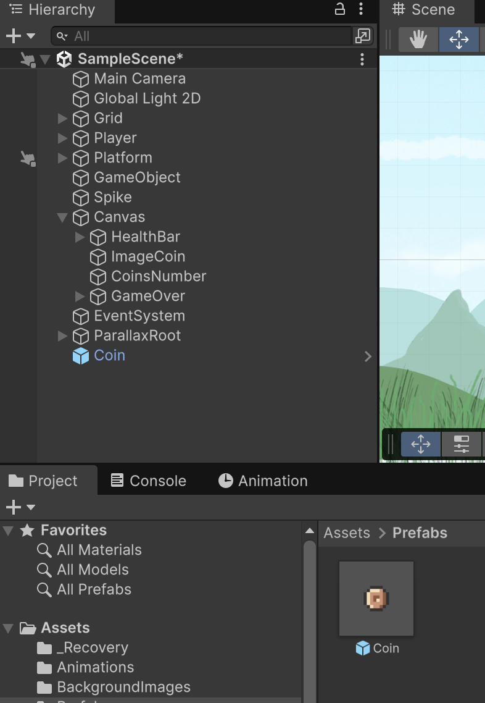
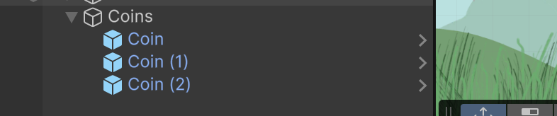

# Monedes i prefabs

**Punt de partida:** Nivell01 amb el jugador i la càmera configurats.

Els items són objectes que el jugador pot recollir, com monedes, power-ups, etc. 

Als *"Assets"*, des de la carpeta:

*Assets > Simple 2d Platformer BE2 > Sprites*

Desplega **"Coins"** i arrosega **"Bronze 0"** cap a l'escena.

<center>

</center>
<br/>

Canvia el nom a **"Coin"**

Obre la finestra d'animacions:

*Menú Window > Animation > Animation*

Amb l'objecte **"Coin"** sel·leccionat, crea una nova animació.

Guarda l'animació dins de **"Animations"** amb el nom **"CoinRotation"**

Arrosega els sprites:

- "Bronze 0" a la posició 0:00
- "Bronze 1" a la posició 0:10
- "Bronze 2" a la posició 0:20
- "Bronze 3" a la posició 0:30
- "Bronze 0" a la posició 0:40

A Sprite Renderer, deixa **Sorting Layer = Default** i posa **Order in Layer = 20**. El Player ha de tenir Order `10` i Ground `0`. Mantén Z a `0`: l'ordre el controlem explícitament amb aquestes propietats, no allunyant els objectes de la càmera.

Activa **Loop Time** al clip CoinRotation i posa **Samples = 60** per interpretar els fotogrames indicats.

Afegeix un component tipus **"Circle collider 2d"** a l'objecte **"Coin"**.

Activa la opció **"Is trigger"** de l'objecte **"Coin"**

<center>

</center>
<br/>

## Script Coin.cs

El Player del tutorial ja té `coins` i `AddCoin()`. Crea **Coin.cs** (singular), copia aquest codi complet i afegeix-lo a Coin:

```csharp
using UnityEngine;

[RequireComponent(typeof(Collider2D))]
public class Coin : MonoBehaviour
{
    private bool collected;

    void OnTriggerEnter2D(Collider2D other)
    {
        if (collected) return;
        Player player = other.GetComponentInParent<Player>();
        if (!player) return;
        collected = true;
        GetComponent<Collider2D>().enabled = false;
        player.AddCoin();
        Debug.Log("Monedes: " + player.coins);
        Destroy(gameObject);
    }
}
```

## Prefabs

Els **Prefabs** són objectes pre definits que podem copiar moltes vegades, i si volem fer canvis a la configuració només caldrà modificar el *Prefab* principal.

Arrossega l'objecte **"Coin"** a la carpeta **"Prefabs"** dels assets.

<center>

</center>
<br/>

Veuràs que es queda de color blau indicant que és un *Prefab*.

Fes un nou objecte buit amb **"Create Empty"** a la jerarquia d'objectes, anomenat **"Coins"**. 

Mou el nou objecte l'objecte **"Coin"** de la carpeta **"Prefabs"** dins del nou objecte **"Coins"** tants cops com vulguis.

<center>

</center>
<br/>

Per al nivell de comprovació, posa cinc monedes a **(-8, -1.3)**, **(-3, 0.65)**, **(3, 2.65)**, **(11, 0.65)** i **(24, -1.3)**, totes amb Z = 0. Deixa Coins a posició zero i escala u. Al full Coins conserva PPU = 16 i ajusta CircleCollider2D a **Radius = 0.3**, Offset zero. Les monedes sobre plataformes queden una mica per damunt de la superfície perquè les puguis recollir caminant-hi.

Comprova que pots recollir-les totes abans d'afegir trampes. No posis una moneda fora de l'abast del salt.

`Destroy` elimina l’objecte recollit al final del cicle d’actualització. El booleà `collected` i la desactivació del collider eviten comptar-lo dues vegades abans de l’eliminació.
## Comprovar el resultat

Cada moneda desapareix una sola vegada i incrementa el comptador.

1. Recull tres monedes i comprova els missatges de Console: 1, 2 i 3.
2. Atura Play: les monedes de l’escena tornen.

## Errors habituals

- Si no pots adjuntar el component, comprova **Coin.cs / class Coin**.
- Si bloqueja el jugador, activa Is Trigger al CircleCollider2D.
- Els triggers 2D necessiten un Rigidbody2D en almenys un participant; aquí el porta Player.
