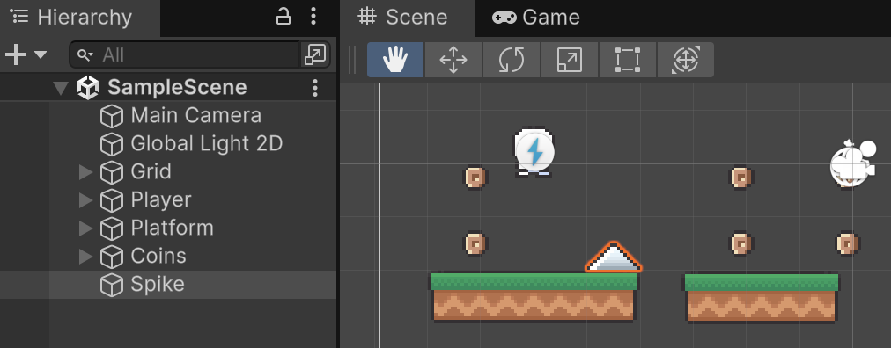
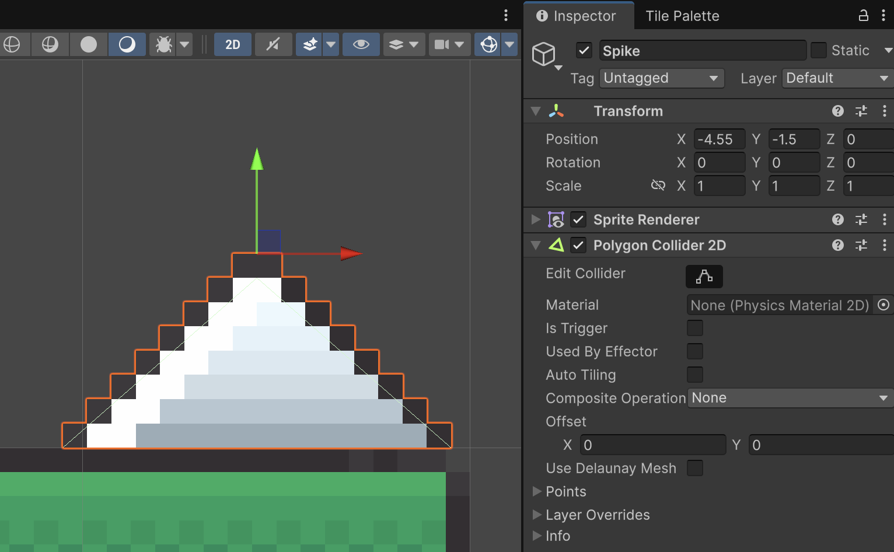
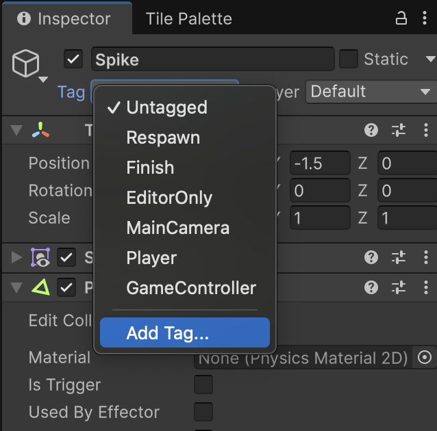
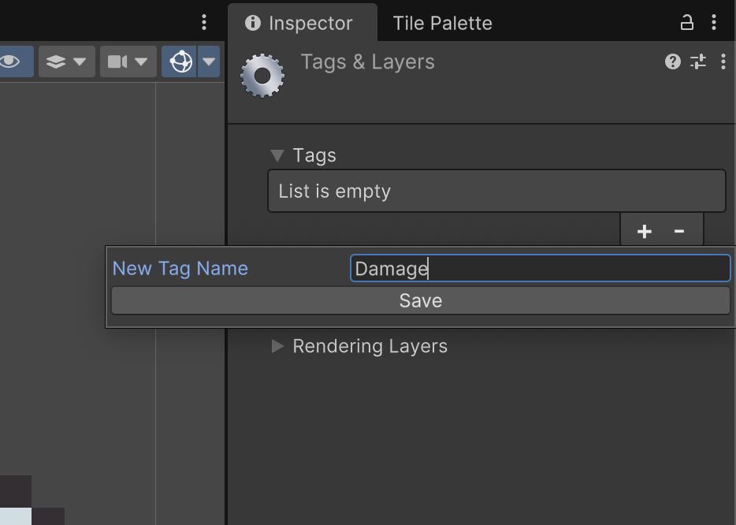
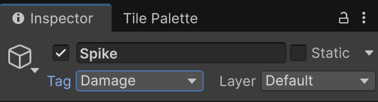

# Trampes i vida

**Punt de partida:** Nivell01 amb un jugador que ja recull monedes.

Les trampes poden produir dany al personatge.

## Definir trampes

Als *"Assets"*, des de la carpeta:

*Assets > Simple 2d Platformer BE2 > Sprites*

Desplega **"Objects"** i arrosega **"Spike"** cap a l'escena.

<center>

</center>
<br/>

Afegeix el component **"Polygon Colider 2D"**, que genera un contorn a partir de la forma física del sprite. No és una còpia exacta de cada píxel. Prem **Edit Collider**, revisa els punts i simplifica les arestes massa petites. Una punta exageradament precisa pot ser menys agradable de jugar que una forma simple.

Deixa **Is Trigger desactivat**: en aquest exemple la trampa és sòlida i utilitzem OnCollision. Una zona de dany que es pugui travessar requeriria Is Trigger i callbacks OnTrigger. Assigna també la Layer **Jumpable** si vols que el jugador pugui saltar des de la trampa.

<center>

</center>
<br/>

Per al nivell de comprovació, posa tres Spike a **(12.5, -1.5)**, **(13.5, -1.5)** i **(14.5, -1.5)**. Mantén PPU = 16 i Scale u. Queden al terra central: es poden superar passant per la tercera plataforma i saltant cap a la dreta. No tapis l'única ruta possible amb una paret de trampes.

## Etiquetar objectes com a trampes

Necessitem *etiquetar* els objectes que produeixen mal amb un **Tag**, escull l'objecte **"Spike"** i al seu inspector la opció d'afegir un **Tag** (etiqueta).

<center>

</center>
<br/>

Com a nom de l'etiqueta defineix **"Damage"**

<center>

</center>
<br/>

Finalment, etiqueta l'objecte **"Spike"** amb el tag **"Damage"**

<center>

</center>
<br/>

## Script complet

Crea **PlayerDamage.cs** i afegeix-lo a Player. Posa **Max Health = 100**, **Damage Per Hit = 10** i **Damage Cooldown = 0.3**.

```csharp
using System.Collections;
using System.Collections.Generic;
using UnityEngine;

[RequireComponent(typeof(SpriteRenderer))]
public class PlayerDamage : MonoBehaviour
{
    [SerializeField] private int maxHealth = 100;
    [SerializeField] private int damagePerHit = 10;
    [SerializeField] private float damageCooldown = 0.3f;
    public int Health { get; private set; }
    public int MaxHealth => maxHealth;
    private readonly HashSet<Collider2D> traps = new HashSet<Collider2D>();
    private SpriteRenderer sr;
    private Color baseColor;
    private float nextDamageTime;
    private Coroutine flash;

    void Awake()
    {
        sr = GetComponent<SpriteRenderer>();
        baseColor = sr.color;
        Health = Mathf.Max(1, maxHealth);
    }

    void OnCollisionEnter2D(Collision2D collision) => TrackTrap(collision);
    void OnCollisionStay2D(Collision2D collision) => TrackTrap(collision);
    void TrackTrap(Collision2D collision)
    {
        if (collision.collider.CompareTag("Damage")) traps.Add(collision.collider);
    }
    void OnCollisionExit2D(Collision2D collision) => traps.Remove(collision.collider);

    void Update()
    {
        traps.RemoveWhere(c => !c || !c.enabled || !c.gameObject.activeInHierarchy);
        if (Health <= 0 || Time.timeScale == 0f || traps.Count == 0 || Time.time < nextDamageTime) return;
        Health = Mathf.Max(0, Health - damagePerHit);
        nextDamageTime = Time.time + Mathf.Max(0.01f, damageCooldown);
        Debug.Log("Vida: " + Health);
        if (flash != null) StopCoroutine(flash);
        flash = StartCoroutine(Flash());
    }

    IEnumerator Flash()
    {
        sr.color = Color.red;
        yield return new WaitForSecondsRealtime(0.15f);
        sr.color = baseColor;
        flash = null;
    }

    void OnDisable()
    {
        traps.Clear();
        if (flash != null) StopCoroutine(flash);
        flash = null;
        if (sr) sr.color = baseColor;
    }
}
```
**Cooldown** és el temps mínim entre cops. Aquí es perd vida cada 0,3 segons mentre es manté el contacte; no a cada fotograma. El conjunt de colliders evita confondre el contacte simultani amb diverses trampes. El flash torna al color original encara que després pausem el temps.

Aquest component guarda la vida i aplica el dany. El HUD llegirà **Health** i **MaxHealth**, i Game Over decidirà què fer quan arribin a zero. Encara no mostrem cap pantalla de derrota.

## Comprovar el resultat

En tocar la trampa, el jugador perd vida i fa un flash vermell.

1. Toca una trampa i comprova que la vida baixa de deu en deu.
2. Separa-te’n: ha de deixar de baixar.
3. Prova dues trampes adjacents i comprova que no dupliquen el dany del mateix instant.

## Errors habituals

- Revisa el Tag Damage, que és diferent de la Layer Jumpable.
- Si no hi ha dany, comprova Is Trigger desactivat i que Player tingui Rigidbody2D.
- Si el contorn no encaixa, ajusta Edit Collider o la forma física a Sprite Editor.
