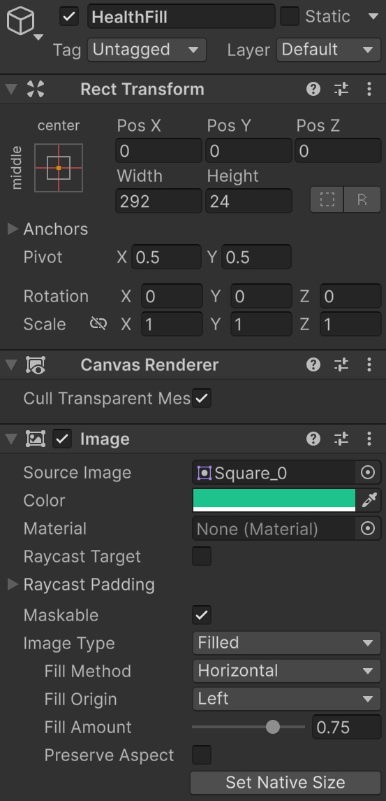
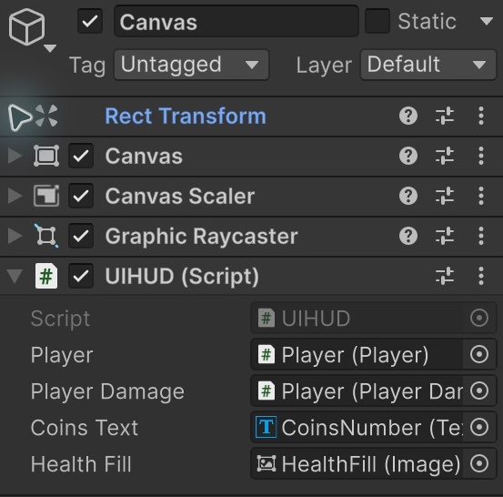
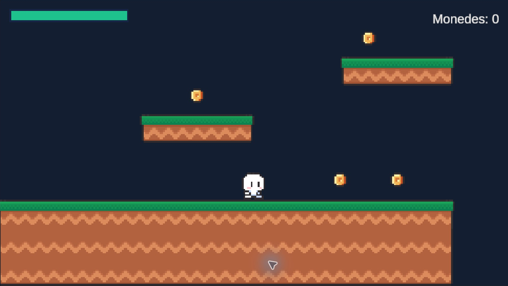

# Connectar el HUD amb la vida i les monedes

**Punt de partida:** Nivell01 amb Player, Coin i PlayerDamage. Aplicarem els conceptes de [02-HUD](../02-HUD/01-Canvas.md) a les dades reals del joc.

**HUD** vol dir **Head-Up Display**: informació que consultem mentre juguem. Aquí mostrarem vida i monedes. La UI presenta les dades; no decideix quan es rep dany.

## Canvas que s'adapta a la pantalla

1. Fes **GameObject > UI (Canvas) > Canvas**.
2. Posa **Render Mode = Screen Space - Overlay**.
3. A **Canvas Scaler**, posa **UI Scale Mode = Scale With Screen Size**, **Reference Resolution = 1280 × 720**, **Screen Match Mode = Match Width Or Height** i **Match = 0.5**.
4. Conserva **Graphic Raycaster** i **EventSystem**.

## Barra de vida de vores netes

1. A Project, selecciona Assets i fes **Create > 2D > Sprites > Square**. El quadrat blanc servirà de sprite rectangular.
2. Selecciona Canvas i crea **UI (Canvas) > Image**, anomenada **HealthBar**.
3. A Rect Transform, obre **Anchor Presets** i, mantenint **Alt+Shift** (Windows) o **Option+Shift** (macOS), escull **top / left**. Les tecles també ajusten el pivot i la posició inicial.
4. Posa **Pos X = 24**, **Pos Y = -24**, **Width = 300**, **Height = 32** i **Scale = (1, 1, 1)**.
5. A Image, assigna **Square** a **Source Image**, deixa **Image Type = Simple**, **Preserve Aspect desactivat**, **Color = 172B4D** al camp Hexadecimal i **A = 255**. Desactiva **Raycast Target**.
6. Selecciona HealthBar i crea una altra Image filla, **HealthFill**. Centra-la amb el preset **middle / center** i les mateixes tecles. Posa **Pos X = 0**, **Pos Y = 0**, **Width = 292**, **Height = 24** i **Scale = (1, 1, 1)**.
7. Assigna **Square**, posa color **20C997** amb A `255` i desactiva Raycast Target.
8. Escull **Image Type = Filled**, **Fill Method = Horizontal**, **Fill Origin = Left**, **Fill Amount = 1** i **Preserve Aspect desactivat**.

No utilitzem Scale per definir la mida. **Width/Height** defineixen el rectangle i **Fill Amount** quina fracció es pinta. `1` és plena, `0.5` és mitja i `0` és buida. Prova-ho amb Play aturat i deixa-la a `1`.

<center>

</center>
<br/>

## Comptador de monedes

1. Selecciona Canvas i crea **UI (Canvas) > Text - TextMeshPro**, anomenat **CoinsNumber**.
2. Si apareix TMP Importer, prem **Import TMP Essentials** i espera que acabi. No cal importar Examples & Extras.
3. Escull **top / right** amb Alt+Shift o Option+Shift. Posa **Pos X = -24**, **Pos Y = -24**, **Width = 300**, **Height = 48**, **Scale = (1, 1, 1)**.
4. Escriu **Monedes: 0**, posa **Font Size = 32**, **Auto Size desactivat**, color blanc i alineació a la dreta i al mig vertical. Tria un color que contrasti amb el teu fons.
5. A Extra Settings del text, desactiva **Raycast Target**.

```text
Canvas
    HealthBar
        HealthFill
    CoinsNumber
EventSystem
```

## Script UIHUD.cs

Crea **UIHUD.cs**, copia el codi complet i afegeix-lo a Canvas. No anomenis la classe Canvas: Unity ja té un component amb aquest nom.

```csharp
using TMPro;
using UnityEngine;
using UnityEngine.UI;

public class UIHUD : MonoBehaviour
{
    [SerializeField] private Player player;
    [SerializeField] private PlayerDamage playerDamage;
    [SerializeField] private TextMeshProUGUI coinsText;
    [SerializeField] private Image healthFill;

    void LateUpdate()
    {
        if (player && coinsText) coinsText.text = "Monedes: " + player.coins;
        if (playerDamage && healthFill)
        {
            float fraction = playerDamage.MaxHealth > 0
                ? (float)playerDamage.Health / playerDamage.MaxHealth : 0f;
            healthFill.fillAmount = Mathf.Clamp01(fraction);
        }
    }
}
```
Assigna els quatre camps a l'Inspector:

| Camp | Objecte a arrossegar des de Hierarchy |
|---|---|
| Player | Player, amb el component Player |
| Player Damage | Player, amb el component PlayerDamage |
| Coins Text | CoinsNumber |
| Health Fill | HealthFill, no HealthBar |

El codi llegeix les dades a LateUpdate, després de l'Update de dany. La divisió vida actual / vida màxima converteix, per exemple, `75 / 100` en `0.75`. El `(float)` evita la divisió entera. Per a aquest primer joc, llegir dos valors cada fotograma és senzill i suficient; més endavant es pot fer amb esdeveniments.

<center>

</center>
<br/>


## Comprovar el resultat

La barra respon al dany i el text a les monedes recollides. El personatge, el terra i les monedes continuen fent servir els sprites del paquet original.

<center>

</center>
<br/>

1. Recull una moneda: el comptador augmenta.
2. Toca una trampa: el farciment disminueix des de la dreta i el fons no canvia de mida.
3. Canvia Game entre 16:9 i 4:3: la barra i el text continuen a les cantonades.

## Errors habituals

- Si Filled no apareix, assigna un sprite a Source Image.
- Si no canvia el HUD, revisa les quatre referències de UIHUD.
- Si es deforma, deixa Scale a u i comprova Canvas Scaler.
