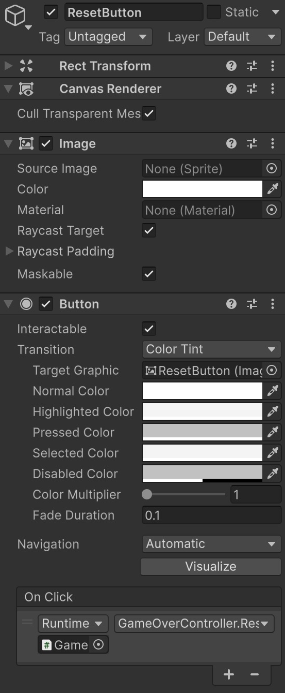
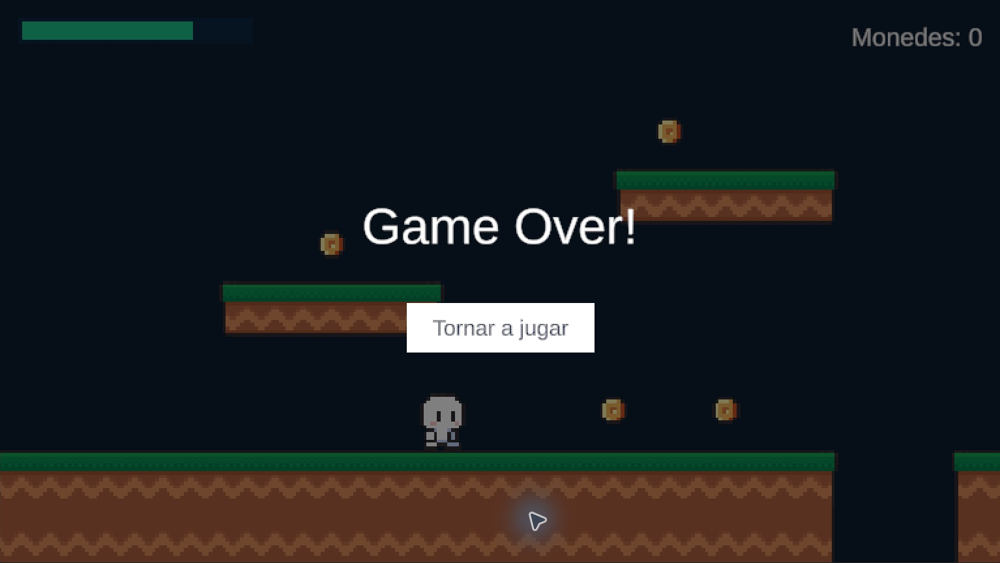

# Game Over i reinici

**Punt de partida:** Nivell01 amb el HUD connectat. Acabarem la partida quan la vida arribi a zero o el jugador caigui per sota de **Y = -25**.

## Crear la pantalla de derrota

1. Selecciona Canvas i crea **UI (Canvas) > Panel**, anomenat **GameOver**. Ha de ser l'últim fill de Canvas perquè es dibuixi sobre el HUD.
2. A Rect Transform, escull **stretch / stretch** amb **Alt+Shift / Option+Shift** i posa **Left, Right, Top i Bottom = 0**. Deixa Scale a `(1, 1, 1)`.
3. A Image, posa **Source Image = None**, un color negre i **A = 190** (si el selector mostra 0–255). Deixa **Raycast Target activat** perquè el fons intercepti els clics destinats a la UI de darrere.
4. Dins de GameOver crea un **Text - TextMeshPro**, anomenat **GameOverText**. Escull el preset **middle / center** amb les mateixes tecles. Posa **Pos X = 0**, **Pos Y = 70**, **Width = 600**, **Height = 100**, text **Game Over!**, mida `64`, color blanc, Auto Size desactivat i alineació centrada en tots dos sentits. Desactiva Raycast Target del text a Extra Settings.
5. Dins de GameOver crea **Button - TextMeshPro**, anomenat **ResetButton**. Centra'l, posa **Pos X = 0**, **Pos Y = -60**, **Width = 240**, **Height = 64**. Al fill Text (TMP), escriu **Tornar a jugar** amb mida `28`.
6. Deixa GameOver activat mentre el prepares. El controlador l'amagarà en començar la partida. Quan acabis de configurar-lo, pots desactivar GameOver a l'Inspector per continuar editant el nivell sense el panell al davant; GameOverController l'activarà quan perdis.

## Controlador de partida

Crea un objecte buit **GameManager**, a l'arrel de Hierarchy, i afegeix-hi aquest script complet **GameOverController.cs**. No el posis dins del panell que es desactiva.

```csharp
using UnityEngine;
using UnityEngine.InputSystem;
using UnityEngine.SceneManagement;

public class GameOverController : MonoBehaviour
{
    [SerializeField] private Player player;
    [SerializeField] private PlayerDamage playerDamage;
    [SerializeField] private GameObject gameOverUI;
    [SerializeField] private float gameOverHeight = -25f;
    private bool gameOver;

    void Awake()
    {
        Time.timeScale = 1f;
        if (gameOverUI) gameOverUI.SetActive(false);
    }

    void Update()
    {
        if (gameOver || !player || !playerDamage) return;
        if (playerDamage.Health <= 0 || player.transform.position.y < gameOverHeight)
            ShowGameOver();
    }

    public void ShowGameOver()
    {
        if (gameOver) return;
        gameOver = true;
        if (gameOverUI) gameOverUI.SetActive(true);
        if (player)
        {
            var input = player.GetComponent<PlayerInput>();
            if (input) input.DeactivateInput();
        }
        Time.timeScale = 0f;
    }

    public void ResetScene()
    {
        Time.timeScale = 1f;
        SceneManager.LoadScene(SceneManager.GetActiveScene().buildIndex);
    }
}
```
1. Assigna **Player** i **Player Damage** amb l'objecte Player, i **Game Over UI** amb el panell GameOver.
2. Posa **Game Over Height = -25**. Si el nivell és més baix, adapta aquest límit: és una coordenada del món, no de pantalla.
3. Selecciona ResetButton. A **Button > On Click ()**, prem **+**, arrossega **GameManager** al camp de l'objecte i escull **GameOverController > ResetScene()**.
4. Selecciona EventSystem: amb Input System, utilitza **Input System UI Input Module**. Si apareix **Replace with InputSystemUIInputModule**, prem-lo. Si falten les accions i apareix **Assign Default Actions**, prem-lo.
5. Aquest EventSystem ha de conservar les seves accions de UI independents de Controls/Gameplay. No assignis el seu mòdul al camp UI Input Module de PlayerInput en aquest exemple: volem desactivar només els controls del jugador.

<center>

</center>
<br/>

`Time.timeScale = 0` atura el temps de joc i la simulació física normal, però **Update continua executant-se**. Per això també desactivem l'entrada de Player i fem servir `gameOver` per executar la derrota només una vegada. L'EventSystem continua permetent prémer el botó.

Abans de carregar l'escena restablim el temps a `1`. El HUD i la vida es reinicien perquè els objectes de Nivell01 es creen de nou.

## Incloure l'escena a la compilació

1. Desa Nivell01 amb **Ctrl+S / Cmd+S**.
2. Obre **File > Build Profiles** i entra a **Scene List**.
3. Fes **Add Open Scenes** i comprova que **Assets/Scenes/Nivell01.unity** està inclosa i marcada a la llista efectiva del perfil actiu. Si el perfil substitueix la llista global, afegeix-la també a la seva llista.
4. En versions antigues de Unity, aquesta configuració era a **File > Build Settings > Scenes In Build**.

El reinici carrega l'escena pel seu índex de compilació; una escena que no està inclosa no té un índex vàlid.

<center>

</center>
<br/>


## Comprovar el resultat

La derrota apareix tant en perdre tota la vida com en caure al buit, i el botó reinicia la partida.

1. Mor tocant una trampa. Prova A/D i Espai: el jugador no ha de respondre.
2. Prem Tornar a jugar: vida i monedes tornen a l’inici i el joc es mou.
3. Cau per sota de -25 i repeteix el reinici.

## Errors habituals

- Si el botó no respon, revisa EventSystem, el seu mòdul, Graphic Raycaster i On Click.
- Si la pantalla es veu des del principi, revisa que GameManager estigui actiu i tingui Game Over UI assignat.
- Si falla LoadScene, revisa la llista d’escenes del perfil actiu.
