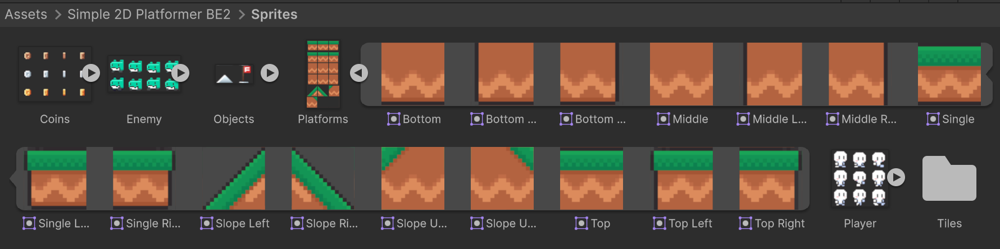
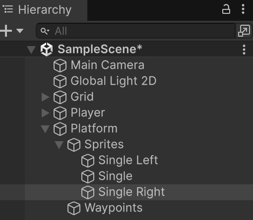
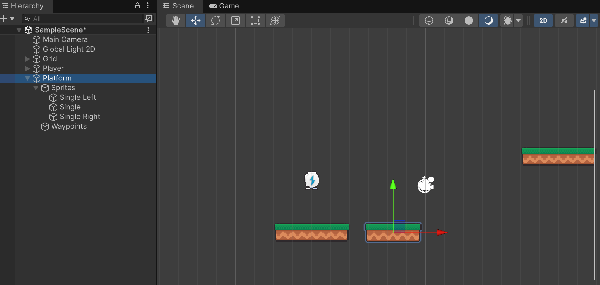
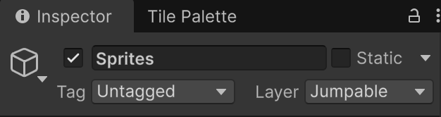
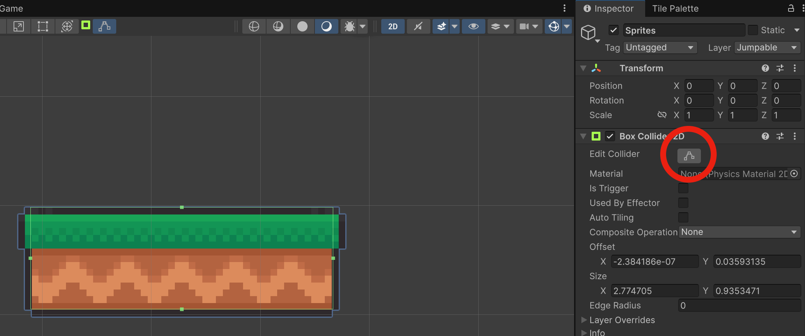
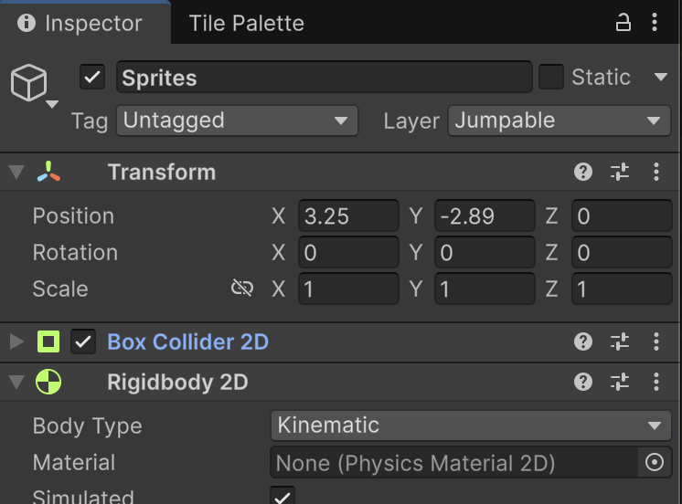
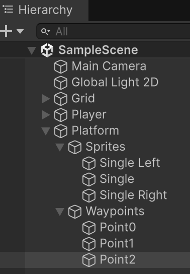

# Plataformes mòbils

**Punt de partida:** completa abans el jugador, les animacions, la càmera, les monedes, les trampes, el HUD i Game Over. Tornem ara a la mateixa escena Nivell01.

Una plataforma mòbil és una superfície que es desplaça entre punts del món. El terreny fix continua sent un Tilemap. Per a una plataforma rectangular petita, tres sprites i un sol BoxCollider2D són suficients; no cal convertir totes les peces del joc en Tilemaps.

Crea un objecte buit amb **"Create Empty"** a l'escena i anomena'l **"Platform"**.

Dins de l'objecte **Platform**, crea dos objectes més:

- Un objecte buit anomenat **"Sprites"** que tindrà els gràfics.
- Un objecte buit anomenat **"Waypoints"** que tindrà els punts que defineixen el recorregut.

## Sprites

Els sprites són les imatges que es veuran.

Des dels *"Assets"*:

*Assets > Simple 2D Platformer BE2 > Sprites*

Desplega l'objecte **"Platforms"**

<center>

</center>
<br/>

**Important!** No et confonguis amb els Tiles!

Arrosega els sprites [Single Left, Single, Single Right] a l'escena. I mou-los dins de l'objecte **Platform > Sprites**.

<center>

</center>
<br/>

Defineix les següents posicions:

- Single Left X = -1
- Single Left Y = 0
- Single X = 0
- Single Y = 0
- Single Right X = 1
- Single Right Y = 0

De manera que quedin de costat.

<center>

</center>
<br/>

Fes que l'objecte **"Sprites"** sigui 'Jumpable'.

**Important!** Et demanarà si vols fer els objectes fills també 'Jumpable'. No cal, es pot dir que **NO**.

<center>

</center>
<br/>

Afegeix un component **BoxCollider2D** a l'objecte **"Sprites"**. I adapta la mida de la caixa al tamany dels sprites amb el botó **Edit Collider**.

<center>

</center>
<br/>

Afegeix un component **Rigidbody2D** a l'objecte **"Sprites"**. I posa:

- **Body Type**: Kinematic
- **Interpolate**: Interpolate
- Al BoxCollider2D, **Is Trigger desactivat**

<center>

</center>
<br/>

## Waypoints

Els waypoints són els punts per on es mourà la plataforma.

Defineix tres elements buits *(Create Empty)* dins de l'objecte **Waypoints**. I anomena'ls **"Point0", "Point1", "Point2"**.

<center>

</center>
<br/>

Deixa Platform, Sprites i Waypoints amb Position zero, Rotation zero i Scale u. Les posicions següents són coordenades del món perquè tots els pares són a zero. La plataforma es col·locarà a Point0 en prémer Play. Amb BoxCollider2D **Size = (3, 1)** i Offset zero, la seva superfície inicial serà Y = 0, accessible des del terra Y = -2.

<br/>

Al nivell de comprovació:

- Point0 X: 22
- Point0 Y: -0.5
- Point1 X: 26
- Point1 Y: -0.5
- Point2 X: 26
- Point2 Y: 0.5

<center>
<!-- Captura pendent: ./assets/revisio-plataforma-mobil.png -->
</center>
<br/>

## Script Platform.cs

Afegeix aquest component a **Platform**, el pare que conté Sprites i Waypoints:

```csharp
using UnityEngine;

[DefaultExecutionOrder(-200)]
public class Platform : MonoBehaviour
{
    [SerializeField] private Rigidbody2D platformBody;
    [SerializeField] private Transform[] points;
    [SerializeField] private float speed = 2f;
    [SerializeField] private float waitAtPoint = 0f;
    private int targetIndex = 1;
    private int direction = 1;
    private float remainingWait;
    public Vector2 SurfaceVelocity { get; private set; }

    void Awake()
    {
        if (!platformBody || points == null || points.Length < 2)
        {
            Debug.LogError("Assigna el cos de la plataforma i almenys dos punts.", this);
            enabled = false;
            return;
        }
        foreach (var point in points)
        {
            if (point) continue;
            Debug.LogError("Hi ha un punt sense assignar.", this);
            enabled = false;
            return;
        }
        platformBody.position = points[0].position;
    }

    void FixedUpdate()
    {
        SurfaceVelocity = Vector2.zero;
        if (remainingWait > 0f)
        {
            remainingWait -= Time.fixedDeltaTime;
            return;
        }
        Vector2 current = platformBody.position;
        Vector2 target = points[targetIndex].position;
        Vector2 next = Vector2.MoveTowards(current, target, Mathf.Max(0f, speed) * Time.fixedDeltaTime);
        SurfaceVelocity = (next - current) / Time.fixedDeltaTime;
        platformBody.MovePosition(next);
        if ((next - target).sqrMagnitude > 0.000001f) return;
        remainingWait = Mathf.Max(0f, waitAtPoint);
        if (targetIndex == points.Length - 1) direction = -1;
        else if (targetIndex == 0) direction = 1;
        targetIndex += direction;
    }
}
```
1. Assigna el **Rigidbody2D de Sprites** al camp **Platform Body**.
2. A **Points**, posa Size `3` i arrossega Point0, Point1 i Point2 en aquest ordre.
3. Posa **Speed = 2** i **Wait At Point = 0**. En començar, la plataforma es col·loca a Point0 i recorre els punts d'anada i tornada.
4. Els waypoints han de ser germans de Sprites, no fills seus: si es moguessin amb la plataforma, el destí també fugiria.

Movem el cos cinemàtic amb **MovePosition** a FixedUpdate. **SurfaceVelocity** és el desplaçament previst durant aquest pas dividit pel temps del pas. L'ordre `-200` el calcula abans de PlayerJump (`-100`) i Player (ordre normal).

## Player.cs complet amb transport

Substitueix tot **Player.cs** pel següent codi. Conserva el comptador de monedes i l'entrada ja configurada:

```csharp
using UnityEngine;
using UnityEngine.InputSystem;

[RequireComponent(typeof(Rigidbody2D), typeof(PlayerInput))]
public class Player : MonoBehaviour
{
    public float moveSpeed = 5f;
    public int coins { get; private set; }
    public float MoveX { get; private set; }
    private Rigidbody2D rb;
    private PlayerJump jump;

    void Awake()
    {
        rb = GetComponent<Rigidbody2D>();
        jump = GetComponent<PlayerJump>();
    }

    public void OnMove(InputValue value)
    {
        MoveX = value.Get<Vector2>().x;
    }

    void FixedUpdate()
    {
        float speedX = MoveX * moveSpeed;
        float speedY = rb.linearVelocity.y;
        if (jump && jump.isGrounded && jump.GroundCollider)
        {
            var platform = jump.GroundCollider.GetComponentInParent<Platform>();
            if (platform)
            {
                speedX += platform.SurfaceVelocity.x;
                // Seguim també el descens i frenem amb la plataforma en arribar.
                // Sense això, el cos pot perdre el suport i ignorar un salt.
                speedY = platform.SurfaceVelocity.y;
            }
        }
        rb.linearVelocity = new Vector2(speedX, speedY);
    }

    public void AddCoin() => coins++;
}
```

**PlayerJump i PlayerAnimation no necessiten canvis.** GroundCollider identifica el mateix contacte que valida el terra. L'animació i l'orientació es basen en MoveX: quedar-se quiet sobre una plataforma no equival a caminar.

Aquest controlador acompanya la velocitat **horitzontal i vertical** mentre hi ha suport. PlayerJump s'executa abans: quan inicia un salt, desmarca isGrounded i el transport deixa de substituir la velocitat vertical. Així conservem el salt del personatge. Comença amb recorreguts lents; no és un controlador complet per a ascensors molt ràpids, aixafaments o plataformes que giren, i no conserva explícitament l'impuls horitzontal en saltar.

## Comprovar el resultat

El jugador és transportat sense prémer tecles i conserva la direcció on mirava.

1. Puja a la plataforma i deixa anar les tecles: ha de mostrar Idle.
2. Deixa que la plataforma canviï de direcció: el jugador no ha de girar sol.
3. Camina i salta des de la plataforma.
4. Prova els extrems del recorregut i el tram vertical sense travessar colliders.

## Errors habituals

- Si no transporta el jugador, comprova Jumpable al mateix objecte que té el collider.
- Si el camí es mou, revisa la jerarquia de Waypoints.
- Si hi ha errors de referències, assigna Platform Body i tots els Points.
- Si el moviment és massa ràpid per al suport vertical, redueix Speed abans d’ampliar el controlador.
