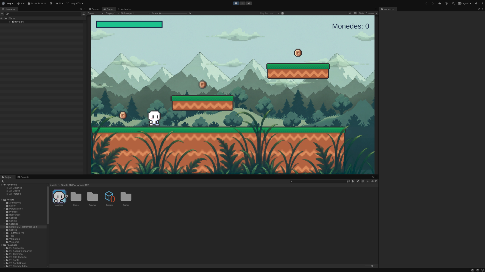
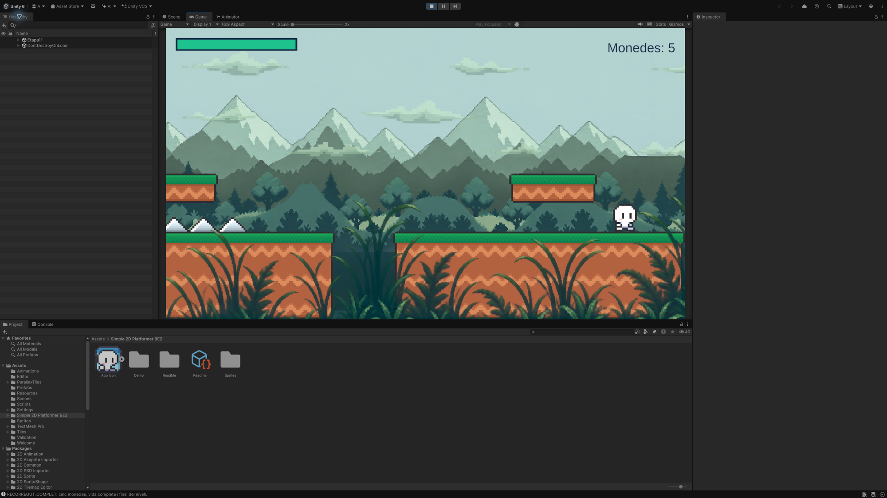

# Parallax amb Tilemaps

**Punt de partida:** l'escena **Nivell01**, amb el personatge, el terreny i la càmera dels tutorials anteriors. Farem servir els mateixos sprites del joc i afegirem un decorat nou. Desa l'escena i atura Play abans de començar.

Quan mires per la finestra d'un tren, els arbres propers passen ràpid i les muntanyes llunyanes semblen moure's molt poc. **Parallax** és reproduir aquest efecte amb diverses capes de dibuix.

En aquest tutorial, **el cel, les muntanyes, els núvols, el bosc i la vegetació del davant són Tilemaps**. Només el terreny del joc té col·lisions. El personatge i les monedes continuen sent els objectes dels capítols anteriors.

<center>

</center>
<br/>

## 1. Importar el pack

Descarrega [ParallaxTiles.zip](./ParallaxTiles.zip), descomprimeix-lo i arrossega la carpeta **ParallaxTiles** directament a **Assets**. La ruta ha de ser **Assets/ParallaxTiles**, sense una altra carpeta intermèdia.

**Només les imatges:** [BackgroundImages.zip](./BackgroundImages.zip) conté només els quatre PNG. Per seguir tots els passos, fes servir ParallaxTiles.zip, que inclou també els scripts. No cal importar tots dos ZIP.

El pack conté:

| Carpeta | Contingut |
|---|---|
| Textures | Muntanyes.png, Nuvols.png, Bosc.png i PrimerPla.png, (núvols, bosc i primer pla amb transparència) |
| Scripts | ParallaxTilemapLayer.cs, que mou i repeteix les capes |
| Editor | ParallaxTilesBuilder.cs, que prepara els sprites, tiles i prefab |

Espera que Unity compili. Si el menú del pas següent no apareix, mira Console i corregeix primer els errors vermells. Necessites **Universal 2D**, **2D Sprite** i **2D Tilemap Editor**, com als primers capítols.

Els gràfics comparteixen tons verds i blavosos: clars al fons, més foscos al davant. Els fulls són de **2172 × 724 píxels**, excepte Nuvols, de **2171 × 724**: l'eina compensa aquest píxel transparent de la vora sense estirar el dibuix. Cada bloc cobreix 24 unitats horitzontals amb diversos grups de vegetació i muntanyes per espaiar les repeticions. Muntanyes inclou el cel del seu full; Nuvols, Bosc i PrimerPla tenen transparència per deixar veure les capes del darrere. Conservem les il·lustracions completes i les dividim en peces; les peces no es poden barrejar a l'atzar sense trencar el dibuix.

## 2. Preparar els tiles

1. Executa **Tools > Parallax > Preparar tiles i prefab** una vegada.
2. Obre **Assets/ParallaxTiles/Generated**.
3. Hi trobaràs les carpetes **Muntanyes**, **Nuvols**, **Bosc** i **PrimerPla**, amb **48 tiles cadascuna**; també el tile de cel i el prefab **Parallax**.
4. Selecciona **Textures/Muntanyes.png**. A l'Inspector comprova **Sprite Mode = Multiple**, **Pixels Per Unit = 90.5**, **Filter Mode = Point**, **Compression = None**, **Max Size = 4096** i mipmaps desactivats. No redueixis Max Size a 2048: canviaria la resolució importada del full.
5. Prem **Sprite Editor** per veure el retall en **12 columnes × 4 files**, amb peces de **181 × 181 píxels**.

<center>
<!-- Captura pendent: ./assets/parallax-tiles-retall.png -->
</center>
<br/>

**Què vol dir Pixels Per Unit?** Cada peça de 181 píxels ocupa una cel·la de dues unitats. El bloc complet ocupa 24 unitats d'amplada i 8 d'alçada. No cal posar el mateix PPU al personatge: els seus 16 píxels per unitat continuen definint la seva mida.

L'eina fa el mateix retall que **Sprite Editor > Slice > Grid by Cell Size = 181 / 181**, amb pivot al centre i conservant les peces transparents. Aquestes peces buides mantenen la disposició del full. No utilitzis **Automatic**, perquè retallaria segons les siluetes i canviaria la graella.

Cada recurs Tile apunta a un d'aquests sprites i té **Collider Type = None**. El PNG original es conserva; retallar-lo dins de Unity no el divideix en 48 fitxers PNG.

<center>
<!-- Captura pendent: ./assets/parallax-tiles-recursos.png -->
</center>
<br/>

Per editar el dibuix amb el pinzell, crea una **Tile Palette** com al capítol 01 i arrossega-hi els sprites del full. Unity pot crear els tiles de la paleta. Conserva l'ordre de les peces: per a aquest primer exemple és més fàcil utilitzar el bloc ja reconstruït pel prefab.

> Tornar a executar l'eina regenera el prefab i els tiles del pack. Si vols personalitzar-los, duplica abans el prefab i treballa sobre la còpia.

## 3. Posar les capes a l'escena

1. Arrossega **Generated/Parallax.prefab** a Hierarchy, al nivell principal de l'escena. No el posis dins de Player ni de Main Camera.
2. Deixa el pare **Parallax** a Position `(0, 0, 0)`, Rotation `(0, 0, 0)` i Scale `(1, 1, 1)`.
3. Desplega'l. Cada capa té un **Grid** i un fill **Tiles**, amb **Tilemap** i **Tilemap Renderer**.
4. A cada capa, assigna **Main Camera** al camp **Target Camera**. Si el deixes buit, l'script busca la càmera amb el tag MainCamera.
5. Comprova que **Source** apunta al fill Tiles d'aquella capa, i no al terreny del joc.

```text
Parallax
    Cel                 Grid + ParallaxTilemapLayer
        Tiles           Tilemap + Tilemap Renderer
    Muntanyes           Grid + ParallaxTilemapLayer
        Tiles
    Nuvols              Grid + ParallaxTilemapLayer
        Tiles
    Bosc                Grid + ParallaxTilemapLayer
        Tiles
            BaseBosc    Tilemap que allarga el color cap avall
    PrimerPla           Grid + ParallaxTilemapLayer
        Tiles
Grid                    El terreny anterior, amb colliders
Player
Main Camera
Canvas
```

<center>
<!-- Captura pendent: ./assets/parallax-tiles-capes.png -->
</center>
<br/>

El prefab utilitza una càmera ortogràfica amb **Size = 5** i posició inicial aproximada `(0, 1, -10)`. Si el teu nivell comença en un altre lloc, mou les capes per emmarcar-lo **amb Play aturat**. L'script conserva aquestes posicions inicials.

Els Grid tenen **Cell Size = (2, 2, 0)**, **Cell Gap = (0, 0, 0)** i escala u. El fill Tiles té posició zero, rotació zero i escala u. No estiris els fons amb Scale: ajusta la posició vertical de la capa.

## 4. Ordenar el dibuix i donar profunditat

**Order in Layer** decideix qui tapa qui. **Depth** decideix quant es desplaça aparentment el dibuix quan la càmera avança. Són dues propietats diferents.

Tots aquests renderers utilitzen la Sorting Layer **Default**:

| Capa | Order in Layer | Depth | Posició Y inicial |
|---|---:|---:|---:|
| Cel | -100 | 0 | -5 |
| Muntanyes | -80 | 0.2 | -1 |
| Núvols | -60 | 0.3 | -1.6 |
| Bosc | -40 | 0.55 | -3.7 |
| Terreny del joc | 0 | Sense script | La del nivell |
| Personatge | 10 | Sense script | La del jugador |
| Monedes | 20 | Sense script | La de cada moneda |
| PrimerPla | 40 | 1.2 | -4.9 |

Les cinc capes decoratives comencen a **X = -12**, **Z = 0**. Els seus Tilemap Renderer utilitzen el material **ParallaxUnlit**, generat pel pack: els colors no depenen de les llums 2D de l'escena.

- **Depth = 0:** la capa acompanya la càmera i queda quieta a la pantalla, com el cel.
- **Depth = 0.2:** sembla moure's poc; la percebem llunyana.
- **Depth = 1:** es comporta visualment com el terreny fix del joc.
- **Depth = 1.2:** passa més ràpid que el terreny; la percebem davant del personatge.

Si la càmera avança cap a la dreta, aquests elements passen cap a l'esquerra a la pantalla, a velocitats diferents. Parlem del moviment que veu el jugador, no de la coordenada que escriu l'script.

<center>
<!-- Captura pendent: ./assets/parallax-tiles-inspector.png -->
</center>
<br/>

**Follow Camera Y** activat manté l'altura del decorat respecte a la pantalla quan la càmera puja. En aquest exemple ens centrem en el parallax horitzontal. No és un sistema de fons infinit vertical: si vols un nivell de pujada, cal preparar més decorat vertical i revisar aquesta opció.

**BaseBosc** és un Tilemap fill de Tiles amb un color verd fosc i Order **-41**. Omple la part inferior del decorat, darrere de la il·lustració, perquè als forats del terreny no es vegi una franja de cel sota el bosc. Es repeteix amb el mateix bloc.

Amb el cel clar, selecciona **Canvas > CoinsNumber** i canvia el color del text a **172B4D**, A **255**, perquè el comptador sigui llegible.

**Els núvols tenen alçades diferents dins del mateix Tilemap**: els més alts queden sobre els cims i els més baixos se superposen a les muntanyes. Order -60 els dibuixa davant de les muntanyes (-80) però darrere del bosc (-40). El Tilemap dels núvols té **Color = D4F2E8** i **A = 140** per suavitzar-los i no competir amb el personatge. La seva mida reduïda i Depth **0.3**, entre muntanyes (**0.2**) i bosc (**0.55**), els situen a una distància intermèdia. Els mou només la càmera; no hi afegim vent independent.

El primer pla té herbes i falgueres altes, amb espais transparents entre les fulles. La base queda per sota de la pantalla per evitar una franja rectangular; les puntes emmarquen el joc. Si tapa els peus del personatge o impedeix veure una trampa, baixa la seva Y. **No hi afegeixis colliders:** veure herba davant no significa que sigui un obstacle.

## 5. Repetir sense talls

El bloc original conté les columnes **0 a 11** i les files **0 a 3**. **Block Width Cells = 12**, amb cel·les de 2 unitats, dona una amplada de 24 unitats i indica on acaba el bloc horitzontal, encara que algunes peces siguin transparents.

Una il·lustració generada no garanteix que la vora esquerra sigui igual que la dreta. Per això activem **Mirror Alternate Blocks**:

```text
bloc normal | bloc en mirall | bloc normal | bloc en mirall
```

A cada unió es troben dues còpies de **la mateixa vora**. No hi ha un salt de color entre extrems diferents. Pot haver-hi simetria visible: aquest és el compromís del pack. No és un sistema de peces que es puguin combinar en qualsevol ordre.

En prémer Play, l'script crea prou còpies per cobrir l'amplada de la càmera, amb marge als costats. Si la finestra s'eixampla, afegeix les còpies necessàries. No pressuposa que amb tres sempre n'hi haurà prou.

<center>
<!-- Captura pendent: ./assets/parallax-tiles-unions.png -->
</center>
<br/>

Les còpies apareixen com **Tiles_Repeat_...** durant Play. No les editis: en sortir de Play desapareixen. Edita el bloc original amb Play aturat. No pintis fora de les 12 columnes si vols conservar aquesta amplada de repetició.

## 6. Entendre l'script

El pack ja inclou **ParallaxTilemapLayer.cs**. No creïs una segona classe amb el mateix nom. Aquest és el seu codi complet:

```csharp
using System.Collections.Generic;
using UnityEngine;
using UnityEngine.Tilemaps;

// La càmera del tutorial es mou a LateUpdate amb ordre 0.
// Actualitzem el decorat després, amb la posició definitiva de la càmera.
[DefaultExecutionOrder(100)]
public class ParallaxTilemapLayer : MonoBehaviour
{
    [SerializeField] private Camera targetCamera;
    [SerializeField] private Tilemap source;
    [SerializeField, Min(1)] private int blockWidthCells = 12;
    [SerializeField, Range(0f, 2f)] private float depth = 0.2f;
    [SerializeField] private bool followCameraY = true;
    [SerializeField] private bool mirrorAlternateBlocks = true;

    private readonly List<Transform> copies = new List<Transform>();
    private Vector3 cameraStart;
    private Vector3 layerStart;
    private float blockWidth;

    void Start()
    {
        if (!targetCamera) targetCamera = Camera.main;
        var grid = GetComponent<Grid>();
        if (!targetCamera || !targetCamera.orthographic || !source || !grid)
        {
            Debug.LogError("Assigna una càmera ortogràfica i un Tilemap fill d'aquest Grid.", this);
            enabled = false;
            return;
        }
        // El tutorial utilitza Grid amb escala 1, sense rotació ni separació entre cel·les.
        blockWidth = blockWidthCells * grid.cellSize.x;
        if (blockWidth <= 0f) { enabled = false; return; }
        cameraStart = targetCamera.transform.position;
        layerStart = transform.position;
        copies.Add(source.transform);
        UpdateLayer();
    }

    void LateUpdate() => UpdateLayer();

    private void UpdateLayer()
    {
        Vector3 cameraNow = targetCamera.transform.position;
        Vector3 delta = cameraNow - cameraStart;
        // depth descriu el moviment APARENT respecte al terreny:
        // 0 = fix a pantalla; 1 = com el terreny; >1 = primer pla.
        transform.position = layerStart + new Vector3(
            delta.x * (1f - depth), followCameraY ? delta.y : 0f, 0f);

        float halfView = targetCamera.orthographicSize * targetCamera.aspect;
        float cameraLocalX = cameraNow.x - transform.position.x;
        int first = Mathf.FloorToInt((cameraLocalX - halfView) / blockWidth) - 1;
        int last = Mathf.FloorToInt((cameraLocalX + halfView) / blockWidth) + 1;
        int needed = last - first + 1;

        // Només creem còpies quan augmenta l'amplada visible, no a cada fotograma.
        while (copies.Count < needed)
        {
            var copy = Instantiate(source.gameObject, transform).transform;
            copy.name = source.name + "_Repeat_" + copies.Count;
            copies.Add(copy);
        }
        for (int i = 0; i < copies.Count; i++)
        {
            bool used = i < needed;
            copies[i].gameObject.SetActive(used);
            if (!used) continue;
            int index = first + i;
            bool mirrored = mirrorAlternateBlocks && (index & 1) != 0;
            // Amb mirall, el costat dret toca una còpia del mateix costat dret.
            // El desplaçament d'una amplada compensa l'escala X negativa.
            copies[i].localPosition = new Vector3(
                (index + (mirrored ? 1 : 0)) * blockWidth, 0f, 0f);
            copies[i].localScale = new Vector3(mirrored ? -1f : 1f, 1f, 1f);
        }
    }
}
```

L'script guarda les posicions inicials. A cada fotograma calcula quant s'ha mogut la càmera des d'aquell punt i situa la capa segons Depth. Així no va acumulant petits desplaçaments que puguin desajustar les unions.

**DefaultExecutionOrder(100)** fa que s'executi després del CameraFollow del tutorial, que utilitza l'ordre per defecte. Si un altre controlador mou la càmera més tard, també caldrà ajustar l'ordre.

## 7. Comprovar el resultat

1. Prem Play i camina a dreta i esquerra: muntanyes lentes, bosc més ràpid i primer pla encara més ràpid.
2. Queda't quiet: si la càmera ja no es mou, el decorat tampoc ha de desplaçar-se.
3. Passa per diverses unions: no hi ha d'haver franges buides ni salts de color.
4. Canvia Game entre 16:9 i una finestra més ampla: el decorat ha de continuar cobrint els costats.
5. Salta: el personatge ha de continuar llegint-se clarament davant del fons.
6. Recull una moneda i toca una trampa: el decorat no ha d'interferir en la física ni en el HUD.

<center>

</center>
<br/>

## Errors habituals

- **Es veuen buits:** comprova Block Width Cells = 12, Source, Scale = 1 i que el bloc comença a la columna 0.
- **Tot es mou igual:** revisa Depth de cada capa; l'ordre de dibuix no canvia la velocitat.
- **El bosc tapa el jugador:** comprova Sorting Layer i Order in Layer.
- **El primer pla tapa els salts:** baixa la capa; no intentis solucionar-ho canviant la física del jugador.
- **Els fons surten roses:** aquest pack utilitza el material de Universal 2D; revisa la plantilla i el renderitzador del projecte.
- **El decorat tremola:** CameraFollow ha d'acabar abans del LateUpdate del parallax.
- **El cel deixa un buit a dalt o a baix:** el prefab cobreix 24 unitats verticals; augmenta les files del cel si augmentes molt l'Orthographic Size.

[Retall de sprites a Unity](https://docs.unity3d.com/6000.0/Documentation/Manual/sprite/sprite-editor/automatic-slicing.html) · [Crear tiles amb la paleta](https://docs.unity.com/en-us/engine/6000.0/manual/unity2d/tilemaps/create-tile-palette/assets).
