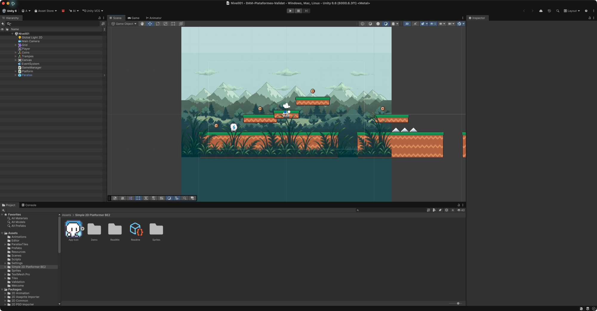
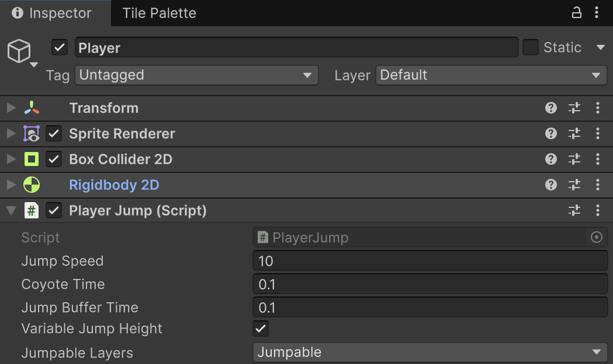

# Millores del salt

**Punt de partida:** el joc de Nivell01 complet, incloses les plataformes mòbils i el decorat amb parallax. Ja tenim un salt bàsic que impedeix dobles salts. Ara afegirem tres ajudes, una per una.

| Millora | Què nota el jugador? |
|---|---|
| Coyote time | Pot saltar durant un instant després de sortir d'una vora |
| Jump buffer | Prémer salt just abans d'aterrar encara funciona |
| Altura variable | Un toc curt fa un salt més baix que mantenir la tecla |

<center>

</center>
<br/>

## Per què cal el coyote time?

Sense aquest marge, només pots saltar si el contacte amb el terra encara existeix en el pas de física que processa la pulsació. Quan surts d'una vora, el contacte pot acabar una fracció de segon abans que premis Espai. Tu encara pots percebre el personatge a la vora, però el joc ja el considera a l'aire i ignora el salt. La diferència entre el dibuix i el collider, el temps de reacció i el moment en què es processa l'entrada poden fer que el control sembli poc tolerant.

El **coyote time** guarda l'instant de l'últim contacte vàlid i permet saltar durant un marge curt després de perdre'l. Per exemple, amb `0.1` segons, si prems Espai `0.06` segons després de sortir de la vora, el salt s'accepta; si passen `0.15` segons, ja no. Aquest marge és una decisió de disseny per fer que el control respongui millor a la intenció del jugador, no un requisit de la física de Unity.

No és un doble salt: només concedeix el salt que encara no has gastat en aquella sortida del terra. **Quan saltes, consumim el permís immediatament**, encara que continuïs dins dels `0.1` segons. El recuperes en aterrar. Amb un marge massa llarg, el jugador podria saltar molt lluny de la vora i canviaria la dificultat del nivell.

El **jump buffer** resol el cas contrari: prémer una mica **abans d'aterrar**. Coyote time tolera una pulsació tardana en sortir; buffer conserva una pulsació anticipada en arribar.

## Comprovar l'entrada abans de canviar el codi

Obre Controls, selecciona Gameplay > Jump i comprova **Action Type = Button**, **Interactions = Press** i **Trigger Behavior = Press And Release**. Desa l'asset. PlayerInput continua amb **Send Messages**. Necessitem saber quan es deixa anar Espai: si només arriba la pulsació, tots els salts tindran la mateixa altura.

## Substituir PlayerJump.cs

Substitueix tot el fitxer pel codi següent. Conserva els camps Jump Speed i Jumpable Layers i és compatible amb Player i PlayerAnimation. No afegeixis un segon component de salt.

```csharp
using UnityEngine;
using UnityEngine.InputSystem;

[DefaultExecutionOrder(-100)]
[RequireComponent(typeof(Rigidbody2D))]
public class PlayerJump : MonoBehaviour
{
    public float jumpSpeed = 10f;
    // Marge per acceptar un salt premut just després de sortir d’una vora.
    // Evita que perdre el contacte un instant abans de la pulsació faci fallar el salt.
    public float coyoteTime = 0.1f;
    public float jumpBufferTime = 0.1f;
    public bool variableJumpHeight = true;
    public LayerMask jumpableLayers;
    public bool isGrounded { get; private set; }
    public Collider2D GroundCollider { get; private set; }

    private Rigidbody2D rb;
    private readonly ContactPoint2D[] contacts = new ContactPoint2D[16];
    private float lastPressedTime = float.NegativeInfinity;
    private float lastGroundedTime = float.NegativeInfinity;
    private bool jumpHeld;
    private bool cutRequested;
    private bool jumpConsumed;
    private bool wasSupported;

    void Awake() => rb = GetComponent<Rigidbody2D>();

    public void OnJump(InputValue value)
    {
        jumpHeld = value.isPressed;
        if (jumpHeld) lastPressedTime = Time.time;
        else cutRequested = true;
    }

    void FixedUpdate()
    {
        UpdateGrounded();
        // Recordem quan hi havia suport real per tolerar una pulsació una mica tardana.
        if (isGrounded) lastGroundedTime = Time.time;
        bool buffered = Time.time - lastPressedTime <= jumpBufferTime;
        // Encara som prou a prop, en temps, de l’últim contacte amb el terra?
        bool coyote = Time.time - lastGroundedTime <= coyoteTime;
        if (!jumpConsumed && buffered && (isGrounded || coyote))
        {
            // Consumim també el marge de coyote: dues pulsacions ràpides
            // no han de convertir aquesta ajuda en un doble salt.
            jumpConsumed = true;
            isGrounded = false;
            GroundCollider = null;
            lastPressedTime = float.NegativeInfinity;
            lastGroundedTime = float.NegativeInfinity;
            float speed = variableJumpHeight && !jumpHeld ? jumpSpeed * 0.5f : jumpSpeed;
            rb.linearVelocity = new Vector2(rb.linearVelocity.x, speed);
            cutRequested = false;
        }
        if (cutRequested && variableJumpHeight && rb.linearVelocity.y > 0f)
            rb.linearVelocity = new Vector2(rb.linearVelocity.x, rb.linearVelocity.y * 0.5f);
        cutRequested = false;
    }

    private void UpdateGrounded()
    {
        GroundCollider = null;
        float bestNormalY = 0.5f;
        int count = rb.GetContacts(contacts);
        for (int i = 0; i < count; i++)
        {
            var contact = contacts[i];
            var other = contact.collider;
            if (!other || other.attachedRigidbody == rb) continue;
            bool jumpable = (jumpableLayers.value & (1 << other.gameObject.layer)) != 0;
            if (jumpable && contact.normal.y > bestNormalY)
            {
                bestNormalY = contact.normal.y;
                GroundCollider = other;
            }
        }
        bool supported = GroundCollider != null;
        // Només una nova arribada al terra torna a donar dret a saltar.
        if (supported && !wasSupported) jumpConsumed = false;
        wasSupported = supported;
        isGrounded = supported && !jumpConsumed;
        if (!isGrounded) GroundCollider = null;
    }
}
```

El codi guarda quan hem tocat terra i quan hem premut salt. Només accepta una pulsació recent. En saltar, **consumeix el salt i invalida els dos temps**: prémer Espai dues vegades dins del marge de coyote no ha de produir dos impulsos. Només un nou aterratge torna a habilitar-lo.

Les pulsacions es recullen al callback d'entrada; els canvis de velocitat es fan a FixedUpdate. Si deixem anar salt mentre pugem, reduïm la velocitat vertical una sola vegada. Una pulsació guardada que ja s'ha alliberat produeix un salt curt.

<center>

</center>
<br/>

## Provar cada ajuda per separat

1. Comença amb **Coyote Time = 0**, **Jump Buffer Time = 0.1** i **Variable Jump Height desactivat**. El marge de buffer també cobreix el temps entre llegir l'entrada i el següent pas de física; un valor zero podria descartar pulsacions entre passos.
2. Deixa't caure des de poca altura i prem Espai just abans de tocar terra. El salt s'ha d'executar en aterrar. Si prems massa aviat, la pulsació caduca.
3. Activa **Coyote Time = 0.1**. Surt caminant d'una vora i prem salt immediatament després: ha de funcionar. Si esperes més, no.
4. Activa **Variable Jump Height**. Compara un toc curt amb mantenir Espai: el salt llarg arriba més amunt.
5. Deixa els marges a `0.1`. Són segons: una dècima, no deu segons.

## Comprovar el resultat

Les ajudes fan el salt més tolerant sense donar salts addicionals a l’aire.

1. Prem dues vegades ràpidament en enlairar-te: només hi ha d’haver un impuls.
2. Prova un salt normal, un salt tardà des d’una vora i un salt guardat abans d’aterrar.
3. Repeteix-ho sobre una plataforma mòbil i tocant una paret.

## Errors habituals

- Si el toc curt no canvia l’altura, comprova Jump com a **Button**, amb **Press > Trigger Behavior = Press And Release**, i PlayerInput amb **Send Messages**. Un Button sense aquesta interacció no envia el missatge d'alliberament amb Send Messages.
- Si el buffer sembla automàtic massa estona, redueix Jump Buffer Time.
- Si permet saltar tocant una paret, revisa la normal del contacte; no substitueixis aquesta comprovació per qualsevol solapament.
