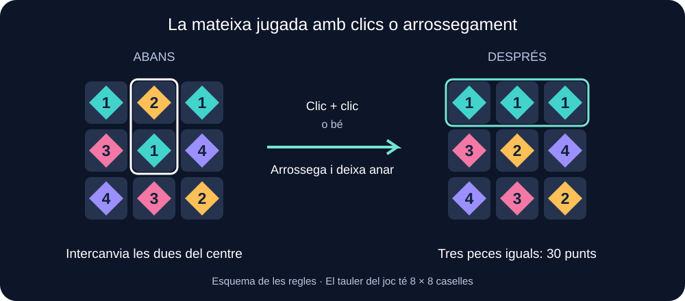
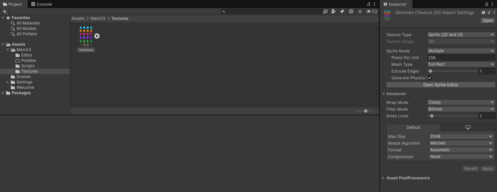
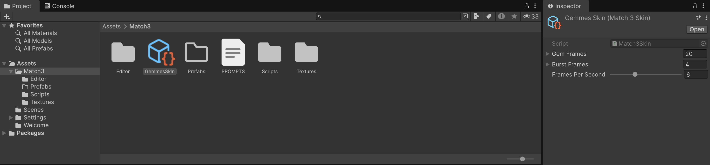

# Match-3: combinar gemmes amb el ratolí

Construirem **Gemmes**, un joc de combinar peces en un tauler. Intercanviem dues peces veïnes per formar una línia de tres o més del mateix tipus. Les peces desapareixen, les de sobre cauen i entren peces noves.

Aquest tutorial és **independent** dels altres apartats. Comença amb un projecte nou i treballa sempre en una sola escena, **Match3**. No necessita assets de pagament ni els gràfics del joc de plataformes. Les gemmes són **sprites il·lustrats amb quatre fotogrames de lluentor**, mostrats amb Images de la UI. Cinc formes diferents i números petits permeten distingir-les encara que no es diferenciïn bé els colors. En eliminar-les, un overlay mostra una lluentor i espurnes.

**Material de l’activitat:** [Match3.zip](./Match3.zip), amb tots els scripts, la imatge de les gemmes i l’eina de preparació. Aquesta guia conté tots els passos, des del projecte buit fins a la partida amb sprites animats, efectes, victòria, derrota i reinici.

## Què podrà fer el jugador?

- **Clic:** clicar una peça per seleccionar-la i clicar una veïna per intercanviar-les. Clicar la mateixa peça cancel·la la selecció; clicar una peça llunyana canvia la selecció.
- **Arrossegament:** mantenir el botó esquerre premut, arrossegar una peça cap a una de les quatre direccions i deixar anar. S'intercanvia amb la veïna d'aquell costat.
- **Partida:** arribar a **800 punts en 20 moviments**. Cada peça eliminada dona 10 punts. Només els intercanvis vàlids gasten un moviment.
- **Reinici:** clicar **Nova partida**, també si una animació està en marxa.

Un arrossegament llarg no permet saltar caselles. Si el gest és diagonal, es tria la direcció en què ens hem mogut més. Deixar anar fora del tauler cancel·la el gest.



## 1. Crear el projecte i l'escena

1. A Unity Hub, fes **New project > Universal 2D**. Anomena el projecte **BoardMatch3** i crea'l. Aquest material s'ha preparat amb Unity **6.6**.
2. Desa l'escena amb **File > Save As**, crea la carpeta **Assets/Scenes** i posa-li **Match3**.
3. Conserva Main Camera. No afegirem Rigidbody2D, colliders ni Tilemaps: tot el tauler és una interfície **uGUI**, com els botons d'un menú.
4. A **Window > Package Management > Package Manager**, comprova que tens **Unity UI**, **Input System** i **2D Sprite** instal·lats. El paquet 2D Sprite proporciona les eines que utilitzarem per retallar el full de gemmes. A **Edit > Project Settings > Player > Other Settings > Configuration**, posa **Active Input Handling = Input System Package (New)**. Accepta el reinici de l'editor si el demana.

Si la plantilla incorpora un paquet antic d'In App Purchasing i mostra un avís, pots retirar-lo des de Package Manager: aquest joc no fa servir compres.

**On treballem:** Hierarchy conté els objectes de l'escena; Project conté els fitxers; Inspector mostra els components de l'objecte seleccionat; Game mostra el joc. Fes els canvis amb **Play desactivat** i desa sovint. Els canvis de l'escena fets durant Play no es conserven en aturar-lo.

## 2. Importar el material i preparar els sprites

1. Descarrega [Match3.zip](./Match3.zip) i descomprimeix-lo fora del projecte.
2. Arrossega la carpeta **Match3** descomprimida directament a **Assets** del panell Project. La ruta ha de ser **Assets/Match3**, sense una altra carpeta intermèdia.
3. Espera que Unity importi els recursos i compili els scripts. **Console no ha de mostrar errors vermells.**
4. Dins de **Assets/Match3**, crea la carpeta **Prefabs**; hi desarem la peça que construirem més endavant.

El paquet conté tot el material addicional de l’activitat. L’escena i el prefab els crearàs seguint aquesta mateixa guia. A Project tindràs:

```text
Assets/
    Match3/
        Scripts/                ← cinc scripts del joc
        Editor/                 ← eina de preparació dels sprites
        Textures/
            Gemmes.png          ← gemmes i efectes en un sol full
        Prefabs/                ← carpeta que acabes de crear
        PROMPTS.md              ← procedència de les imatges
```

Conserva **Editor** amb aquest nom: el seu codi només ha de compilar dins de Unity Editor. Pots obrir els scripts des del panell Project per seguir les explicacions de la guia:

| Fitxer complet | Responsabilitat |
|---|---|
| `Match3Model.cs` | Guardar el tauler, trobar combinacions, comprovar moviments i fer baixar les peces |
| `Match3Piece.cs` | Rebre els clics i l'arrossegament d'una peça |
| `Match3Board.cs` | Crear les peces visibles, animar-les, comptar punts i dirigir la partida |
| `Match3Skin.cs` | Guardar les referències als fotogrames de gemmes i efectes |
| `Match3Effects.cs` | Reproduir l’overlay d’eliminació i netejar-lo en reiniciar |
| `Match3ArtBuilder.cs` | Retallar el full i preparar GemmesSkin des d’un menú de l’editor |

No canviïs el nom dels fitxers: han de coincidir exactament amb els de les classes.

Match3Model no és un component: **no s’arrossega a cap objecte**. Match3Skin és un **ScriptableObject**, un recurs de dades que compartiran les peces. Match3ArtBuilder és una eina de l’editor. Els components que afegirem a objectes són Match3Piece, Match3Board i Match3Effects.

### Retallar el full i crear les dades de les animacions

1. Comprova que la imatge importada és a **Assets/Match3/Textures/Gemmes.png**. Ja està inclosa en el mateix paquet que els scripts.
2. Espera que Unity acabi d’importar i compilar els scripts. Executa **Tools > Match3 > Preparar sprites i animacions** una vegada.
3. L’eina configura el PNG com a **Sprite (2D and UI)**, **Sprite Mode = Multiple**, **Filter Mode = Bilinear**, **Compression = None**, **Max Size = 2048**, **Generate Mip Maps desactivat**, **Alpha Is Transparency activat** i **Pixels Per Unit = 256**.

   

4. A Project, desplega Gemmes.png amb la fletxa de la icona. Hi ha **20 sprites Gemma_0_0 … Gemma_4_3** i **4 sprites Burst_0 … Burst_3**.
5. A Assets/Match3 també apareix **GemmesSkin.asset**. Aquest recurs el genera l’eina; no l’has de descarregar ni crear a mà. Selecciona’l: **Gem Frames** té 20 entrades, **Burst Frames** en té 4 i **Frames Per Second = 6**. L’eina ja ha assignat cada referència.

   

6. Si vols inspeccionar els rectangles, selecciona Gemmes.png i prem **Open Sprite Editor** a l’Inspector. **No facis Slice amb una graella de 256 × 256:** el full és il·lustrat i les formes no estan centrades en una graella exacta. L’eina usa rectangles ajustats, amb marge transparent i la mateixa mida als quatre fotogrames de cada tipus. Això evita tallar les puntes de l’ametista o fer saltar la imatge entre fotogrames.

| Tipus / número | Forma i color | Fotogrames |
|---|---|---|
| 0 / 1 | Aquamarina rodona, cian | Gemma_0_0 a Gemma_0_3 |
| 1 / 2 | Ambre hexagonal, daurat | Gemma_1_0 a Gemma_1_3 |
| 2 / 3 | Robí en forma de cor, rosa | Gemma_2_0 a Gemma_2_3 |
| 3 / 4 | Ametista allargada, violeta | Gemma_3_0 a Gemma_3_3 |
| 4 / 5 | Maragda en forma de fulla, verda | Gemma_4_0 a Gemma_4_3 |
| Efecte | Lluentor, anell i espurnes | Burst_0 a Burst_3 |

El PNG fa **1024 × 1536** i té transparència real. No redimensionis el fitxer: els rectangles del retall estan preparats per a aquestes dimensions. El fons del joc es veurà entre les formes. Reexecutar l’eina actualitza GemmesSkin; si el vols personalitzar, duplica primer aquest recurs.

## 3. Crear el Canvas i l'entrada del ratolí

1. Fes **GameObject > UI (Canvas) > Canvas**.
2. A Canvas, deixa **Render Mode = Screen Space - Overlay**.
3. A **Canvas Scaler**, posa **UI Scale Mode = Scale With Screen Size**, **Reference Resolution = 960 × 900** i **Screen Match Mode = Expand**. Unity ajusta la interfície perquè càpiga sencera; si sobra espai als costats o a dalt i a baix, el cobreix Fons.
4. Conserva el component **Graphic Raycaster**: permet saber quina imatge de la UI rep el ratolí.
5. Comprova que hi ha **un sol EventSystem** a Hierarchy. Si falta, crea'l amb **GameObject > UI (Canvas) > Event System**.
6. Selecciona EventSystem. Ha de tenir **Input System UI Input Module**. Si té **Standalone Input Module**, utilitza **Replace with InputSystemUIInputModule**, o elimina aquell component i afegeix el nou.
7. Al mòdul nou, les accions **Point** i **Left Click** no poden estar buides. Si ho estan, prem **Assign Default Actions**. Point és la posició del ratolí i Left Click és el botó esquerre.

No necessitem un component Player Input ni un mapa de controls Gameplay. La UI rep el ratolí a través d'EventSystem. [Documentació d'Input System per a la UI](https://github.com/Unity-Technologies/InputSystem/blob/develop/Packages/com.unity.inputsystem/Documentation~/using-ui-input-module.md).

## 4. Construir la pantalla

Per crear una Image, selecciona el pare a Hierarchy i fes **GameObject > UI (Canvas) > Image**. Deixa **Source Image = None**: servirà com un rectangle de color.

Per centrar un objecte, al seu **Rect Transform** obre **Anchor Presets**, mantén **Alt+Shift** a Windows o **Option+Shift** a macOS i escull **middle / center**. Això centra ancoratges, pivot i posició. Després escriu la mida i la posició de la taula. Deixa Scale a `(1, 1, 1)` i Rotation a zero, també a la imatge Gemma.

Els colors són valors **Hexadecimal** del selector Color, sempre amb opacitat **A = 255**.

### Fons, targeta i tauler

1. Crea una Image filla de Canvas anomenada **Fons**, color `0D1528`. A Anchor Presets, amb les mateixes tecles, escull **stretch / stretch** i posa Left, Right, Top i Bottom a **0**. Omple la pantalla.
2. Crea una altra Image filla de Canvas anomenada **Targeta**, centrada, de **600 × 790**, posició `(0, 0)`, color `192640`.
3. Dins de Targeta crea una Image anomenada **Tauler**, centrada, de **512 × 512**, posició `(0, 0)`, color `101B30`.
4. A Tauler afegeix **Rect Mask 2D**, amb Padding zero. Amaga les peces noves mentre encara són per sobre del límit del tauler.
5. Desactiva **Raycast Target** a Fons, Targeta i Tauler. Són decoració i no han de rebre clics.
6. **No afegeixis Grid Layout Group ni Content Size Fitter.** El codi col·locarà i animarà cada peça.

### Textos

Selecciona **Targeta** i crea-hi aquests fills amb **GameObject > UI (Canvas) > Text - TextMeshPro**. Si apareix TMP Importer, prem **Import TMP Essentials** i espera que acabi. No cal importar Examples & Extras.

Abans de continuar, comprova que existeix **Assets/TextMesh Pro/Resources**, que cada text té **Font Asset** assignat (per exemple, **LiberationSans SDF**) i que el text es veu a Game. Tancar TMP Importer no importa els recursos. Si falten, obre **Window > TextMeshPro > Import TMP Essential Resources**, completa la importació i revisa les fonts abans de desar l’escena.

Tots els textos van centrats amb Anchor Presets, amb alineació centrada horitzontal i vertical, **Auto Size desactivat** i **Raycast Target desactivat** a Extra Settings.

| Nom | Pos X / Y | Width / Height | Font Size | Color | Text inicial |
|---|---|---|---|---|---|
| Titol | 0 / 350 | 540 / 50 | 32 | FFFFFF | GEMMES · MATCH 3 |
| Punts | -130 / 285 | 285 / 40 | 23 | 73E5D7 | Punts |
| Moviments | 145 / 285 | 245 / 40 | 23 | FFFFFF | Moviments |
| Missatge | 0 / -292 | 555 / 60 | 19 | D9E4F8 | Clica dues veïnes o arrossega una peça. |

Crea un **GameObject > UI (Canvas) > Button - TextMeshPro** dins de Targeta, anomena'l **NovaPartida**, centra'l i posa **Pos X / Y = 0 / -355**, **Width / Height = 250 / 48**. A Image, deixa Source Image a None, posa color `73E5D7` i mantén **Raycast Target activat**. Al fill Text (TMP), escriu **Nova partida**, Font Size 22, color `10223A`, alineació centrada i Raycast Target desactivat. El text fill ha d'omplir el botó, amb marges zero.

## 5. Construir una peça reutilitzable

Un **prefab** és un model d'objecte que podem copiar. En prepararem un i el joc en crearà 64 còpies.

1. Crea una Image filla de Canvas anomenada **Peca**. Centra-la, posa **56 × 56**, color `25334E` i **Raycast Target activat**. És el marc que rep els clics.
2. Dins de Peca, crea una Image anomenada **Gemma**, centrada, de **56 × 56**, **Rotation Z = 0**, color **FFFFFF** amb A 255. Assigna **Gemma_0_0** a Source Image i activa **Preserve Aspect**. Desactiva Raycast Target.
3. Crea una altra Image filla de Peca, anomenada **NumeroFons**, de **17 × 17**, centrada amb **Pos X = 18, Pos Y = -18**, color `10223A`, Source Image None i Raycast Target desactivat.
4. Crea un **Text - TextMeshPro** anomenat **Numero**, també fill directe de Peca. Posa **17 × 17**, **Pos X = 18, Pos Y = -18**, text `1`, Font Size **12**, negreta, color **FFFFFF**, alineació centrada i Raycast Target desactivat. Deixa’l després de NumeroFons perquè el text es dibuixi per sobre. El número queda com una etiqueta petita a la cantonada inferior dreta.
5. A Peca afegeix **Match3 Piece**.
6. Assigna **Frame = Peca**, **Gem = Gemma**, **Number = Numero** i **Skin = GemmesSkin.asset**. Frame i Gem necessiten Image; Number necessita TMP; Skin és el recurs generat, no el PNG.
7. Arrossega Peca a **Assets/Match3/Prefabs** per crear **Peca.prefab**.
8. Elimina **només la còpia de Hierarchy**. Conserva el prefab a Project. Tauler continua buit fora de Play.

Abans de desar el prefab, comprova **rotació zero i color blanc a Gemma**, i **Skin assignat a Match3Piece de Peca**.

### Com s’anima el sprite?

Match3Piece escull un dels quatre fotogrames del tipus de peça i l’assigna a **Image.sprite**. Amb 6 fotogrames per segon, el cicle dura aproximadament 0,67 segons. Cada casella té un petit desfasament perquè no brillin totes alhora. També es modifica molt lleugerament l’escala del fill Gemma.

No necessites Animator ni Animation Clips per a aquest primer exemple de UI. **Són fotogrames de sprite reals**, reproduïts amb un script. Només s’anima el fill Gemma: el pare Peca queda reservat per arrossegar, intercanviar, caure i encongir-se en eliminar-lo.

No afegeixis Button a Peca: Match3Piece ja gestiona tant el clic com l'arrossegament. Tampoc necessita un collider.

## 6. Connectar la partida

### Preparar l’overlay d’eliminació

1. Selecciona **Targeta** i fes **GameObject > Create Empty Child**. Anomena el nou objecte **Efectes**. Com que és dins del Canvas, ja té **Rect Transform**.
2. Centra’l, posa **512 × 512**, **Pos X / Y = 0 / 0**, Rotation zero i Scale u. Ha de ser **germà de Tauler**, immediatament després seu a Hierarchy. No el posis dins de Tauler: el seu RectMask2D tallaria les espurnes que surten de les vores.
3. Afegeix **Canvas Group**, amb **Interactable desactivat** i **Blocks Raycasts desactivat**. No hi afegeixis Image, mask ni collider.
4. Afegeix **Match3 Effects**. Assigna **Overlay = Efectes**, **Skin = GemmesSkin.asset** i **Duration = 0.36**.

### Connectar el controlador

1. Fes **GameObject > Create Empty**, anomena’l **Partida** i afegeix **Match3 Board**.
2. Arrossega cada objecte al camp corresponent:

| Camp de Match3 Board | Objecte que hi arrosseguem |
|---|---|
| Area | Tauler de Hierarchy |
| Piece Prefab | Peca.prefab de Project |
| Score Text | Punts |
| Moves Text | Moviments |
| Message Text | Missatge |
| Effects | Efectes, amb el component Match3Effects |

3. Deixa **Target = 800**, **Initial Moves = 20**, **Seed = 12345** i **Duration = 0.18**. Duration és el temps, en segons, d'una animació curta.
4. Selecciona NovaPartida. Al component Button, a **On Click ()**, prem **+**, arrossega Partida i escull **Match3Board > NewGame()**. Només ha d'haver-hi una entrada.
5. Desa l'escena. La jerarquia principal serà:

```text
Main Camera
Canvas
    Fons
    Targeta
        Titol
        Punts
        Moviments
        Tauler                 ← buit fins que premem Play
        Efectes                ← overlay; buit fins que s’eliminin peces
        Missatge
        NovaPartida
            Text (TMP)
EventSystem
Partida
```

Prem **Play**. Han d'aparèixer 64 peces, zero punts i 20 moviments. Els números de l'1 al 5 identifiquen els cinc tipus. Una línia vàlida és horitzontal o vertical; les diagonals no compten.

## 7. Entendre les caselles sense matemàtiques complicades

El tauler és com una prestatgeria de vuit columnes i vuit files. En el codi comencem a comptar per zero:

- X indica la columna: `0` és l'esquerra i `7` és la dreta.
- Y indica la fila: `0` és la de baix i `7` és la de dalt.
- `Cells[x, y]` guarda el **tipus de peça**, del 0 al 4. El número visible suma u, perquè al jugador li mostrem de l'1 al 5.
- `-1` significa que la casella està buida durant una eliminació.

Dues peces són veïnes si es pot anar de l'una a l'altra amb **un sol pas** amunt, avall, a l'esquerra o a la dreta. Adjacent comprova aquesta regla i impedeix sortir del tauler.

Cada casella ocupa 64 punts de la interfície. La peça fa 56 punts i deixa una separació visible. El centre de les peces va de -224 a 224; Position converteix una columna i una fila en una posició al Canvas. **No canviïs només el 64 o només la mida del Tauler:** les mides estan relacionades.

## 8. Com funciona el clic?

Llegeix **OnPointerClick** de Match3Piece i **Click** de Match3Board.

1. EventSystem detecta un clic sobre la Image de Peca.
2. Match3Piece comunica la columna i la fila a Match3Board.
3. El primer clic marca la peça amb un marc blanc.
4. Un segon clic en una veïna demana l'intercanvi. Si cliquem la mateixa, es desmarca; si cliquem més lluny, seleccionem la nova peça.

El clic **selecciona**; encara no garanteix que la jugada sigui vàlida. CanSwap prova l'intercanvi sobre les dades, busca una combinació i restaura les dades. Si la jugada no és vàlida, les dues peces fan el viatge d'anada i tornada sense gastar moviments.

## 9. Com funciona l'arrossegament?

Match3Piece implementa tres esdeveniments de Unity:

| Esdeveniment | Què fa |
|---|---|
| OnBeginDrag | Recorda on hem premut i marca la peça |
| OnDrag | Mou la imatge perquè segueixi el gest, com a màxim una casella |
| OnEndDrag | Restaura la posició visual i demana l'intercanvi en la direcció del gest |

El ratolí dona coordenades de pantalla. **RectTransformUtility** les converteix a coordenades de Tauler. Així el gest continua funcionant quan Canvas Scaler canvia la mida del joc.

No es mouen les dades a cada petit desplaçament del ratolí. Primer es mostra el gest; en deixar anar es decideix la jugada. Un desplaçament de menys d'aproximadament un terç de casella es cancel·la.

La variable **dragged** evita que un arrossegament es converteixi també en un clic. Es reinicia en prémer de nou el botó. La UI també pot distingir botó esquerre, dret i central: aquí només acceptem l'esquerre. [Esdeveniments de la UI](https://docs.unity3d.com/Packages/com.unity.ugui@2.0/manual/SupportedEvents.html).

## 10. Combinacions, caigudes i cascades

Segueix la coroutine **Resolve** de Match3Board. Una coroutine permet repartir una animació entre diversos fotogrames: `yield return null` espera el fotograma següent, sense congelar el joc.

L'ordre és important:

1. Bloquejar els nous moviments amb **busy**.
2. Animar l'intercanvi. Si no és vàlid, desfer l'animació i desbloquejar.
3. Si és vàlid, actualitzar les dades i restar **un** moviment.
4. Buscar **totes** les línies horitzontals i verticals de tres o més peces.
5. Sumar 10 punts per peça, crear una lluentor a Efectes en la seva posició, encongir les peces i eliminar-les.
6. Fer baixar les peces que queden, sense canviar-ne l'ordre, i crear les noves per sobre del tauler.
7. Tornar a buscar combinacions. Si n'hi ha, repetir l'eliminació i la caiguda: això és una **cascada** i no costa un altre moviment.
8. Quan el tauler queda estable, comprovar victòria o derrota i tornar a acceptar el ratolí.

**FindMatches** guarda les caselles en un HashSet, una col·lecció que no admet repetits. Si una peça és al centre d'una creu, desapareix una vegada i puntua una vegada.

**CollapseAndRefill** treballa de baix a dalt. Si una columna té dues peces i la resta de caselles buides, aquestes dues peces passen a les dues posicions inferiors. Després arriben les noves des de dalt. Les imatges s'animen cap a les posicions calculades pel model.

No afegim gravetat física: aquí «caure» significa passar a una casella inferior segons les regles del tauler.

### L’overlay no forma part de les regles

Match3Board crida **Match3Effects.PlayAt** una vegada per peça eliminada, abans que desaparegui. El controlador converteix la posició de la peça a coordenades locals d’Efectes, crea una Image amb els quatre Burst i sis espurnes petites, les anima durant 0,36 segons i les elimina. Les Images tenen **Raycast Target desactivat**.

La lluentor és visual: no suma punts, no gasta moviments i no modifica Cells. Com que Efectes és germà de Tauler, el nombre de peces del tauler continua sent 64 quan s’estabilitza. Un canvi de mida de pantalla afecta tots dos igual perquè comparteixen el mateix Canvas i els mateixos ancoratges.

## 11. Evitar partides bloquejades

**Generate** crea el tauler sense combinacions inicials i comprova que hi hagi almenys un intercanvi possible. No volem regalar punts automàticament en començar ni donar un tauler impossible de moure.

Després de cada jugada i les seves cascades, **HasMove** prova els intercanvis amb la dreta i amb la casella superior. Això és suficient per visitar totes les parelles de veïnes sense repetir-les.

Si no queda cap jugada, el joc genera **peces noves** i conserva punts i moviments. No és una barreja que conservi la quantitat de cada tipus: aquesta versió renova el contingut del tauler i ho anuncia al missatge.

**Seed** és la llavor de l'atzar: el mateix número produeix el mateix tauler inicial. Això ajuda a repetir una prova. Amb les mateixes jugades també es repeteixen les peces noves; amb jugades diferents, la partida pot evolucionar diferent. Pots canviar Seed fora de Play per proposar un altre repte.

## 12. Final de partida i reinici

La victòria es comprova **després de totes les cascades**. Si l'últim moviment arriba a l'objectiu, guanyem, encara que el comptador ja sigui zero.

Quan la partida acaba, les peces no accepten més jugades però Nova partida continua disponible. NewGame atura les animacions anteriors, crida **effects.Clear()** per aturar les coroutines de l’overlay i retirar totes les lluentors, elimina les peces antigues i restaura punts, moviments i tauler. Per això podem reiniciar fins i tot durant una caiguda.

## 13. Comprovar el resultat

Fes aquestes proves amb el ratolí a Game; no n'hi ha prou que el codi compili:

| Prova | Resultat esperat |
|---|---|
| Prem Play i revisa tots els textos | Es veuen el títol, punts, moviments, missatge, números de les peces i «Nova partida»; cap Font Asset queda buit |
| Clicar una peça dues vegades | Es marca i es desmarca; no gasta moviments |
| Clicar dues peces separades | Canvia la selecció; no s'intercanvien |
| Intercanvi sense combinació | Anada i tornada; mateixos punts i moviments |
| Intercanvi vàlid amb dos clics | Desapareixen les línies, puntuen i cau la resta |
| Mateixa jugada després de reiniciar, ara arrossegant | Mateix resultat que amb els clics |
| Arrossegar fora del tauler o cap a fora des d'una vora | Cap jugada ni moviment gastat |
| Arrossegar amb el botó dret | No mou peces |
| Clicar repetidament durant una cascada | No s'inicia una altra jugada simultània |
| Deixar el tauler quiet | Les cinc formes reprodueixen la lluentor de quatre fotogrames sense moure la casella |
| Eliminar una combinació | Apareixen lluentors i espurnes sobre les peces; desapareixen soles |
| Clicar Nova partida durant una animació | Tauler nou complet, zero punts, 20 moviments i cap efecte antic |
| Canviar Game entre 16:9 i 4:3 | El tauler i els textos continuen dins de la pantalla; el ratolí continua encertant les peces |

### Acabar una partida completa

1. Fora de Play, comprova **Target = 800**, **Initial Moves = 20** i **Seed = 12345** a Partida i desa l’escena.
2. Prem Play i juga fent intercanvis que formin línies de tres o més gemmes. Espera que acabin les caigudes i les cascades abans de la jugada següent.
3. Continua fins a arribar als **800 punts** o esgotar els **20 moviments**. Ha d’aparèixer el missatge de victòria o derrota corresponent; no aturis Play per donar la partida per acabada.
4. Intenta moure una peça: la partida acabada no ha d’acceptar més jugades. Les lluentors i espurnes d’eliminació han d’haver desaparegut.
5. Prem **Nova partida** i comprova que pots tornar a jugar amb zero punts, 20 moviments i el tauler complet. Les gemmes han de continuar animant-se.
6. Atura Play i desa l’escena amb els valors normals de partida.

### Comprovar els dos finals amb una prova curta

Per provar el final sense jugar molta estona: fora de Play posa **Target = 30** i **Initial Moves = 1**; qualsevol intercanvi vàlid ha de donar victòria. Després prova **Target = 100000** i **Initial Moves = 1** per veure la derrota. Al final, restaura **800** i **20**.

## Errors habituals

- **No apareixen peces:** comprova Console, les referències de Match3 Board i el prefab.
- **Sprites tenyits o sense animació:** assigna GemmesSkin al prefab, posa Gemma blanca, Rotation Z zero i Preserve Aspect activat.
- **Gemmes tallades:** executa l’eina de retall del pack; no utilitzis una graella automàtica ni canviïs la mida del PNG.
- **No hi ha lluentors en eliminar:** assigna Effects a Partida i Overlay/Skin a Match3Effects.
- **L’overlay bloqueja clics:** desactiva Blocks Raycasts al CanvasGroup; les Images creades pel codi també tenen Raycast Target desactivat.
- **Apareixen, però no reben clics:** revisa EventSystem, Input System UI Input Module, les accions assignades, Graphic Raycaster i Raycast Target de Peca.
- **Només algunes parts de la peça responen:** Gemma i Numero han de tenir Raycast Target desactivat. La Image de Peca ha de tenir-lo activat.
- **Una imatge tapa els clics:** desactiva Raycast Target dels fons i textos decoratius. El botó de reinici sí que el necessita.
- **Les peces tornen soles a una posició mentre s'animen:** elimina Grid Layout Group o qualsevol altre component de disposició de Tauler.
- **Els números giren:** Numero ha de ser fill directe de Peca, no de Gemma.
- **Les peces noves es veuen per sobre del tauler:** falta Rect Mask 2D a Tauler.
- **El botó no reinicia:** revisa Button > On Click, l'objecte Partida i el mètode NewGame().

## Ampliacions, després de tenir la partida funcionant

Pots afegir sons a les combinacions, un objectiu de recollir un tipus concret o peces especials per línies de quatre. Caldrà ampliar les regles abans de dibuixar les animacions d'aquestes mecàniques; aquesta primera versió ja és un joc complet sense elles.
